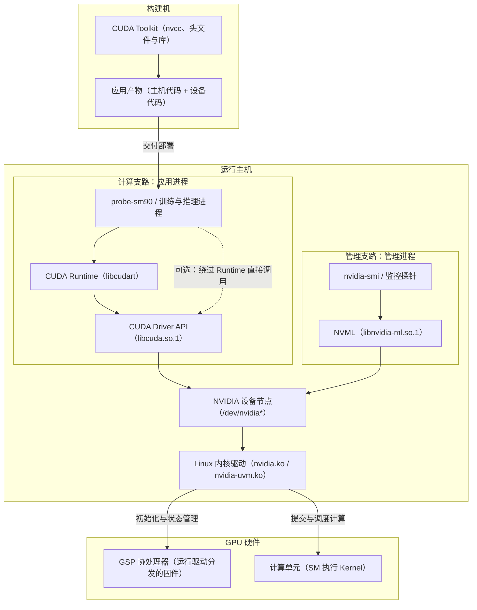

# CUDA 软件栈中的驱动、Runtime 与 Toolkit

刚上架一台 H100 服务器，先敲 `nvidia-smi`——卡在线、显存 80 GB、温度正常，看着万事俱备。可一跑 PyTorch 训练或大模型推理，终端却立刻报错 `CUDA driver version is insufficient` 或 `no kernel image is available for execution on the device`。

更让人疑惑的是，顺手敲 `nvcc --version` 还提示找不到命令：难道宿主机不装 `nvcc` 就跑不了 CUDA 程序？产生这些困惑的根源，在于把“能查到卡”等同于“能正常计算”，也把“编译工具”混同于“运行依赖”。

下面我们用一个最简单的预编译程序 `probe-sm90`（让 GPU 的 1 个线程向显存写入整数 7 并拷回 CPU 校验）作为切入点，彻底拆清构建侧、计算支路与管理支路的分工。

## 构建侧：CUDA Toolkit 与应用产物

**CUDA** 是 NVIDIA 的 GPU 计算平台与编程模型。上层应用借助 CUDA 提供的接口分配显存、搬运数据并提交 Kernel。一个 CUDA 程序内部同时包含两类代码：由 CPU 执行的**主机代码**负责选卡、发起任务与校验结果；由 GPU 执行的**设备代码**负责把整数 7 写入显存。

**CUDA Toolkit** 是用于开发和构建应用的工具套件，核心包含编译器驱动 `nvcc`、头文件、CUDA Runtime 库以及各类数学加速库。在构建机上，`nvcc` 分别编译主机代码与设备代码，并将设备代码直接打包嵌入最终生成的可执行文件或共享库中。

把这份产物部署到生产服务器时，主机并不需要再编译代码，因此**运行主机通常根本不需要安装 `nvcc` 或整套 Toolkit**。真正影响它能否启动的，是构建时选择的 Runtime 链接方式：

- **动态链接共享 Runtime**：产物体积小，但运行主机（或容器镜像）里必须存在对应的共享库文件（如 `libcudart.so.13`），且能被进程正确加载。
- **静态链接 Runtime**：Runtime 代码已经直接编入产物自身，省去了外部 `libcudart` 依赖，但进程运行时**依然离不开宿主机上的 CUDA 驱动**。

> [!tip] 工程直觉：为什么 AI 镜像自带 CUDA 库却不自带驱动？
> 在 PyTorch 训练或 vLLM/SGLang 推理的容器镜像里，开发者通常会把特定版本的 `libcudart`、cuBLAS、FlashAttention 等库直接打进镜像以保证环境一致；但底层的用户态驱动库与内核模块强绑定宿主机内核与硬件，必须由宿主机提供。这一分工将在第 10 章的容器设备注入中进一步展开。

## 计算支路：Runtime、用户态驱动、内核模块与 GSP 固件

当 `probe-sm90` 在运行主机上真正跑起来、调用 `cudaMalloc` 申请显存时，请求会沿一条清晰的分层链路一路向下传递：

1. **CUDA Runtime API（`libcudart`）**：面向开发者的上层运行时库。它封装了常用操作，替应用自动管理设备上下文与设备代码的按需装载。
2. **CUDA Driver API（`libcuda.so.1`）**：由 NVIDIA 驱动提供的底层用户态库。你可以把 `libcudart` 看作高级包装层，而 `libcuda.so.1` 才是与内核打交道的底层引擎。需要极致控制权的高级程序或框架，也可以绕过 Runtime 直接调用 Driver API。
3. **Linux 设备节点（`/dev/nvidiactl`、`/dev/nvidia0` 等）**：用户态进程跨越权限边界、向内核驱动发送控制指令的文件入口。进程要真正使用某张 GPU，既需要内核驱动就绪，也需要具备对应设备节点的访问权限。
4. **Linux 内核驱动模块（`nvidia.ko`、`nvidia-uvm.ko`）**：`nvidia.ko` 负责在 PCIe 总线枚举出 GPU 后绑定并接管设备，`nvidia-uvm.ko` 提供统一虚拟内存（Unified Virtual Memory，UVM）等内核支持。
5. **GPU 侧的 GSP 固件与计算单元**：H100 芯片内部配有一颗专职管理的协处理器——**GSP（GPU System Processor，GPU 系统处理器）**。驱动把固件文件从宿主机加载到 GPU 后，由 GSP 承担大量设备初始化与底层管理任务；而 `probe-sm90` 携带的 Kernel 设备代码，则交由 GPU 的计算单元去执行。

> [!summary] 核心结论
> 固件文件存放在宿主机磁盘上，但执行在 GPU 的 GSP 上，干的是“设备管理”的活；Kernel 代码随应用产物交付，但执行在 GPU 的计算单元上，干的是“训练或推理计算”的活。

## 管理支路：NVML 与 `nvidia-smi`

既然计算支路要穿过 `libcudart` 与 `libcuda.so.1`，那我们每天敲的 `nvidia-smi` 又走了哪条路？

**NVML（NVIDIA Management Library，NVIDIA 管理库）** 是 NVIDIA 专门提供给监控、运维和调度工具的底层管理接口库，在 Linux 上通常对应 `libnvidia-ml.so.1`。**`nvidia-smi`** 正是构建在 NVML 之上的命令行前端工具，用来查询卡型、显存用量、温度功耗与健康状态。

看清下面这张全景图，就能瞬间明白为什么“查卡正常”和“能跑计算”是两回事：管理进程与应用进程虽然共享底层的设备节点、Linux 内核驱动和 GPU 硬件，但在用户态完全分道扬镳。



*图 03-01-01：CUDA 软件栈的构建交付、计算支路与 NVML 管理支路分工示意。虚线代表应用直接调用 Driver API 的可选路径，设备节点按类型合并绘出。*

> [!warning] 常见误区：不要把单条路径的通畅外推到全栈
> - **`nvidia-smi` 正常 ≠ CUDA 应用能跑**：NVML 成功只证明管理库、设备节点和内核驱动基本可用；计算进程照样可能因为缺少 `libcudart`、驱动版本低于应用要求，或产物缺少当前 GPU 架构的设备代码而失败。
> - **找不到 `nvcc` ≠ 节点不能跑 AI 作业**：`nvcc` 属于构建机侧的编译器。线上训练或推理容器若使用预编译好的算子库，宿主机完全可以不装 CUDA Toolkit。

## 三条核心命令：一眼看清每一层状态

面对一台陌生的 GPU 服务器，只需要三条命令就能迅速把物理绑定、驱动管理层与本地编译器层彻底分开核对：

```bash
# 1. 查看 PCIe 枚举与内核驱动绑定（关注 BDF 与 Kernel driver in use）
$ lspci -nnk -d 10de:
65:00.0 3D controller [0302]: NVIDIA Corporation GH100 [H100 SXM5 80GB] [10de:2330] (rev a1)
	Subsystem: NVIDIA Corporation Device [10de:16c1]
	Kernel driver in use: nvidia        # 已由 NVIDIA 内核驱动接管
	Kernel modules: nvidiafb, nouveau, nvidia_drm, nvidia

# 2. 通过 NVML 查看驱动、最高支持 CUDA 版本及 GSP 固件版本
$ nvidia-smi -q | grep -E "Driver Version|KMD Version|CUDA|GSP Firmware"
Driver Version                            : 595.91.07     # 内核/驱动版本（新版称 KMD Version）
CUDA Version                              : 13.2          # 驱动支持的最高 CUDA 版本（新版称 CUDA UMD Version）
    GSP Firmware Version                  : 595.91.07     # 运行在 GPU GSP 上的固件版本

# 3. 检查当前 PATH 中是否存在本地 CUDA 编译器（与能否运行预编译程序无关）
$ nvcc --version
bash: nvcc: command not found
```

把这三条命令对应的验证层次整理成一张速查表，后续排障时随时对号入座：

| 观测命令 | 落在哪一层 | 能确认的关键事实 |
| --- | --- | --- |
| `lspci -nnk`（配合 `lsmod`） | PCIe 总线与内核驱动层 | BDF 条目存在说明总线枚举成功；`Kernel driver in use: nvidia` 说明目标卡已绑定到 NVIDIA 内核模块。 |
| `nvidia-smi -q` | NVML 管理支路与固件层 | 查询成功说明管理支路与设备可通信；支持 GSP 的卡可直接读取 `GSP Firmware Version`。 |
| `nvcc --version` | 本地开发构建环境 | 仅反映当前命令搜索路径下 `nvcc` 的构建版本；命令缺失只代表当前 Shell 未配置编译器。 |

> [!note] 版本与字段说明：读懂 `nvidia-smi` 的新旧版本标签
> 传统 `nvidia-smi` 顶部输出中的 `Driver Version` 和 `CUDA Version`，在较新版本工具文档中已更精确地命名为 **`KMD Version`**（Kernel Mode Driver，内核态驱动版本）和 **`CUDA UMD Version`**（User Mode Driver，用户态驱动支持的最高 CUDA 版本）。
>
> 请特别注意：无论叫 `CUDA Version` 还是 `CUDA UMD Version`，它标明的都是**驱动能够向上支持的 CUDA 版本上限**，而非本机 Toolkit 或应用编译版本——查本机编译器看 `nvcc`，查 Toolkit 包看系统包清单，查应用构建版本看交付清单。

现在回看文章开头的状态：`nvidia-smi` 正常说明管理支路与底层内核驱动已就绪，找不到 `nvcc` 则无碍运行预编译程序。至于 `probe-sm90` 究竟能不能顺利把 7 写进显存并读回来，下一篇我们将钻进应用进程内部，逐关跟踪库装载、设备枚举、上下文建立与首次 Kernel 执行。

> [!info]- 参考资料
> - **CUDA 编程平台与总览**：[CUDA 13.2.1 Programming Guide](https://docs.nvidia.com/cuda/archive/13.2.1/cuda-programming-guide/index.html)、[CUDA Platform Overview](https://docs.nvidia.com/cuda/archive/13.2.1/cuda-programming-guide/01-introduction/cuda-platform.html)
> - **编译器与安装指南**：[CUDA 13.2 NVCC 编译器驱动](https://docs.nvidia.com/cuda/archive/13.2.0/cuda-compiler-driver-nvcc/index.html)、[CUDA 13.2 Linux 安装指南](https://docs.nvidia.com/cuda/archive/13.2.0/cuda-installation-guide-linux/index.html)
> - **Runtime 与 Driver API 边界**：[CUDA 13.2.1 Driver API vs Runtime API](https://docs.nvidia.com/cuda/archive/13.2.1/cuda-driver-api/driver-vs-runtime-api.html)
> - **Linux 驱动组件与 GSP 固件**：[NVIDIA Linux 驱动已安装组件说明](https://download.nvidia.com/XFree86/Linux-x86_64/580.65.06/README/installedcomponents.html)、[NVIDIA Linux 驱动 GSP 固件说明](https://download.nvidia.com/XFree86/Linux-x86_64/580.65.06/README/gsp.html)
> - **管理支路与系统工具**：[NVIDIA SMI 手册](https://docs.nvidia.com/deploy/nvidia-smi/index.html)、[NVIDIA SMI GPU 属性字段](https://docs.nvidia.com/deploy/nvidia-smi/index.html#gpu-attributes)、[NVML API 参考](https://docs.nvidia.com/deploy/nvml-api/nvml-api-reference.html)、[Linux lspci(8) 手册](https://man7.org/linux/man-pages/man8/lspci.8.html)
