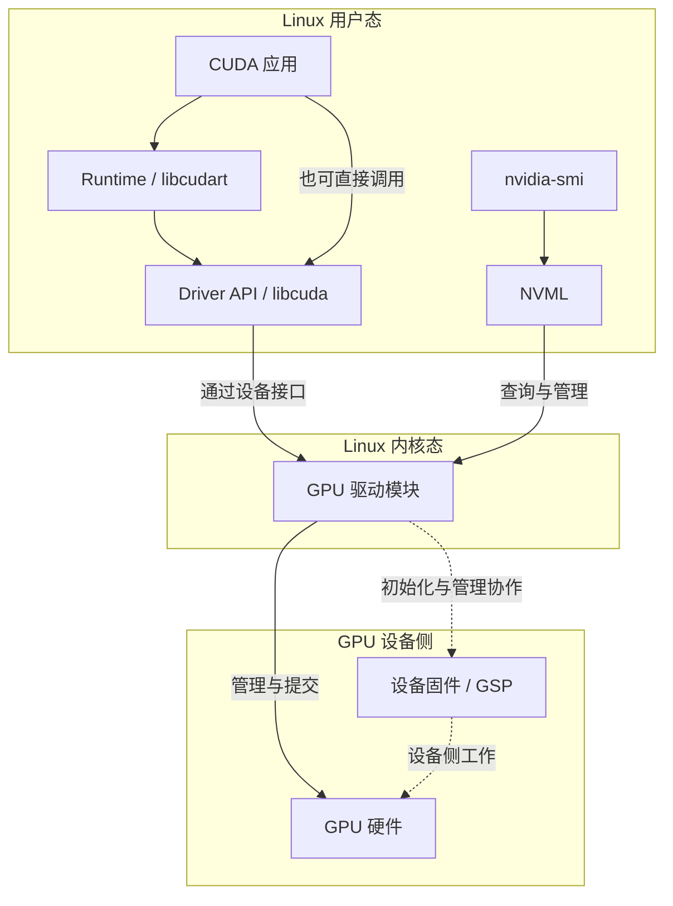

# 把驱动、Runtime 与 Toolkit 放回软件地图

## “驱动”同时跨过用户态与内核态

第 01 章的 `lspci` 能说明 PCIe 配置空间里有一个设备。Linux 要把它变成可被 CUDA 使用的 GPU，还需要驱动接管、设备初始化和进程访问接口。NVIDIA 驱动包含内核模块，也包含用户态库；只检查其中一半，无法判断整条计算路径。

内核中的 `nvidia` 模块负责 GPU 的底层访问、资源管理以及与操作系统的协作。用户态的 `libcuda.so.1` 提供 **CUDA Driver API**：进程通过它发现设备、管理执行上下文、装载设备代码并提交计算。API 是接口约定，`.so` 是实现该接口的库文件；Driver API 不是要额外安装的另一个内核模块。

**CUDA Runtime** 在 Driver API 之上提供较高层的调用方式，常见接口以 `cuda` 开头，例如 `cudaMalloc`、`cudaMemcpy`、`cudaSetDevice`。Driver API 的名字常以 `cu` 开头，例如 `cuInit`、`cuDeviceGetCount`、`cuLaunchKernel`。Runtime 可以由共享库 `libcudart.so` 提供，也可以静态链接进应用。应用也能直接使用 Driver API，不必经过 Runtime。两种接口的职责差异见 [CUDA 12.8.1：Difference between the driver and runtime APIs](https://docs.nvidia.com/cuda/archive/12.8.1/cuda-driver-api/driver-vs-runtime-api.html)。

下面是**软件调用关系图**。范围框表示代码运行的位置，实线箭头表示向下调用或提交请求；虚线表示驱动与设备侧固件协作。它不表示每次 API 调用都进入内核，也不描绘 DMA 数据搬运路径。

`nvidia-smi` 走的是旁边的管理路径。**NVML（NVIDIA Management Library）** 是查询和管理设备状态的用户态接口，Linux 库名为 `libnvidia-ml.so`；`nvidia-smi` 是它的一个使用者。温度、显存状态和设备身份可以通过这条路径获得，CUDA 应用计算则需要自己的初始化、代码与内存条件。因此管理查询成功，尚未执行任何应用 Kernel。职责依据见 [NVML API Reference](https://docs.nvidia.com/deploy/nvml-api/nvml-api-reference.html)。

## 固件与内核模块各处在哪个位置

GPU 板卡的 VBIOS 属于设备启动与配置相关的固件，不能与主机 CUDA Toolkit 版本混为一谈。在支持的 GPU 上，**GSP（GPU System Processor）** 运行驱动分发的固件，承担一部分设备初始化与管理工作。这意味着“固件”既可能指板卡固件，也可能指驱动包携带、加载到设备处理器上的固件；判断缺件或版本问题时要具体到对象。

GSP 不替应用解释 CUDA C++ 源码，更新 Toolkit 也不等于刷写板卡 VBIOS。GSP 的作用和随驱动分发方式见 [R570 Linux README：GSP Firmware](https://download.nvidia.com/XFree86/Linux-x86_64/570.124.04/README/gsp.html)。具体设备与模块类型是否要求 GSP，应按所选驱动文档核对。

模块名称也要按用途阅读：

| 对象 | 在本章中的位置与用途 |
| --- | --- |
| `nvidia` / `nvidia.ko` | Linux GPU 核心驱动模块；模块名与磁盘文件名的常见写法 |
| `nvidia_uvm` / `nvidia-uvm.ko` | Unified Memory 相关模块，在支持平台上由 CUDA 驱动使用；CUDA 程序启动时可能触发其加载 |
| `nvidia_modeset`、`nvidia_drm` | 显示模式设置和 Linux 图形子系统相关模块；不能以缺少它们就断言无显示的 CUDA 节点失效 |
| `/dev/nvidiactl`、`/dev/nvidia0` 等 | 进程进入驱动的设备接口；文件存在仍需对应的驱动状态和访问权限 |
| `/dev/nvidia-uvm` 等 | 配合相应模块提供接口；应按运行路径与失败记录判断需求 |

`lsmod` 中的下划线名称与包内带连字符的文件名可能对应同一模块。不要把 `nvidia_uvm` 的缺失与 `nvidia_drm` 的缺失解释成同一件事。组件职责与设备文件说明见 [R570 Linux README：Listing of Installed Components](https://download.nvidia.com/XFree86/Linux-x86_64/570.124.04/README/installedcomponents.html)。

NVIDIA 的开放与专有内核模块是内核部分的两种实现选择；选用开放模块也仍需配套的用户态驱动与固件。[开放内核模块 570.124.06 的 README](https://raw.githubusercontent.com/NVIDIA/open-gpu-kernel-modules/570.124.06/README.md)明确要求使用对应 `.06` 发行的 GSP 固件和用户态组件。这里先保留分层关系，具体支持设备和安装选择应查对应分支文档，不把“开放”理解为只靠 Linux 自带模块就具备全部 CUDA 能力。

## Toolkit 解决构建问题，Runtime 承担运行职责

**CUDA Toolkit** 是开发工具与库的集合，包括编译工具 `nvcc`、头文件、Runtime、数学库和调试分析工具等。`nvcc` 的工作是组织编译流程：将主机代码交给主机编译器，将设备代码编译为 GPU 可用的形式，再完成链接。它不是每次 GPU 运算时都要启动的常驻服务。

对于导读中的 `vector-check`，依赖交付可以拆成两份：

| 构建环境提供 | 运行环境提供 |
| --- | --- |
| `nvcc`、CUDA 头文件、受支持的主机编译器与链接工具 | 可执行文件及其设备代码 |
| 构建时使用的 Runtime 和所需库 | 本例动态链接的 `libcudart.so.12` 与其他主机依赖 |
| `sm_80` 等设备代码生成参数 | 配套的 NVIDIA 驱动、设备接口与可访问 GPU |

应用的运行库可以随应用一起交付，因此运行节点未必安装完整 Toolkit。相反，`nvcc --version` 成功只说明当前能执行该编译器，不能证明内核驱动已经接管 GPU。开发机也能在没有 GPU 的条件下为指定架构编译；运行成功需要补齐设备侧条件。编译组织方式见 [NVCC 12.8.1：Purpose of NVCC](https://docs.nvidia.com/cuda/archive/12.8.1/cuda-compiler-driver-nvcc/index.html#purpose-of-nvcc)。

静态链接 Runtime 时，应用文件里已经包含其代码，不会要求装载同名共享库；它仍需要运行时的 GPU 驱动。NVCC 12.8.1 的 `--cudart` 可选 `shared` 或 `static`，默认是后者。本章特意把 `vector-check` 设为 `--cudart=shared`，方便观察动态库依赖；不能从本例推出所有 CUDA 应用都能在 `ldd` 中看到 `libcudart`。参数依据见 [NVCC：--cudart](https://docs.nvidia.com/cuda/archive/12.8.1/cuda-compiler-driver-nvcc/index.html#cudart-none-shared-static-cudart)。

cuBLAS 等计算库会替应用组织特定运算和 Kernel；cuDNN 等还有自己的发行与支持矩阵。它们的依赖应按应用实际使用记录，本章的小应用没有这些额外依赖。“应用基于 CUDA 12.8 构建”并不是完整的软件物料清单。

## 三个工具分别回答什么

| 工具或接口 | 当前可以回答的问题 | 不会替你完成的工作 |
| --- | --- | --- |
| `nvidia-smi` | 管理路径能否初始化、设备身份与状态、所用驱动信息 | 检查应用所有动态库、设备代码或计算结果 |
| NVML | 程序怎样读取设备管理状态 | 提交普通 CUDA Kernel |
| `nvcc --version` | 本次命令选中了哪个 CUDA 编译器 | 查明另一进程实际装载了哪份 Runtime 或驱动库 |

现在可以解释导读中的两种现象：没有 `nvcc` 的运行节点，只要应用交付与驱动条件完整，就能计算；能够运行 `nvidia-smi` 的节点，还需沿计算路径继续检查。下一篇按时间跟踪这条路径。

[上一篇：本章导读](00_导读.md) · [下一篇：一个 CUDA 进程怎样开始计算](02_一个CUDA进程怎样开始计算.md)
