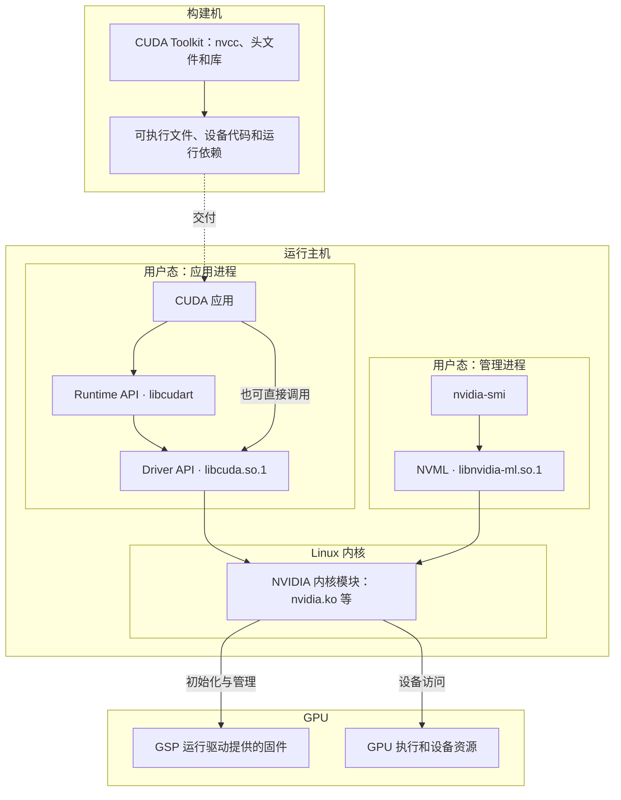

# 驱动、Runtime 与 Toolkit 各在哪里

在一台 Linux GPU 服务器上，`nvidia-smi` 能列出 H100，当前 shell 却找不到 `nvcc`。这两条命令检查的是不同环节。前者通过 NVIDIA 的管理库查询设备，后者用于编译 CUDA 程序。能否运行别人交付的二进制，还要看它需要的共享库、驱动能力和设备代码。以下以 x86_64 Linux 裸机和单张 NVIDIA H100 为例。 [NVIDIA SMI](https://docs.nvidia.com/deploy/nvidia-smi/index.html) · [CUDA 13.2.1 · NVCC](https://docs.nvidia.com/cuda/archive/13.2.1/cuda-compiler-driver-nvcc/index.html)

## 从枚举设备到驱动接管

Linux 可以先通过 PCIe 枚举识别设备。每个 PCI 设备用 BDF（域、总线、设备、功能号）标识，例如 `0000:65:00.0`。在 `lspci -nnk` 里找到对应条目，再看 `Kernel driver in use`。看到设备说明 PCI 枚举成功，看到 `Kernel driver in use: nvidia` 才能把绑定到 NVIDIA 驱动的结论落到这张卡上。`lsmod` 中出现 `nvidia` 说明模块已装入，绑定情况仍要按 BDF 查。 [pciutils · lspci(8)](https://man7.org/linux/man-pages/man8/lspci.8.html) · [kmod · lsmod(8)](https://man7.org/linux/man-pages/man8/lsmod.8.html)

`nvidia.ko` 提供用户态驱动访问 GPU 所需的内核支持，`nvidia-uvm.ko` 提供 CUDA 统一虚拟内存相关的内核支持。CUDA 进程通过驱动打开相应的设备文件，例如控制节点 `/dev/nvidiactl` 和设备节点 `/dev/nvidia0`。因此即使驱动已绑定，节点能否打开仍取决于设备文件和进程权限。在支持 GSP（GPU System Processor）的设备上，例如 H100，驱动分发的固件由 GPU 上的 GSP 运行，分担初始化与管理工作。固件文件存放在主机，执行位置在 GPU。NVIDIA R580.65.06 的文档给出 `/lib/firmware/nvidia/580.65.06/` 及 `GSP Firmware Version` 的查询示例，实际路径以打包方式为准。 [NVIDIA R580.65.06 · Installed Components](https://download.nvidia.com/XFree86/Linux-x86_64/580.65.06/README/installedcomponents.html) · [GSP Firmware](https://download.nvidia.com/XFree86/Linux-x86_64/580.65.06/README/gsp.html) · [CUDA 13.2 · Linux Installation Guide](https://docs.nvidia.com/cuda/archive/13.2.0/cuda-installation-guide-linux/index.html)

## 计算、管理与构建各有入口

CUDA Runtime API 提供 `cudaSetDevice`、`cudaMalloc` 等接口，由 `libcudart` 实现。它可以作为共享库在运行时装入，也可以静态编入程序或应用库。Runtime 使用 CUDA Driver API 访问设备。后者由 NVIDIA 驱动的用户态库 `libcuda.so.1` 提供，应用也可以直接调用它，例如显式初始化 Driver API 和管理上下文。另一路是 `nvidia-smi`，它使用驱动提供的 NVML 库 `libnvidia-ml.so.1` 访问管理和监控能力。管理与计算共用底层驱动和设备，但各自需要相应的用户态库和调用成功。 [CUDA 13.2.1 · Driver vs Runtime APIs](https://docs.nvidia.com/cuda/archive/13.2.1/cuda-driver-api/driver-vs-runtime-api.html) · [NVIDIA R580.65.06 · Installed Components](https://download.nvidia.com/XFree86/Linux-x86_64/580.65.06/README/installedcomponents.html) · [NVML API Reference](https://docs.nvidia.com/deploy/nvml-api/nvml-api-reference.html)

CUDA Toolkit 提供 `nvcc`、头文件、Runtime 与开发库等构建材料。同一台机器可以兼任构建机和运行主机。分开部署时，构建侧交付可执行文件、所需的运行库和构建信息，运行侧提供能访问设备的驱动。举例来说，用 `--cudart=shared` 构建时，运行侧要能找到匹配的共享 Runtime。用静态 Runtime 时，这部分已在产物中，运行侧仍须提供 CUDA 用户态驱动库和匹配的内核驱动。 [CUDA 13.2 GA · NVCC](https://docs.nvidia.com/cuda/archive/13.2.0/cuda-compiler-driver-nvcc/index.html)

## 用三条命令判断当前具备什么

| 观测 | 能据此判断的事 |
| --- | --- |
| `lspci -nnk` | 用 BDF 找设备，用 `Kernel driver in use` 核对该卡绑定的驱动。 |
| `nvidia-smi -q` | 查询成功说明这次 NVML 管理调用可达相应设备。驱动及 CUDA 版本字段用来读驱动侧能力，`GSP Firmware Version` 用来观察固件状态。 |
| `nvcc --version` | 输出的 `release` 和完整构建版本属于当前命令解析到的编译器。找不到命令时，只能判定当前调用环境没有找到它。 |

常见 `nvidia-smi` 输出中的 `CUDA Version` 表示驱动支持的 CUDA 版本。较新版工具文档分别使用 `KMD Version` 和 `CUDA UMD Version` 表示内核驱动版本与 CUDA 用户态驱动所支持的版本。阅读历史截图或采集结果时，按该工具版本的字段解释。已安装 Toolkit 的版本查编译器或包清单，别人交付的程序用什么构建查交付记录。 [NVIDIA SMI · Query Attributes](https://docs.nvidia.com/deploy/nvidia-smi/index.html) · [CUDA 13.2.1 · NVCC](https://docs.nvidia.com/cuda/archive/13.2.1/cuda-compiler-driver-nvcc/index.html)

在开头的场景里，判断预编译程序能否使用这张 H100，可以在实际启动环境中依次检查共享库解析、CUDA 枚举、选卡与一次最小计算。即使管理查询成功，也要检查应用进程自己的依赖和可见设备。下面的图把三条路径放在各自的边界内。

图中实线表示调用或控制依赖，虚线表示产物交付。驱动和固件的交互按职责简化，箭头未表达数据传输路线。
