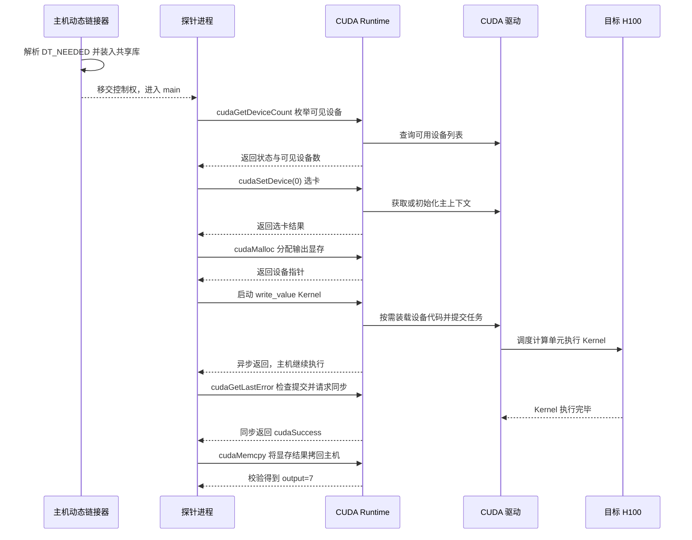

# CUDA 进程的库装载、选卡与首次 Kernel 执行

对于熟悉 Linux 的工程师来说，一个普通程序启动失败，往往先怀疑“缺 `.so` 动态库”或“没权限”。CUDA 应用本质上也是标准的 Linux ELF 进程，只不过在进入 `main()` 之后，它还要额外闯过四道关卡：发现可用 GPU、为线程建立设备上下文、按需装入设备代码，以及异步提交并同步回收结果。

下面我们沿统一参考环境（Ubuntu 24.04 LTS x86_64、单张未切分 H100、驱动 R595 `595.91.07`、CUDA `13.2.1` 动态链接 Runtime 构建的 `probe-sm90`），把一次健康执行的全过程拆解清楚，看看每一关都在验证什么。

## 第一关：ELF 共享库装载（进入 `main` 之前）

Linux 上的预编译 CUDA 程序是标准的 ELF（Executable and Linkable Format）文件，它在动态段中用 `DT_NEEDED` 写明了启动时必须加载的共享库。例如，采用共享 Runtime 构建的 `probe-sm90` 会直接声明依赖 `libcudart.so.13`。

进程启动瞬间，内核把控制权先交给系统动态链接器（`ld-linux`）。如果 `DT_NEEDED` 列出的直接依赖解析失败，进程甚至还没机会进入 `main()` 就会退出，根本走不到任何 CUDA API 调用。用 Linux 工程师熟悉的 `ldd` 即可查看启动时的直接依赖解析结果：

```bash
$ ldd /opt/probe/probe-sm90
	linux-vdso.so.1 (0x00007fff123fe000)
	libcudart.so.13 => /opt/probe/lib/libcudart.so.13 (0x00007f8a4c200000)  # 启动期直接依赖
	libstdc++.so.6 => /lib/x86_64-linux-gnu/libstdc++.so.6 (0x00007f8a4be00000)
	libc.so.6 => /lib/x86_64-linux-gnu/libc.so.6 (0x00007f8a4ba00000)
```

需要留意两个极易忽略的细节：
1. **运行期按需加载**：进程进入 `main()` 后，CUDA Runtime 或深度学习框架仍会通过 `dlopen` 按需加载 `libcuda.so.1` 等共享库。因此，程序跑进 `main()` 只说明启动期依赖通过，并不代表后续所有动态库都已就位。
2. **主机库与设备代码分离**：动态链接器此刻加载的全是 CPU 执行的主机侧共享对象；即便文件内部嵌着 GPU Kernel 二进制，设备代码也由 CUDA 驱动在稍后的步骤中专门提取并装载。

## 第二关：设备枚举、选卡与 Primary Context

进入 `main()` 之后，应用进程开始通过 Runtime API 向驱动打招呼。这个过程分为连续的三步：

1. **枚举可见设备并对齐物理卡**：应用先调用 `cudaGetDeviceCount`，务必先检查函数返回的状态码，成功后再读取可用设备数量。进程看到的逻辑设备序号从 `0` 开始编号。为了把进程里的“设备 0”准确对应到宿主机上的物理卡，程序可调用 `cudaDeviceGetPCIBusId` 获取其 BDF，与 `nvidia-smi` 输出对齐；跨重启追踪同一张卡时，则配合管理记录中的 UUID 核对。
2. **选定目标设备并初始化主上下文**：枚举出列表后，主机线程调用 `cudaSetDevice(0)` 声明自己接下来的操作归属设备 0。在现代 CUDA Runtime 中，这一步会顺带初始化 Runtime 与该设备的 **Primary Context（主上下文）**，因此必须检查它的返回值。
3. **在上下文内分配显存与提交队列**：**上下文（Context）之于 GPU，就像进程地址空间之于 CPU**——它保存着当前进程在这张 GPU 上的独立显存页表、已分配缓冲区以及工作队列（CUDA Stream）。同一进程中操作同一张卡的多个线程，默认共享该卡唯一的主上下文。选卡完成后，探针调用 `cudaMalloc` 在主上下文里为结果分配一块整型显存，并将设备指针传给后续 Kernel。

> [!note] 版本演进与 Driver API 显式入口
> - **CUDA 12.0 语义变更**：自 CUDA 12.0 起，`cudaSetDevice` 会直接触发 Runtime 与目标设备主上下文的初始化；而在更早版本中，主上下文初始化会被推迟到首个真正需要上下文的调用（如 `cudaMalloc`）才发生。
> - **Driver API 显式管理**：若框架绕过 Runtime 直接使用 Driver API，上述步骤都需显式编写——先调 `cuInit(0)`、获取设备句柄、用 `cuDevicePrimaryCtxRetain` 与 `cuCtxSetCurrent` 绑定主上下文，结束后再解绑释放。
>   - 当同一进程混用两套 API 时，Runtime 会自动沿用调用线程上已经设为当前的 Driver API 上下文。

## 第三关：Kernel 延迟装载、异步提交与结果校验

显存分配完毕，终于轮到向 GPU 发起真正的计算。很多人以为设备代码早在进程启动或 `cudaSetDevice` 时就全部灌进 GPU 了，实际上现代 CUDA 默认采用的是**延迟装载（Lazy Loading）**。

驱动将一组相关的设备代码与数据封装为一个 **CUDA module**。开启延迟装载后，驱动会把 module 与 Kernel 的装入推迟到首次真正调用它的那一刻，从而大幅缩短大模型框架（往往内嵌数千个算子）的冷启动耗时与显存占用。

> [!note] 延迟装载的生效条件与排障含义
> 延迟装载要求 CUDA Runtime ≥ 11.7 且驱动 ≥ R515，Linux 平台自 CUDA 12.2（配套 R535）起默认启用，可通过环境变量 `CUDA_MODULE_LOADING` 切换模式（含统一内存管理变量的 module 仍可能提前装载）。
>
> 这一机制解释了一个高频现象：**为什么枚举卡、选卡甚至 `cudaMalloc` 一路绿灯，到第一次执行 Kernel 才爆出架构或镜像错误？**因为设备代码直到那一刻才真正被提取与装载。

Kernel 发起后，主机线程不会原地死等 GPU 算完，而是立刻返回继续往下执行。正因这种异步特性，探针把“提交是否报错”“执行是否完成”“结果是否正确”拆成三个独立检查点来记录：

| 检查点 | 调用接口 | 在健康路径中证明了什么 |
| --- | --- | --- |
| `launch` | `cudaGetLastError()` | 读取并清除当前主机线程在这一 Runtime 实例中的最近错误。返回 `cudaSuccess` 说明本次提交参数与即时装载检查未报错。 |
| `synchronize` | `cudaDeviceSynchronize()` | 阻塞等待当前上下文此前提交的全部任务在 GPU 上落盘完成，同时暴露异步执行期间触发的设备错误。 |
| `copy_back` 与校验 | `cudaMemcpy(..., D2H)` | 把显存中的整数拷回主机内存并校验是否等于 `7`，同步与数据校验共同闭环了整条计算链路。 |

真实业务（如连续迭代的训练步或推理请求）中，前一个异步任务的错误可能延迟到后续某次 CUDA 调用才浮现。把探针设计成“新进程单次 Kernel + 每步必检”，就能把排障窗口精确压缩到单条调用。下面这张时序图串起了从链接器到写回整数 7 的完整生命线：



*图 03-02-01：首次使用 Kernel 时按需装载设备代码的健康执行时序。图中合并了用户态与内核态驱动，省略了查询 PCI 地址与释放缓冲区步骤。*

> [!summary] 核心结论
> 看到 Kernel 启动瞬间没有报错，只证明请求已经成功入队；唯有显式同步通过、且把显存计算结果准确读回主机校验，才能确认 GPU 真正完成了这次计算。

## 环境变量对照：`CUDA_VISIBLE_DEVICES` 如何改写进程视图

在多卡服务器或容器调度里，你几乎每天都会见到 `CUDA_VISIBLE_DEVICES`。理解它的关键在于：**它只修改当前应用进程通过 CUDA 看到的“可见设备清单与编号映射”，绝不会触动物理硬件、内核驱动或 `nvidia-smi` 的视角**。

保持宿主机 GPU、驱动、共享库和二进制产物完全不变，只改变这个环境变量，就能立刻观察到两条支路的分野：

- **未设置该变量**：进程枚举到 1 张 GPU，分配进程内逻辑编号 `0`，用 `cudaDeviceGetPCIBusId` 读出的 BDF 能直接对上 `nvidia-smi` 的物理卡记录。
- **设为空字符串（`CUDA_VISIBLE_DEVICES=`）**：CUDA 驱动将当前进程的可见列表清空。探针在最开始的枚举检查处就会失败（返回 `cudaErrorNoDevice` 或可见数量为 0），根本走不到选卡和建上下文；但与此同时，在同一个终端里敲 `nvidia-smi`，管理支路依然把物理 H100 报得清清楚楚。
- **多卡重排（如 `CUDA_VISIBLE_DEVICES=2,3`）**：训练框架或推理引擎在进程内看到的逻辑 `device 0` 和 `device 1`，实际指向的分别是宿主机上的第 2 号和第 3 号物理卡。排查多卡故障时，必须靠 BDF 或 UUID 才能把逻辑序号还原回物理槽位。

## 最小探针源码、构建与典型运行输出

下面保留这份完整的最小探针源码 `probe.cu`。它只有 40 余行，却把每一个检查点的状态码与错误名都清清楚楚打到标准错误流，任何一步出错即刻退出，非常适合用来理解或复现整个启动链路：

```cpp
#include <cuda_runtime.h>
#include <cstdio>
#include <cstdlib>

// 统一状态检查器：打印每一步的 CUDA 错误名与错误码，失败即退出
static void check(const char* stage, cudaError_t status) {
    std::fprintf(stderr, "%s: %s (%d)\n",
                 stage, cudaGetErrorName(status), static_cast<int>(status));
    if (status != cudaSuccess) {
        std::exit(1);
    }
}

__global__ void write_value(int* output) {
    *output = 7;
}

int main() {
    int count = 0;
    check("enumerate", cudaGetDeviceCount(&count));
    std::printf("visible_devices=%d\n", count);
    if (count == 0) {
        return 2;
    }

    check("select", cudaSetDevice(0));
    char bus_id[32];
    check("device_id", cudaDeviceGetPCIBusId(bus_id, sizeof(bus_id), 0));
    std::printf("device_ordinal=0 pci_bus_id=%s\n", bus_id);

    int* device_output = nullptr;
    check("allocate", cudaMalloc(&device_output, sizeof(int)));
    write_value<<<1, 1>>>(device_output);            // 仅启动 1 个 Block、1 个线程
    check("launch", cudaGetLastError());             // 检查提交期与即时装载错误
    check("synchronize", cudaDeviceSynchronize());   // 等待 GPU 完成并暴露异步执行错误

    int output = 0;
    check("copy_back", cudaMemcpy(&output, device_output, sizeof(output),
                                  cudaMemcpyDeviceToHost));
    check("release", cudaFree(device_output));
    std::printf("output=%d\n", output);
    return output == 7 ? 0 : 3;
}
```

使用 CUDA Toolkit `13.2.1` 编译时，`--cudart=shared` 指定动态链接共享 Runtime，`-gencode=arch=compute_90,code=sm_90` 指定为 H100（计算能力 9.0）生成原生设备二进制。对照运行结果，可以直观看到“正常可见”与“环境变量屏蔽”最先在 `enumerate` 阶段分叉：

```bash
# 构建动态链接 Runtime 且目标为 H100 (sm_90) 的探针
$ nvcc --cudart=shared -gencode=arch=compute_90,code=sm_90 probe.cu -o probe-sm90

# 1. 先记录管理支路的物理卡身份（名称、UUID、BDF）
$ nvidia-smi --query-gpu=name,uuid,pci.bus_id --format=csv,noheader
NVIDIA H100 80GB HBM3, GPU-8c4a12e0-..., 00000000:65:00.0

# 2. 正常启动（未设置 CUDA_VISIBLE_DEVICES）：一路通关并拷回 7
$ env -u CUDA_VISIBLE_DEVICES ./probe-sm90
enumerate: cudaSuccess (0)
visible_devices=1
select: cudaSuccess (0)
device_id: cudaSuccess (0)
device_ordinal=0 pci_bus_id=0000:65:00.0     # 与管理侧 65:00.0 对齐（忽略域前导零差异）
allocate: cudaSuccess (0)
launch: cudaSuccess (0)
synchronize: cudaSuccess (0)
copy_back: cudaSuccess (0)
release: cudaSuccess (0)
output=7

# 3. 置空可见性变量：在 enumerate 即停步，但宿主机 nvidia-smi 依然可见该卡
$ env CUDA_VISIBLE_DEVICES= ./probe-sm90
enumerate: cudaErrorNoDevice (100)           # 部分组合亦可能返回 cudaSuccess 且 visible_devices=0
```

走完一次健康路径，你会发现：即便所有动态库、设备可见性与上下文都完全正常，在“首次启动 Kernel”这一关里还隐藏着最常令工程师头疼的兼容性雷区——**产物里的设备代码、Runtime 版本和宿主机驱动版本到底怎样才算匹配？**这正是下一篇的核心议题。

> [!info]- 参考资料
> - **CUDA 平台与运行初始化**：[CUDA 13.2.1 编程指南 · CUDA 平台](https://docs.nvidia.com/cuda/archive/13.2.1/cuda-programming-guide/01-introduction/cuda-platform.html)、[CUDA 13.2.1 Runtime 初始化](https://docs.nvidia.com/cuda/archive/13.2.1/cuda-programming-guide/02-basics/intro-to-cuda-cpp.html#runtime-initialization)、[CUDA 13.2.1 异步执行](https://docs.nvidia.com/cuda/archive/13.2.1/cuda-programming-guide/02-basics/asynchronous-execution.html)
> - **Runtime 与 Driver API 参考**：[CUDA 13.2.1 设备管理 API](https://docs.nvidia.com/cuda/archive/13.2.1/cuda-runtime-api/group__CUDART__DEVICE.html)、[CUDA 13.2.1 错误处理 API](https://docs.nvidia.com/cuda/archive/13.2.1/cuda-runtime-api/group__CUDART__ERROR.html)、[Driver API vs Runtime API](https://docs.nvidia.com/cuda/archive/13.2.1/cuda-driver-api/driver-vs-runtime-api.html)、[Context Management](https://docs.nvidia.com/cuda/archive/13.2.1/cuda-driver-api/driver-vs-runtime-api.html#context-management)、[Primary Context API](https://docs.nvidia.com/cuda/archive/13.2.1/cuda-driver-api/group__CUDA__PRIMARY__CTX.html)、[CUDA 编程指南 · Driver API](https://docs.nvidia.com/cuda/archive/13.2.1/cuda-programming-guide/03-advanced/driver-api.html)
> - **延迟装载与环境变量**：[CUDA 13.2.1 Lazy Loading](https://docs.nvidia.com/cuda/archive/13.2.1/cuda-programming-guide/04-special-topics/lazy-loading.html)、[CUDA 12.2 Release Notes · 默认装载模式](https://docs.nvidia.com/cuda/archive/12.2.0/cuda-toolkit-release-notes/index.html#general-cuda)、[CUDA 13.2.1 CUDA_VISIBLE_DEVICES](https://docs.nvidia.com/cuda/archive/13.2.1/cuda-programming-guide/05-appendices/environment-variables.html#cuda-visible-devices)
> - **工具链、发布说明与 Linux 动态链接**：[CUDA 13.2 GA Release Notes · CUDA Driver](https://docs.nvidia.com/cuda/archive/13.2.0/cuda-toolkit-release-notes/index.html#cuda-driver)、[CUDA 13.2 Linux 安装指南](https://docs.nvidia.com/cuda/archive/13.2.0/cuda-installation-guide-linux/index.html)、[CUDA 13.2 NVCC 构建选项](https://docs.nvidia.com/cuda/archive/13.2.0/cuda-compiler-driver-nvcc/index.html)、[NVIDIA SMI 手册](https://docs.nvidia.com/deploy/nvidia-smi/index.html)、[glibc ld.so(8) 手册](https://man7.org/linux/man-pages/man8/ld-linux.8.html)、[dlopen(3) 手册](https://man7.org/linux/man-pages/man3/dlopen.3.html)
