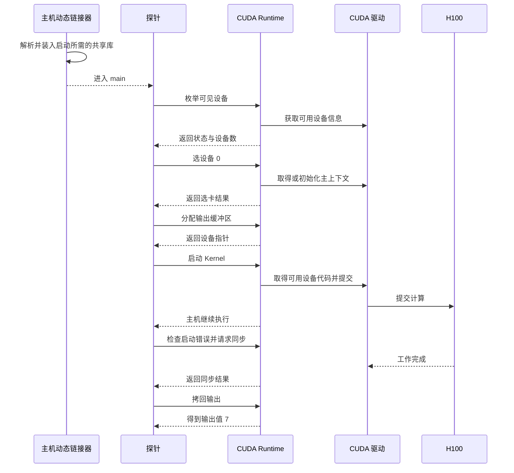

以 Ubuntu 24.04 LTS、x86_64 Linux 裸机上的一张未切分 H100 为例。GPU 由驱动 `595.45.04` 管理，教学 PCI 地址为 `0000:65:00.0`。`probe-sm90` 是用 CUDA Toolkit 13.2 GA 构建、动态链接 CUDA Runtime 的程序。它在 GPU 上把 7 写入一个整数大小的显存缓冲区，主机等待执行完成并拷回验证。下面按 CUDA 13.2.1 归档的接口语义推演健康路径。 [CUDA Toolkit 13.2 GA · 驱动版本](https://docs.nvidia.com/cuda/archive/13.2.0/cuda-toolkit-release-notes/index.html#cuda-driver)

## ELF 共享库装载

Linux 上的探针是 ELF（Executable and Linkable Format，可执行与可链接格式）文件。它的动态段可以用 `DT_NEEDED` 记录依赖的共享库名。启动时，主机的动态链接器根据该名称选择并加载库文件。例如探针使用共享 Runtime 时，需要解析 `libcudart.so.13`。如果直接依赖无法解析，程序可能在进入 `main` 前退出，探针也就没有机会发出任何 CUDA 调用。进程启动后还可通过 `dlopen` 按需加载共享对象，所以 `main` 已运行只能证明启动所需的库解析通过。此处装入的是主机侧的共享对象，即使文件里也携带 Kernel，GPU 设备代码仍由 CUDA 驱动取得和装载。 [glibc 动态链接器 · ld.so(8)](https://man7.org/linux/man-pages/man8/ld-linux.8.html) · [dlopen(3)](https://man7.org/linux/man-pages/man3/dlopen.3.html) · [CUDA 平台 · Cubins 与 Fatbins](https://docs.nvidia.com/cuda/archive/13.2.1/cuda-programming-guide/01-introduction/cuda-platform.html)

## CUDA 设备枚举与 Primary Context

1. **枚举进程可见的设备。** `cudaGetDeviceCount` 先给出调用结果，成功时再读设备数。主例只有一张可用卡，返回数量 1。进程里的设备序号从 0 开始，设备 0 指当前可见列表的第一项。调用 `cudaDeviceGetPCIBusId` 可取回它的 PCI 地址，与 `nvidia-smi` 查询的 BDF 对齐。UUID（Universally Unique Identifier，通用唯一标识符）可随管理记录保存，用于核对不同时间查看的是同一张卡。BDF 对照适用于这里的裸机整卡。 [CUDA 13.2.1 Runtime API · Device Management](https://docs.nvidia.com/cuda/archive/13.2.1/cuda-runtime-api/group__CUDART__DEVICE.html) · [NVIDIA SMI 手册](https://docs.nvidia.com/deploy/nvidia-smi/index.html)
2. **为当前主机线程选卡。** 枚举给出设备列表，接下来需要确定分配内存和提交任务所用的设备。纯 Runtime 程序调用 `cudaSetDevice(0)` 指定当前线程使用设备 0。CUDA 12.0 起，这个调用还初始化 Runtime 和所选设备的 **primary context（主上下文）**，因此要检查它的返回值。早期版本会把该设备的初始化推迟到后续有需要的调用。 [CUDA 13.2.1 编程指南 · Runtime 初始化](https://docs.nvidia.com/cuda/archive/13.2.1/cuda-programming-guide/02-basics/intro-to-cuda-cpp.html#runtime-initialization)
3. **在上下文内创建资源。** 上下文保存程序在某个设备上的执行状态。CUDA 由此知道一次分配属于哪个地址空间，以及提交的任务属于哪条 Stream（有序工作队列）。常规 Runtime 用法下，每个进程为每张使用的卡按需建立一个主上下文，同一进程中使用该卡主上下文的线程可以共享其资源。探针选卡后用 `cudaMalloc` 为输出分配缓冲区，再把设备指针交给 Kernel。 [CUDA 13.2.1 · 上下文管理](https://docs.nvidia.com/cuda/archive/13.2.1/cuda-driver-api/driver-vs-runtime-api.html#context-management) · [CUDA 编程指南 · Driver API](https://docs.nvidia.com/cuda/archive/13.2.1/cuda-programming-guide/03-advanced/driver-api.html)

## Kernel 代码装载、提交与完成

Runtime 为探针安排设备代码的装载，驱动使用产物为 H100 准备的代码。随后主机发起 Kernel，设备收到输出缓冲区的地址。主机可以在 GPU 完成之前继续执行，所以探针将提交与完成分开记录。 [CUDA 13.2.1 · 设备代码装载](https://docs.nvidia.com/cuda/archive/13.2.1/cuda-programming-guide/04-special-topics/lazy-loading.html) · [CUDA 13.2.1 · 异步执行](https://docs.nvidia.com/cuda/archive/13.2.1/cuda-programming-guide/02-basics/asynchronous-execution.html)

| 检查点 | 主例中的证据 |
| --- | --- |
| `launch` | 启动后立即用 `cudaGetLastError` 读取并清除当前主机线程在这一 Runtime 实例中的最近错误。`cudaSuccess` 表示这次检查时未报告错误。 |
| `synchronize` | `cudaDeviceSynchronize` 等待当前上下文此前提交的工作。通过后可以确认本例的 Kernel 已完成。 |
| `copy_back` 与 `output=7` | 将显存缓冲区拷回主机后验证值。同步结果和数据校验共同证明这份产物在这组条件下完成了预期工作。 |

真实应用中，后续调用可能返回先前异步任务的错误。探针在一个新进程里只提交一次 Kernel，先前的调用也逐一检查，便于缩小错误窗口。 [CUDA 13.2.1 Runtime API · 错误处理](https://docs.nvidia.com/cuda/archive/13.2.1/cuda-runtime-api/group__CUDART__ERROR.html) · [CUDA 13.2.1 Runtime API · 同步](https://docs.nvidia.com/cuda/archive/13.2.1/cuda-runtime-api/group__CUDART__DEVICE.html)



时序图采用首次使用 Kernel 时装载设备代码的成功路径。图中合并了用户态和内核态驱动，省略了查询 PCI 地址和释放缓冲区。主机在同步返回成功后可以确认此前提交的工作已完成。

## 应用可见性与设备序号

只改探针进程的 `CUDA_VISIBLE_DEVICES`，主机的 GPU、驱动、共享库和产物保持相同。变量未设置时，主例枚举到一张 CUDA 设备，选中设备 0，再根据 `0000:65:00.0` 对上管理记录。把变量设为空字符串时，CUDA 可见列表为空。探针在枚举检查处结束，主机上另行执行的 NVML 查询仍可列出原来的卡。变量还可以重排可见列表，换成多卡时，同一个序号可能指向另一张卡。 [CUDA 13.2.1 · CUDA_VISIBLE_DEVICES](https://docs.nvidia.com/cuda/archive/13.2.1/cuda-programming-guide/05-appendices/environment-variables.html#cuda-visible-devices)

## 最小探针的源码与构建

源码供阅读或在符合条件的 Linux 环境复现。用 CUDA Toolkit 13.2 GA 和受支持的主机编译器构建，运行端需有可用的 H100、兼容驱动和能被动态链接器找到的共享 Runtime。将源码保存为 `probe.cu`。每个检查点打印接口的状态，任一步失败即停止后续调用。 [CUDA 13.2 GA · Linux 安装指南](https://docs.nvidia.com/cuda/archive/13.2.0/cuda-installation-guide-linux/index.html) · [CUDA 13.2 GA · NVCC 构建选项](https://docs.nvidia.com/cuda/archive/13.2.0/cuda-compiler-driver-nvcc/index.html)

```cpp
#include <cuda_runtime.h>
#include <cstdio>
#include <cstdlib>

static void check(const char* stage, cudaError_t status) {
    std::fprintf(stderr, "%s: %s (%d)\n",
                 stage, cudaGetErrorName(status), static_cast<int>(status));
    if (status != cudaSuccess) {
        std::exit(1);
    }
}

__global__ void write_value(int* output) {
    *output = 7;
}

int main() {
    int count = 0;
    check("enumerate", cudaGetDeviceCount(&count));
    std::printf("visible_devices=%d\n", count);
    if (count == 0) {
        return 2;
    }

    check("select", cudaSetDevice(0));
    char bus_id[32];
    check("device_id", cudaDeviceGetPCIBusId(bus_id, sizeof(bus_id), 0));
    std::printf("device_ordinal=0 pci_bus_id=%s\n", bus_id);

    int* device_output = nullptr;
    check("allocate", cudaMalloc(&device_output, sizeof(int)));
    write_value<<<1, 1>>>(device_output);
    check("launch", cudaGetLastError());
    check("synchronize", cudaDeviceSynchronize());

    int output = 0;
    check("copy_back", cudaMemcpy(&output, device_output, sizeof(output),
                                  cudaMemcpyDeviceToHost));
    check("release", cudaFree(device_output));
    std::printf("output=%d\n", output);
    return output == 7 ? 0 : 3;
}
```

```bash
nvcc --cudart=shared -gencode=arch=compute_90,code=sm_90 probe.cu -o probe-sm90
nvidia-smi --query-gpu=name,uuid,pci.bus_id --format=csv,noheader
env -u CUDA_VISIBLE_DEVICES ./probe-sm90
env CUDA_VISIBLE_DEVICES= ./probe-sm90
```

`--cudart=shared` 指定共享 Runtime，`code=sm_90` 让编译器为 H100 所用的架构生成设备二进制。运行对照时，先用管理查询记下 BDF，再比较两次启动最先出现差异的检查点。未设置变量时的教学预期是通过启动、同步和拷回校验。置空时以实际枚举返回值为准，若调用成功且数量为 0，则走源码的无设备分支。上述命令及结果用于推演，尚未在 H100 上实测。

## Driver API 的显式上下文管理

采用 Driver API 的应用要显式处理这些工作。例如可以用 `cuInit(0)` 初始化驱动接口，枚举并取到目标设备，用 `cuDevicePrimaryCtxRetain` 获取主上下文，再用 `cuCtxSetCurrent` 将其设为当前线程的上下文，用完后解除当前线程的绑定，再用 `cuDevicePrimaryCtxRelease` 释放持有的引用。混用两套接口时，Runtime 通常可使用调用线程上已经被设为当前的 Driver API 上下文。 [CUDA 13.2.1 · Runtime 与 Driver API](https://docs.nvidia.com/cuda/archive/13.2.1/cuda-driver-api/driver-vs-runtime-api.html) · [CUDA Driver API · Primary Context Management](https://docs.nvidia.com/cuda/archive/13.2.1/cuda-driver-api/group__CUDA__PRIMARY__CTX.html)

## 设备代码的延迟装载

**CUDA module** 是驱动用于管理一组设备代码及其数据的单元。延迟装载（lazy loading）把部分 module 或 Kernel 的装入推迟到需要时，减少启动时的工作。该机制要求 Runtime 至少 11.7、驱动至少 R515，Linux 从 CUDA 12.2 配套的 R535 起默认启用，可用 `CUDA_MODULE_LOADING` 选择模式。含受 CUDA 统一内存管理的变量等 module 仍可能提前装入。选卡成功而第一次使用 Kernel 才报错，符合设备代码按需装入的情形。错误出现在哪个调用，取决于应用实际使用的 module 与装载方式。 [CUDA 13.2.1 · Lazy Loading](https://docs.nvidia.com/cuda/archive/13.2.1/cuda-programming-guide/04-special-topics/lazy-loading.html) · [CUDA 12.2 Release Notes · 默认装载模式](https://docs.nvidia.com/cuda/archive/12.2.0/cuda-toolkit-release-notes/index.html#general-cuda)
