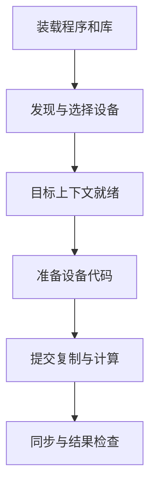

# 一个 CUDA 进程怎样开始计算

## 先让主机程序装载成功

运行 `./vector-check` 时，首先启动的是 Linux 主机进程。它的 CPU 代码需要由 Linux 装载；本例动态链接的 `libcudart.so.12` 等共享库也要找到。若缺少启动必需的共享库，动态装载器就可能在进入应用 `main` 前终止，GPU 尚未接到请求。

可执行文件中的 `DT_NEEDED` 记录所需共享库名称；`RPATH` / `RUNPATH` 是文件内记录的搜索路径信息，`LD_LIBRARY_PATH` 是启动环境中的搜索目录。它们与动态装载器缓存、默认目录一起影响实际选择。`PATH` 用于 shell 查找命令，改变 `PATH` 不会自动解决共享库搜索。

在普通 glibc 进程中，对不带斜杠的依赖名，若没有 `DT_RUNPATH`，先考虑 `DT_RPATH`；再考虑 `LD_LIBRARY_PATH`，随后是 `DT_RUNPATH`、装载器缓存与默认目录。带斜杠的依赖、运行中 `dlopen` 的调用环境、安全执行模式和间接依赖还有细节，不能把这一顺序机械套到所有程序。本章的路径推演明确限定无 `DT_RPATH`、无安全执行模式；完整规则见 [Linux man-pages：ld.so 的 DESCRIPTION](https://www.man7.org/linux/man-pages/man8/ld.so.8.html)。

ELF 是 Linux 常见的可执行文件与共享对象格式。下面为**自拟、删节的 ELF 元数据教学输出**，只保留当前需要的动态项；它说明本例应用如何找到随包交付的 Runtime：

```bash
readelf -d /opt/apps/vector/bin/vector-check
```

```text
0x0000000000000001 (NEEDED)  Shared library: [libcudart.so.12]
0x000000000000001d (RUNPATH) Library runpath: [$ORIGIN/../lib]
```

`$ORIGIN` 在这里由装载器解释为包含该动态项的可执行文件所在目录，因而候选目录为 `/opt/apps/vector/lib/`。输出没有给出驱动库的最终落点。程序或库还可以在运行中通过 `dlopen` 装载其他库，Runtime 访问驱动也不能只看应用的直接 `DT_NEEDED`。要知道本次进程实际使用的路径，需要结合装载调试记录，或在库已装载后查看 `/proc/<PID>/maps`。

例如，`LD_DEBUG=libs,versions /opt/apps/vector/bin/vector-check` 会在启动应用的同时记录库搜索和版本依赖检查；`/proc/<PID>/maps` 则给出该进程当时已映射文件的路径。前者解释“怎样选到”，后者核对“现在用了谁”。后文的 `loaded.*` 是从这类材料人工汇总的字段；无需读者运行应用来补齐证据。

“库名能找到”之后还要检查它能否满足所需符号和版本。ABI（应用二进制接口）规定已编译代码如何相互调用；相同文件名不是全部 ABI 兼容性的证明。后面的兼容性判断要同时看库来源与应用要求。

## 设备发现与上下文建立

主机程序进入自身逻辑后，才开始选择 GPU。直接使用 Driver API 的程序先用 `cuInit` 初始化接口，再枚举设备，建立或取得上下文；Runtime 路径替应用管理其中一部分工作。**CUDA Context（上下文）**保存进程使用某设备所需的执行状态，关联地址空间、装载代码、内存分配与执行对象等。发现一张 GPU 与建立可用于计算的 Context 是两个阶段。

在本章基线中，`cudaGetDeviceCount` 返回进程能发现的 CUDA 设备数量；设备发现也可能触发驱动或 Runtime 的内部初始化，不能将它理解成只读一个静态列表。随后 `cudaSetDevice(0)` 为当前主机线程选择进程可见的设备 0。在 **CUDA 12.0 及以后**，`cudaSetDevice` 还会初始化 Runtime 和该设备的 Primary Context；因此必须检查它的返回值，不能把初始化错误一概推到后续 `cudaMalloc`。Primary Context 是驱动为一个进程中的某设备提供、可供 Runtime 与 Driver API 互操作的主要上下文；本例中该进程的多个主机线程共享它，不代表不同进程共用一个上下文。行为依据见 [CUDA 12.8.1：Initialization](https://docs.nvidia.com/cuda/archive/12.8.1/cuda-c-programming-guide/index.html#initialization)。

设备编号属于当前观察范围。`CUDA_VISIBLE_DEVICES` 可以筛选并重排进程能看到的 CUDA 设备。例如，在已明确 CUDA 原始枚举顺序为 A、B 的双卡主机上，设置 `CUDA_VISIBLE_DEVICES=1` 后，应用只看到 B，并将它编号为 0。这个例子没有假定 CUDA 原始枚举顺序必然等于另一进程的 `nvidia-smi` 顺序。真实对应应核对 UUID 或 PCI 地址；变量规则见 [CUDA 12.8.1：CUDA Environment Variables](https://docs.nvidia.com/cuda/archive/12.8.1/cuda-c-programming-guide/index.html#env-vars)。

设备文件的访问权限、进程隔离或设备状态也会影响初始化。若 `nvidia-smi` 与应用由不同用户、不同环境启动，它们的结果不能直接互相代替。容器中如何注入和限制设备留给第 10 章，本章先始终对齐同一宿主机与进程环境。

## 装载设备代码，再提交工作

主机可执行文件被 CPU 装载，不代表里面的 GPU 代码已适用于当前设备。CUDA 应用可以携带针对具体 GPU 架构的机器码，也可以携带由驱动在运行时编译的中间表示；下一篇分别解释 cubin 和 PTX。

驱动需要为将要执行的 Kernel 找到适合当前 GPU 的代码，必要时进行 JIT（Just-In-Time，即运行时即时编译）。代码装载与 JIT 的实际时间点受应用调用和延迟装载策略影响，可以发生在初始化或第一次使用附近，不能断言全部 Kernel 一定在进程启动时编译完。

下面是**单次运行的逻辑阶段图**。箭头表示依赖先后；设备发现阶段可以包含底层初始化，上下文框表示目标设备的 Context 可用。代码准备框表示相应 Kernel 使用前必须满足的条件，不指定它一定早于首次内存分配。各阶段的失败表现再与后文故障材料对照。



在调用层面，读者可以把本例理解成下列**省略类型和清理代码的伪代码**。`CHECK` 表示当场检查该调用返回值；尖括号写法只表示第 02 章的 Kernel 启动，不要求掌握 CUDA 编程：

```text
CHECK(cudaGetDeviceCount(&count))
若 count == 0，报告当前进程未发现可用设备并退出
CHECK(cudaSetDevice(0))             // 本章 CUDA 12.8 基线在此完成相应初始化
CHECK(cudaMalloc(&device_buffer, bytes))
CHECK(cudaMemcpy(device_buffer, host_input, bytes, HostToDevice))
vector_kernel<<<grid, block>>>(device_buffer)
CHECK(cudaGetLastError())           // 检查启动提交阶段可报告的问题
CHECK(cudaDeviceSynchronize())      // 等待此前设备工作完成，检查执行结果状态
CHECK(cudaMemcpy(host_output, device_buffer, bytes, DeviceToHost))
检查 host_output 与预期结果
```

`cudaGetLastError` 成功仍不等于 Kernel 已完成。异步执行错误可能在之后的同步调用才被观察到，这承接第 02 章的提交与完成区别。定位时应记录哪个调用首次报告错误、之前提交过什么；不能只按报错行把根因归到同步函数。

## 用一份完整记录说明已经走过哪些环节

以下为**自拟应用探针记录**，由本章 `vector-check` 按阶段输出，字段不是 NVIDIA 工具的原生格式。应用使用导读基线，驱动路径是在初始化后按进程映射汇总的；省略无关主机库：

```text
build.toolkit = 12.8.1
build.nvcc_component = 12.8.93
loaded.cudart = /opt/apps/vector/lib/libcudart.so.12.8.90
loaded.libcuda = /usr/lib/x86_64-linux-gnu/libcuda.so.570.124.06
cudaGetDeviceCount = cudaSuccess, count = 1
selected.ordinal = 0, pci_bus_id = 0000:41:00.0, uuid = GPU-<A>
selected.compute_capability = 8.0
cudaSetDevice = cudaSuccess
allocation_and_input_copy = cudaSuccess
kernel_launch_check = cudaSuccess
cudaDeviceSynchronize = cudaSuccess
output_copy = cudaSuccess
result_check = PASS
```

沿记录可以逐步得出肯定结论：本次启动找到了指定 Runtime；计算路径实际装载 `.06` 的 `libcuda`；进程发现一张设备并将 ordinal 0 映射到 GPU-A；选择与初始化成功；本次输入规模的分配、复制、Kernel、同步和结果检查都已通过。

这比“`nvidia-smi` 看到了卡”多覆盖了应用计算链，也比“启动函数返回成功”多覆盖了完成与结果。它的范围仍是这个二进制、这份输入、这张 GPU 和此次运行，没有包含显存压力、多卡互联、持续负载或性能验收。下一篇说明：要在运行前预测这些阶段能否通过，需要哪些版本与设备代码信息。

[上一篇：软件地图](01_把驱动_Runtime与Toolkit放回软件地图.md) · [下一篇：从版本号与设备代码判断兼容性](03_从版本号与设备代码判断兼容性.md)
