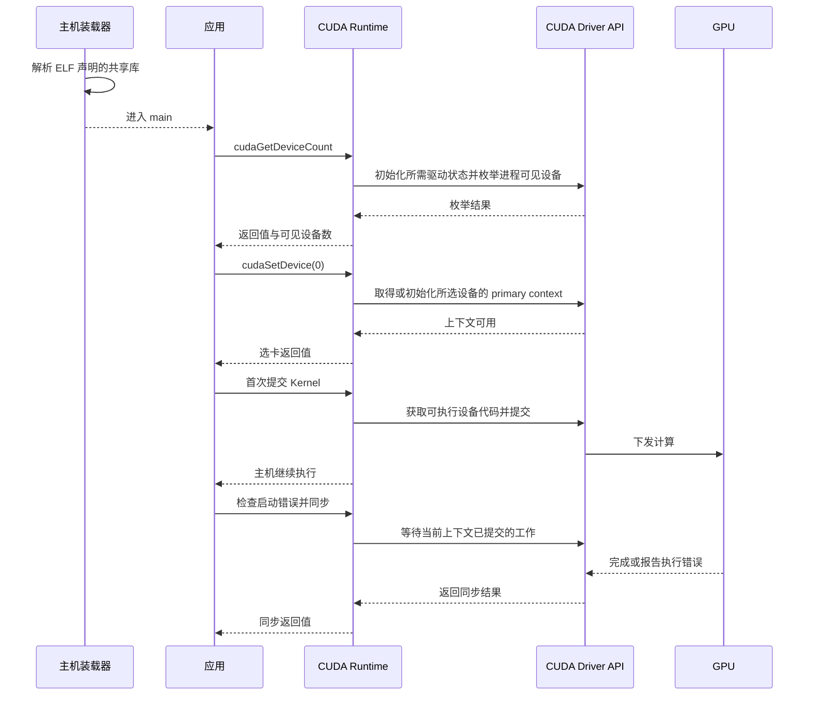

# 一个 CUDA 进程怎样到达第一次计算

一张 GPU 在 `nvidia-smi` 里可见，CUDA 进程仍可能找不到设备。进程也可能顺利选卡，却在第一次使用 Kernel 时失败。以单进程、单张 NVIDIA GPU 和 CUDA 13.2.1 的 API 语义为例，沿库装载、枚举、选卡、装入设备代码和完成计算逐步检查。每一步成功都为下一步建立了不同的条件。

## ELF 进程先装入主机代码

对于动态链接的 Linux ELF 程序，动态链接器解析 `DT_NEEDED` 记录的共享库依赖。若程序动态链接 `libcudart`，找不到相应共享库时，应用可能连 `main` 都进不去。静态 Runtime 已编入产物。无论 Runtime 如何链接，进程仍可能在框架导入或初始化 CUDA 时才通过 `dlopen` 装入额外的库。先确定失败发生在进程启动还是某次库调用，取证范围就会不同。主机动态链接器装载的是 ELF 共享库，CUDA 驱动随后装载的 module 包含 GPU 设备代码。 [Linux man-pages · ld.so(8)](https://man7.org/linux/man-pages/man8/ld-linux.8.html) · [dlopen(3)](https://man7.org/linux/man-pages/man3/dlopen.3.html) · [CUDA 13.2.1 · Cubins and Fatbins](https://docs.nvidia.com/cuda/archive/13.2.1/cuda-programming-guide/01-introduction/cuda-platform.html)

## 从进程内枚举到上下文建立

`cudaGetDeviceCount` 报告该进程可用的 CUDA 设备数量，先检查它的返回值，再读数量。比如在启动时给 `CUDA_VISIBLE_DEVICES` 赋空值，该进程的可见列表为空，主机的 NVML 查询仍可列出 GPU。给变量提供一组设备也会改变枚举顺序，因此应用里的 `device 0` 只表示可见列表的第一个设备。需要与管理侧对齐时，记录应用取到的 PCI BDF 或 GPU UUID，再和管理工具的字段比较。 [CUDA 13.2.1 · CUDA Environment Variables](https://docs.nvidia.com/cuda/archive/13.2.1/cuda-programming-guide/05-appendices/environment-variables.html) · [Runtime API · Device Management](https://docs.nvidia.com/cuda/archive/13.2.1/cuda-runtime-api/group__CUDART__DEVICE.html)

在常见的纯 Runtime 程序中，`cudaSetDevice(0)` 为调用它的主机线程选择设备。CUDA 12.0 起，此调用会初始化 Runtime 及选中设备的 primary context。更早的版本会将初始化推迟到后续需要它的调用。primary context 按进程和设备建立。同一进程的不同线程可以使用同一设备的 primary context，内存分配和 Stream 等资源归属于相应的上下文。调用 Driver API 的程序可以显式执行 `cuInit(0)`、`cuDeviceGetCount`、`cuDeviceGet`，然后用 `cuDevicePrimaryCtxRetain` 取得上下文、用 `cuCtxSetCurrent` 将其绑定到当前线程，结束时释放 retain 引用。若混用两套 API，Runtime 可使用该线程已经设为当前的 Driver API 上下文。 [CUDA 13.2.1 · Runtime Initialization](https://docs.nvidia.com/cuda/archive/13.2.1/cuda-programming-guide/02-basics/intro-to-cuda-cpp.html) · [Driver vs Runtime APIs](https://docs.nvidia.com/cuda/archive/13.2.1/cuda-driver-api/driver-vs-runtime-api.html) · [Driver API Initialization](https://docs.nvidia.com/cuda/archive/13.2.1/cuda-driver-api/group__CUDA__INITIALIZE.html)

## 第一次使用 Kernel 时还要找到设备代码

对于本例的预编译程序，驱动从产物中的 fatbin 选取可用 cubin，也可以把兼容的 PTX 即时编译为设备代码。选卡成功说明已能进入该设备的上下文，某个 Kernel 所需的代码可能到第一次使用才装载。CUDA 的 lazy loading 要求 Runtime 11.7 或更新以及 R515 或更新的驱动。Linux 从 CUDA 12.2 开始默认启用，可通过 `CUDA_MODULE_LOADING` 控制。含 managed variables 的 CUDA module 等对象仍可能提前装载。首次报错的位置因此取决于实际调用、模块和装载模式。 [CUDA 13.2.1 · Lazy Loading](https://docs.nvidia.com/cuda/archive/13.2.1/cuda-programming-guide/04-special-topics/lazy-loading.html) · [Cubins and Fatbins](https://docs.nvidia.com/cuda/archive/13.2.1/cuda-programming-guide/01-introduction/cuda-platform.html)

Kernel 启动后，用 `cudaGetLastError` 读取并清除当前线程在该 Runtime 实例中的最近错误，再用 `cudaDeviceSynchronize` 等当前上下文此前提交的工作完成。CUDA 调用也可能报告先前异步工作的错误，所以一般应用要结合前序调用定位。在只有一个 Kernel 的干净进程里，启动检查、同步和拷回校验可以把失败窗口缩小到一次提交。 [CUDA 13.2.1 · Runtime API Error Handling](https://docs.nvidia.com/cuda/archive/13.2.1/cuda-runtime-api/group__CUDART__ERROR.html) · [Runtime API · Device Management](https://docs.nvidia.com/cuda/archive/13.2.1/cuda-runtime-api/group__CUDART__DEVICE.html)



图示为动态链接的纯 Runtime 程序在 lazy loading 下的一条成功路径，省略中间的内存分配。若装载、枚举或选卡失败，先记录该步结果并停止后续测试。

## 用一个 Kernel 分别记录枚举、启动和完成

下面的 `probe.cu` 让一个 GPU 线程写出整数 7。它在每个关键调用后记录符号和数值错误码，并读取进程内设备 0 的 PCI BDF。若枚举失败或没有设备，程序不会继续选卡。需要 GPU 才能运行，后面的对照材料可离线阅读。

```cpp
#include <cuda_runtime.h>
#include <cstdio>
#include <cstdlib>

static void check(const char* stage, cudaError_t status) {
    std::fprintf(stderr, "%s: %s (%d)\n",
                 stage, cudaGetErrorName(status), static_cast<int>(status));
    if (status != cudaSuccess) {
        std::exit(1);
    }
}

__global__ void write_value(int* output) {
    *output = 7;
}

int main() {
    int count = 0;
    check("enumerate", cudaGetDeviceCount(&count));
    std::printf("visible_devices=%d\n", count);
    if (count == 0) {
        return 2;
    }

    check("select", cudaSetDevice(0));
    char bus_id[32];
    check("device_id", cudaDeviceGetPCIBusId(bus_id, sizeof(bus_id), 0));
    std::printf("device_ordinal=0 pci_bus_id=%s\n", bus_id);

    int* device_output = nullptr;
    check("allocate", cudaMalloc(&device_output, sizeof(int)));
    write_value<<<1, 1>>>(device_output);
    check("launch", cudaGetLastError());
    check("synchronize", cudaDeviceSynchronize());

    int output = 0;
    check("copy_back", cudaMemcpy(&output, device_output, sizeof(output),
                                  cudaMemcpyDeviceToHost));
    check("release", cudaFree(device_output));
    std::printf("output=%d\n", output);
    return output == 7 ? 0 : 3;
}
```

构建 H100（计算能力 9.0）版本时，可用 CUDA Toolkit 13.2 GA 显式生成 `sm_90` cubin。下例假设构建侧已配置 `nvcc` 和受支持的主机编译器，运行侧驱动支持 H100 和此产物，并能解析 `libcudart.so.13`。用 `nvidia-smi` 登记管理侧 UUID 和 BDF，再从应用输出读 BDF。对单张未切分的裸机 GPU，可以按 BDF 将二者对齐。 [NVIDIA GPU Compute Capability](https://developer.nvidia.com/cuda/gpus) · [CUDA 13.2 GA · Linux Installation Guide](https://docs.nvidia.com/cuda/archive/13.2.0/cuda-installation-guide-linux/index.html) · [NVIDIA SMI](https://docs.nvidia.com/deploy/nvidia-smi/index.html)

```bash
nvcc --cudart=shared -gencode=arch=compute_90,code=sm_90 probe.cu -o probe-sm90
nvidia-smi --query-gpu=name,uuid,pci.bus_id --format=csv,noheader
env -u CUDA_VISIBLE_DEVICES ./probe-sm90
env CUDA_VISIBLE_DEVICES= ./probe-sm90
```

下表按上面的 H100 场景推演。假设该主机只有一张可用 GPU，库与驱动均满足运行条件。示例用 `0000:65:00.0` 表示这张卡的 BDF，两次启动只改变应用进程的 `CUDA_VISIBLE_DEVICES`。

| 启动方式 | 预期枚举结果 | 选卡与计算 |
| --- | --- | --- |
| `env -u CUDA_VISIBLE_DEVICES ./probe-sm90` | 枚举成功，可见设备数为 1 | 选中设备 0，按 BDF 与管理侧记录对齐。检查启动和同步的返回值，再验证拷回的值为 7。 |
| `env CUDA_VISIBLE_DEVICES= ./probe-sm90` | 进程没有可见设备 | 记录枚举返回值，程序在选卡前退出。主机的 NVML 查询仍可看到这张卡。 |

对照中首先改变的是应用的枚举结果。若管理查询仍能看到同一张卡，先检查应用的设备可见性设置。若枚举和选卡均成功，再根据启动检查、同步和结果校验判断计算是否完成。
