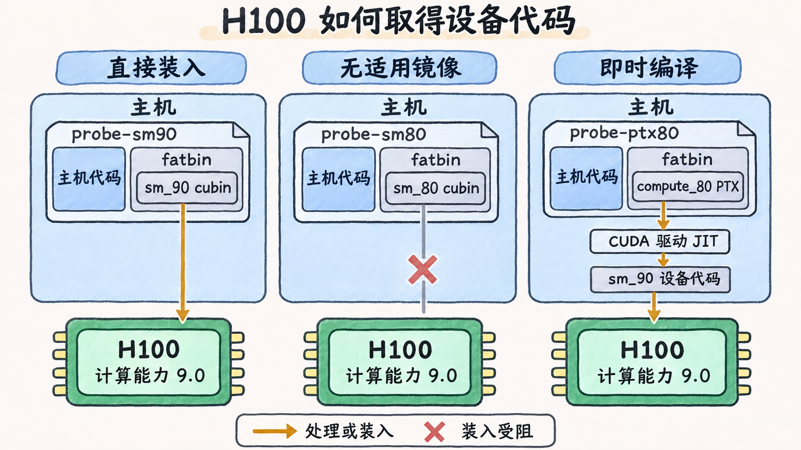
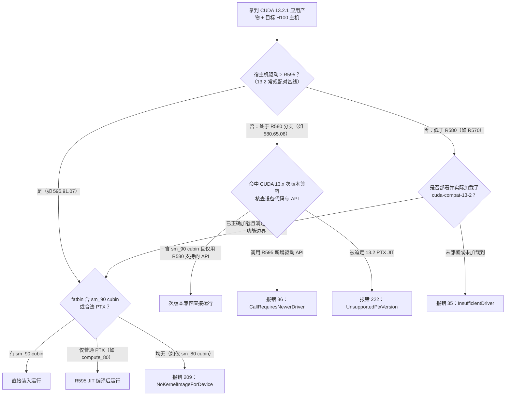

# CUDA 设备代码与驱动版本兼容性

把在开发机上用 CUDA `13.2.1` 编译好的 `probe-sm90`（或一套刚验证通过的训练/推理服务镜像）搬到另一台 H100 节点，敲开 `nvidia-smi` 一看，顶部显示的却是 `CUDA Version: 13.0` 甚至 `12.8`。这时候别急着盲目升级整台机器的驱动，也别直接断定“版本号低就一定跑不了”。

判断一份 CUDA 产物在目标主机上能不能跑，本质上只需拆开回答两个互不混淆的问题：
1. **硬件代码关**：目标 GPU 能不能执行产物里携带的设备代码？
2. **驱动版本关**：宿主机驱动能不能托住应用加载的 Runtime 版本与 API 调用？

下面先固定驱动与 H100 硬件讲透设备代码规则，再固定应用产物，梳理清晰的三层驱动兼容判断树。

## 计算能力、cubin 与 PTX JIT

NVIDIA 用**计算能力（Compute Capability）** 的主版本与次版本标识 GPU 的硬件架构和功能集，例如 H100 的计算能力为 `9.0`（对应代号 `sm_90`），A100 为 `8.0`。构建应用时，编译器把面向不同架构的设备代码打包进同一个名为 **fatbin** 的容器，嵌入主机可执行文件或共享库中。

fatbin 里通常装着两类设备代码，它们就像“本地原生机器码”与“可跨代翻译的虚拟字节码”：

- **cubin（CUDA binary）**：面向真实架构编译好的二进制机器码（如 `sm_90`、`sm_80`），优势是零翻译开销、装入即跑。
  - 普通编译目标**严格绑定架构主版本**（主版本相同且 GPU 次版本 ≥ cubin 次版本）：`sm_80` 可跑在 `8.6` 上，反之不行；H100（`9.0`）无法直接装入任何 `8.x` 普通 cubin。
- **PTX（Parallel Thread Execution）**：面向虚拟 GPU 架构的中间指令表示（如 `compute_80`），只要目标 GPU 计算能力 ≥ 虚拟架构要求（如 H100 满足 `compute_80`）即可向下覆盖。
  - 运行前，CUDA 驱动会在**主机 CPU 侧**触发 **JIT（即时编译）**，把 PTX 现场翻译为当前 GPU 可执行的机器码。

按默认装载策略，驱动会优先在 fatbin 中寻找匹配当前 GPU 的 cubin 直接装入；找不到合适 cubin 时，才会退而求其次寻找可用的 PTX 并调用驱动内置的 JIT 编译器。但要注意：**PTX JIT 成立有两个硬前提——驱动 JIT 未被禁用，且当前驱动里的 JIT 编译器读得懂这份 PTX 的指令集版本（`.version`）**。

> [!note] 架构特化目标与旧架构演进
> - **特化目标不可跨代**：类似 `sm_90a`、`compute_90a` 这类带 `a` 后缀的架构特化目标启用了某一代芯片独有的硬件指令，只能按特化规则匹配对应架构，不能套用普通目标的跨代兼容规律。本文示例均采用无后缀的普通目标。
> - **工具链退役与组件独立编号**：自 CUDA 11.0 起，Toolkit 内部各组件实行独立版本编号。CUDA Toolkit 13.0 已移除对 Maxwell、Pascal、Volta 架构的离线编译与库支持；存量二进制能否在旧卡上继续运行，要分别看运行主机的驱动是否仍支持该卡、所需共享库是否齐全，以及产物内是否留有对应设备代码。

## 实战对照：同一 Kernel 在 H100 上的三种构建结果

为了把上述规则看个通透，我们固定同一台 H100（计算能力 `9.0`）与统一参考栈（R595 `595.91.07` + CUDA `13.2.1`），只改动编译 `probe.cu` 时的 `-gencode` 参数。其中 `arch` 指定编译时假定的虚拟架构，`code` 指定要真正塞进 fatbin 的产物形态（`sm_` 保存 cubin，`compute_` 保留 PTX）：

| 应用产物 | `-gencode` 编译参数 | H100（9.0）上的装载路径与结果 |
| --- | --- | --- |
| `probe-sm90` | `arch=compute_90,code=sm_90` | 仅含 `sm_90` cubin，与 H100 架构精准匹配，直接装入 GPU 执行。 |
| `probe-sm80` | `arch=compute_80,code=sm_80` | 仅含 `sm_80` cubin。H100 主版本为 9，无法装入 8.x 二进制，又缺少可供 JIT 的 PTX，在主机侧直接被拦截。 |
| `probe-ptx80` | `arch=compute_80,code=compute_80` | 仅含 `compute_80` PTX。H100 满足功能集要求，驱动在主机侧完成 JIT 编译生成 `sm_90` 设备代码后再装入执行。 |



*图 03-03-01：同一 H100（计算能力 9.0）运行三份独立产物的设备代码路径对照。右列成立还要求驱动 JIT 支持产物中的 PTX 指令集版本。*

遇到线上报镜像不兼容时，甚至不需要在 GPU 机器上运行程序，直接用 Toolkit 自带的 `cuobjdump` 就能把二进制或算子库里的 fatbin 剖开看清：

```bash
# 构建仅含 sm_80 cubin 与仅含 compute_80 PTX 的两个对照产物
$ nvcc --cudart=shared -gencode=arch=compute_80,code=sm_80 probe.cu -o probe-sm80
$ nvcc --cudart=shared -gencode=arch=compute_80,code=compute_80 probe.cu -o probe-ptx80

# 逐一盘点产物内包含（以及缺少）的 cubin 与 PTX 清单
$ cuobjdump --list-elf probe-sm90
ELF file    1: probe-sm90.1.sm_90.cubin

$ cuobjdump --list-elf probe-sm80 && cuobjdump --list-ptx probe-sm80
ELF file    1: probe-sm80.1.sm_80.cubin
# （--list-ptx 输出为空：说明缺少可回退 JIT 的 PTX）

# 查看 PTX 头部声明的指令集版本（.version）与目标架构特性（.target）
$ cuobjdump --dump-ptx probe-ptx80 | head -n 10
Fatbin ptx code:
================
arch = sm_80
code version = [9,2]
.version 9.2               # CUDA 13.2 生成的 PTX ISA 版本，旧驱动 JIT 可能不认识
.target sm_80              # 目标虚拟架构要求
.address_size 64
```

在 PyTorch、vLLM 或自定义算子扩展中，失败的 Kernel 往往藏在按需加载的 `.so` 动态库里，而不是主可执行文件里；此时应对准实际提交失败 Kernel 的那个 `.so` 文件执行 `cuobjdump`。

> [!tip] 两条高频设备代码报错速查
> - **`cudaErrorNoKernelImageForDevice`（错误码 209）**：当前 GPU 找不到可执行的 Kernel 镜像（对应 `probe-sm80` 落点）。优先核对目标 GPU 计算能力与产物 fatbin 中的 cubin/PTX 清单。
> - **`cudaErrorUnsupportedPtxVersion`（错误码 222）**：产物走上了 PTX JIT 路径，但 `.version` 高于当前驱动 JIT 编译器能理解的上限。优先核对 PTX 版本与进程实际加载的驱动 JIT 组件。

## 驱动兼容判断树：向后兼容、次版本兼容与前向兼容

搞定设备代码后，我们反过来固定应用产物（基于 CUDA `13.2.1` 构建、携带对应共享 Runtime），只改变宿主机驱动版本。围绕 `R595 + CUDA 13.2.1` 这条主线，CUDA 的跨版本兼容规则可以干净利落地归结为三条路径：

1. **驱动向后兼容（Backward Compatibility）**：**新驱动跑旧应用**。例如安装 R595 驱动的主机，可以直接运行按 CUDA 12.x 构建的老程序，前提是驱动仍支持该 GPU，且应用自己带齐了所需的旧版 Runtime 及数学库（宿主机驱动支持高版本 API，并不会替应用提供旧版 `libcudart`）。
2. **CUDA 次版本兼容（Minor Version Compatibility）**：**同大版本内，新 Runtime 兼容稍旧驱动**。
   - CUDA 13.2 官方 Release Notes 用两张表区分口径：表 3 给出常规配对驱动基线（Linux x86_64 为 **R595 `≥ 595.45.04`**，全书采用 `595.91.07`）；表 2 给出 13.x 次版本兼容下限——**R580**。
   - 若将 H100 主机换为 R580 驱动（例如 `580.65.06`，`nvidia-smi` 显示 `CUDA Version: 13.0`），它已跨过 13.x 最低门槛。携带原生 `sm_90` cubin 的 `probe-sm90` 只要不调用 R595 专属的新 API，就能顺利跑通；一旦调用较新驱动才支持的功能，则会触发 **`cudaErrorCallRequiresNewerDriver`（错误码 36）**。
   - 更隐蔽的坑在于 PTX：**次版本兼容下限（R580）不保证能 JIT 编译新版 Toolkit（13.2）生成的 PTX**。同一台 R580 主机上，换成仅带 13.2 生成 PTX 的 `probe-ptx80` 时，驱动虽然允许枚举和选卡，却会在首次调用 Kernel 走 JIT 时抛出 `cudaErrorUnsupportedPtxVersion`（222）。
3. **Linux CUDA 前向兼容（Forward Compatibility）**：**老内核驱动 + 新用户态兼容包**。若宿主机驱动进一步降到 R570（如 `570.124.06`，对应 CUDA 12.8），已经跌破 13.x 次版本兼容下限，裸跑会直接报 **`cudaErrorInsufficientDriver`（错误码 35）**。
   - 在受支持的 Linux 系统与数据中心 GPU（如 H100）上，可以部署对应的前向兼容包（如 `cuda-compat-13-2`，官方兼容矩阵中它与 `570+` 分支的交叉项标记为 `C` 支持）。
   - 前向兼容包提供新版用户态驱动库（含 `libcuda.so.1` 与新版 PTX JIT 等组件），应用加载这些新版用户态库后，底层依然借道宿主机旧内核模块访问 GPU。注意它作用在**用户态驱动 ↔ 内核驱动**之间，与次版本兼容（作用在 **Runtime ↔ 驱动** 之间）处于不同层次；不仅要安装兼容包，还必须确保目标进程的库搜索路径真正加载到了兼容包里的库，且应用未触碰强依赖新内核驱动的功能。

下面这棵判断树把整套版本与代码兼容逻辑浓缩成四步决策，排查线上环境时按箭头顺藤摸瓜即可：



*图 03-03-02：给定 CUDA 13.2.1 应用产物与目标主机驱动时的兼容性快速判读树（以 H100 为例）。*

> [!warning] 常见误区：别把“装了兼容包”当成“用上了兼容包”
> 安装 `cuda-compat-13-2` 只是把新版用户态驱动文件放进了磁盘上的特定目录（例如 `/usr/local/cuda/compat`），绝不会自动替换所有进程的加载目标。如果启动脚本或容器入口没有配置正确的动态库搜索路径，进程依然会去加载宿主机系统目录里旧版本的 `libcuda.so.1`，照样触发错误码 35。

## 交付清单：上线前必须核对的三项证据

把一份 CUDA 应用或推理镜像从构建机交付到生产节点前，把下面三项事实写进交付清单，就能提前挡住绝大多数环境扯皮：

| 核对维度 | 具体取证方式与关键提醒 |
| --- | --- |
| **目标 GPU 与实际驱动** | 按 BDF 或 UUID 核对物理卡型号与计算能力；同时记录运行中内核模块版本与进程实际加载的 `libcuda.so.1` 来源（前向兼容场景尤须确认库路径）。 |
| **构建工具链与运行时库** | 交付清单写明构建 Toolkit、Runtime 及关键数学库版本与编译目标。动态库看进程实际加载路径，静态编入的组件查构建记录（`libcudart.so.13` 文件名只体现接口主版本，无法区分次版本）。 |
| **真正执行的设备代码** | 针对提交失败 Kernel 的具体可执行文件或扩展 `.so` 运行 `cuobjdump`，确认其中是否包含目标卡的 cubin 或可用 PTX。 |

到此为止，我们已经搞清了软件版本和设备代码的逻辑账。但在真实 Linux 服务器上，**明明磁盘上装好了新驱动、目录里放好了正确的共享库，进程为什么偏偏加载到旧的模块或错误的 `.so`？** 下一篇我们切入 Linux 内核模块管理与 glibc 动态链接器的现场取证。

> [!info]- 参考资料
> - **GPU 计算能力与设备代码**：[NVIDIA GPU 计算能力表](https://developer.nvidia.com/cuda/gpus)、[CUDA 13.2.1 编程指南 · CUDA 平台](https://docs.nvidia.com/cuda/archive/13.2.1/cuda-programming-guide/01-introduction/cuda-platform.html)、[NVIDIA Hopper 兼容指南](https://docs.nvidia.com/cuda/archive/12.6.0/hopper-compatibility-guide/index.html)、[Hopper Application Compatibility](https://docs.nvidia.com/cuda/archive/12.6.0/hopper-compatibility-guide/index.html#application-compatibility-on-hopper-architecture)
> - **编译工具、PTX 与二进制检查**：[CUDA 13.2 NVCC 代码生成选项](https://docs.nvidia.com/cuda/archive/13.2.0/cuda-compiler-driver-nvcc/index.html)、[CUDA 13.2.1 Binary Utilities（cuobjdump）](https://docs.nvidia.com/cuda/archive/13.2.1/cuda-binary-utilities/index.html)、[CUDA 13.2 PTX ISA 9.2 手册](https://docs.nvidia.com/cuda/archive/13.2.0/parallel-thread-execution/index.html)、[CUDA 13.2.1 Runtime API 错误码](https://docs.nvidia.com/cuda/archive/13.2.1/cuda-runtime-api/group__CUDART__TYPES.html#group__CUDART__TYPES)
> - **驱动兼容矩阵与发布说明**：[CUDA 13.2 GA Release Notes · CUDA Driver（表 2 与表 3）](https://docs.nvidia.com/cuda/archive/13.2.0/cuda-toolkit-release-notes/index.html#cuda-driver)、[CUDA 13.2 组件版本](https://docs.nvidia.com/cuda/archive/13.2.0/cuda-toolkit-release-notes/index.html#cuda-toolkit-major-components)、[CUDA 13.0 Release Notes · 已弃用架构](https://docs.nvidia.com/cuda/archive/13.0.0/cuda-toolkit-release-notes/index.html#deprecated-architectures)
> - **次版本兼容与前向兼容**：[CUDA 次版本兼容说明](https://docs.nvidia.com/deploy/cuda-compatibility/latest/minor-version-compatibility.html)、[次版本兼容应用注意事项](https://docs.nvidia.com/deploy/cuda-compatibility/latest/minor-version-compatibility.html#application-considerations-for-minor-version-compatibility)、[NVIDIA CUDA 前向兼容说明](https://docs.nvidia.com/deploy/cuda-compatibility/latest/forward-compatibility.html)、[前向兼容部署与支持矩阵](https://docs.nvidia.com/deploy/cuda-compatibility/latest/forward-compatibility.html#deployment-considerations-for-forward-compatibility)
