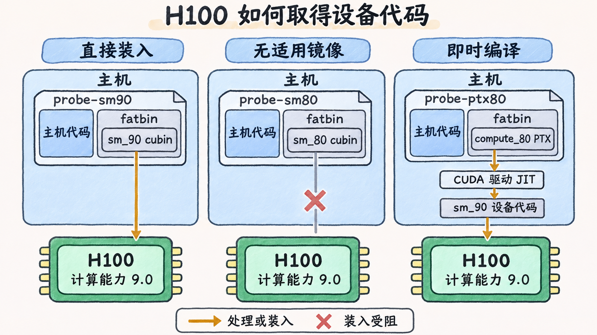

# 先查驱动兼容性，再查设备代码

应用用 CUDA Toolkit 13.2 GA 构建，宿主机的 `nvidia-smi` 却显示 `CUDA Version: 13.0`。在 H100 上，带原生 `sm_90` 代码的简单程序和依赖新版 PTX JIT 的程序，可能得到不同结果。判断时先确认应用需要哪种驱动支持，再检查实际用到的 Kernel 有没有可装入的设备代码。 [NVIDIA CUDA Compatibility](https://docs.nvidia.com/deploy/cuda-compatibility/latest/) · [Hopper Compatibility Guide](https://docs.nvidia.com/cuda/archive/12.6.0/hopper-compatibility-guide/index.html)

## 把机器版本和应用版本分开登记

| 需要知道什么 | 从哪里取证 |
| --- | --- |
| 设备型号和计算能力 | 用 `nvidia-smi` 确认 GPU 型号、UUID 或 BDF，再查计算能力表。H100 是 9.0。 |
| 正在运行的内核驱动 | Linux 裸机可读 `/proc/driver/nvidia/version`，与管理工具的驱动字段对照，记录完整版本。 |
| 应用用什么构建 | 看交付清单、构建记录和 `-gencode` 参数。运行主机上 `nvcc --version` 另记为本机编译器版本。 |
| 应用实际加载了什么 | 用 `readelf -d` 看 ELF 声明，再用 `LD_DEBUG=libs,files` 看实际路径。Runtime 或数学库静态编入时，版本依赖构建记录。 |
| 应用带了哪些设备代码 | 对可执行文件以及实际调用的共享库用 `cuobjdump` 检查 cubin 和 PTX。 |

Toolkit 的组件从 CUDA 11.0 起分别编号。用 `libcudart.so.13` 可以识别共享库接口的主版本，具体构建和运行库版本仍须分别查。某个框架能导入时，框架按需加载的扩展和数学库仍可能各有自己的设备代码及版本限制。 [NVIDIA GPU Compute Capability](https://developer.nvidia.com/cuda/gpus) · [CUDA 13.2 GA Release Notes · CUDA Driver](https://docs.nvidia.com/cuda/archive/13.2.0/cuda-toolkit-release-notes/index.html#cuda-driver) · [Linux man-pages · ld.so(8)](https://man7.org/linux/man-pages/man8/ld-linux.8.html) · [CUDA Binary Utilities](https://docs.nvidia.com/cuda/archive/13.2.1/cuda-binary-utilities/index.html)

## 驱动版本能提供哪种兼容性

**向后兼容**指新 CUDA 驱动继续支持较早 CUDA Toolkit 构建的应用。比如支持 CUDA 13.2 的驱动可运行按 CUDA 12.x 构建的旧应用，前提是驱动仍支持该 GPU 和平台，应用需要的运行库和设备代码也都具备。 [CUDA 13.2 GA Release Notes · CUDA Driver](https://docs.nvidia.com/cuda/archive/13.2.0/cuda-toolkit-release-notes/index.html#cuda-driver) · [NVIDIA CUDA Compatibility](https://docs.nvidia.com/deploy/cuda-compatibility/latest/)

**次版本兼容（minor version compatibility）** 允许同一 CUDA 主版本系列内较新的应用使用满足最低要求的较早驱动。读 CUDA 13.2 GA 的 Release Notes 时，把表 2 的 CUDA 13.x 驱动范围（R580 或更新）和表 3 的 13.2 GA 对应 Linux x86_64 驱动（`595.45.04` 起）分开。依赖这一模式时，要为目标设备显式构建可用 cubin。若应用调用的功能同时依赖新驱动，较早驱动可能返回 `cudaErrorCallRequiresNewerDriver`。若必须即时编译新版 Toolkit 生成的 PTX，较早驱动的 JIT 也可能不支持。 [CUDA 13.2 GA Release Notes · CUDA Driver](https://docs.nvidia.com/cuda/archive/13.2.0/cuda-toolkit-release-notes/index.html#cuda-driver) · [NVIDIA · Minor Version Compatibility](https://docs.nvidia.com/deploy/cuda-compatibility/minor-version-compatibility.html)

**前向兼容（forward compatibility）** 可以让满足条件的 Linux 系统在较早基础驱动上使用较新的 CUDA 用户态驱动。兼容包提供 `libcuda` 和相关 JIT 组件，仍由原有内核驱动访问 GPU。先确认适用的系统和 GPU（如支持的 NVIDIA 数据中心 GPU），再查包与基础驱动分支的矩阵、所需功能的限制，以及应用实际装入的库。安装包只把库放到相应目录，进程还需按部署方式解析到它们。内核侧所需的新能力仍要由基础驱动提供。 [NVIDIA · Forward Compatibility](https://docs.nvidia.com/deploy/cuda-compatibility/latest/forward-compatibility.html)

以下是 **查表算例**，固定 x86_64 Linux 裸机、H100 和 CUDA Toolkit 13.2 GA 构建的简单程序。假设应用依赖已交付，按表分别判断驱动路径。

| 基础驱动         | 对照表项                            | 判断                                                                                   |
| ------------ | ------------------------------- | ------------------------------------------------------------------------------------ |
| `595.45.04`  | 13.2 GA 对应的 Linux 驱动            | 按该 Toolkit 的常规驱动组合检查，下一步确认产物带有可用设备代码。                                                |
| `580.65.06`  | 13.0 GA 对应驱动，且达到 13.x 的 R580 下限 | 带 `sm_90` cubin 且不依赖更新驱动功能时，可走次版本兼容。若改成只带 13.2 生成的 PTX，分支下限无法保证 JIT 成功。              |
| `570.124.06` | 12.8 Update 1 对应驱动，低于 R580      | 前向兼容矩阵的 `cuda-compat-13-2` 行与 570+（CUDA 12.8）列交叉为 `C`。可据此继续核对 H100、系统、进程选中的兼容库和应用功能。 |

最后一行的 `C` 描述基础驱动与兼容包的组合。实际部署时按所用版本复查矩阵，并确认进程加载到兼容目录下的 CUDA 驱动库。表里的驱动版本仅用于演示判读，应用运行结果以实际调用为准。 [CUDA 13.2 GA Release Notes · CUDA Driver](https://docs.nvidia.com/cuda/archive/13.2.0/cuda-toolkit-release-notes/index.html#cuda-driver) · [NVIDIA · Forward Compatibility Support Matrix](https://docs.nvidia.com/deploy/cuda-compatibility/latest/forward-compatibility.html#deployment-considerations-for-forward-compatibility)

## H100 能装入哪一种设备代码

`nvcc` 可以将 GPU 代码以 cubin 或 PTX 放入宿主可执行文件或共享库中的 fatbin。cubin 是已生成的设备二进制。对本例的普通目标，GPU 与 cubin 的计算能力主版本须相同，GPU 的次版本须大于或等于 cubin 的次版本。例如 `sm_80` 可以在 8.6 上执行，`sm_86` 无法在 8.0 上执行，两者都无法直接在 9.0 上执行。普通 PTX 可以由驱动为满足其目标能力的 GPU 做 JIT，还要让 JIT 认识这份 PTX 的 ISA 版本。带架构特化后缀的 `sm_90a`、`compute_90a` 只适用于对应架构，按该目标的规则单独判断。 [CUDA 13.2.1 · The CUDA Platform](https://docs.nvidia.com/cuda/archive/13.2.1/cuda-programming-guide/01-introduction/cuda-platform.html) · [Hopper Compatibility Guide](https://docs.nvidia.com/cuda/archive/12.6.0/hopper-compatibility-guide/index.html)

用同一份 `probe.cu` 做三次构建即可隔离代码目标的影响。源程序只需选卡、启动一个 Kernel 写入整数 7、同步并校验拷回值。三份产物使用同一动态 Runtime 选项，分别只要求一类设备代码。

```bash
nvcc --cudart=shared -gencode=arch=compute_90,code=sm_90 probe.cu -o probe-sm90
nvcc --cudart=shared -gencode=arch=compute_80,code=sm_80 probe.cu -o probe-sm80
nvcc --cudart=shared -gencode=arch=compute_80,code=compute_80 probe.cu -o probe-ptx80

cuobjdump --list-elf probe-sm90
cuobjdump --list-elf probe-sm80
cuobjdump --list-ptx probe-ptx80
cuobjdump --dump-ptx probe-ptx80
```

实际排查时，对同一待查文件分别使用 `--list-elf` 和 `--list-ptx`。前者列出 fatbin 中的设备 ELF，后者列出 PTX。PTX 的 `.target` 给出目标特性，例如本例的 `sm_80`，`.version` 则给出这份 PTX 的 ISA 版本。若 Kernel 来自应用装入的 `.so`，检查该文件及对应的 Kernel，主程序的镜像清单只覆盖主程序。 [CUDA 13.2 GA · NVCC Code Generation Options](https://docs.nvidia.com/cuda/archive/13.2.0/cuda-compiler-driver-nvcc/index.html) · [CUDA Binary Utilities · cuobjdump](https://docs.nvidia.com/cuda/archive/13.2.1/cuda-binary-utilities/index.html)

| 产物 | H100（9.0）上的预期判读 |
| --- | --- |
| `probe-sm90` | 有适用的原生 cubin，可直接装入。 |
| `probe-sm80` | 只有 `sm_80` cubin，跨主计算能力，且无 PTX 作为备选。 |
| `probe-ptx80` | 目标能力可向前覆盖 H100。驱动支持这份 PTX 的 ISA 版本并启用 JIT 时，可生成 H100 的设备代码。 |

表中假设主机依赖齐全，驱动和 JIT 满足 CUDA 13.2 GA 产物的需要。若出现 `CUDA_ERROR_NO_BINARY_FOR_GPU`（209，Runtime 对应 `cudaErrorNoKernelImageForDevice`），先检查失败 Kernel 的代码目标与设备。若出现 `CUDA_ERROR_UNSUPPORTED_PTX_VERSION`（222），则检查生成 PTX 的工具链和实际加载的 JIT。设备架构匹配与 JIT 能读懂 PTX 是两项条件。 [Driver API 13.2.1 · Error Codes](https://docs.nvidia.com/cuda/archive/13.2.1/cuda-driver-api/group__CUDA__TYPES.html) · [Runtime API 13.2.1 · Error Handling](https://docs.nvidia.com/cuda/archive/13.2.1/cuda-runtime-api/group__CUDART__ERROR.html)



**图 03-03-01**　三个场景分别使用一张计算能力为 9.0 的 H100，假设驱动和运行库满足 CUDA Toolkit 13.2 GA 产物的要求。右列还要求驱动支持这份 PTX 的 ISA 版本并启用 JIT。

还要核对构建工具是否能生成所需目标。CUDA Toolkit 13.0 起移除了 Maxwell、Pascal 和 Volta 的离线编译与库支持。已有产物能否在这些设备上继续运行，取决于驱动分支仍支持的 GPU、产物包含的设备代码和所需库。 [CUDA 13.0 Release Notes · Deprecated Architectures](https://docs.nvidia.com/cuda/archive/13.0.0/cuda-toolkit-release-notes/index.html#deprecated-architectures)
