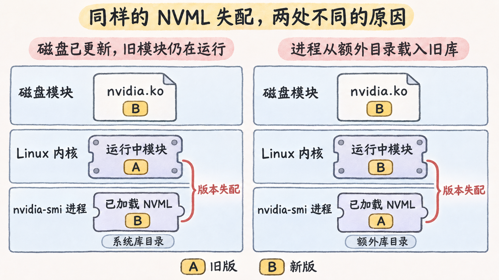

运行 `probe-sm90` 要同时具备两种运行状态。Linux 已装入 NVIDIA 内核模块，并让它管理目标 GPU。进程也选到了预期的共享库。软件包安装会改变磁盘上的文件，正在运行的内核和新启动的进程各有自己的加载过程。于是同一次更新后，可以出现整机的 GPU 管理查询失败，也可以只有某个启动环境无法使用 GPU。

## 启动内核、磁盘模块与设备绑定

内核模块使用 Linux 内核提供的接口。更新内核包会在磁盘上增加可启动的版本，当前运行版本则由本次启动决定，用 `uname -r` 查询。若新启动的内核找不到适用的 NVIDIA 模块，PCIe 仍能枚举出同一张 H100，`nvidia` 驱动却无法接管那条 BDF。 [Ubuntu Server · NVIDIA 驱动模块安装](https://ubuntu.com/server/docs/how-to/graphics/install-nvidia-drivers/#installing-the-kernel-modules) · [Linux kbuild · 外部模块](https://docs.kernel.org/kbuild/modules.html)

在 Ubuntu，适用的模块通常由以下一种方式提供。

- **预编译模块。** 发行版提供与特定内核 ABI（Application Binary Interface，应用二进制接口）和内核风味匹配的模块包。检查当前内核对应的包，例如 `linux-modules-nvidia-` 后接驱动分支、打包变体及 `uname -r` 对应的内核版本。计算用途的打包变体可能带 `-server` 后缀。
- **DKMS（Dynamic Kernel Module Support，动态内核模块支持）。** 在目标机器上为指定内核构建和安装模块，需要对应的内核头文件和构建环境。已经为旧内核构建成功时，仍要查新内核的构建与安装状态。

对当前启动依次读下面的证据。 [Ubuntu Server · 预编译模块与 DKMS](https://ubuntu.com/server/docs/how-to/graphics/install-nvidia-drivers/#installing-the-kernel-modules) · [kmod · modinfo(8)](https://man7.org/linux/man-pages/man8/modinfo.8.html) · [PCI 设备查询 · lspci(8)](https://man7.org/linux/man-pages/man8/lspci.8.html)

| 要确认的状态 | 可读证据 |
| --- | --- |
| 内核实际启动了哪个版本 | `uname -r` 给出当前内核。`journalctl -k -b` 将观察范围限定在本次启动的内核日志。 |
| 磁盘上有对应的模块 | `modinfo -k "$(uname -r)" nvidia` 查该内核模块树中的文件。读 `filename`、`version`、`vermagic` 和 `signer`，分别查看路径、版本、构建标记和签名者。使用 DKMS 时，另查 `dkms status` 与目标内核的构建日志。 |
| 当前已装入 NVIDIA 模块 | `lsmod` 检查装入状态，读取 `/proc/driver/nvidia/version` 可确认正在运行的 NVIDIA 模块版本。 |
| 该卡归 NVIDIA 驱动管理 | `lspci -nnk` 中用 BDF `0000:65:00.0` 对准 H100。该条目显示 `Kernel driver in use: nvidia` 才能确认目标设备的绑定。 |

磁盘上找到文件后，内核还要验证能否接纳它。例如内核启用符号版本检查时，模块所需符号与内核对应符号的版本信息必须匹配。强制签名验证时，还需要有效签名和内核信任的签名公钥。在允许装载未签名模块的配置中，日志里的签名告警可以与成功装载同时出现。把 `modinfo` 的字段与本次启动日志、装入状态及 BDF 的绑定情况一起看，才能区分模块文件缺失、被拒绝与装入后未绑定。 [Linux kbuild · Module Versioning](https://docs.kernel.org/kbuild/modules.html#module-versioning) · [Linux 模块签名](https://docs.kernel.org/admin-guide/module-signing.html)

## glibc 的共享库搜索顺序

模块和绑定均正常时，同一探针仍可能在不同启动环境中映射到不同的 Runtime 文件。下面是教学打包。假设 `/opt/probe/probe-sm90` 的直接依赖为 `DT_NEEDED=libcudart.so.13`，打包时还设置了 `DT_RUNPATH=$ORIGIN/lib`。`DT_RUNPATH` 是为直接依赖提供的查找目录，`$ORIGIN` 在此展开为可执行文件所在的 `/opt/probe`。这些是本例额外指定的打包属性。 [glibc 动态链接器 · ld.so(8)](https://man7.org/linux/man-pages/man8/ld-linux.8.html) · [NVIDIA 官方镜像 · CUDA 13.2 Runtime 库名](https://catalog.ngc.nvidia.com/orgs/nvidia/-/containers/nvhpc/26.5-runtime-cuda13.2-ubuntu22.04/layers)

对这个普通 glibc 进程，假设直接依赖名没有斜杠，没有旧式 `DT_RPATH`，且未进入安全执行模式。动态链接器先查 `LD_LIBRARY_PATH`，再查该直接依赖的 `DT_RUNPATH`，之后才查缓存与默认目录。若两处都有可加载的同名文件，可推导出两次启动的第一处匹配。 [glibc 动态链接器 · 共享对象查找顺序](https://man7.org/linux/man-pages/man8/ld-linux.8.html)

| 启动环境 | 按顺序选中的文件 |
| --- | --- |
| 未设置 `LD_LIBRARY_PATH` | `/opt/probe/lib/libcudart.so.13` |
| `LD_LIBRARY_PATH=/opt/old-app/lib` | `/opt/old-app/lib/libcudart.so.13` |

对这个假设已经打包好的探针，可以用下面的命令检查声明和实际路径。`readelf -d` 显示 ELF 记录的 `NEEDED`、`RUNPATH` 或 `RPATH`。`LD_DEBUG=libs,files` 则在启动时记录动态链接器实际走的路径，包括随后按需加载的对象。`trying file` 只表示搜索候选，要结合实际加载记录判断，例如为对象生成映射或调用其初始化函数的记录。真实环境的时序和路径应以跟踪输出为准。 [glibc 动态链接器 · LD_DEBUG](https://man7.org/linux/man-pages/man8/ld-linux.8.html) · [dlopen(3)](https://man7.org/linux/man-pages/man3/dlopen.3.html)

```bash
readelf -d /opt/probe/probe-sm90
env -u LD_LIBRARY_PATH LD_DEBUG=libs,files /opt/probe/probe-sm90
env LD_LIBRARY_PATH=/opt/old-app/lib LD_DEBUG=libs,files /opt/probe/probe-sm90
```

若库名无法解析，动态链接器会报告打不开所需库。若选中的库缺少应用要求的符号或符号版本，错误可能出现在链接装载或首次使用该符号时。上述查找顺序只覆盖给定条件。依赖名带路径、旧式 `DT_RPATH`、安全执行模式都可能改变查找行为。对于传递依赖，要查声明它的对象，因为主程序的 `DT_RUNPATH` 只用于主程序的直接依赖。 [glibc 动态链接器 · ld.so(8)](https://man7.org/linux/man-pages/man8/ld-linux.8.html)

## NVML 与运行中内核模块的版本失配

用户态库加载成功后，库还要能与正在运行的内核驱动交互。Canonical 在 Ubuntu Server 文档中给出了一个独立的公开示例。`nvidia-smi` 在初始化 NVML 时报告 `Driver/library version mismatch`，内核的 `NVRM: API mismatch` 指明用户态客户端为 `570.172.08`、正在运行的内核模块为 `570.158.01`。文档用升级后旧模块仍在运行解释这类现象，公开片段没有列出 GPU、内核版本或采集日期。 [Ubuntu Server · Driver/library version mismatch](https://ubuntu.com/server/docs/how-to/graphics/install-nvidia-drivers/#driver-library-version-mismatch-error)

如果只看到失配错误，先取参与运行的两个版本。用 `/proc/driver/nvidia/version` 和本次启动的内核日志确认模块，用同一启动环境下的 `LD_DEBUG=libs,files nvidia-smi` 确认实际加载的 `libnvidia-ml.so.1` 路径，再查该库的实际文件和所属包。加上 `modinfo` 查到的磁盘模块版本，可以检验两个不同的解释。 [Ubuntu Server · NVIDIA 驱动排查](https://ubuntu.com/server/docs/how-to/graphics/install-nvidia-drivers/#troubleshooting) · [glibc 动态链接器 · LD_DEBUG](https://man7.org/linux/man-pages/man8/ld-linux.8.html)



**图 03-04-01**　A 表示旧版，B 表示新版。左列的磁盘模块和系统目录 NVML 已更新，已加载模块还是 A，故障与更新时序有关。右列内核已运行 B，进程从额外目录选中了 A，故障与库解析有关。图中的 A/B 是两种状态示意，Canonical 示例只给出了参与交互的两个版本。

复核要回到发生故障的同一查询。先确认实际加载的 NVML 与运行中的模块能配合，再运行原来的管理请求。若还要确认应用可以计算，用原交付件继续检查 CUDA 枚举、Kernel 完成与结果。这两项复核分别覆盖管理支路和计算支路。
