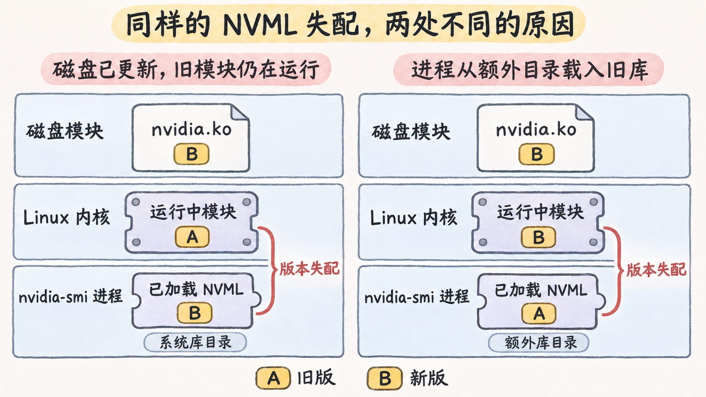

# 内核更新和库装载怎样让同一程序失效

在 Linux GPU 主机上，重启后所有用户都查不到卡，与仅有一个启动环境无法运行 CUDA 程序，往往需要从不同地方取证。宿主机侧先看正在运行的内核、模块和设备绑定。用户态侧再核对进程实际解析到的库，以及它与内核驱动能否配合。

## 对齐启动内核、磁盘模块和实际绑定

内核软件包安装完成后，正在运行的内核仍由当前启动决定。用 `uname -r` 取版本。NVIDIA 内核模块需要与目标内核匹配。以 Ubuntu 为例，预编译模块按内核 ABI 和风味分发，核对当前内核对应的 `linux-modules-nvidia-${DRIVER_BRANCH}${SERVER}-$(uname -r)` 包，其中 `DRIVER_BRANCH` 是驱动分支，`SERVER` 视打包类型为 `-server` 或空值。用 DKMS 时，安装钩子为目标内核构建模块，需要对应内核头文件和可用的构建环境。更新后先确认模块是否为**正在运行的内核**准备好。 [Ubuntu Server · NVIDIA drivers installation](https://ubuntu.com/server/docs/how-to/graphics/install-nvidia-drivers/) · [Linux kbuild · Building External Modules](https://docs.kernel.org/kbuild/modules.html)

```bash
uname -r
modinfo -k "$(uname -r)" nvidia
lsmod
lspci -nnk
journalctl -k -b
cat /proc/driver/nvidia/version
```

| 观测 | 怎样用它定位 |
| --- | --- |
| `modinfo` 的 `filename`、`version`、`vermagic`、`signer` | 检查当前内核的模块搜索树里能否找到文件，读出模块版本、内核构建标记和签名者。字段描述磁盘文件。 |
| `dkms status`（使用 DKMS 时） | 按当前内核版本检查该驱动的构建或安装记录，构建失败时结合 DKMS 日志核对头文件和编译错误。 |
| `lsmod`、`/proc/driver/nvidia/version` | 看模块当前是否已装入，以及运行中的 NVIDIA 模块版本。 |
| `lspci -nnk` 的 `Kernel driver in use` | 按 GPU 的 PCI BDF 确认设备由哪个驱动绑定。 |
| `journalctl -k -b` | 在本次启动的内核日志里找模块装载、版本、签名和设备绑定的记录。 |

如果 `modinfo` 找不到模块，先查包或 DKMS 是否为这一内核生成并安装了模块。如果文件存在但装不进去，看内核如何拒绝。启用了符号版本检查的内核可以拒绝导出符号版本不匹配的模块。若内核强制校验签名，模块还需要有效签名，签名公钥要被运行中的内核信任。在允许未签名模块的配置中，部分签名告警可以伴随模块成功加载。把 `signer`、内核拒绝记录与实际装载状态并读，才能区分签名告警、签名拒绝和构建失败。 [kmod · modinfo(8)](https://man7.org/linux/man-pages/man8/modinfo.8.html) · [Linux kbuild · Module Versioning](https://docs.kernel.org/kbuild/modules.html#module-versioning) · [Linux Kernel · Module Signing](https://docs.kernel.org/admin-guide/module-signing.html)

## 用户态库升级了，内核仍运行旧模块

用户态包可以先更新，当前内核仍使用之前装入的 NVIDIA 模块。新启动的 `nvidia-smi` 此时可能找到新版 NVML，到了与内核驱动交互才失败。Canonical 的 Ubuntu Server 文档给出了这种故障的公开示例。NVML 报驱动与库版本不匹配，内核的 `NVRM: API mismatch` 同时指明客户端版本 `570.172.08` 与内核模块版本 `570.158.01`。文档用软件包升级后的情况解释此例，公开片段未列出 GPU 型号、内核版本和采集日期。 [Ubuntu Server · Driver/library version mismatch](https://ubuntu.com/server/docs/how-to/graphics/install-nvidia-drivers/#driver-library-version-mismatch-error)

要判断现场是否与该例相同，把 `/proc/driver/nvidia/version`、`modinfo -F version nvidia` 与 `LD_DEBUG=libs,files nvidia-smi` 选中的 NVML 路径并读。若磁盘模块和实际 NVML 都来自同一新版驱动，而运行中的模块是旧版，证据支持更新时序问题。若运行中和磁盘模块一致，但进程从额外目录装入另一版 NVML，证据转向进程的库路径。版本错误本身只证明参与交互的组件不同，路径与运行状态才能区分两种原因。 [Ubuntu Server · NVIDIA drivers installation](https://ubuntu.com/server/docs/how-to/graphics/install-nvidia-drivers/) · [Linux man-pages · ld.so(8)](https://man7.org/linux/man-pages/man8/ld-linux.8.html)



**图 03-04-01**　A 代表旧版，B 代表新版。左列的磁盘模块和系统目录中的 NVML 已更新，内核仍运行旧模块。右列的内核已经运行新版模块，进程却从额外目录装入了旧版 NVML。

## 同一 ELF 在两个环境中可以装入不同的库

下面是 **教学配置**。应用放在 `/opt/probe/probe`，动态依赖名为 `libcudart.so.13`，其 `DT_RUNPATH` 是 `$ORIGIN/lib`。假设普通 glibc 进程，直接依赖名不带斜杠，未使用旧式 `DT_RPATH`，两个目录都有可被加载的同名文件。动态链接器先查 `LD_LIBRARY_PATH`，再查直接依赖的 `DT_RUNPATH`，之后是缓存和默认路径。`$ORIGIN` 在本例展开为可执行文件所在目录。 [Linux man-pages · ld.so(8)](https://man7.org/linux/man-pages/man8/ld-linux.8.html) · [NVIDIA HPC SDK · CUDA 13.2 Runtime Image Layers](https://catalog.ngc.nvidia.com/orgs/nvidia/-/containers/nvhpc/26.5-runtime-cuda13.2-ubuntu22.04/layers)

| 启动环境 | 预测的 `libcudart.so.13` 路径 |
| --- | --- |
| 未设 `LD_LIBRARY_PATH` | `/opt/probe/lib/libcudart.so.13` |
| `LD_LIBRARY_PATH=/opt/old-app/lib` | `/opt/old-app/lib/libcudart.so.13` |

```bash
readelf -d /opt/probe/probe
env -u LD_LIBRARY_PATH LD_DEBUG=libs,files /opt/probe/probe
env LD_LIBRARY_PATH=/opt/old-app/lib LD_DEBUG=libs,files /opt/probe/probe
```

`readelf -d` 能看到 `NEEDED`、`RUNPATH` 或 `RPATH`，说明 ELF 声明了什么。启动跟踪里，`trying file` 只表示候选路径。结合对象被加载的记录，例如 `calling init`，判断实际选中了什么，也可看到后续通过 `dlopen` 加载的驱动库。旧式 `DT_RPATH`、传递依赖及安全执行模式会改变这些查找规则。例如 `DT_RUNPATH` 只作用于直接依赖，传递依赖需要检查声明它的对象。 [Linux man-pages · ld.so(8)](https://man7.org/linux/man-pages/man8/ld-linux.8.html) · [dlopen(3)](https://man7.org/linux/man-pages/man3/dlopen.3.html)

首次报错出现在哪一步，决定接下来该取什么证据。

- **共享库未找到。** 动态链接器报告无法打开所需的库。核对报错中的名称、依赖声明、搜索目录和实际文件。
- **找到库但所需符号不满足。** 加载时或首次绑定时出现符号或版本错误。核对报错里的符号及其版本，再检查提供它的实际库文件。
- **驱动库已加载，初始化仍失败。** 例如 NVML 报版本失配。核对同次启动的内核日志及运行中的模块版本，再把日志的客户端版本对应到实际装入的驱动库。
