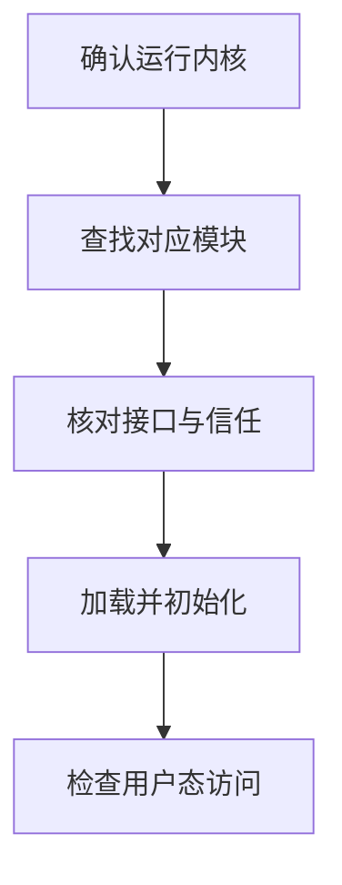

# 内核更新与库装载为何使 GPU 失效

## 先区分正在使用、磁盘可用与安装记录

驱动包安装成功不代表当前内核已经加载了它。尤其是升级之后，系统可能同时存在三种不同的状态：包管理器记录的新版本、磁盘上为某内核准备的模块，以及仍在内存中服务的旧模块。

| 证据 | 对应状态 |
| --- | --- |
| `uname -r` | 本次启动实际运行的 Linux 内核 |
| `modinfo -k <内核版本> nvidia` | 为指定内核查到的模块文件及元数据；不证明它已经加载 |
| `lsmod` | 当前内核已加载的模块 |
| `/proc/driver/nvidia/version` | 当前已加载的 NVIDIA 核心模块版本等信息 |
| `dkms status` | DKMS 管理的模块在各内核上的构建/安装记录；不涵盖所有预编译包方案 |
| `/proc/<PID>/maps`、装载调试记录 | 该进程实际使用的用户态共享库，而非目录中的候选文件 |

NVIDIA 内核模块需要适合当前内核的接口。安装时可以本机构建，也可以使用适合发行版内核的预编译包；**DKMS（Dynamic Kernel Module Support）**用于在内核变化后管理外部模块重建。重建需要相应内核头文件、编译工具及受支持的组合。DKMS 被安装或启用，不等于每次构建都会成功。相关机制见 [R570 Linux README：Installing the Kernel Interface、Registering the NVIDIA Kernel Module with DKMS](https://download.nvidia.com/XFree86/Linux-x86_64/570.124.04/README/installdriver.html)。

下图是**模块可用性检查顺序**，箭头表示前置满足后继续检查的关系，不是硬件数据路径：



## 材料一：内核变了，新内核没有模块

以下为**自拟、删节的故障快照**。它独立于健康基线：节点从 `5.15.0-107-generic` 启动到 `5.15.0-108-generic`，驱动发行版本不变。空的模块筛选结果用正文说明，未伪造成错误码：

```bash
uname -r
modinfo -k 5.15.0-108-generic nvidia
dkms status
lsmod | grep '^nvidia'
```

```text
uname：
5.15.0-108-generic

modinfo：
modinfo: ERROR: Module nvidia not found.

dkms status 相关行：
nvidia/570.124.06, 5.15.0-107-generic, x86_64: installed
```

最后一条命令没有匹配行。材料支持的直接结论是：当前运行 `.108` 内核，模块查找没有找到该内核的 `nvidia`，DKMS 只展示 `.107` 的已安装记录，当前也没有已加载的 NVIDIA 模块。旧内核有记录不能支撑新内核可用。

下一步是查看 `.108` 的模块包或 DKMS 构建记录：没有触发构建、缺少头文件、编译失败，还是选择了另一种预编译包方案？本材料尚未给出构建日志，所以不能直接认定缺头文件。修复对象已经能确定为当前内核的模块交付，而非应用的 Runtime。完成修复后，要重新核对模块查找、实际加载与应用探针；仅把状态改成 `installed` 仍少了运行证据。

## 材料二：模块存在，但信任检查拒绝加载

模块文件存在还可能过不了加载检查。启用强制签名验证的内核只接受能够用其信任密钥验证的模块；Secure Boot 下的发行版还会将固件信任、引导链和模块签名策略连接起来。**有签名**与**签名者受到当前内核信任**不同，`modinfo` 显示某个 signer 字符串不足以证明可加载。签名检查规则见 [Linux Kernel v6.12：Kernel module signing facility](https://www.kernel.org/doc/html/v6.12/admin-guide/module-signing.html)；具体发行版操作应按对应驱动与系统说明。

下面是另一次**独立、自拟的教学记录**。题设该内核执行强制签名策略，模块接口已匹配；`modprobe` 片段是管理员先前尝试加载时留下的记录，本文未要求读者执行加载操作：

```text
module file：/lib/modules/5.15.0-108-generic/updates/dkms/nvidia.ko
modinfo signer：Lab GPU Modules
管理员的 modprobe 记录：
modprobe: ERROR: could not insert 'nvidia': Key was rejected by service
同一时刻内核日志的人工摘要：模块签名密钥不在当前信任集合，加载被拒绝
```

在题设与日志共同支持下，这次应处理签名与信任链，而非重装 `libcudart`。可选修复需要遵循发行版的模块签名、密钥登记或受信任模块包流程，并在加载后复核；本章不以关闭验证作为通用步骤。日志中只出现“module verification failed”也可能表示允许加载但标记内核污染，必须结合是否强制验证及实际加载结果阅读，不能只按关键词定性。

## 材料三：更新了用户态库，内存里仍是旧驱动

下面变更与前两例独立：内核回到健康基线 `.107`，已加载模块为 `570.124.06`；随后磁盘用户态驱动更新为 `570.133.07`，旧模块仍在服务。不使用兼容包。以下为**自拟删节输出和进程装载记录**：

```text
cat /proc/driver/nvidia/version 的相关字段：
NVRM version: NVIDIA UNIX x86_64 Kernel Module 570.124.06

该次 nvidia-smi 实际选择的库文件（装载记录整理）：
/usr/lib/x86_64-linux-gnu/libnvidia-ml.so.570.133.07

nvidia-smi 的错误片段：
Failed to initialize NVML: Driver/library version mismatch
NVML library version: 570.133
```

当前失败在 NVML 初始化。结合加载模块 `.124.06` 与实际 NVML 文件 `.133.07`，可定位驱动用户态/内核态未配套。它不是“CUDA Toolkit 比驱动新”的同一问题，也不是一个 `libcudart` 的装载错误。正常方案应恢复配套组件，并在安排好的变更窗口切换实际加载状态；有活动作业时不能随手卸载模块或重启。

这一例还解释了为什么只查 `modinfo` 可能误导：磁盘上也许已经有 `.133.07` 模块，内核却仍加载 `.124.06`。若用户态路径还混入另一份库，即使重启也未必解决全部问题，必须复核新进程实际选择的路径。下一例将路径本身放进材料。

## 材料四：驱动健康，应用先选错了库

回到完整健康基线。只有应用启动器增加了一个目录：`LD_LIBRARY_PATH=/opt/old-cuda/lib64`。本例无 `DT_RPATH`，只有第二篇的 `DT_RUNPATH=$ORIGIN/../lib`，也不处于安全执行模式。下面是**自拟的路径解析记录与文件清单**；不是原样的 `LD_DEBUG` 输出：

```text
应用请求：libcudart.so.12
LD_LIBRARY_PATH 候选：/opt/old-cuda/lib64/libcudart.so.12  [被选中]
RUNPATH 候选：/opt/apps/vector/lib/libcudart.so.12         [未采用]

文件清单：
/opt/old-cuda/lib64/libcudart.so.12 -> libcudart.so.12.0.146
/opt/apps/vector/lib/libcudart.so.12 -> libcudart.so.12.8.90
```

根据给定搜索条件，环境路径先于 `RUNPATH`，所以实际装载的是旧 Runtime。材料已足以证明应用没有使用发布包指定的库；但没有给出缺失符号或调用失败，**不能仅凭不同版本就断定应用必然失败**。CUDA 同主版本库还可能有兼容路径，具体要看依赖和使用方式。

修订启动器环境、让本应用解析到约定库后，应重新记录实际路径并运行同样探针。在得到前后对照之前，“已经发现偏离交付清单”和“已经证明故障唯一原因”是不同结论。若启动时直接报告 `libcudart.so.12: cannot open shared object file`，优先检查所请求库是否交付、搜索路径是否正确；若是 `undefined symbol`，再对照请求方、提供方和实际装载版本分析。

Toolkit 中还可存在供链接使用的 driver stub。stub 用于构建时满足驱动符号引用，不是可用于实际控制 GPU 的驱动实现；不应把 Toolkit 的 `lib64/stubs` 目录当作通用运行库路径。判断此类问题要看实际库路径与来源，不能只看到文件名 `libcuda.so` 就认为驱动已经存在。

## 把错误放回已经建立的阶段

| 首次观察到的现象 | 已经能缩小到的范围 | 值得补的证据 |
| --- | --- | --- |
| `lspci` 有 GPU，管理工具无法连接驱动 | PCIe 枚举之后，驱动初始化或访问路径 | 当前内核、模块加载、内核日志、设备绑定与权限 |
| `Failed to initialize NVML: Driver/library version mismatch` | 管理路径的驱动组件配套 | 已加载核心模块版本、该进程实际 NVML 路径与版本 |
| `libcudart.so.12` 无法装载 | 主机共享库交付与搜索 | `DT_NEEDED`、搜索条件、候选与实际文件 |
| `cudaErrorInsufficientDriver` | Runtime 判断驱动支持不足等初始化问题 | 实际 Runtime、`libcuda`、驱动版本和兼容路径 |
| `no kernel image is available for execution on the device` | 当前 Kernel 没有可用设备代码等问题 | GPU 计算能力、主程序/库/插件的 cubin/PTX |
| `unsupported PTX version` 或 unsupported toolchain 相关报错 | PTX JIT 与工具链能力 | PTX 来源、目标与 ISA 版本、实际 JIT 驱动组件 |

错误文本和错误名可能来自不同 API 或上层框架包装，不能把表中一行当作唯一根因字典。Runtime 中的 `cudaErrorInsufficientDriver`、`cudaErrorNoKernelImageForDevice`、`cudaErrorUnsupportedPtxVersion` 等定义见 [CUDA Runtime 12.8.1：Data types 中的 cudaError](https://docs.nvidia.com/cuda/archive/12.8.1/cuda-runtime-api/group__CUDART__TYPES.html)；Driver API 对应分类见 [CUresult 定义](https://docs.nvidia.com/cuda/archive/12.8.1/cuda-driver-api/group__CUDA__TYPES.html)。将错误与前面已成功的阶段、库来源和设备代码联系起来，才形成定位结论。

下一篇把这些判断合成一份交付评审与练习。读者已有足够材料，可以同时回答“依赖是否合理”和“现有记录实际证明了什么”。

[上一篇：兼容性判断](03_从版本号与设备代码判断兼容性.md) · [下一篇：应用交付与故障材料](05_读懂一份应用交付与故障材料.md)
