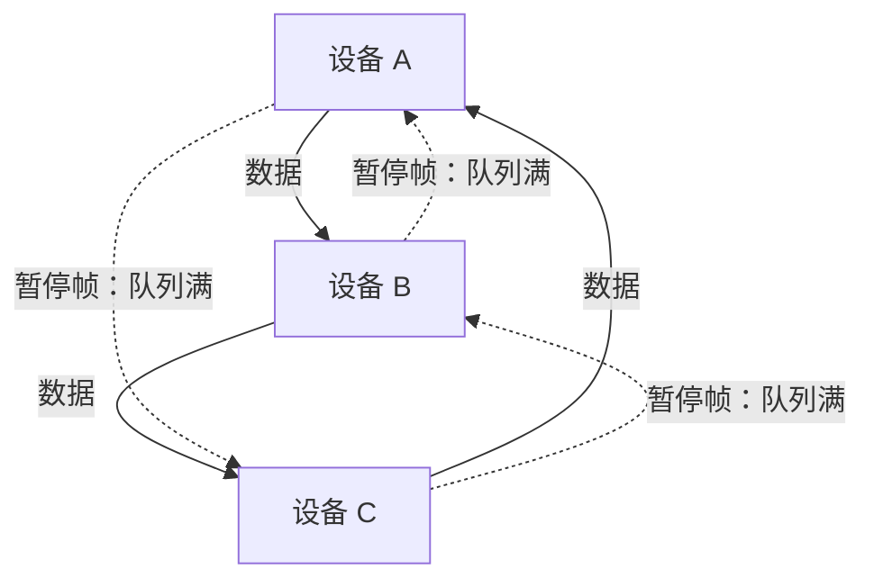

---
tags:
  - AI-Infra
  - RDMA
  - RoCE
  - 无损网络
  - 原理
created: 2026-09-24
---

# PFC 与 ECN 的配合

一次微突发（一段短时间内的突发流量）从高速端口进入低速端口时，进入的量会在出口队列上堆积。假设入口侧瞬时速率远高于出口链路速率，那么出口队列的长度在极短的时间内上升：队列先越过低门限，此时交换机的显式拥塞通知（Explicit Congestion Notification，ECN）机制开始给报文打标记，报文继续被转发出去，只不过打上了「路径正在拥塞」的标记；若堆积继续，队列越过共享缓冲的可用水位，交换机就没有空间再收，只能向上一跳发出优先级流控（Priority Flow Control，PFC，IEEE 802.1Qbb）的暂停帧（PAUSE）要求它停发。上一跳收到暂停帧后停止发送该优先级的流量，于是它自己的出口队列也开始堆积，进而在它自己的上一跳上重复同样的过程。两跳之间的一次微突发，就这样变成了沿链路逐跳向上游扩散的停发。

把一次具体的微突发按水位走完一遍（速率与门限位置仅示意，门限的名称与取值以交换机侧文档为准）：

| 阶段 | 出口队列水位 | 交换机的动作 | 主机侧能看到的计数变化 |
| --- | --- | --- | --- |
| 1 突发到达 | 从低位快速上升 | 正常转发，无标记、无停发 | 无异常项增长 |
| 2 越过标记门限 | 超过开始打标的门限，尚未到缓冲极限 | 按概率给报文打上拥塞标记后继续转发 | 厂商扩展里的拥塞标记类计数开始增长 |
| 3 标记生效 | 停止上升或缓慢回落 | 发送端已降速，进入队列的量降到离开的量之下 | 标记类计数增长，而暂停类计数基本不涨 |
| 4 越过共享缓冲水位 | 标记未能止住堆积，缓冲将尽 | 向上一跳发出该优先级的暂停帧 | 按优先级的暂停类计数开始增长 |

健康的时间线停在第 3 阶段；第 4 阶段反复出现，说明这条链路正在用停发承担拥塞。

这条时间线里，标记出现在缓存将满之前，反压出现在缓存装满之后，两者的顺序不是实现细节，而是「止住一次突发要用多少代价」的分界：标记只让发送端降速，暂停帧则直接让上游停发，被停发的队列上所有流量一起停。因此健康的水位是标记计数在涨而暂停计数几乎不涨；反之，若暂停计数在涨而标记计数不涨，说明这条链路上正在用停发承担全部拥塞。

## 标记与反压的分工与代价

| 机制 | 它作用在哪一段 | 触发条件 | 代价落在哪里 | 判据 |
| --- | --- | --- | --- | --- |
| ECN 标记 | 端到端：交换机在出口队列上按门限给报文打标，接收端据此回送拥塞通知包（Congestion Notification Packet，CNP），发送端降速 | 队列长度越过出口队列的门限 | 发送端速率下降，吞吐的恢复要靠加性增速缓慢爬升 | 标记类计数有增长而暂停类计数基本不涨 |
| PFC 暂停帧 | 逐跳：本端向上游发出暂停帧，要求它在一段时间内停发该优先级的流量 | 队列越过共享缓冲的可用水位 | 上游该优先级上的全部流量一起停，且停发沿链路继续向上游传播 | 按优先级的暂停类计数出现增长 |

两条路线的代价性质不同：标记让速率下降，代价是吞吐；反压让发送停止，代价是时延与队列上的全部流量。因此把两者配合起来使用，才能在缓存被占满之前就把拥塞信息传到发送端。CNP 的生成点在接收端网卡的硬件里，并且可以走低延迟路径返回发送端，因此发送端得到降速指令的延迟并不取决于处理器的软件路径。

## PFC 必须在端点与路径上每一台交换机上使能

PFC 是逐跳机制，官方对使能范围的表述是必须在本端、对端以及流量路径上的每一台交换机上使能（must be enabled on all endpoints and switches in the flow path）。由于逐跳停发依赖每一跳都能理解并执行暂停帧，任何一跳没有使能，这一跳就不会参与反压，整条路径的无损前提随之不成立。

只配一端或只配路径中的一台设备时，在压力不足的场景下看不出问题：队列从未越过水位，既没有暂停帧也没有丢包。一旦出现微突发，缺口就暴露为某一跳上的丢包，而这种丢包在主机侧表现为超时与重传类计数增长，与「配置没生效」在现象上并不相同。因此在交付时，PFC 的使能范围只能按「路径上每一台交换机」逐台核对，而不能按「两端都配了」结案。交换机侧的命令行形态与配置取值方式不在这条主机侧观测线上。

本端的使能状态可以从只读观测确认，以下在生产节点上也可以做：

```bash
ethtool -S <if> | grep -E 'prio[0-7]_(rx|tx)_pause'   # 验证：本机在哪些优先级上出现过反压，未使能 PFC 的优先级不会出现这些项
```

使能动作本身按优先级逐位指定，命令形态是 `mlnx_qos -i <ethX> --pfc 0/1×8` 这类写法，例如只打开第 4 个优先级时写作 `0,0,0,0,1,0,0,0`；分隔符与取值格式以本机 `mlnx_qos` 的帮助输出为准。这条命令属破坏性动作，只在实验节点上做：它的影响范围是同一台机器上经过这个网络设备的全部作业，回滚路径是在同一次操作里把使能位改回改动前的取值并复测基线。

```bash
mlnx_qos -i <ethX> --pfc 0,0,0,0,1,0,0,0      # 只在实验节点：改前备份当前取值，回滚即把原取值写回
```

这些计数器的单位是次数，属累计值，判据是把两次读数的差值按优先级分别比较；它们必须与交换机侧的队列配置同看，看到某个优先级的计数在涨，转向的是核对流量是否真的落在期望的优先级上，而不是先扩带宽。贴出的字段名与数值仅示意、不代表你的环境，端口的按优先级反压计数只有在使能了该优先级的 PFC 之后才可见，且与机型、驱动四元组、网卡固件强相关。

## 反压会逐跳传播，因此受益范围必须与使能范围一致

反压的传播方向是逆着数据流向上游的，因此一个队列被停发，会连带停发这个队列上承载的全部流量，而这些流量未必是造成拥塞的那一条。这种现象是头阻塞（Head-of-Line Blocking，HOL）：被停住的队列里，排在造成拥塞的流量后面的报文在这一段时间内无法发出，即使它的下一跳完全空闲。

使能 PFC 的优先级因此必须只覆盖真正需要无损的流量。若把无损优先级开在承载大量无关流量的队列上，等于让这些无关流量共同承担停摆风险：一旦拥塞发生，停发范围会覆盖这个队列上的所有流量，而恢复时间取决于发送端补发与缓存排空的速度。反过来说，若需要无损的流量没有被映射到使能了 PFC 的优先级上，它就在一条会丢包的队列上运行，无损的前提同样不成立。

## 反压沿链路级联会形成 PFC 风暴

若反压沿链路继续向上游传播，并且上游设备之间存在相互依赖的关系，停发状态就可能形成环状等待：A 等 B 排空队列才恢复发送，而 B 又在等 A 恢复发送。这种状态在本端表现为该优先级长时间没有任何发送进展，而链路上的暂停帧持续出现，即 PFC 风暴。它的代价高于丢包：丢包至少会让重传机制介入并最终报错，而环状等待下连接可能既不报错也没有进展——协议层的重传计时器不会因此到期，也等不到一个带缺口的序号，因此它的现象是「不报错但不动」。要从这种状态里出来，靠的是停滞防护在超时后主动放弃停发，或者人工干预把链路中的一环拆开；连接本身不会自己恢复。

环状等待的结构画出来是这样的：数据沿一个方向流，暂停帧沿反方向追，每个设备都在等下游排空队列，而下游又在等它自己的下游：



判断是否进入这种状态，看的不是单个计数器的绝对值，而是暂停类计数在多个优先级、多个端口上同时持续增长，同时应用侧没有进展、也没有错误返回。此时能缩小范围的动作是逐跳确认哪一段的反压是被别处引来的，而不是在本端反复调整队列配置。

## 停滞防护：反压机制在极端情况下会自己放弃无损

PFC 停滞防护（stall prevention）是避免反压长时间停不下来的一道措施，它有默认与自动两种模式，由 `/sys/class/net/<if>/settings/pfc_stall_prevention` 这个开关选择，可取值为 `default` 或 `auto`。默认模式下的停滞超时是 8 秒，自动模式把停滞超时设为 100 毫秒。超过警戒水位时，`tx_pause_storm_warning_events` 持续增长；超过停滞超时之后，网卡会停止发送暂停帧，并让 `tx_pause_storm_error_events` 增长。

这个行为解释了一个反直觉现象：作为无损机制的提供方，网卡在最极端的情况下会自己放弃无损。原因是持续发送暂停帧会让上游长时间停发，而持续停发本身可能造成更大范围的停滞；两害相权之下，固件选择恢复发送并接受丢包。因此一旦发送端放弃暂停帧，链路上就只剩丢包一条路，此时该优先级已经不再无损。

| 计数与开关 | 是什么 | 单位 | 判据 | 与谁同看 | 转向哪一步 |
| --- | --- | --- | --- | --- | --- |
| `tx_pause_storm_warning_events` | 反压状态超过警戒水位的累计次数 | 累计次数 | 取两次读数的差值；有增长说明本端长时间在向上游发暂停帧 | 与按优先级的 `tx_pause` 计数、与开关取值同看 | 转向核对上游速率与出口队列水位，而不是只在本端加缓存 |
| `tx_pause_storm_error_events` | 反压超过停滞超时、网卡已停止发送暂停帧的累计次数 | 累计次数 | 有增长即说明无损已经失效，链路只会丢包 | 与超时、重传类计数同看 | 转向定位造成持续反压的源头，并复核使能范围 |
| `pfc_stall_prevention` | 停滞防护的模式开关，不是计数器 | 无单位，取值为 `default` 或 `auto` | 它决定停滞超时是 8 秒还是 100 毫秒，因此是解释上面两项计数增长快慢的前提 | 与上面两项 storm 计数同看 | 若 error 级计数在增长，先确认当前取值再判断反压为何没有止住 |

这个开关的修改属破坏性动作，只在实验节点上做，因为它改变该端口在压力下是否放弃无损；影响范围是同一台机器上经过这个网络设备的全部作业，回滚路径是在同一次操作里把原值写回并复测基线：

```bash
cat /sys/class/net/<if>/settings/pfc_stall_prevention              # 验证：当前取值，生产节点上也可以做
echo auto > /sys/class/net/<if>/settings/pfc_stall_prevention      # 只在实验节点：改前记录原值，回滚即把原值写回
```

因此停滞防护不是治疗手段，而是逃生机制：它用「停发暂停帧、接受丢包」换取链路继续推进，代价是该优先级的无损在这一刻失效。看到 error 级计数增长，只说明这套逃生机制已经动作过，接下来要做的是定位持续反压的来源，而不是依靠它维持无损。

## 反压计数看方向

按优先级的暂停类计数必须按方向分开读，两个方向回答的是不同的问题。这里的「收/发」指的是暂停帧这个报文自身的进出方向，不是数据的方向：发方向的计数表示本端发出了暂停帧，等于本端在对链路对端喊「先别发了」；收方向的计数表示本端收到了暂停帧，等于本端的发送被对端叫停。暂停帧由接收侧的压力触发——一个端口的接收缓冲快满时，它才向正在给它灌数据的对端发出暂停。因此两个方向分别指向两端各自的接收侧，而不是某一端的出口队列。把两者混读，会把对端的问题算到自己头上，或者反过来。

| 计数方向 | 含义 | 单位 | 判据 | 与谁同看 | 转向哪一步 |
| --- | --- | --- | --- | --- | --- |
| 收方向（`prio4_rx_pause` 一类） | 本端收到针对该优先级的暂停帧，本端的发送被对端叫停 | 累计次数 | 取差值的增长率；持续增长说明对端的接收侧在被灌满，本端发送快过它排空 | 与该优先级的发方向计数、与对端的接收侧配置同看 | 转向核对对端的接收侧排空能力与本端发送速率，而不是本端接收侧 |
| 发方向（`prio4_tx_pause` 一类） | 本端针对该优先级发出暂停帧，要求对端停发 | 累计次数 | 取差值的增长率；持续增长说明本端接收方向进来得多、排空得慢 | 与拥塞标记类计数、与对端发送速率同看 | 转向核对本端接收侧的排空能力与对端发送速率，而不是本端出口带宽 |
| 反压状态切换（`prio4_rx_pause_transition` 一类） | 该优先级进入或退出反压状态的累计切换次数，收发两个方向各有一组 | 累计次数 | 切换频繁说明反压是间歇性的而非持续的 | 与两个方向的暂停计数同看 | 转向核对微突发是否反复出现 |

上表的字段名以现场 `ethtool -S` 输出为准，示例中出现的优先级编号仅示意，不同部署使用的优先级编号不同。此外，不带优先级编号的全局暂停计数（`rx_pause` 与 `tx_pause` 一类）在语义上对应全局流控，它的读数与按优先级的反压不在同一个口径上，两者不能互相替代。

## 标记与暂停同时出现时怎么读

一次拥塞的完整证据链是：交换机出口队列水位上升导致 ECN 标记，接收端网卡生成并回送 CNP，发送端降速；只有在队列继续上升时，才出现暂停帧，进而在上游引起新的堆积。因此读到「标记在涨」时，结论是拥塞控制正在工作；读到「暂停在涨」时，结论是缓存已经不足以吸收突发。若两者同时快速增长，则说明反压正在承担全部拥塞；判断哪一方在主导，比较的是同一段时间内标记计数与暂停计数各自的增长率，而不是任一项的绝对值，此时即使吞吐尚未明显下降，也应当转向核对出口带宽与流量分布。

全局流控（global pause）出于性能原因不被推荐，官方表述是它在性能上通常是不希望出现的选择（normally undesirable, for performance reasons）；原因是全局反压不分优先级，一旦触发会让链路上所有流量停发，其影响范围比按优先级的反压高出一个层级。

## 关于这几个量常见的四种混读

一是把反压计数不为零当成故障，忽略它是累计值、要用增长率判断。二是把两个方向的暂停计数混读，从而判断错责任方。三是把停滞防护当成无损的保障，忽略它一旦触发就已经是丢包。四是把「配了 PFC」当成无损前提已经成立，忽略使能范围必须覆盖路径上的每一台交换机。

**第一反应不要做什么**：不要只在两端使能 PFC 就认为无损已经成立；不要在暂停计数增长时先扩带宽而不看出口队列与流量分布；不要把停滞防护的告警级计数当成可忽略的噪声。

## 参考文档

- NVIDIA DOCA 文档中流控一章：PFC 使能范围、按优先级的反压计数与可见条件、停滞防护的两种模式与两个 storm 计数器，以及全局流控在性能上的取舍。
- NVIDIA DOCA 文档中拥塞控制基础设施一章：CNP 的生成点在接收端网卡硬件内，以及它可以走低延迟路径返回发送端。
- IEEE 802.1Qbb 标准中关于按优先级暂停帧语义的部分：优先级、暂停时间与逐跳反压的行为定义。
