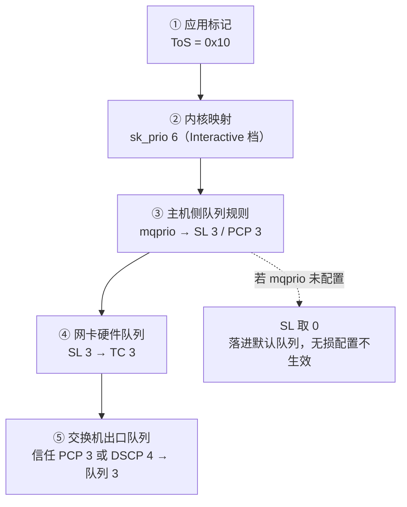

---
tags:
  - AI-Infra
  - RDMA
  - RoCE
  - 无损网络
  - 优先级映射
  - DSCP
  - 原理
created: 2026-09-24
---

# 标记到队列的五段映射链

一个报文携带的优先级标记，要真正决定它排进交换机的哪个队列，靠的不是某一处的配置，而是一连串五段的接力：应用把标记写上报文，内核把它换算成优先级，主机侧的队列规则把它映射成服务等级，网卡把它落进硬件队列，最后交换机按自己的信任模式把它放进出口队列。五段各有一个负责人，任何一段把标记改写成别的值，后面所有的无损配置——反压、标记门限、拥塞控制——都对这条流量不生效；而这种不生效在压力不足时完全不暴露，它只在微突发到达时以「无损队列里出现丢包」的形态出现。因此「标记没生效」不能作为结论存在，它必须落到具体哪一段，否则既无法验收，也无法回滚。

## 五段各自的负责人

| 段 | 这一段在做什么 | 由谁决定 | 现场含义 |
| --- | --- | --- | --- |
| 一 应用标记 | 应用在建链或发送时设置 ToS（Type of Service，服务类型）或 DSCP（Differentiated Services Code Point，差分服务代码点） | 应用代码，或 RDMA-CM 在 configfs 里的默认 ToS 项 | 应用不显式设置时继承默认值，因此「标记是谁设的」要回到应用与默认项确认 |
| 二 内核映射 | 内核把 ToS 映射成套接字优先级（`sk_prio`） | 内核的映射表 | 这一步决定流量属于哪一类优先级；映射表在较新内核上按 RFC 1349 的服务位解释 |
| 三 优先级到服务等级 | `sk_prio` 映射到服务等级（Service Level，SL）与 VLAN 优先级（PCP） | 主机侧的 `tc mqprio` 队列规则，或 VLAN 接口的出向映射 | 若 `mqprio` 未配置且不在 VLAN 接口上，SL 默认取 0，流量落进默认队列 |
| 四 硬件队列 | 网卡把 SL 落到硬件流量类别（Traffic Class，TC） | 网卡驱动与固件 | 主机侧通常没有逐包可读的记录，只能用队列相关的计数间接确认 |
| 五 交换机队列 | 交换机按 DSCP 或 PCP 映射到自己的出口队列 | 交换机侧配置，包含信任模式 | 这一段不属于主机侧可改的范围，属于与网络团队对账的项目 |

第一段是整条链上唯一由应用决定的一段，也是最容易被漏掉的一段：裸 verbs 程序不在代码里设置优先级时会继承网卡与 RDMA-CM 的默认值；RDMA-CM 应用可以走 configfs 里的默认 ToS 项，而应用自己显式设置的 ToS 会覆盖该默认项。因此「训练进程的流量跑在默认队列，而反压却开在另一个优先级上」这类不一致，来源就在这一段与第三段的组合上。

以一个具体的配置为例，把五段走完一遍（第三段与第五段的映射取值仅示意，实际以现场配置为准）：应用把 ToS 设为 `0x10`，它落在 Interactive 档，内核映射出 `sk_prio` 6；主机侧的 `mqprio` 规则把 `sk_prio` 6 映射到服务等级 3 与 VLAN 优先级 3；网卡把服务等级 3 落到硬件流量类别 3；报文出线时，若交换机按二层优先级信任，它看到的是 VLAN 优先级 3，若按三层服务等级信任，它看到的是 DSCP 4（ToS 取值 16 除以 4 的换算结果）；交换机据此把它放进出口队列 3。若队列 3 正是使能了反压与标记门限的那个队列，这条链就闭合了；若第三段实际把它映射到了服务等级 0，它会落进默认队列，后面两段的无损配置对它都不生效——而这一点在低负载时看不出来。

同一次走查画成图是这样的（第三段与第五段的映射取值仅示意）：



### ToS 到 sk_prio 的映射只有四档

第二段的映射表在较新内核上按 RFC 1349 的服务位解释 ToS，因此取值只有四档，而不是每个 DSCP 值各对应一档。这一点决定了应用把 ToS 设置成相邻的两个值时，可能落进完全相同的优先级。

| ToS 取值 | 映射到的 `sk_prio` | 该档的名称 |
| --- | --- | --- |
| 0x0–0x6 | 0 | Best Effort |
| 0x8–0xE | 2 | Bulk Data |
| 0x10–0x16 | 6 | Interactive |
| 0x18–0x1E | 4 | Interactive Bulk |

因此若应用设置的 ToS 落在 0x0 到 0x6 这一段，无论它本意属于哪一类流量，映射结果都是 0，也就是默认优先级；此时服务等级与队列也就无从区分。反之，若应用确实要把两类流量分开，就要把 ToS 分别设在不同的档位区间内，并在交换机侧按同一档位建立对应的队列。

### DSCP 与 ToS 的换算

DSCP 与 ToS 的关系是左移 2 位：要设置 DSCP 取值为 X，ToS 就要填 X 乘 4。官方给出的例子是 DSCP 24 对应 ToS 96。由于应用接口给的是 ToS，而交换机侧配置的常常是 DSCP，两处对照之前必须完成这一步换算，否则会得出「主机侧与交换机侧配置不一致」这个并不成立的结论。

主机侧这一项可以只读确认：

```bash
# 验证：端口级的全局强制 DSCP 取值；负值表示该特性关闭，有效范围 0–255，实际取值以现场输出为准
cat /sys/class/infiniband/<dev>/tc/<port>/traffic_class
```

这一步是只读观测，在生产节点上也可以做。它的判据是「是否存在非负的全局值」，而不是某个具体数字看起来是否合理。

### 强制 DSCP 的两种用法

强制 DSCP（force DSCP）有全局与按规则两种用法，两者的优先关系是确定的。

全局写法是把取值写进端口的 `traffic_class` 文件：负值表示关闭该特性，有效范围是 0 到 255。按规则写法是一个字符串，形态如 `tclass=16,src_ip=1.1.1.2,dst_ip=1.1.1.0/24`。两者的优先关系是：全局值存在时对所有队列对生效；没有全局值时才看匹配源地址与目的地址的规则。

由此得到「这条队列对的标记是谁设的」的确定查法：先看该文件里有没有全局值。若存在全局值，应用侧设置的 ToS 在包出网卡时会被这个值覆盖，此时去应用代码里找原因不会有结果。写入该文件属于破坏性动作，影响同一台机器上的全部作业，只在实验节点执行，回滚路径是改动前记录原值、改动后按原值写回。

### 主机侧与交换机侧的分工

第三段在主机侧，第四段在驱动与固件里，第五段在交换机侧。因此主机侧能够确认到「流量被放进了哪个硬件队列」，而交换机侧的出口队列门限与队列水位必须找网络团队对账；交换机侧的门限取值与命令行不属于主机侧负责的内容，主机侧只能提供「标记是否在涨、反压是否在涨」这一侧的证据。检查 `mqprio` 是否存在同样属于只读观测，在生产节点上也可以做：

```bash
# 验证：本设备上是否存在 mqprio 队列规则，也就是 sk_prio 到服务等级的映射是否被配置过
tc qdisc show dev <if>
```

若输出中没有 `mqprio` 规则，且该接口不是 VLAN 接口，那么按第三段的规则，SL 取 0，流量进入默认队列；此时应先补齐这一段的映射，再谈反压与拥塞标记，而不是先去调拥塞参数。

## 字段怎么读

| 字段 | 是什么与单位 | 判据 | 与谁同看 | 看到它转向哪一步 |
| --- | --- | --- | --- | --- |
| `traffic_class` 的全局值 | 端口级的全局强制 DSCP 取值，无量纲整数，负值表示特性关闭，有效范围 0–255 | 是否存在非负的全局值；存在即对所有队列对生效，不存在才看地址匹配规则 | 与应用的 ToS 设置、`tc qdisc show dev <if>` 的映射规则同看 | 若存在全局值，先决定是否保留它，再谈映射与队列；不要先去查应用代码 |
| 应用设置的 ToS | 应用交给内核的服务类型，无量纲的 8 位字段 | 它落在四档中的哪一档，由此决定 `sk_prio` | 与 `mqprio` 的映射配置、交换机侧的信任模式同看 | 若它落在 0 档，说明标记没有起到分流作用，先改应用侧的取值 |
| `mqprio` 队列规则 | 主机侧 `sk_prio` 到服务等级与 VLAN 优先级的映射配置，属于配置状态而非累计量 | 是否配置了 `mqprio`，以及该接口是否为 VLAN 接口 | 与硬件流量类别、交换机侧队列映射同看 | 若没有配置且不在 VLAN 接口上，SL 取 0，先补这一段映射 |

表里的三项都是配置状态，读一次即可判断当下处于哪一种；它们回答的是「标记此刻被设成什么、被映射到哪一段」，不回答队列此刻有多满——后者是交换机侧的瞬时量，需要与网络团队对账。

**第一反应不要做什么**：不要在「标记没生效」时先去改应用代码，也不要先去调交换机侧的门限。先看 `traffic_class` 有没有全局强制值，再按五段逐段确认标记在哪一段被改写成别的值；五段没有走完之前，改任何一段都可能被另一段覆盖。

## 参考文档

- NVIDIA DOCA 文档中 RoCE 一章的服务类型一节：ToS 到 Linux 优先级的映射表、优先级到服务等级与 VLAN 优先级的映射方式、DSCP 与 ToS 的换算关系，以及强制 DSCP 的全局与按规则两种用法与其优先关系。