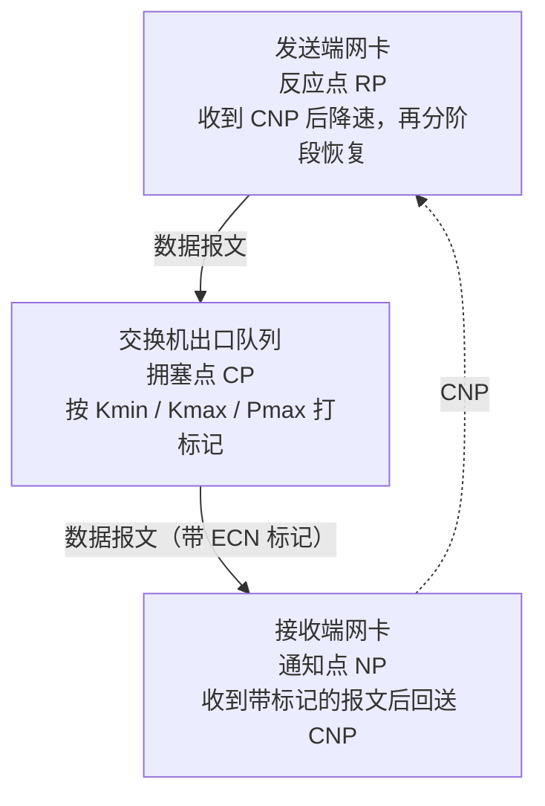

---
tags:
  - AI-Infra
  - RDMA
  - RoCE
  - 无损网络
  - 拥塞控制
  - DCQCN
  - 原理
created: 2026-09-24
---

# 两条拥塞控制路线

交换机上的 ECN 标记规则已经按无损优先级配置完成，主机侧的反压也已经使能，压力一上来却出现发送端不降速：出口队列开始被填满，端口的标记类计数在增长，发送端的发送速率却不随之下降。这种处境下的第一句结论常被写成「拥塞控制没有生效」，而它并不能指向任何一个可查的对象，因为可能的断点落在两个完全不同的位置上：一是这批网卡的固件走的不是「交换机打标记、端点按标记降速」这条路线，二是这批流量确实被标记了，但标记所对应的队列与它实际排队的队列不是同一个。

这两处断点的判据不同，处置顺序也不同。第一处是路线本身：这批网卡是否在用「交换机打标记、端点按标记降速」这条路。第二处是标记的落点：这条连接的标记由谁设置、最终落进哪个队列，判据是标记经过的每一段是否都指向同一个使能了无损的队列，五段中没有一段被改写。本篇展开第一处——两条原生算法各自需要的前提，以及哪一条在生效由固件路径与端口算法两处共同决定；第二处的逐段判据不在本篇范围内。

## 两条原生算法

### DCQCN：依赖交换机标记

数据中心的量化拥塞通知（Data Center Quantized Congestion Notification，DCQCN）把「指出拥塞」「回送拥塞指示」「调整速率」分成三个角色，三个角色各在一个位置上。

拥塞点（Congestion Point，CP）是交换机上的出口队列。它按阈值给经过的包打 ECN 标记（ECN，即交换机在出口队列越过门限时打在报文上的拥塞标记）：标记概率在最低门限 `Kmin` 之上随队列长度线性上升，到上限门限 `Kmax` 时达到最大概率 `Pmax`。因此 `Kmin`、`Kmax`、`Pmax` 这三个参数描述的是「出口队列在多满的时候、以多大的概率打标记」，它们是交换机侧的对象，取值与配置入口以交换机侧为准，不属于主机侧可改的范围。

通知点（Notification Point，NP）是接收端网卡。它收到带标记的包之后回送拥塞通知包（CNP，即接收端网卡在收到带标记的报文后生成的降速通知），因此标记的响应点与拥塞通知的生成点都落在网卡硬件里，而不是落在主机软件里。

反应点（Reaction Point，RP）是发送端网卡。它收到 CNP 之后按降速因子 alpha 更新降速幅度，先降速，再按三个阶段恢复速率：快速恢复、加性增速与超量增速。具体地，alpha 按 `DCE_TCP_RTT` 给出的周期更新；降速窗口由 `RATE_REDUCE_MONITOR_PERIOD` 界定；增速由计时器 `TIME_RESET` 与字节计数 `BYTE_RESET` 两个触发器推动，阶段门限由 `RPG_THRESHOLD` 给出。这些都是固件层的参数，它们的可读写法与可写入口随网卡固件版本与 RDMA 栈版本变化，具体位置以现场输出为准；因此判断「降速幅度是否合适」要从行为与计数上看，而不是凭记忆去改某个文件。

由这三个角色可以推出一条判据：若标记类计数在增长而发送速率不下降，断点不在某个参数的数值上，而在「标记是否到达了反应点」或者「这批卡是否使用这条路线」这两件事上。

三个角色的位置与报文流向画出来是这样的：

### ZTR-RTT CC：在反馈模型上加入硬件时间戳

另一条路线基于硬件时间戳测量往返时间（ZTR-RTT CC）。它在四个时点各取一次时间戳：请求发出、请求到达、响应发出、响应回到发送端，由此得到一次往返时间。它把该往返时间与 CNP 一起当作拥塞指示，因此不需要交换机为它做专门的 ECN 配置。它在探测到第一次拥塞指示时立刻快速反应，用于降低头阻塞的发生，速率调整方式为加性增与乘性减。

由于这条路线不依赖交换机的标记动作，运维上不能假设每张网卡都靠「交换机打标加端点反压」这一套工作。若一批节点上有一部分卡走的是这条路线，那么用交换机侧的门限配置去解释全部节点的降速行为就会失效；反之，若全部卡走的都是依赖标记的路线，而交换机侧的门限没有配置或配置在另一个队列上，端到端也不会出现降速。

### 路线由固件路径与端口算法共同决定

固件里并存的不止这两条算法，还有一条用户可编程拥塞控制（Programmable Congestion Control，PCC）路径：允许用户自行设计算法并部署到网卡上。固件的 `USER_PROGRAMMABLE_CC` 设置决定的是「走原生算法路径还是走用户可编程路径」，这两条执行路径互斥，同一时刻只有一条在执行；而在原生路径内部，具体启用 DCQCN 还是 ZTR-RTT CC，以及各算法的参数与计数，由端口的可编程拥塞控制寄存器（Port Programmable Congestion Control，PPCC）按端口控制。因此「这批卡走哪一条路线」这个问题的答案由两处共同决定：固件选的是哪条路径，以及端口上实际启用的是哪个算法。

这一项的判断含义是：决定「用交换机门限解释降速」是否成立的是端口此刻实际启用的算法。启用 DCQCN 时，交换机侧的 ECN 门限与主机侧的 CNP 处理必须同时成立；启用 ZTR-RTT CC 时，交换机侧不必为它做专门的 ECN 配置，交换机门限不构成这条路径的判决条件。因此部署之前要先确认固件路径与端口实际启用的算法这两项，并把它们与网卡固件版本、RDMA 栈版本一起记录，否则后续所有关于标记的观测都会被解释错。

## 字段怎么读

| 字段 | 是什么与单位 | 判据 | 与谁同看 | 看到它转向哪一步 |
| --- | --- | --- | --- | --- |
| 固件的 `USER_PROGRAMMABLE_CC` | 固件层在原生算法路径与用户可编程路径之间二选一的设置项，取值为枚举，具体文本以现场固件工具的输入输出为准 | 它只说明当前生效的是哪一条路径，不说明原生路径内部启用了哪个算法 | 与端口实际启用的算法、网卡固件版本、RDMA 栈版本同看 | 路径与算法未确认之前，不要用交换机门限解释不降速 |
| 端口实际启用的算法（可编程拥塞控制寄存器） | 按端口启用 DCQCN 或 ZTR-RTT CC，并管理其参数与计数的控制面，取值为算法选择项 | 它决定这条端口上的降速行为是否需要交换机侧的 ECN 门限配合 | 与固件的 `USER_PROGRAMMABLE_CC`、交换机侧的 ECN 配置状态同看 | 启用依赖交换机标记的算法而交换机侧无对应门限时，先补交换机侧；启用不依赖标记的算法时，不要动交换机门限，转向 CNP 与速率调整行为 |
| 交换机侧 ECN 门限与队列水位 | 出口队列上触发标记的门限与当前水位，属于交换机侧读数；水位是瞬时量 | 门限与队列长度的关系决定标记概率，具体取值由网络团队给出 | 与主机侧观察到的标记增长、反压增长同看 | 主机侧标记在涨而速率不降时，把这一侧读数拿去对账，而不是在主机侧改参数 |

表里的读数分成三类：固件路径与端口算法都是配置状态，读一次就能判断当下处于哪一种，两者必须一起读——只看固件路径会把「原生路径」误当成「就是依赖交换机标记的算法」；交换机侧的队列水位是瞬时量，必须与主机侧的累计标记计数分开看。把瞬时水位与累计标记数放在一起比大小，会得出「标记很多但队列不深」这类没有意义的结论。

**第一反应不要做什么**：不要在「发送端不降速」时先去调大反压门限或增加缓存，也不要在确认算法之前去改交换机侧的门限取值。先读固件的 `USER_PROGRAMMABLE_CC` 确定走的是哪条路径，再读端口实际启用的是哪个算法；这两项确定之前，任何参数改动都只是把不确定的断点又挪了一处。

## 参考文档

- NVIDIA DOCA 文档中拥塞控制基础设施、DCQCN 算法与 ZTR-RTT CC 算法各一章：拥塞点、通知点与反应点三个角色的划分，alpha 与各阶段增速相关参数的名字，DCQCN 与 ZTR-RTT CC 同属固件提供的原生算法，原生路径与用户可编程路径互斥且由 `USER_PROGRAMMABLE_CC` 决定，以及端口级的算法启用与参数控制在可编程拥塞控制寄存器这一处。
