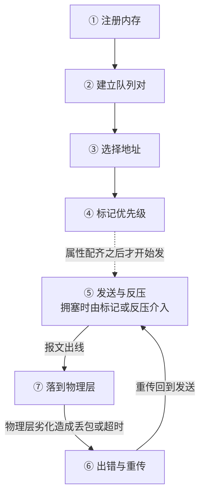

---
tags:
  - AI-Infra
  - RDMA
  - RoCE
  - 无损网络
  - 体系
  - RDMA 建链
  - 七段链路
  - 地址与标识
  - 无损对齐
created: 2026-09-24
---

# 一次 RDMA 建链的完整旅程

两个进程各自拿到一段要交换的缓冲区，一个在主机内存里，另一个在另一台机器上。在第一次传输真正发生之前，这段缓冲区必须依次办完七件事：它要被注册给网卡，两端要各自建立队列对，这条队列对要选定一个地址与协议版本，它的流量要带上一个能被交换机队列识别的优先级标记，网卡要按拥塞控制把报文发出去并在拥塞时接受反压，超时后要按重试参数重传，最后帧要经线缆或光模块出线。

这七件事不是一条单向的流水线，而是三层。前四件属于配置：它们必须各自成立，但彼此之间没有固定的先后——内存可以先注册也可以后注册，而队列对与地址向量的各项属性是在状态迁移时一次配齐的，因此「配置完成」是一组条件同时成立，不是一条顺序清单。第五到第七件才是数据路径本身，它们的关系也不是一条直线：物理层在最下面承托全部报文，出错与重传是报文出去之后回到发送的回路，而不是物理层之后的下一步。把这三层分开，才能解释为什么「内存注册成功」不会让报文发得更快，也才能解释为什么一次丢包会同时牵动发送、重传与物理层三处读数。

需要先建立的一个判断是：这条链上大多数失败不表现为「不通」。注册失败是调用直接返回错误；建链失败是连不上；地址选错才是不通或者走错版本；而标记没有对齐、反压与标记的比例失衡、超时时间不足以覆盖路径往返这三类失败，表现是平时正常、一上压力就变慢或者偶发停顿。若只用一个「通不通」的判据去找原因，后三类会被整体漏掉。因此排障的第一步不是问「网通不通」，而是问「这七件里哪一件还没有成立」。下表把这七段排开，标出它属于哪一层，并给出每一段要能说清的核心问题；它是后面逐段展开的目录。

| 层 | 段 | 这一段在做什么 | 到这里要能说清 |
| --- | --- | --- | --- |
| 配置 | 1 注册内存 | 应用把缓冲区注册给网卡，换取网卡直接读写这块内存的权限 | 为什么注册要锁定物理页，锁定失败时呈现为哪一类错误 |
| 配置 | 2 建立队列对 | 两端交换建链信息，各自建立队列对与完成队列 | 建链走的是哪条带外通道，它与数据面是什么关系 |
| 配置 | 3 选择地址 | 选定这条队列对用哪个全局标识符与哪个源地址发包 | 一张网卡上为什么会有多个全局标识符，选错时的报错文本是什么 |
| 配置 | 4 标记优先级 | 把流量的服务等级标记映射到交换机队列，并让队列具备无损能力 | 主机侧与交换机侧分别要配哪几处，只配一边会怎样 |
| 数据路径 | 5 发送与反压 | 网卡按拥塞控制发送；拥塞时由逐跳反压或端到端标记介入 | 反压与标记各自的代价，以及为什么两者要配合 |
| 数据路径 | 6 出错与重传 | 超时或收到否定应答后按重试参数重传，重试耗尽则连接进入错误状态 | 超时时间的量级怎么算，重试次数与超时时间的乘积意味着什么 |
| 数据路径 | 7 落到物理层 | 帧经线缆或光模块发出，误码在这一层产生 | 误码在计数器上留下什么，它与前面几段的读数怎么区分 |

三层之间的关系画出来是这样的。配置层为数据路径准备好属性，物理层在下面承托每一个报文，重传则是一条从出错回到发送的回路：



## 段 1：注册内存

这一段在做的动作是：应用把一段虚拟内存区域交给网卡，换取网卡在本机直接读写这块内存的权限，这个区域在 RDMA 里称为内存区域（Memory Region，MR）。它之所以必须发生，是因为数据面完全由硬件卸载：数据搬运的执行者是网卡，不是内核网络栈，因此网卡需要一份自己能用的地址映射。注册要成立，先要有三样东西——进程的可锁定内存上限（`memlock`，即 `RLIMIT_MEMLOCK` 施加给进程的锁定上限）还有余量、这段内存确实属于本进程、以及驱动侧的内存注册能力可用。若要注册的是显存，另有一套模块前置条件（内核需具备 RDMA peer-memory 支持，且对应的内核模块必须已加载），那不属于这一段的主线。

出问题时这一段留下的证据是注册调用的返回值，以及进程当时能够锁定的内存上限。注册失败不表现为「慢」，它表现为调用直接失败，并且落在内存分配类错误上；具体的错误文本以本地运行库与内核版本为准。下表给出这一段的证据字段读法，其中「与谁同看」一列说明单独一个字段为什么不足以定结论。

| 字段                                   | 是什么与单位                                  | 判据                        | 与谁同看                          | 读到它转向哪一步                              |
| ------------------------------------ | --------------------------------------- | ------------------------- | ----------------------------- | ------------------------------------- |
| 注册调用（`ibv_reg_mr` 一类用户态 verbs 接口）的返回 | 一次注册动作的成败，成功返回一个内存区域句柄，失败返回空并置错误号       | 失败即本段不成立，不存在「部分成功」        | 与进程的 `memlock` 上限同看，判断是不是额度不足 | 失败时先核对 `memlock` 上限，再核对内核模块前置，最后才怀疑网卡 |
| 进程可锁定内存上限（`memlock`）                 | 单位是字节，表示该进程允许锁定在物理页上的内存总量，由 `ulimit` 读取 | 注册所需字节数必须小于剩余额度；上限不足时调用失败 | 与注册调用的返回值、以及同一节点上其它进程的占用同看    | 额度不足时调整上限并重新注册，不要改注册之外的东西             |
| 注册后的内存区域属性                           | 权限位与长度，长度单位是字节                          | 网卡只能读写权限位允许的部分，越界访问不会成功   | 与应用实际使用的缓冲区长度同看               | 长度或权限不符时回到应用侧核对缓冲区定义                  |

这一段走的是哪条路径，读注册结果就能回答：注册成功说明网卡拿到了本机物理页的地址映射，后面的数据面搬运将完全由硬件完成，报文不经过内核网络栈。由此推出一个容易被误判的现象：注册成功、链路正常时，用标准内核网络工具去看，看不到这部分流量——这不是配置缺项，而是机制的结果。

## 段 2：建立队列对

这一段在做的动作是：两端交换建链信息，各自建立队列对（Queue Pair，QP）与完成队列（Completion Queue，CQ）。队列对是一对发送队列与接收队列，是 RDMA 通信的基本单位；完成队列承载完成事件，应用从它取回操作结果。它要成立，先要有三件事：设备已经被识别并且端口处于活动状态、两端对这条连接的身份信息理解一致、以及建链所需的地址交换通道是通的。

队列对的状态机是关键：接收侧就绪由 RTR 状态决定（Ready to Receive），可以发送由 RTS 状态决定（Ready to Send）。超时与重试这两个队列对属性只在从接收就绪态转入发送就绪态的那一次迁移里写入，进入发送就绪态之后属性接口不再接受修改，因此要改只能回到初始态重建这条队列对。固件层的自适应重传档位是另一条路，它能在不重建连接的情况下改变重传行为，但一份档位作用于该物理功能上的全部队列对，粒度比逐条连接粗得多。这也是为什么超时口径必须在上线前对齐。

| 字段 | 是什么与单位 | 判据 | 与谁同看 | 读到它转向哪一步 |
| --- | --- | --- | --- | --- |
| 端口状态（`ibv_devinfo` 的端口状态项） | 端口的瞬时状态，取值含 `PORT_ACTIVE` 这类活动态 | 必须是活动态，否则本段不可能成立 | 与同一输出里的 `link_layer` 是否为 `Ethernet` 同看 | 非活动态时先查物理链路与对端端口，再回到本段重试建链 |
| 设备状态（同一输出里的设备与固件信息） | 设备当前的状态与固件标识 | 设备可用且固件信息可读，才说明驱动与固件交互正常 | 与端口状态同看，二者不是一回事 | 设备不可用时先解决驱动与固件，不进入建链 |
| 队列对状态 | 瞬时状态，依次为初始态、接收就绪态、发送就绪态、错误态 | 处于发送就绪态才允许发送；进入错误态后不会自行恢复 | 与本地确认超时、序号错误计数同看 | 停不到发送就绪态时回到地址与标识核对；落到错误态时转入重传段的判据 |
| 建链通道与数据面是否同一条路 | 一个是带外通道，一个是硬件数据面 | 连接管理通了不代表数据面能跑满 | 与端口计数器的增量同看 | 建链成功但吞吐上不去时，转去读端口计数器而不是继续查建链 |

这一段失败时的现象是连不上：应用侧在建立连接时就返回错误，或者长时间停在建链阶段。这里必须说清一个区别：建链走的是带外通道，负责地址交换与连接管理；数据面是另一条路。因此连接管理通了不代表数据面能跑满，反之数据面跑通了也不证明策略配置正确，两件事要分别验证。

## 段 3：选择地址

这一段在做的动作是：在以太网承载的 RDMA 场景下，为这条队列对选定用哪个全局标识符（Global Identifier，GID）与哪个源地址。全局标识符表中的每一条包含 GID 值、GID 类型与关联网络设备三项，取值位置分别是 `/sys/class/infiniband/<device>/ports/<port>/gids/<index>`、`gid_attrs/types/<index>` 与 `gid_attrs/ndevs/<index>`。它要成立，先要有两件事：设备上配置了 IP 地址（表中的条目在配置了 IP 地址的以太网设备上自动生成），以及两端对协议版本的理解一致。

版本不是端口级开关，而是每条队列对各自的选择：连接类队列对从初始态转到接收就绪态时必须给出地址向量，其中的 GID 索引决定这条队列对用哪个版本发包。选错的两种形态必须分开：跨三层却选了链路本地的条目，表现是建链失败或找不到路由；多端口机器上选了另一个端口 IP 对应的条目，可能能通但走错端口。另一种更隐蔽的情况是版本选错，此时会绕过为另一版本准备的策略。

| 字段 | 是什么与单位 | 判据 | 与谁同看 | 读到它转向哪一步 |
| --- | --- | --- | --- | --- |
| 全局标识符表（`show_gids` 是查看入口） | 每张网卡上可用的地址与协议组合，按索引列出一行一条 | 索引与版本、类型、关联网络设备三者绑定；要跨三层用必须同时满足类型为可路由版本且关联设备上配了 IP | 与 RDMA-CM 使用的版本设置同看 | 建链报 `Call to ibv_modify_qp failed with error Invalid argument` 时，先核对这一项 |
| 队列对的地址向量 | 一组身份参数，含 GID 索引与服务等级等字段 | 它决定这条队列对用哪个版本、走哪个地址；同一台机器上不同队列对可以不同 | 与全局标识符表同看 | 不通或走错端口时回到本表重新取索引，不要沿用上一次交付记录的索引数字 |
| RDMA-CM 使用的版本设置 | 一个模块级设置，决定连接管理解析本地 GID 时用哪种类型 | 只有自动选择确实选错时才手工指定，逐条队列对写死索引不是常规做法 | 与全局标识符表、以及应用是否自己指定了地址同看 | 自动选择结果与预期不符时，先核对表中关联网络设备与 IP，再考虑手工指定 |

索引漂移是「只有一部分节点失败」这类随机故障的常见来源：增加 VLAN 接口、增加 IP 地址或更换多端口网卡之后，原来的索引会指向别的地址或别的版本。因此记录索引这件事必须以「每次交付重新取一遍」为条件，而不是把上一次的数字抄进表格。

## 段 4：标记优先级

这一段在做的动作是：给这条队列对的流量指定一个服务等级标记，并让承载该标记的交换机队列具备无损能力。它要成立，先要有四件事依次对齐：应用或连接管理设置的标记值、网卡信任的是二层优先级还是三层服务等级（这一项叫信任模式）、服务等级到硬件队列的映射表、以及路径上每一跳对应队列的逐跳反压已使能。这四件事分别由不同的人负责，因此「标记没生效」这句话必须落到具体哪一段上。

主机侧与交换机侧的分工也要在这一段说清：主机侧能查的是信任模式、映射表与使能的队列编号；交换机侧的队列门限、缓存与预留、以及路径中间每一跳的使能状态，只有网络团队能查。下表给出这一段的判据，其中最后一行是对账项的来源。

| 字段 | 是什么与单位 | 判据 | 与谁同看 | 读到它转向哪一步 |
| --- | --- | --- | --- | --- |
| 信任模式 | 网卡按哪一种标记决定优先级：二层优先级或三层服务等级，取值是枚举而非数字 | 若标记打在三层而信任模式停在三层之外，后面所有映射都不生效 | 与同一输出里的映射表与逐跳反压使能队列同看 | 映射不生效时先改信任模式再看映射，否则改了也白改 |
| 服务等级到队列的映射表 | 一张把服务等级与硬件流量类别对应起来的表，条目数是有限档位 | 被使用的那一档必须与逐跳反压使能的队列编号一致 | 与逐跳反压使能队列、以及交换机侧的入口信任与队列映射同看 | 映射落到别的队列时，先看映射表再看下发方式是否被固件接管 |
| 逐跳反压使能的队列 | 按队列号给出的使能位图，单位是队列 | 位图里每一个被开启的优先级都要与映射表的目标优先级一一对应；常规做法是收敛到一个专用优先级，开在承载大量无关流量的队列上等于让无关流量承担停摆风险 | 与映射表、按优先级的反压计数同看 | 使能范围与映射不一致时，先收敛到同一个优先级再谈调优 |
| 交换机侧队列门限与水位 | 由交换机维护的阈值与占用量，主机侧读不到 | 主机侧读数与交换机侧配置必须逐行对齐才能判定一致 | 与主机侧映射表、路径中间每一跳的使能状态同看 | 主机侧自检全部正确但仍有停顿或丢包时，转入与网络团队对账 |

这一段失败的形态很特别：平时完全正常，一上压力才抖。原因是压力不足时反压根本不会被触发，配置的不对齐没有机会暴露。因此验收时若只做轻载连通性测试，这一段等于没有验收。

## 段 5：发送与反压

这一段在做的动作是：网卡按拥塞控制把报文发出去；链路出现拥塞时，由逐跳反压或端到端标记介入。它要成立，先要有三件事：两端优先级对齐（判据是标记经过的每一段都指向同一个使能了无损的队列，没有一段把它改写成别的值）、拥塞控制路线已知并且与交换机的配合方式匹配、以及反压使能范围覆盖端点与路径上每一台交换机。

两条介入路线的分工必须在现场分清：逐跳反压是按优先级、逐跳传播的链路层机制，代价是反压会传播，可能把与拥塞源头无关的流量一起停住；端到端标记走的是「交换机在缓存将满时给包打标记、接收端据此回送拥塞通知包、发送端降速」这条路，它的代价是需要在两端与交换机上都配对。健康的水位是标记在涨而反压几乎不涨；反过来，反压涨而标记不涨，说明正在拿反压承担全部拥塞。

| 字段 | 是什么与单位 | 判据 | 与谁同看 | 读到它转向哪一步 |
| --- | --- | --- | --- | --- |
| 按优先级的收方向反压计数 | 累计次数，表示本端收到暂停帧、发送被对端叫停 | 累计值必须取两次读数的差值；判据是增长率，不是绝对值 | 与发方向反压计数、拥塞标记计数同看 | 收方向明显增长时，先核对对端接收侧的排空能力与两端使能范围，而不是先扩带宽 |
| 按优先级的发方向反压计数 | 累计次数，表示本端发出暂停帧、要求对端停发 | 与收方向含义不同，必须分开读，不能相加 | 与收方向反压计数、以及本端接收侧与映射表同看 | 只有发方向增长时，先核对对端发送速率与本端接收侧排空能力 |
| 拥塞标记与通知计数 | 厂商扩展计数器中的累计次数，名字随驱动版本变化，现场用 grep 取本机输出为准 | 标记在涨、反压几乎不涨是健康组合 | 与两个方向的反压计数同看 | 标记长期为零而反压持续增长时，先确认拥塞控制路线与两端配对是否成立 |
| 反压停滞防护的两个事件计数 | 累计次数，一个是警戒级，一个是错误级 | 错误级增长说明网卡已经停止发送暂停帧，无损在这一刻失效 | 与反压计数、拥塞标记计数同看 | 错误级增长时按「无损已经失效」处理，不要再假定链路不丢包 |

命令演示只在需要证明读数位置时给出。下面这条用于确认本机实际的计数器名字，因为厂商扩展计数器的名字随驱动版本变化。

```bash
grep -l . /sys/class/infiniband/*/ports/*/counters/* 2>/dev/null | head   # 验证：确认本机端口计数器目录里实际有哪些项
```

这一段失败的形态是变慢或者偶发停顿：吞吐掉一截、应用侧出现周期性无进展，而链路状态始终是活动的。

## 段 6：出错与重传

这一段在做的动作是：当确认没有按预期回来时，发送端按超时参数判定，然后按重试参数重传；重试耗尽则连接进入错误状态。它要成立，先要有两件事：超时与重试参数在进入发送就绪态之前已经设好，以及路径往返时间落在超时时间能够覆盖的范围内。

超时时间不是固定值，它是「超时基数乘以 2 的 timeout 次幂」。同一个基数下，官方给出的两个换算是 timeout 为 17 时约 536.9 毫秒、timeout 为 20 时约 4.3 秒，后者约为前者的 8 倍。由此得到的判据是：两个程序用不同的默认超时跑在同一条 fabric 上，一次超时的代价相差很大，因此改超时参数会同时改变「多久报错」与「抖动时掉多少吞吐」。真正决定一次故障最长等待的是重试次数与超时时间的乘积，等待期满连接进入错误状态，应用侧看到的是操作失败或长时间无进展。这些默认值与版本相关，至少要把驱动、CUDA、NCCL 与 RDMA 栈四项一起记录，缺任一项时读数不构成结论。

| 字段 | 是什么与单位 | 判据 | 与谁同看 | 读到它转向哪一步 |
| --- | --- | --- | --- | --- |
| 本地确认超时参数与超时计数 | 参数是一个指数档位（无单位），计数是累计次数 | 超时时间等于超时基数乘以 2 的该档位次幂；计数取差值后不为零增长，说明超时不足以覆盖路径往返 | 与序号错误、接收端未就绪重试、以及物理层错误计数同看 | 先核对超时与重试参数，再看交换机侧是否丢包 |
| 重试次数字段 | 一个次数上限，作为队列对属性在转入发送就绪态时写入，之后不经重建不能改 | 重试次数与超时时间的乘积就是一次故障的最长等待 | 与本地确认超时参数同看 | 乘积与业务可接受的最长停顿不符时，重建队列对并同步两端参数；固件层的自适应重传档位作用范围更粗，改前先确认它覆盖哪些作业 |
| 序号错误与乱序计数 | 累计次数 | 取差值判断增长率；按默认的回退式重传语义，缺口之后的报文要一起重发，因此序号错误的代价不止那个包（启用选择性重传时重发量明显更少） | 与重复请求、接收端未就绪重试计数同看 | 序号错误持续增长时转入物理层，查误码与链路事件 |
| 接收端未就绪重试计数 | 累计次数，表示对端接收队列一时没有可用的工作请求 | 它增长时问题在接收侧供给，而不在链路 | 与接收缓冲耗尽计数、接收队列的补位方式同看 | 转向接收侧核对工作请求的投递节奏 |
| 自适应重传计数 | 累计次数，表示重传行为被自适应机制调整过 | 自适应只调整重传行为，不解决根因；它有增长说明链路已经在丢 | 与序号错误、本地确认超时计数同看 | 不要以自适应重传的增长作为「已经恢复」的证据，转入物理层 |

物理层的劣化要先在这里被认出来，而不是等到报错：本地确认超时计数缓慢增长、序号错误缓慢增长、而链路状态始终活动，这个组合指向线缆、光模块或链路对端，而不是参数。

## 段 7：落到物理层

这一段在做的动作是：帧经线缆或光模块发出，误码在这一层产生。它要成立，先要有两件事：端口处于活动状态，以及物理介质与距离在规格之内。这一段留下的证据与前六段不同，它是一组缓慢增长的端口错误计数与链路事件计数：符号错误表示物理编码层面的错误，链路反复上下表示端口在做成帧与协商级别的挣扎。这两类计数都只有累计值，而链路反复上下这类事件还可能以瞬时状态的形式出现，两者要分清。

| 字段 | 是什么与单位 | 判据 | 与谁同看 | 读到它转向哪一步 |
| --- | --- | --- | --- | --- |
| 符号错误计数 | 累计次数 | 取差值判断增长率；零增长是预期状态，缓慢增长说明介质或光模块在退化 | 与链路上下计数、端口接收错误计数同看 | 缓慢增长时先查线缆与光模块，再查对端端口 |
| 链路上下事件计数 | 累计次数，另有物理层单独的一项 | 取差值；增长说明端口在反复重新建立链路 | 与符号错误、端口状态瞬时值同看 | 与网络团队核对交换机侧端口与光模块日志 |
| 端口接收错误计数 | 累计次数 | 取差值；它与序号错误同时增长时，优先按物理层处理 | 与序号错误、超时计数同看 | 进入对账，由网络团队确认交换机侧端口错误 |

下面这条命令给出主机侧可查的端口计数器位置，只读，生产节点上也可以做。

```bash
ls /sys/class/infiniband/*/ports/*/counters/ >/dev/null && echo readable   # 验证：确认端口计数器目录可读，后续读数都从这里取
```

这一段失败的形态是错误计数缓慢增长：吞吐没有明显塌陷，也没有报错，但偶发停顿的频率在上升。若只看「通不通」或者只看瞬时带宽，这一段会被完全漏掉。

## 七段的失败形态汇总

把七段各自失败时的表现并列在一张表里，用途是反向定位：值班时手上拿到的往往只是一个现象，而现象与段之间存在多对多的关系，因此需要先按现象缩小到候选段，再回来读那一段对应的字段。下表给出这三个字段的固定搭配，中间的「现象」一列按读者最先察觉到的形式书写。

| 段       | 现象长什么样                  | 起决定作用的判据                     | 主机侧能读还是必须对账         |
| ------- | ----------------------- | ---------------------------- | ------------------- |
| 1 注册内存  | 调用直接失败，应用在初始化阶段就退出，不是变慢 | 注册调用的返回值与可锁定内存上限             | 主机侧能读               |
| 2 建立队列对 | 连不上，或长时间停在建链阶段          | 设备状态、端口状态、队列对状态              | 主机侧能读               |
| 3 选择地址  | 不通，或能通但走错端口与版本          | 全局标识符表的类型与关联网络设备、连接管理的版本设置   | 主机侧能读               |
| 4 标记优先级 | 平时正常，一上压力才抖             | 信任模式、映射表、使能队列三者是否指向同一个优先级    | 主机侧读一半，交换机侧队列映射必须对账 |
| 5 发送与反压 | 变慢或偶发停顿，链路状态始终是活动的      | 两个方向的反压计数与拥塞标记计数的增量组合        | 主机侧能读，门限与水位必须对账     |
| 6 出错与重传 | 带宽掉一截，或重试耗尽后直接报错        | 本地确认超时计数、序号错误计数、重试次数与超时档位的乘积 | 主机侧能读，是否丢包要交换机侧确认   |
| 7 落到物理层 | 错误计数缓慢增长，偶发停顿频率上升       | 符号错误与链路上下计数的增长率              | 主机侧能读，光模块与对端端口必须对账  |

这张表也解释了为什么不能用单一判据收工：「通不通」只有段 2 与段 3 失败时才会给出信号，剩下五段的失败在这一个判据下全部隐形。

## 三段贯穿的核对对象

七段不是七个互不相干的检查项，有三件事横跨多段，必须当成一组核对对象来对待，否则会出现「每一段单看都正常，合起来仍然跑不好」的情况。下表给出这三组对象各自覆盖哪些段、每一处读什么，以及它们回答的判断是什么。

| 核对对象 | 它贯穿哪几段 | 每一处读什么 | 它回答的判断 |
| --- | --- | --- | --- |
| 地址与标识 | 段 2、段 3 与段 6 | 段 2 读设备与端口状态；段 3 读全局标识符表与连接管理版本设置；段 6 读端口错误状态 | 一次建链的身份由设备、端口、全局标识符与队列对共同确定，任何一项变化都会让记录失效 |
| 无损配置的对齐 | 段 4 到段 7 | 段 4 读信任模式、映射表与使能队列；段 5 读两个方向的反压计数与拥塞标记计数；段 7 读端口错误计数 | 标记、队列与反压分别配在主机与交换机两侧，任一处不对齐都只在压力下暴露 |
| 超时与重试的乘积 | 段 5 与段 6 | 段 6 读当前生效的本地确认超时档位与重试次数，按超时基数乘以 2 的次幂估算单次超时时间 | 集群规模越大，一次超时必须覆盖的往返时间越长；乘积决定一次故障的最长停顿 |

## 主机侧能查到哪几段

把七段按「谁能查」分一次类，是这条链上最实用的一步。主机侧能自证的是：注册结果与可锁定内存上限、设备与端口状态、全局标识符表与连接管理版本设置、信任模式与映射表与使能队列、两个方向的反压计数与拥塞计数、超时与重试参数及各类重传计数、端口错误与链路事件计数。必须找网络团队对账的是：交换机侧的入口信任与队列映射、队列门限与缓存水位、路径中间每一跳的逐跳反压使能状态。

责任划分的用途不是推诿，而是收敛排查范围：当主机侧这一列全部符合判据、而停顿仍然发生时，可改的参数已经不多，剩下的空间在交换机侧；反之，若主机侧有任意一项不符合判据，那么在把这一项改对之前，任何针对交换机侧的改动都无法被验证。

最后有一件容易混淆的事需要点明：「能 ping 通」证明不了 RDMA 可用。数据面完全由硬件卸载，这部分流量不进标准以太网接口的软件计数，也不走内核网络栈，它的计数器读在 RDMA 设备的端口计数器目录下。因此验收必须用 RDMA 语义的工具跑通，并且看到端口计数器出现增量；这一步没做，前面七段的结论都只是间接推断。

**第一反应不要做什么**：不要一看到应用变慢就去改超时与重试参数。这两个值是队列对属性，在转入发送就绪态时写入，之后不经重建不能改，而它们只改变「多久报错」，不改变「已经丢了」这个事实。正确的顺序是先按段定位：注册失败读调用返回，建链失败读设备与端口状态，不通读全局标识符表，上压力才抖读信任模式与映射表，停顿读两个方向的反压计数与拥塞标记，缓慢恶化读符号错误与链路上下计数；在这四组读数指向同一段之前，不要动任何一端的配置。

## 参考文档

- NVIDIA DOCA 文档中关于 RoCE 的章节：数据面硬件卸载的表述、两种承载的封装差别、全局标识符表的结构与取值位置、地址向量与队列对状态的关系，以及 RoCE 没有子网管理器因此需要自行准备路径记录这一条。
- NVIDIA DOCA 文档中关于流控的章节：逐跳反压的使能范围要求、按优先级的反压计数的可见条件与两个方向的含义、停滞防护的两种模式与两个事件计数。
- NVIDIA DOCA 文档中关于拥塞控制基础设施与 RoCE 时间戳的章节：端到端标记的生成点、两条原生算法与用户可编程路径的关系，以及固件路径设置与端口级算法控制的分工。
- NVIDIA DOCA 文档中关于自适应重传的章节：重传超时的定位与自适应机制只调整重传行为这一条。
- InfiniBand verbs 手册页中关于队列对状态与地址向量的一节：初始态、接收就绪态、发送就绪态之间的迁移条件与各状态可改动的字段。
- Linux 内核 `Documentation/ABI/stable/sysfs-class-infiniband`：端口状态与端口计数器的 sysfs 语义。
