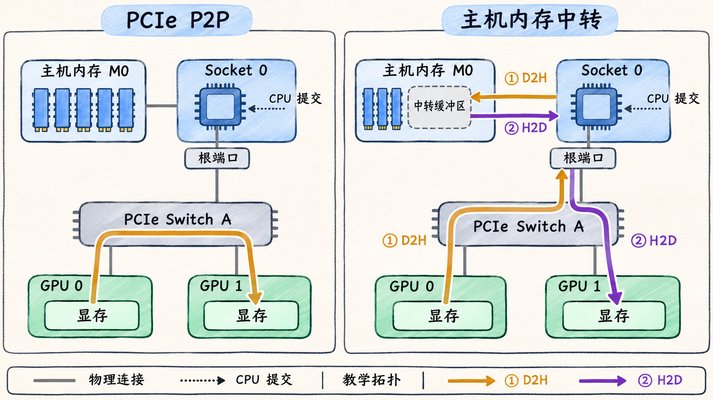

# 主机与 GPU 的 DMA 拷贝及卡间数据路径

不少工程师第一次接手多卡服务器时，都会遇到一个反直觉现象：单卡算力明明很充裕，但把训练任务扩到四卡，或者跑起多卡大模型推理（如张量并行 TP）后，整体速度远没有成倍提升，GPU 反而经常在空等。

症结往往不在算力，而在**数据搬运路径**。计算开始前，输入数据要先从主机内存搬进显存；多卡协作时，中间激活和梯度还要在各张卡的显存之间流转。不摸清数据在 PCIe 交换机、主机内存和处理器互联上到底怎么走，就无法解释带宽为什么会莫名腰斩。

在标准拷贝流程里，CPU 并不亲自逐字节搬运数据。CPU 线程只负责把输入放到内存、向 CUDA Runtime 提交复制请求，以及在结束后检查结果；真正按映射地址逐块读写内存的，是 GPU 内部的硬件**复制引擎（Copy Engine）** 通过 DMA 完成的。

## 本地 H2D 的提交、读取请求与回包完成

先看最干净的场景：一台双路 x86\_64 Linux 服务器，每个 CPU Socket 对应一个 NUMA 节点，各自直连本侧主机内存。两颗处理器之间通过处理器间互联互通，四张 GPU 分别挂在两条独立的 PCIe Switch 分支下，卡间没有 NVLink。

后续需要对照具体拓扑和命令输出时，沿用下面这张参考映射表：

| 接入位置 | 本地主机内存 | 从处理器侧到设备的 PCIe 连接 |
| --- | --- | --- |
| Socket 0 / NUMA 0 | `M0` | 根端口 → `Switch A` → `GPU 0`、`GPU 1`、`NIC 0` |
| Socket 1 / NUMA 1 | `M1` | 根端口 → `Switch B` → `GPU 2`、`GPU 3`、`NIC 1` |

在这棵 PCIe 树里，交换机面向 CPU 根端口的链路称为**上行（Uplink）**，面向 GPU 或网卡的链路称为**下行（Downlink）**。需要注意，“上行”和“下行”只表示端口在拓扑中的位置，物理链路本身支持全双工双向传输。

现在，应用要把一批已经放在**本地主机内存**中的页锁定（Page-locked / Pinned）输入，通过一次主机到显存拷贝（H2D）送进**同侧目标 GPU** 的显存。整个过程按三个阶段展开：

1. **提交任务**：CPU 线程调用 CUDA 复制接口，将复制指令排入一条 CUDA Stream。Stream 按提交顺序调度工作，提交本身只需很短的 CPU 时间。
2. **发起读请求并回传载荷**：轮到该任务执行时，目标 GPU 的复制引擎向源地址发出 PCIe 读取请求；请求沿目标 GPU 下行和 Switch 上行抵达本地 Socket 根侧，随后读取到的有效数据沿反方向流回显存。
3. **同步确认完成**：有效载荷落入显存后，同一 Stream 里排在后面的 Kernel 才能安全读取这批数据；而主机线程如果想复用源缓冲区，必须显式等待复制完成（例如同步对应的 Stream 或事件）。

> [!tip] 工程直觉：核算带宽时永远跟踪“有效载荷方向”
> H2D 虽然由 GPU 先向上发出“读取请求”，但请求包体积很小，真正吃满链路带宽的是从内存流回显存的数据回包。因此，本地 H2D 的载荷路径记作 **本地内存 → 本地 Socket 根侧 → Switch 上行 → 目标 GPU 下行 → 显存**。
>
> 反之，当目标 GPU 把计算结果拷回本地内存（D2H）时，复制引擎直接把数据向上写入，载荷路径正好相反：**显存 → 目标 GPU 下行 → Switch 上行 → 本地 Socket 根侧 → 本地内存**。

## 远端页、锁页缓冲与 CUDA 拷贝返回时点

把条件只改一处：目标 GPU 不变，但参与 DMA 的源缓冲区物理页落在了**另一颗 CPU 的远端内存**上。

此时，读取请求抵达本地 Socket 后，还得穿过**处理器间互联**去对端 Socket 取数；返回的有效载荷也要先经过处理器间互联回到本地 Socket，再走原有的 PCIe 分支进入显存。硬件连线一根没变，但数据平白多走了一段跨 Socket 路径。

这里有一个极易踩坑的细节：**提交线程绑定在哪个 CPU 上，只影响新分配内存时的“首次触页”落点；对于已经分配好的缓冲区，DMA 究竟走本地还是跨 Socket，完全由它实际驻留的物理页决定**。

除了物理页落点，主机内存是否“页锁定”也会改写路径。普通可分页内存（如直接 `malloc` 出来的缓冲）随时可能被内核换出或迁移，GPU 无法直接安全地对其发起长期 DMA。应用通常用 `cudaMallocHost` 直接申请锁页内存，或用 `cudaHostRegister` 将已有内存注册为锁页区域。

如果直接把普通可分页内存传给 CUDA 复制接口，驱动往往要先由 CPU 把字节搬进一块内部**页锁定暂存区**，再让 GPU 从暂存区发起 DMA。一旦发生暂存，不仅多出一次 CPU 内存拷贝，后续 DMA 的 NUMA 路径也要按暂存区实际所在节点来算。

```cpp
// 典型异步 H2D 提交与精确同步：提交返回 != DMA 完成
void* host_pinned = nullptr;
void* dev_buf = nullptr;
cudaStream_t stream;
cudaEvent_t copy_done;

cudaMallocHost(&host_pinned, bytes);             // 申请锁页主机内存，免去隐式暂存
cudaMalloc(&dev_buf, bytes);                     // 在目标 GPU 显存分配缓冲区
cudaStreamCreate(&stream);
cudaEventCreate(&copy_done);

// 1. CPU 提交异步拷贝后立即返回，复制引擎在后台通过 DMA 搬运
cudaMemcpyAsync(dev_buf, host_pinned, bytes, cudaMemcpyHostToDevice, stream);
cudaEventRecord(copy_done, stream);              // 在拷贝之后插入完成事件

// 2. 同一 Stream 内的 Kernel 会自动等待拷贝完成；CPU 复用 host_pinned 前必须等待事件
cudaEventSynchronize(copy_done);                 // 此时才确认有效载荷已完整落入显存
```

不同内存类型和 API 在“函数返回时点”与“设备真正完成时点”上的行为差异很大。按 CUDA 13.2.1 规范，一次 H2D 的同步约定如下：

| 复制调用 | 主机源内存类型 | 函数返回与设备 DMA 完成的关系 |
| --- | --- | --- |
| `cudaMemcpy` | 页锁定内存 | 对主机同步；检查成功返回即可确认拷贝已完成。 |
| `cudaMemcpy` | 可分页内存 | 复制前同步相关 Stream；数据拷入内部暂存区后函数即可返回，最终 DMA 可能仍在后台执行。 |
| `cudaMemcpyAsync` | 页锁定内存 | 对主机异步；提交成功后，必须通过所属 Stream 或其后的事件确认完成。 |
| `cudaMemcpyAsync` | 可分页内存 | 可能退化为对主机同步；若驱动需搬入暂存区会阻塞等待，仍应以 Stream 或事件判断完成。 |

> [!warning] 常见误区：把 API 返回时刻当成拷贝完成时刻
> 给 H2D 测速或复用主机缓冲区时，千万不要只包住 `cudaMemcpyAsync`（甚至可分页源的 `cudaMemcpy`）的调用前后就停表。异步提交给计算与拷贝重叠留出了窗口，但计时窗口必须覆盖到 `cudaStreamSynchronize` 或 `cudaEventSynchronize` 返回，才能测到真实的 DMA 耗时。

## GPU 间直达（P2P）与主机内存中转

接下来把源头也搬进显存：让**发送卡**把一块张量交给**同 Switch 下的邻居接收卡**。两张卡各自拥有独立显存，彼此之间出现两条截然不同的候选路径。

第一条是**卡间直达**。**P2P（Peer-to-Peer，对等访问）** 是指一张 GPU 在满足硬件路由和软件权限条件时，绕开主机内存，直接经设备互联读写另一张 GPU 的显存。当发送卡与接收卡挂在同一颗 PCIe Switch 下，且 PCIe 事务允许在 Switch 内部转发时，有效载荷直接从发送卡下行转进接收卡下行，全程不碰 Switch 上行和主机内存。

第二条是**经主机内存中转**。当直达条件不满足或应用显式拆成两步时，发送卡必须先做一次 D2H，把数据经 Switch 上行写入主机内存中的中转缓冲区；等数据到位后，接收卡再从同一缓冲区发起 H2D，把数据经 Switch 上行拉回自己的显存。

对照下面这幅双路节点 `Switch A` 局部拓扑图（`GPU 0` 向 `GPU 1` 交付数据），两种路径经过的硬件差异一目了然：



*图 04-01-01：PCIe 同分支下卡间 P2P 直达（左）与经本地主机内存 M0 中转（右）的数据路径对照。左图事务在 Switch A 内部转发，避开上行与主机内存；右图同色箭头代表同一阶段，点线标注 CPU 控制提交，两段因读写同一缓冲存在先后依赖。*

顺着图中的连线，流量会在哪里“撞车”立刻清晰可见：

- 当同分支上的两张 GPU 同时从本地主机内存读取训练批次或加载模型权重时，两路 H2D 载荷都会挤在同一条 Switch 上行的“主机 → Switch”方向上互相争抢带宽。
- 如果同分支两张卡做卡间交换时走了主机内存中转，每个字节都要把 Switch 上行来回跑两遍，同时白白消耗主机内存带宽；一旦改走 Switch 内部 P2P 直达，交换载荷就被隔离在两卡下行之间，宝贵的上行带宽可以完整留给主机输入或网卡流量。

> [!summary] 核心结论
> 追踪单机 GPU 数据路径，只需盯紧三个坐标：**数据从哪来（物理页或源显存）**、**有效载荷沿哪几段链路移动**、**由谁在何时确认完成**。下一篇我们就把这些路段换算成确切的带宽上限和毫秒级耗时，看清共享上行与中转流水的真实代价。

> [!info]- 参考资料
> - **CUDA 系统内存、页锁定内存与显存**：[CUDA 13.2.1 · Understanding Memory](https://docs.nvidia.com/cuda/archive/13.2.1/cuda-programming-guide/02-basics/understanding-memory.html)、[Page-Locked Host Memory](https://docs.nvidia.com/cuda/archive/13.2.1/cuda-programming-guide/02-basics/understanding-memory.html#page-locked-host-memory)
> - **CUDA 异步执行与 API 同步行为**：[CUDA 13.2.1 · Asynchronous Execution](https://docs.nvidia.com/cuda/archive/13.2.1/cuda-programming-guide/02-basics/asynchronous-execution.html)、[CUDA Runtime API Sync Behavior](https://docs.nvidia.com/cuda/archive/13.2.1/cuda-runtime-api/api-sync-behavior.html)、[Runtime Memory Management](https://docs.nvidia.com/cuda/archive/13.2.1/cuda-runtime-api/group__CUDART__MEMORY.html)
> - **CUDA 多 GPU 对等传输**：[CUDA 13.2.1 · Multi-Device Peer-to-Peer Transfers and Memory Access](https://docs.nvidia.com/cuda/archive/13.2.1/cuda-programming-guide/03-advanced/multi-gpu-systems.html#multi-device-peer-to-peer-transfers-and-memory-access)
> - **Linux NUMA 内存策略**：[Linux Kernel · NUMA Memory Policy](https://docs.kernel.org/admin-guide/mm/numa_memory_policy.html)
