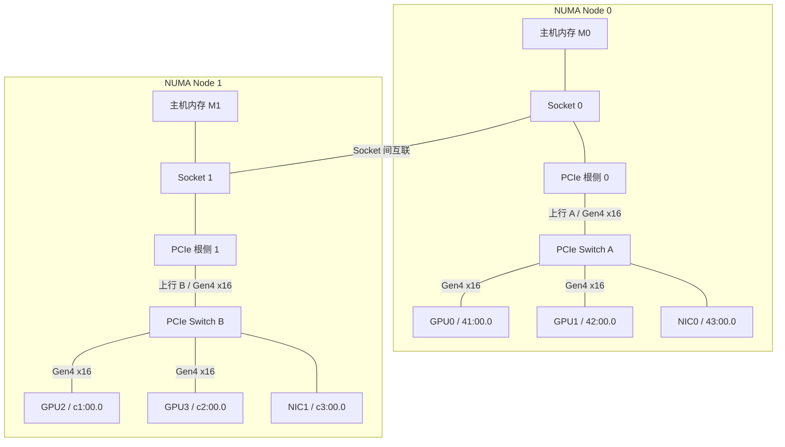

# 先确定数据从哪里到哪里

## 复制请求需要两个具体端点

第 02 章用 H2D 表示 Host to Device，用 D2H 表示 Device to Host。来到多卡服务器，还要补上主机页位于哪个 NUMA Node、设备是哪一张 GPU，以及复制完成后谁将使用结果。

例如，“把 1 GB 输入送入 GPU0”至少需要确认：这 1 GB 当前在 Node 0 还是 Node 1 的主机内存；GPU0 对应哪个 UUID 和 PCI 地址；目标设备缓冲是否已经分配；源数据准备与复制是否满足先后依赖。这里只讨论普通离散 GPU 的主机缓冲和设备分配，不引入统一内存的自动迁移路径。

每张卡的显存仍是独立的物理存储。四张 48 GiB 卡提供四份本地容量，不能据此让一个普通的 60 GiB 单卡分配自动成功。卡间可访问、软件把数据分片、形成统一地址视图，都不等于每张卡本地显存变成 192 GiB。

## 把设备放回同一张连接图

下图是本章四卡教学节点，**无箭头实线表示物理连接，框表示 NUMA 资源分组**。Root Complex 和 Root Port 聚合为“根侧”，省略具体桥、内存控制器与 NVMe。Node 不是转发设备，数据不会先“进入 Node 框”再流向 GPU。

图中出现 CPU，并不意味着每个字节都要由 CPU 核心执行一次读写指令。主机侧 I/O 与内存子系统也位于处理器附近，设备 DMA 可以经过这些硬件而不由 CPU 核心逐字节复制。

**DMA（Direct Memory Access，直接内存访问）** 是设备在驱动设置的地址与权限条件下进行数据搬运的机制。CPU 仍会准备描述、提交请求、处理同步与错误；“CPU 不逐字节复制”与“CPU 完全不参与”是两回事。GPU 还可能用复制引擎搬运，或由 SM 上执行的 Kernel 读写远端内存；传输测试要记录采用哪种方式。

## 同一个 H2D，为何会出现远端内存路径

先考虑源缓冲已经准备好、可以供 DMA 读取的 H2D。按照上图，两条路径分别为：

| 操作 | 主要数据路径 | 新增的共享资源 |
| --- | --- | --- |
| M0 → GPU0 | M0 → Socket 0 内存/I/O 子系统 → 根侧 0 → 上行 A → Switch A → GPU0 | 上行 A 与目标 GPU 下行 |
| M1 → GPU0 | M1 → Socket 1 子系统 → Socket 间互联 → Socket 0 子系统 → 根侧 0 → 上行 A → Switch A → GPU0 | 还要经过 Socket 间互联与远端内存服务 |
| GPU0 → M0 | 第一条的反向搬运 | 上行 A 的 GPU→主机方向 |

这是一张基于教学整机连接关系的路径表，真实 Root Complex 与 Socket 间路由需要结合厂商资料确认。跨 Socket 增加了需服务的路径，但不能只按“多一跳”计算固定倍数的损失；各段可用带宽、并发与缓冲状态共同决定结果。

主机线程的位置和源数据的位置也要分别记录。把线程从 Node 1 绑定到 Node 0，不会自动把已经位于 M1 的页搬到 M0。第四篇再用具体材料解释如何确认这两个位置。

## 可分页内存与锁页内存增加了什么区别

普通可分页主机内存的物理页可能被操作系统换出或重新安排。为安全地让设备访问，驱动需要建立合适的映射；某些复制会先把数据送入内部锁页缓冲，再交给 DMA。这样，应用看到的一次 H2D 可能包含 CPU 侧复制和额外的中转空间。

**锁页内存（Pinned / Page-locked Memory）**在用于设备访问期间保持页驻留，常用 `cudaHostAlloc` 分配，或以 `cudaHostRegister` 注册已有缓冲。它有利于获得稳定的主机—设备传输条件，也是常见的异步复制与计算重叠方案所需条件；分配/注册本身有成本，过量锁页会挤压主机可用内存。机制见 [CUDA 12.8.1 最佳实践：Pinned Memory](https://docs.nvidia.com/cuda/archive/12.8.1/cuda-c-best-practices-guide/index.html#pinned-memory)。

Pinned 只说明页驻留等属性，不指定页必须在 Node 0。注册一批已经落在 Node 1 的页，不等于把它们移动到 GPU0 附近。本章预算题从“位置已确认、已锁页、分配和准备完成”的缓冲开始计时，排除这些额外准备成本；真实测试则应明确是否把分配、注册和 CPU 复制计入时间。

## GPU 到 GPU 的两个候选过程

如果 GPU0 的结果下一步交给 GPU1，可以有两类过程：

1. **直接访问或复制。** 在设备、路径与软件允许时，GPU 间通过 PCIe 或 NVLink 访问对方显存，不把有效负载落到主机 DRAM。其能力与启用条件称为 GPU Peer-to-Peer，简称 P2P。
2. **主机内存中转。** 先把 GPU0 的数据 D2H 到主机缓冲，确认这一阶段完成，再 H2D 到 GPU1。软件也可以按块流水安排，但每块的先后依赖仍需满足。

P2P 描述访问能力与传输方式，PCIe/NVLink 描述承载它的互联。两张卡共用 Switch 时，直达流量可在 Switch 内转发；使用主机中转则需要经过 Switch 的上行抵达主机内存。哪些路径真正可用，第三篇会逐项建立条件。

还应区分复制与远端读取。复制会在 GPU1 建立本地副本，之后可从本地显存反复使用；远端读取则让 GPU1 的 Kernel 直接读 GPU0 的内存，避免完整副本，却可能把多次访问都留在互联上。是否划算取决于实际访问量、复用和延迟，不能仅由“少一次复制”判断。

现在已经能列出候选路径。下一步沿路径逐段数流量，才能解释为什么端点各自支持 x16，两个并发请求却未必各有一份独立的 x16 带宽。

[返回导读](00_导读.md) · [下一篇：沿 PCIe 路径计算带宽预算](02_沿PCIe路径计算带宽预算.md)
