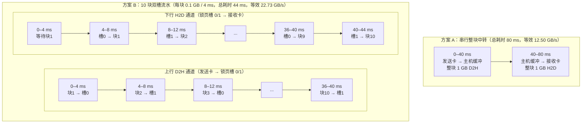

# PCIe 链路速率、共享上行与中转耗时

在多卡节点上排查性能时，工程师常会遇到一类让人摸不着头脑的怪事：查单卡状态显示它连在 PCIe Gen4 x16 上，但实测从主机拷入数据却始终卡在 15 GB/s 以下；或者两张卡同时加载模型权重时，总耗时直接翻倍。

光看设备终端标称规格远远不够。一条数据路径往往串联着根端口、PCIe Switch 上行和设备下行多段链路——**只要中间任何一段协商降速或被多路流量同向共享，整条通路的实际速度就会被拉低**。

## 沿 PCIe 桥树核查当前协商速率与位宽

要揪出“木桶最短板”，第一步是用 `lspci -D -t` 拉出 PCIe 桥树，顺着目标 GPU 的完整 BDF 一路回溯到根端口；第二步是对路径上的每个关键桥和端点执行 `lspci -D -s <BDF> -vv`，比对端口能力（`LnkCap`）与当前协商状态（`LnkSta`）。

以双路四卡节点的 Switch A 分支为例，桥树与链路检查输出如下：

```bash
# 1. 查看 Switch A 所在的 PCIe 桥树（0000:41/42/43 分别为 GPU 0、GPU 1、NIC 0）
$ lspci -D -t
-[0000:20]---01.0-[3f-43]----00.0-[40-43]--+-01.0-[41]----00.0   # GPU 0 (0000:41:00.0)
                                           +-02.0-[42]----00.0   # GPU 1 (0000:42:00.0)
                                           \-03.0-[43]----00.0   # NIC 0 (0000:43:00.0)
# 路径回溯：GPU 0 (41:00.0) → 下行桥 (40:01.0) → Switch 上行口 (3f:00.0) → 根端口 (20:01.0)

# 2. 在持续传输负载下，检查 Switch A 上行口 0000:3f:00.0 的能力与实际协商状态
$ sudo lspci -D -s 0000:3f:00.0 -vv | grep -E "LnkCap:|LnkSta:"
        LnkCap: Port #0, Speed 16GT/s, Width x16, ASPM not supported
        LnkSta: Speed 16GT/s, Width x8 (downgraded), TrErr- Train- SlotClk+ DLActive+
```

PCIe 的每条 **Lane** 都包含一对独立收发通道，`Width x16` 表示链路启用了 16 条 Lane。一条物理链路的速率和宽度由两端共同协商确定，即使在链路两端都能查到状态，核算带宽时也只计一次。

如果出现上面日志中的**窄上行降级**，整理出路径上三处采样结果就会立刻发现瓶颈所在：

| 采样位置 | 对应物理链路 | `LnkCap`（能力上限） | `LnkSta`（持续负载下协商状态） |
| --- | --- | --- | --- |
| `0000:41:00.0`（`GPU 0`） | `GPU 0` 下行 | `16 GT/s x16` | `16 GT/s x16` |
| `0000:42:00.0`（`GPU 1`） | `GPU 1` 下行 | `16 GT/s x16` | `16 GT/s x16` |
| `0000:3f:00.0`（`Switch A` 上行口） | `Switch A ↔ 根端口` | `16 GT/s x16` | **`16 GT/s x8`（降宽）** |

> [!tip] 工程直觉：一定要在持续负载下核对 `LnkSta`
> GPU 端的链路速率也可以用 `nvidia-smi -q` 中的 `GPU Link Info` 辅助查看。但 GPU 空闲时为了省电，驱动会自动将链路降频（例如降到 Gen1/Gen2）；只有在进行实际数据传输时采样 `LnkSta` 或 `Current` 字段，才能区分“正常节能”和“硬件插槽接触不良/固件降宽”。

## 从 GT/s 到单向带宽上界与有效吞吐

读出 `16 GT/s x16` 之后，怎么换算成大家熟悉的 `GB/s`？

**GT/s** 表示每秒十亿次传输。PCIe Gen3、Gen4、Gen5 每条 Lane 的速率分别是 `8`、`16`、`32 GT/s`，每次传输对应 1 bit，三代均采用 **`128b/130b` 编码**——每发送 130 bit 线路符号，实际承载 128 bit 编码前数据。

设单 Lane 速率为 $R\ (\text{GT/s})$，当前协商宽度为 $w$ 条 Lane，按十进制单位 $1\ \text{GB} = 10^9\ \text{B}$，链路**编码后的单向带宽上界**为：

$$B_{\text{uni}} = \frac{R \times w \times \frac{128}{130}}{8}\ \text{GB/s}$$

将常见协商组合代入公式，得到日常排障最常用的速查基准：

| 当前协商状态 | 计算式（按十进制 $1\ \text{GB} = 10^9\ \text{B}$） | 编码后单向上界 |
| --- | --- | ---: |
| Gen3 x16 | $8 \times 16 \times \frac{128}{130} \div 8$ | `≈ 15.75 GB/s` |
| Gen4 x8 | $16 \times 8 \times \frac{128}{130} \div 8$ | `≈ 15.75 GB/s` |
| Gen4 x16 | $16 \times 16 \times \frac{128}{130} \div 8$ | `≈ 31.51 GB/s` |
| Gen5 x16 | $32 \times 16 \times \frac{128}{130} \div 8$ | `≈ 63.02 GB/s` |

回到刚才的窄上行案例：尽管两张卡的下行链路都是 Gen4 x16（单向上界 `31.51 GB/s`），但数据必须穿过降宽为 Gen4 x8 的 Switch 上行，因此任何一路本地 H2D 的理论天花板都被死死按在 `15.75 GB/s`。

> [!warning] 常见误区：别把“双向合计规格”当成单向拷贝极限
> 硬件规格书经常把 Gen4 x16 的双向带宽合起来写成 `~64 GB/s`（准确上界约 `63.02 GB/s`）。但一次单纯的 H2D 权重加载或数据读入，载荷只沿着单方向流动，必然受单向上界 `31.51 GB/s` 制约；再扣除事务包头（TLP）、链路管理、确认与流控开销，应用侧实测有效吞吐还会进一步低于这个理论值。

## 共享上行的方向记账与共同完成时间下界

现在恢复健康的双路四卡模型：所有 GPU 下行与 Switch 上行均协商在 Gen4 x16。为了方便定量对比，将**每段链路每个方向的有效载荷预算设为 `25 GB/s`**（假定主机内存与复制引擎供给充足）。

分析同一时间窗内的多路并发传输时，只需做三步“按向记账”：先画出各路流量的载荷路径，再把落在**同一链路同一方向**上的字节数 $V_i$ 相加，最后除以该方向预算 $B_{e,d}$。所有链路方向上的最大下界，就是这批并发传输的**共同完成时间下界**：

$$T_{\min} = \max_{(e,\,d)} \frac{\sum_{i \in (e,\,d)} V_i}{B_{e,\,d}}$$

对比两种常见并发场景（两路各传输 `1 GB`，同时启动）：

| 并发传输组合（每路 `1 GB`） | “主机 → Switch”方向载荷记账 | 共同完成时间下界 |
| --- | --- | ---: |
| 同 Switch 两卡并发本地 H2D（`M0 → GPU 0`，`M0 → GPU 1`） | 上行 A 承担 `2 GB`，两张卡下行各承担 `1 GB` | $2 \div 25 = 0.08\ \text{s}\ (80\ \text{ms})$ |
| 跨 Switch 两卡并发本地 H2D（`M0 → GPU 0`，`M1 → GPU 2`） | 上行 A、B 各承担 `1 GB`，两张卡下行各承担 `1 GB` | $1 \div 25 = 0.04\ \text{s}\ (40\ \text{ms})$ |

在同分支场景下，如果两路传输恰好平分上行预算，每路实测约 `12.5 GB/s`。需要注意，下界公式只约束总量与最后完成时刻，两路各自实际分到多少比例还要看具体调度观测。

反过来，如果同分支上一张卡以 `18 GB/s` 做 H2D，另一张邻居卡同时以 `20 GB/s` 做 D2H，两路载荷分别落在共享上行的两个相反方向上。由于两条方向通道互不叠加，模型下两端预算各自都够用；实际能否同时跑满，则进一步取决于读请求与回包开销、主机内存通道以及复制引擎并行度。

## 串行整块中转 vs 分块双槽流水

再看一个直接影响通信性能的经典优化：当**发送卡**需要把 `1 GB` 数据经**本地主机内存**中转交给**同分支接收卡**（每段单向有效速率仍为 `25 GB/s`）时，不同组织方式的时间差几乎翻倍。

- **串行整块中转**：必须等整块 `1 GB` 全部 D2H 落盘到主机缓冲区，接收卡才开始 H2D 拉取。两段耗时分别为 $1 / 25 = 40\ \text{ms}$，串行总耗时高达 **`80 ms`**（等效吞吐仅 `12.5 GB/s`）。
- **分块双槽流水**：把 `1 GB` 切成 $N = 10$ 个 `0.1 GB` 的小块，每段处理一块只需 `4 ms`。在主机内存中准备**两个可轮换的页锁定缓冲槽（槽 0 / 槽 1）**——当接收卡从槽 0 读走第 1 块时，发送卡同步把第 2 块写入槽 1，两条方向同时开跑。

对任意包含 $N$ 个等长数据块、使用至少两个轮换缓冲槽的两段流水，设单块 D2H 耗时为 $t_1 = \frac{V/N}{B_{\text{D2H}}}$、单块 H2D 耗时为 $t_2 = \frac{V/N}{B_{\text{H2D}}}$，忽略提交与同步固定开销时，串行与流水的理想总耗时分别为：

$$T_{\text{serial}} = N(t_1 + t_2), \qquad T_{\text{pipe}}(N) = \min(t_1,\, t_2) + N \cdot \max(t_1,\, t_2)$$

当两段速率对称（$t_1 = t_2 = 4\ \text{ms}$）时，10 块流水的总耗时收缩为：

$$T_{\text{pipe}}(10) = (10 + 1) \times 4\ \text{ms} = 44\ \text{ms}, \qquad B_{\text{eff}} = \frac{1\ \text{GB}}{0.044\ \text{s}} \approx 22.73\ \text{GB/s}$$

下面这张时间线对照图直观展示了双槽流水如何把原本串行排队的 `80 ms` 压缩到 `44 ms`：



*图 04-02-01：串行整块中转与 10 块双槽流水的时间重叠对照（每段有效预算 25 GB/s，忽略提交等固定开销）。*

逐时段核对双槽轮换的依赖边界，可以看到每一步既不会读脏数据，也不会覆盖未读完的槽位：

| 时间窗口 | 发送卡 → 本地锁页缓冲（D2H） | 本地锁页缓冲 → 接收卡（H2D） |
| --- | --- | --- |
| `0–4 ms` | 将第 1 块写入槽 0 | 等待第 1 块就绪 |
| `4–8 ms` | 将第 2 块写入槽 1 | 从槽 0 读取第 1 块 |
| `8–12 ms` | 待槽 0 读完释放后，写入第 3 块 | 从槽 1 读取第 2 块 |
| `36–40 ms` | 写入最后的第 10 块 | 读取第 9 块 |
| `40–44 ms` | 写入全部结束 | 读取第 10 块，交付完成 |

这条流水线跑满的前提非常明确：同一块必须“先写完再读”，复用槽位必须“先读完再写”，并且两张卡的复制引擎、PCIe 上行的两个方向与主机内存能同时并发供给。

> [!summary] 核心结论
> 与串行中转（`80 ms`）相比，分块双槽流水把同分支中转压缩到了 `44 ms`；但如果两张卡确认可以走 Switch 内部 **P2P 直达**，同样 `25 GB/s` 预算只需 **`40 ms`**，还能彻底省掉主机内存的读写和 Switch 上行的双向占用。下一篇我们就拆解：满足哪些权限和路由条件，这条直达捷径才会真正打开。

> [!info]- 参考资料
> - **PCIe 桥树与 `LnkCap`/`LnkSta` 字段**：[pciutils · lspci 手册](https://github.com/pciutils/pciutils/blob/v3.13.0/lspci.man)、[pciutils · PCIe Capability 解码](https://github.com/pciutils/pciutils/blob/v3.13.0/ls-caps.c)
> - **PCIe 代际速率与编码规范**：[PCI-SIG · PCIe 速率与 128b/130b 编码](https://pcisig.com/sites/default/files/files/PCI-SIG%20Cabling%20Webinar_FINAL.pdf)
> - **GPU 链路信息查询**：[NVIDIA SMI · GPU Link Information](https://docs.nvidia.com/deploy/nvidia-smi/)
> - **CUDA 异步拷贝重叠**：[CUDA 13.2.1 · Asynchronous Execution](https://docs.nvidia.com/cuda/archive/13.2.1/cuda-programming-guide/02-basics/asynchronous-execution.html)
