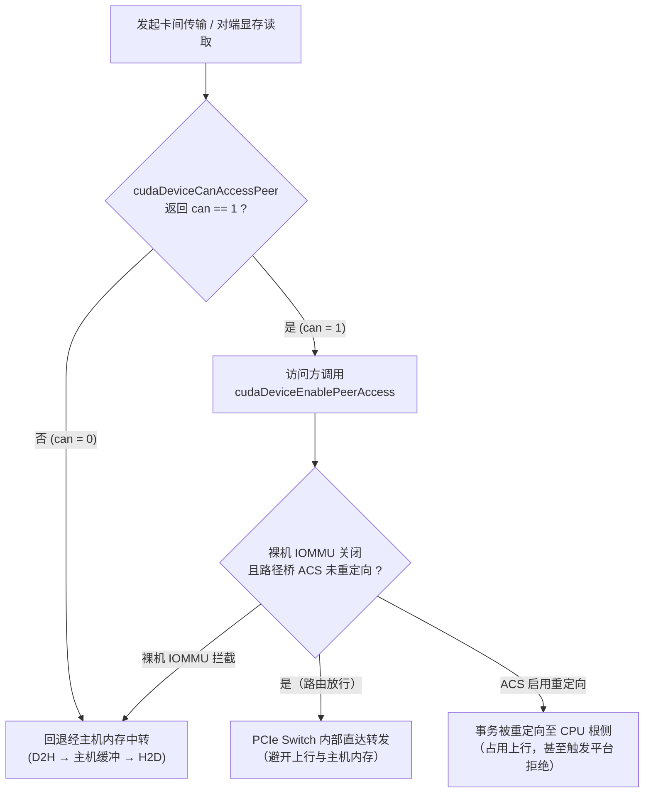

# CUDA P2P 的访问权限与 PCIe 路由

两张 GPU 明明插在同一颗 PCIe Switch 下，为什么把大模型张量并行（TP）推理或双卡训练跑起来后，卡间同步延迟仍然高得像是绕了一圈主机内存？

因为**物理上挂在同一颗 Switch 下，只代表具备硬件直达的“候选条件”**。真正让一次卡间传输走通 P2P，软件与硬件两道关卡必须同时过关：CUDA 运行时要为访问方打开对端显存地址的访问权限，PCIe 桥与主板芯片组也要允许事务在 Switch 内部直接转发，而不是拦截或重定向回 CPU。

## 对端显存访问的方向语义与三步启用流程

理解 CUDA P2P 最容易绕晕的地方，是把**“谁发起访问”**和**“数据往哪流”**混成一回事。

设想一个最简场景：同一进程能看到同分支上的**发送卡**与**接收卡**。发送卡用普通的 `cudaMalloc` 分配一块显存并写入计算结果；随后接收卡在自己的 Kernel 里直接解引用发送卡的设备指针，把数据读走并写入本地缓冲。

这一次操作的两个方向恰好相反：
- **访问方向（访问者 → 显存所有者）**：`接收卡 → 发送卡`（谁的 Kernel 发起寻址，谁就是访问方）；
- **有效载荷方向**：`发送卡 → 接收卡`（实际数据回包从显存所有者流向读取方）。

要让接收卡顺利读到发送卡的显存，应用需要按严格顺序走完“查询 → 启用 → 同步与校验”三步：

```cpp
// 假设同一进程中，ordinal 0 为发送卡（写入数据），ordinal 1 为接收卡（直接读取对端显存）
int can_access = 0;
// 1. 按有向顺序查询：设备 1（访问者）能否访问设备 0（显存所有者）
cudaError_t err = cudaDeviceCanAccessPeer(&can_access, /*device=*/1, /*peerDevice=*/0);

if (err == cudaSuccess && can_access == 1) {
    // 2. 切到访问方上下文并启用单向对等访问权限
    cudaSetDevice(1);
    cudaDeviceEnablePeerAccess(/*peerDevice=*/0, /*flags=*/0);

    // 3. 先等待发送卡完成写入，再由接收卡发起读取并同步校验
    cudaSetDevice(0);
    cudaStreamSynchronize(prod_stream);          // 保证生产者结果已可见

    cudaSetDevice(1);
    read_peer_kernel<<<1, 256, 0, cons_stream>>>(src_dev0_ptr, dst_dev1_ptr, n);
    // 若希望在接收卡保留整块本地副本，也可调用对等复制接口（启用 P2P 后免去主机暂存）：
    // cudaMemcpyPeerAsync(dst_dev1_ptr, 1, src_dev0_ptr, 0, bytes, cons_stream);
    cudaStreamSynchronize(cons_stream);          // 等待读取完成，随后拷回主机校验数据
}
```

> [!warning] 常见误区：返回 `cudaSuccess` 不等于支持 P2P，单向启用也不等于双向互通
> - **`err == cudaSuccess` 只表示查询接口本身执行正常**，真正的能力结论要看输出参数 `can_access == 1`。跨分支无直达能力时，接口同样返回 `cudaSuccess`，但 `can_access` 为 `0`。
> - **对等权限是有向的**：在接收卡侧执行 `cudaDeviceEnablePeerAccess` 仅授权“接收卡 → 发送卡”；如果反向也需要直达访问，必须切换到发送卡侧重新查询并启用。
> - **权限不代替执行顺序**：打开 P2P 仅解决“能不能寻址”，生产者何时写完、消费者何时可读，仍须靠 Stream 或 Event 显式同步保证。

当应用希望把整块张量完整复制到接收卡显存中反复使用时，通常会调用 `cudaMemcpyPeerAsync`。按 CUDA 13.2.1 规范，只要相关设备对已启用对等访问，这类设备间拷贝就能绕开主机内存暂存区；不过最终事务到底走哪条物理链路，还要看下一节的 PCIe 路由与平台约束。

## PCIe Switch 内转发、ACS 重定向与裸机 IOMMU

哪怕两张卡同挂在一颗 PCIe Switch 下，PCIe 事务的实际路由仍可能分叉出三种截然不同的命运：

1. **Switch 内部直达转发（理想路径）**：读取请求与数据回包只在两张卡的下行端口之间交换，Switch 上行与主机内存全程空闲，延迟最低、带宽独立。
2. **ACS 重定向至根侧（性能退化）**：**ACS（Access Control Services，访问控制服务）** 是 PCIe 桥用于强制隔离和安全检查的硬件机制。当桥上的 `ReqRedir`（请求重定向）或 `CmpltRedir`（完成包重定向）开启时，本可在 Switch 内短路的对等事务会被强制拐回 CPU 根侧；这不仅白白吃掉上行带宽，还可能因芯片组不支持根侧转发而导致 P2P 失败。
3. **主机内存中转（显式或隐式回退）**：当 P2P 不可用时，载荷先通过 D2H 写入主机内存，再通过 H2D 拉到接收卡，既占满双向 PCIe 上行，又叠加两倍延迟——在每生成一个 token 都要做数十次小消息同步的大模型推理 TP 场景下，这种回退会直接拉爆尾延迟。

除了 ACS，Linux 裸机上另一个常见“拦路虎”是 **IOMMU（输入输出内存管理单元）**，它负责为设备 DMA 提供地址转换和隔离保护。按 CUDA 13.2.1 官方指南，**在启用了 IOMMU 的 Linux 裸机上，CUDA 与 NVIDIA 驱动不支持 GPU 间的 PCIe P2P 内存传输**。

> [!note] 适用边界：裸机直连 vs 虚拟机直通
> 上述 IOMMU 限制针对 Linux 裸机上的 PCIe P2P。如果通过 VFIO 将 GPU 直通给虚拟机（VM），虚拟化场景有独立的透传与互联支持条件；而网卡经 PCIe 直接访问显存（GPUDirect RDMA）涉及的 DMA-BUF、ACS 与 IOMMU 配合，将在 [第 06 章](../06_从普通网络通信走向RDMA/00_内容大纲.md) 深入展开。

下面这张判定流程把权限与路由的检查顺序串成一条可执行的排查主线：



*图 04-03-01：PCIe 节点上卡间 P2P 从软件授权到硬件路由的判定主线。*

排查真实节点时，可以通过四组只读命令交叉核对拓扑、驱动状态、桥配置与内核启动参数：

| 检查命令 / 观察点 | 能回答的核心问题 |
| --- | --- |
| `nvidia-smi topo -m` 与 `lspci -D -t` | 两张卡挂在哪颗桥下，物理上是否存在公共 Switch 捷径？ |
| `nvidia-smi topo -p2p p` | 驱动层对各 GPU 对报告什么 PCIe P2P 状态（`OK` / `CNS` / `NS`）？ |
| `lspci -D -s <桥BDF> -vv` | 沿途下行桥的 `ACSCtl` 中 `ReqRedir`、`CmpltRedir` 是否为 `+`（开启重定向）？ |
| `/proc/cmdline` 与本次 `dmesg` | 内核启动参数意图是什么，系统实际是否启用了 IOMMU / DMAR？ |

对照本章双路四卡参考拓扑，一次健康裸机上的 P2P 取证片段如下：

```bash
# 1. 查看驱动上报的 PCIe P2P 能力矩阵（OK=支持，CNS=芯片组不支持跨路转发）
$ nvidia-smi topo -p2p p
        GPU0    GPU1    GPU2    GPU3
 GPU0   X       OK      CNS     CNS
 GPU1   OK      X       CNS     CNS
 GPU2   CNS     CNS     X       OK
 GPU3   CNS     CNS     OK      X

# 2. 检查 Switch A 下行桥 0000:40:01.0 的 ACS 控制位（尾缀 "-" 表示已关闭重定向）
$ sudo lspci -D -s 0000:40:01.0 -vv | grep -A1 "ACSCap:"
        ACSCap: SrcValid+ TransBlk+ ReqRedir+ CmpltRedir+ UpstreamFwd+ EgressCtrl- DirectTrans-
        ACSCtl: SrcValid- TransBlk- ReqRedir- CmpltRedir- UpstreamFwd- EgressCtrl- DirectTrans-

# 3. 核对内核启动参数与本次启动的 IOMMU 状态
$ cat /proc/cmdline | tr ' ' '\n' | grep -iE "iommu|dmar"
intel_iommu=off
```

`nvidia-smi topo -p2p p` 的矩阵非常适合与 CUDA 进程内的有向查询交叉印证；不过，光看到某一条桥配置或启动参数还不足以下最终结论，必须把能力查询、执行结果和校验合在一起看。

## 设备对能力记录与“真走直达”的取证边界

在双路四卡参考节点上，用直接读取对端指针的测试 Kernel 分别检验“同分支邻居对”与“跨分支远端对”，结果如下（箭头均表示**访问者 → 显存所有者**）：

| 访问方向 | 查询返回码 | `can` | 启用结果 | 执行完成与数据校验 |
| --- | --- | ---: | --- | --- |
| `GPU 1 → GPU 0` | `cudaSuccess` | `1` | 成功 | 成功，读回结果校验一致 |
| `GPU 0 → GPU 1` | `cudaSuccess` | `1` | 成功 | 成功，读回结果校验一致 |
| `GPU 2 → GPU 0` | `cudaSuccess` | `0` | 未调用 | 未执行 |
| `GPU 0 → GPU 2` | `cudaSuccess` | `0` | 未调用 | 未执行 |

读这张表时，要分清每一级证据究竟确认了什么：

- **第一行通过**：证明在当前节点条件下，`GPU 1` 可以直接按设备指针读到 `GPU 0` 的显存并拿到正确字节。但如果想进一步确认**有效载荷全程留在 `Switch A` 内部而未绕道根侧**，还需要结合沿途桥的 `ACSCtl` 状态，并在平台支持性能计数器时对照两卡下行与 Switch 上行的实际流量。
- **第三、四行返回 `can = 0`**：明确给出跨分支无 PCIe P2P 能力的结论。此时若要把 `GPU 0` 的计算结果送给 `GPU 2`，应用需显式先 D2H 写入本地内存 `M0`，再由 `GPU 2` 跨 Socket 经 `Switch B` 发起 H2D，并分别等待两段完成、校验目标数据。

> [!summary] 核心结论
> PCIe P2P 是否真正落地，取决于**软件有向授权**（`CanAccessPeer` + `EnablePeerAccess`）与**硬件路由放行**（同 Switch、ACS 不重定向、裸机关闭 IOMMU）同时成立。即便全部放行，PCIe 带宽仍受制于插槽位宽与桥树层级；要想把单机多卡互联推高一个数量级，就需要下一篇登场的专有高速互联——**NVLink 与 NVSwitch**。

> [!info]- 参考资料
> - **CUDA 对等访问与多 GPU 内存模型**：[CUDA 13.2.1 · Multi-GPU Systems](https://docs.nvidia.com/cuda/archive/13.2.1/cuda-programming-guide/03-advanced/multi-gpu-systems.html)、[Multi-Device P2P Transfers & Memory Access](https://docs.nvidia.com/cuda/archive/13.2.1/cuda-programming-guide/03-advanced/multi-gpu-systems.html#multi-device-peer-to-peer-transfers-and-memory-access)、[Peer-to-Peer Memory Transfers](https://docs.nvidia.com/cuda/archive/13.2.1/cuda-programming-guide/03-advanced/multi-gpu-systems.html#peer-to-peer-memory-transfers)、[Host IOMMU, ACS and VMs](https://docs.nvidia.com/cuda/archive/13.2.1/cuda-programming-guide/03-advanced/multi-gpu-systems.html#host-iommu-hardware-pci-access-control-services-and-vms)
> - **CUDA Runtime P2P 与内存 API**：[CUDA 13.2.1 · Peer Device Memory Access](https://docs.nvidia.com/cuda/archive/13.2.1/cuda-runtime-api/group__CUDART__PEER.html)、[Runtime Memory Management](https://docs.nvidia.com/cuda/archive/13.2.1/cuda-runtime-api/group__CUDART__MEMORY.html)
> - **Linux PCIe P2P、ACS 与工具参考**：[Linux Kernel · PCI Peer-to-Peer DMA](https://docs.kernel.org/driver-api/pci/p2pdma.html)、[pciutils · ACS 扩展能力字段](https://github.com/pciutils/pciutils/blob/v3.13.0/ls-ecaps.c)、[NVIDIA SMI · Topology](https://docs.nvidia.com/deploy/nvidia-smi/)
> - **NCCL P2P 与 ACS 排障指南**：[NCCL 2.27.3 · Troubleshooting](https://docs.nvidia.com/deeplearning/nccl/archives/nccl_2273/user-guide/docs/troubleshooting.html)、[NCCL 2.27.3 · PCIe ACS 与卡间通信排查](https://docs.nvidia.com/deeplearning/nccl/archives/nccl_2273/user-guide/docs/troubleshooting.html#pci-access-control-services-acs)
