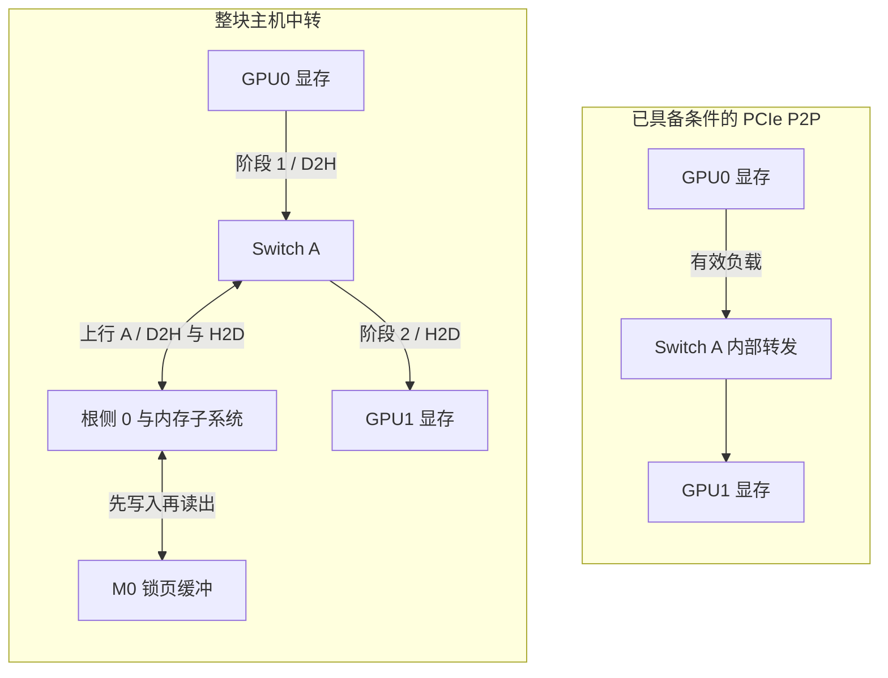
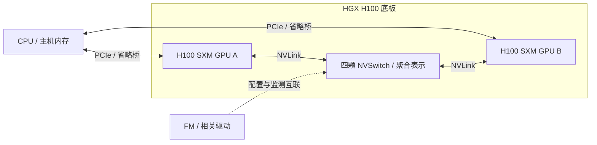

# GPU 直达、NVLink 与互联就绪

## P2P 让哪一段不再经过主机内存

先只看 GPU0、GPU1。下图对比**有效负载的数据流**，两部分是互斥的传输安排，不表示同时复制两份。中转部分的双向箭头表示同一段通路在两个阶段被反向使用：先沿 GPU0→M0 完成 D2H，再沿 M0→GPU1 完成 H2D。所有中间节点都是相应路径上的硬件；主机控制调用没有画成数据流。



中转图只画一份 Switch A 和根侧，GPU0 与 GPU1 的数据会先后经过它们。P2P 路径不把负载落入主机 DRAM，但 CPU 仍可参与提交与同步。某些 P2P 路径也可能经过根侧；“不经主机内存”并不等于“绝不经过 CPU 所在芯片的 I/O 硬件”。

## 能访问与已经启用是两件事

CUDA 的 `cudaDeviceCanAccessPeer(&can, device, peerDevice)` 查询前一个设备能否直接访问后一个设备的显存。下面是**说明调用含义的 C++ 片段**，不构成可直接运行的完整程序：

```cpp
int can = 0;
cudaError_t query = cudaDeviceCanAccessPeer(&can, 0, 1);
// 先检查 query == cudaSuccess，再解释 can；查询失败不等于“不支持”。
// 只有 can == 1 时才继续，并逐次检查以下调用的返回值：
cudaSetDevice(0);
cudaDeviceEnablePeerAccess(1, 0);
// 此后，GPU0 的当前上下文获得对 GPU1 相应分配的访问权限。
```

这里的方向是“访问者 GPU0 → 内存所有者 GPU1”。GPU0 读取 GPU1 内存时，返回的数据会从 GPU1 流向 GPU0，所以它不是一张简单的“复制源→目的”矩阵。反向访问需要单独查询并从 GPU1 启用；当前设备的启用不会自动授予反向权限。精确定义见 [CUDA 12.8.1 Runtime API：Peer Device Memory Access](https://docs.nvidia.com/cuda/archive/12.8.1/cuda-runtime-api/group__CUDART__PEER.html)。

本章四卡模型现在新增一份**自拟的 API 查询汇总**：所有查询均成功，行是访问者，列是显存所有者，1/0 表示具备/不具备该方向的能力；对角线不查询，写作 `—`。

| 访问者 \ 显存所有者 | GPU0 | GPU1 | GPU2 | GPU3 |
| --- | --- | --- | --- | --- |
| GPU0 | — | 1 | 0 | 0 |
| GPU1 | 1 | — | 0 | 0 |
| GPU2 | 0 | 0 | — | 1 |
| GPU3 | 0 | 0 | 1 | — |

本例同分支两卡具备双向能力，跨 Socket 两卡不具备。它是题设能力，不能推广成“所有同 Switch 都支持”或“所有跨 Socket 都不支持”。本节限于普通设备分配与进程内访问；内存池、跨进程导出等还有各自的访问安排。

访问权限也不建立生产者与消费者的时序。GPU0 的 Kernel 生成结果后，GPU1 若要读取或复制这些结果，需要先确认生产完成；复制完成之后，GPU1 的后续 Kernel 才能使用本地副本。可以先等待相应操作完成，再提交后续工作，也可以按 CUDA 支持的 Event/Stream 依赖组织执行。软件必须分别解决“能访问”和“何时可访问”，最后检查返回值与数据校验。

`cudaMemcpyPeerAsync` 这样的名字也不足以证明一次负载实际采用了直达路径。应结合能力、启用结果、所用内存/API、完成与测试信息解释；软件可能采用主机中转，也可能因访问方式不受支持而报错。P2P 的地址访问与卡间复制机制见 [CUDA 12.8.1 编程指南：Peer-to-Peer Memory Access / Memory Copy](https://docs.nvidia.com/cuda/archive/12.8.1/cuda-c-programming-guide/index.html#peer-to-peer-memory-access)。

## 拓扑近只是条件之一

GPU 产品与设备模式、PCIe 转发结构、驱动和操作系统支持、地址映射与访问控制，都会参与 P2P 是否成立的判断。统一虚拟寻址只提供地址组织基础，不授予任意设备直接访问权限。

其中两个容易混淆的名字需要先建立：**IOMMU** 为设备 DMA 地址提供翻译与访问限制，支持隔离和虚拟机直通等场景；**ACS（Access Control Services）**是 PCIe 的访问控制机制，某些重定向设置会把本可在 Switch 内完成的点对点事务送向根侧，从而改变路径、性能或可用性。相关支持性与诊断见 [NCCL 2.31.2：Linux bare-metal IOMMU 与 ACS](https://docs.nvidia.com/deeplearning/nccl/archives/nccl_2312/user-guide/docs/troubleshooting/gpu_troubleshooting.html#linux-bare-metal-iommu-and-pcie-peer-to-peer)。

按本章 CUDA 12.8.1 基线，Linux 裸机上启用 IOMMU 的 PCIe P2P 复制有明确的不支持说明；虚拟机 PCIe 直通场景的条件不同，见[归档编程指南 “IOMMU on Linux”](https://docs.nvidia.com/cuda/archive/12.8.1/cuda-c-programming-guide/index.html#iommu-on-linux)。阅读支持性时必须保留裸机/虚拟化、PCIe/NVLink 与版本条件。出现问题时先读取平台和配置证据；本章不把关闭隔离机制或修改 PCIe 寄存器列为通用修复操作。

## NVLink 与 NVSwitch 分别改变什么

NVLink 是 GPU 间的专用互联，可承载支持条件下的 P2P。NVSwitch 则把多条 NVLink 接入交换结构，扩展 GPU 间的可达关系。它与扩展 PCIe 端口的 PCIe Switch 属于不同的互联。

切换到**独立的平台对照：HGX H100 八 GPU、第三代 NVSwitch**。下图只画其中两张 GPU，把四颗 NVSwitch 聚合成一个节点，不表达逐芯片端口数量；虚线是管理关系，双向实线是数据连接。



底板是器件的容纳范围，数据经过实际 NVLink 和 NVSwitch。GPU 间通信可以走 NVLink，主机给 GPU 的输入仍需分析自己的 PCIe 路径；不能把卡间带宽数值赋给 H2D。结构与代际见 [Fabric Manager：NVSwitch-Based Systems](https://docs.nvidia.com/hgx-platforms/fabric-manager-user-guide/index.html#nvswitch-based-systems)。

例如，H100 SXM 的 18 条第四代 NVLink 合计标为 **900 GB/s 双向带宽**，见 [CUDA 12.8.1 Hopper Tuning Guide：Fourth-Generation NVLink](https://docs.nvidia.com/cuda/archive/12.8.1/hopper-tuning-guide/index.html#fourth-generation-nvlink)。在该规格口径下，对称单向合计为 450 GB/s；900 既不是一条链路的速率，也不是每对 GPU 同时各自独占的单向带宽。实际复制吞吐还受双方端口、交换资源、显存与传输方式约束。本章的 25 GB/s PCIe 教学预算不用于这一平台。

NVLink 也没有把八张卡的显存自动变成一张卡的本地显存。应用仍要建立访问关系，安排数据分片或复制，并处理同步；计算所需数据位于本地还是远端，仍会影响执行。

## Fabric Manager 管的是互联状态

这里把由 NVLink 和交换结构组成的互联网络称为 NVLink Fabric。Fabric Manager（FM）参与受支持 NVSwitch 平台的发现、配置、GPU 加入互联与运行状态管理。它是管理软件，应用有效负载经过的是互联硬件，不逐字节流经 FM 进程。普通无 NVSwitch 的四卡 PCIe 教学节点，不因“有多张 GPU”就需要安装 FM。

初始化细节必须按代际区分。HGX A100 等不支持 ALI 的平台，驱动加载后还需 FM 配置 NVLink；若未完成初始化，CUDA 初始化可能报 `cudaErrorSystemNotReady`。HGX H100 支持 **ALI（Autonomous Link Initialization，自主链路初始化）**，链路训练可由硬件完成，而 GPU 仍需注册到 NVLink Fabric 才具备相应 P2P 能力。注册失败时也不能统一描述为“所有 CUDA 计算都不可用”。第四代 NVSwitch 平台另涉及 NVLSM（NVLink Subnet Manager）等服务，本章不沿用 H100 的服务组成推断它们。依据见 [FM 指南：Initializing NVSwitch and NVLink](https://docs.nvidia.com/hgx-platforms/fabric-manager-user-guide/index.html#initializing-nvswitch-and-nvlink)及 “Systems Using Fourth Generation NVSwitches” 小节。

下面给出 **HGX H100 场景的自拟、删节状态材料**。只保留 GPU A 的 Fabric 字段，用于学习读法；命令是 `nvidia-smi -q -i <GPU-A的UUID>`，占位参数须替换为该独立平台的真实标识。

```text
时刻 t0：                   时刻 t1：
Fabric                      Fabric
    State  : In Progress        State  : Completed
    Status : N/A                Status : Success
```

t0 的注册尚未完成，`N/A` 不是失败码；t1 支持该 GPU 的注册已完成且成功。它还不能代表其余七张卡、所有链路和作业性能都已通过验收。完整判断应接上每张 GPU 的 Fabric 状态、预期链路状态、P2P 正确性与带宽材料。

可用的只读证据包括 `systemctl status nvidia-fabricmanager`、`journalctl -u nvidia-fabricmanager -b`、`nvidia-smi -q` 与 `nvidia-smi nvlink -s`；关注服务是否退出、初始化是否完成、GPU 是否加入、链路是否符合平台预期。服务 Active 只说明进程状态，链路 Active 也不是当前正在传多少数据。字段和命令含义见 [nvidia-smi：NVLINK](https://docs.nvidia.com/deploy/nvidia-smi/index.html)小节。恢复步骤与版本变更在第 18—19 章展开，不能用反复重启服务替代状态核对。

接下来回到四卡节点，将设备身份与这些关系对应起来，才能知道应该验证哪一对 GPU、把主机缓冲放在哪边。

[上一篇：沿 PCIe 路径计算带宽预算](02_沿PCIe路径计算带宽预算.md) · [下一篇：把拓扑输出变成放置判断](04_把拓扑输出变成放置判断.md)
