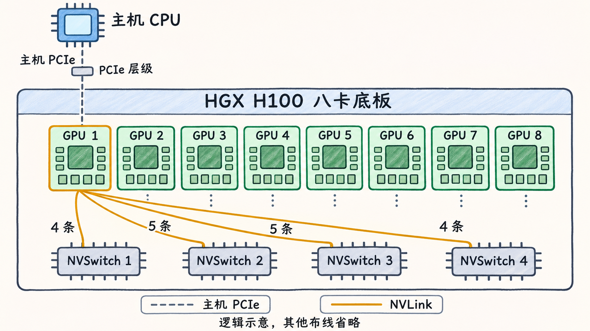

# NVLink、NVSwitch 与 HGX H100 Fabric 就绪

哪怕 PCIe 链路完全健康且 P2P 一路绿灯，Gen4 x16 的单向带宽上限也只有 `31.51 GB/s`，Gen5 x16 也不过 `63.02 GB/s`。一旦进入八卡规模——无论是训练每步同步数 GB 梯度，还是 70B 推理做 8 卡张量并行（TP）时每生成一个 token 都要做几十层全卡归约——把卡间通信塞进 PCIe 树，算力芯片很快就会退化成“等通信的摆设”。

解决思路非常干脆：**把卡间高速通信从 PCIe 树里彻底剥离出来，在 GPU 之间单独铺设一张超高带宽专用交换网**。这套体系由四个核心部件组成：

- **NVLink**：NVIDIA 专为 GPU 间高速通信设计的点对点串行总线。两张直连 GPU 可经 NVLink 直接读写彼此显存，绕开主机 PCIe 树。
- **NVSwitch**：专用于连接多张 GPU NVLink 端口的高速全互联交换芯片。有了它，八张 GPU 无需两两拉线组成复杂网状拓扑，任意两张卡都能通过交换芯片以全对等高带宽直达互通。
- **NVLink Fabric**：由底板上的 GPU、NVSwitch 芯片和全部 NVLink 物理链路共同构成的卡间高速交换结构。
- **Fabric Manager（FM）**：运行在宿主机上的控制面系统服务，与 NVIDIA 驱动协作完成 NVSwitch 路由表配置、GPU 注册协调与运行期 Fabric 健康监控。

对上层软件而言，NVLink Fabric 保持了极佳的透明性：CUDA 依然用上一篇的 `cudaDeviceCanAccessPeer` 与 `cudaDeviceEnablePeerAccess` 表达访问者与显存所有者，只是底层传输介质从 PCIe 无缝切换到了 NVLink。

## HGX H100 底板拓扑与带宽量级

下面切换到一个独立的八卡高阶平台——标准 **HGX H100** 裸机底板。底板集成 8 张 H100 SXM 模组与 4 颗第三代 NVSwitch 芯片；每张 GPU 通过 **18 条第四代 NVLink** 分别连入四颗 NVSwitch，链路按 `4、5、5、4` 条均匀扇出。

沿下图追踪一次跨卡读取（例如由 `GPU 2` 读取图中展开接线的 `GPU 1` 显存）：读取请求沿 **访问卡 → NVSwitch → 目标卡** 抵达对端，有效载荷再沿相反方向返回读取方；两张卡各自持有独立 HBM 显存，主机 PCIe 链路全程不受打扰。



*图 04-04-01：HGX H100 八卡底板逻辑拓扑（仅展开 GPU 1 的主机 PCIe 与 18 条 NVLink 接线，其余卡同类连线从略；GPU 与 NVSwitch 均会作为 PCIe 设备出现在主机 PCIe 树中，图中编号按底板物理丝印标出，运行时须用 UUID 核对设备）。*

算一笔直白的带宽账，就能立刻感受到 NVLink Fabric 的量级跃升。第四代 NVLink 单条双向合计规格为 `50 GB/s`（对称拆分即每方向 `25 GB/s`），因此每张 H100 SXM 的 18 条链路总聚合带宽为：

$$B_{\text{bi}} = 18 \times 50\ \text{GB/s} = 900\ \text{GB/s}, \qquad B_{\text{uni}} = 18 \times 25\ \text{GB/s} = 450\ \text{GB/s}$$

| 互联方式 | 单向理论上限（单卡聚合） | 相对 PCIe Gen4 x16 倍数 | 典型承载流量 |
| --- | ---: | ---: | --- |
| PCIe Gen4 x16 | `31.51 GB/s` | `1.0×` | 主机 ↔ GPU（H2D/D2H）、无 NVLink 卡间 P2P |
| PCIe Gen5 x16 | `63.02 GB/s` | `2.0×` | H100 主机 ↔ GPU（数据加载、权重载入） |
| **H100 第四代 NVLink（18 条）** | **`450 GB/s`** | **`~14.3×`** | **机内多卡 P2P、训练 AllReduce、推理 TP 同步** |

> [!tip] 工程直觉：记住两条“物理分工边界”
> 1. **算力与互联各管一段**：HGX H100 的 `450 GB/s` 单向聚合规格只服务于**卡间 NVLink 通信**；当主机把训练批次或百 GB 模型权重送入显存（H2D）时，数据依然走虚线标出的**主机 PCIe 通道**，必须按 PCIe 速率与主机内存预算核算。
> 2. **规格上限 ≠ 任意并发实测值**：估算真实卡间拷贝速度时，除单卡 18 条链路聚合上限外，还要考虑源端发送能力、目的端接收能力，以及同一时间窗内其他卡对在 NVSwitch 上的共享流量。

## ALI 链路训练、Fabric Manager 与 GPU 注册闭环

在 PCIe 服务器上，能被系统识别的卡往往很快就能跑 P2P；但在带 NVSwitch 的 HGX H100 节点上，**“主机看见了 8 张卡”离“8 张卡能走 NVLink 互通”中间还隔着三道关**：

1. **主机 PCIe 枚举**：操作系统识别到底板上的 8 张 GPU 和 4 颗 NVSwitch 设备，`nvidia-smi` 管理查询通畅。
2. **ALI 硬件链路训练**：HGX H100 支持 **ALI（Autonomous Link Initialization，自主链路初始化）**，让 GPU 与 NVSwitch 硬件自主完成物理链路训练，建立端到端链路层通信。
3. **Fabric Manager 路由与 GPU 注册**：链路通了只代表“每张卡连上了交换机”，要让任意两张卡跨 NVSwitch 互相寻址，还必须由宿主机上的 `nvidia-fabricmanager` 服务协同驱动配置路由表，并由每张 GPU 完成向 Fabric 的注册。
4. **设备对功能与方向验证**：两端 GPU 均注册完成后，还需核对目标方向的 NVLink P2P 能力并完成一次实际数据传输与数据校验。

> [!warning] 常见误区：能查到卡 ≠ NVLink P2P 可用
> 按 NVIDIA 对 HGX H100 裸机的官方行为定义，**如果某张 GPU 未能完成 Fabric 注册，它会丧失 NVLink P2P 能力，但依然可以运行不依赖 P2P 的单卡任务**。因此，交付或排障时只跑 `nvidia-smi` 看 8 张卡都在列表里，极易漏掉 Fabric 未就绪的隐患——直到多卡训练或 8 卡 TP 推理启动才在通信阶段报错或掉速。

在运行 systemd 的 Ubuntu 24.04 节点上，下面这组命令可以一次把服务、注册状态、物理链路和 NVLink P2P 矩阵全部取齐：

```bash
# 1. 确认 Fabric Manager 服务运行状态，并对齐本次启动日志
$ systemctl status nvidia-fabricmanager.service --no-pager
● nvidia-fabricmanager.service - NVIDIA fabric manager service
     Active: active (running)

$ journalctl -b -u nvidia-fabricmanager.service -o short-iso | tail -n 5
2026-11-20T09:12:04+0800 node-1 nv-fabricmanager[2184]: Successfully configured all the available GPUs and NVSwitches...

# 2. 按已核对的 GPU UUID 查询单卡 Fabric 注册状态（启动中为 In Progress / N/A，就绪为 Completed / Success）
$ nvidia-smi -q -i GPU-aaaa1111-1111-1111-1111-111111111111 | grep -A 3 "Fabric"
    Fabric
        State                             : Completed
        Status                            : Success

# 3. 检查物理 NVLink 链路激活速率（单条第四代 NVLink 单向约 25+ GB/s）与 NVLink P2P 矩阵
$ nvidia-smi nvlink -s -i 0 | head -n 5
GPU 0: NVIDIA H100 80GB HBM3 (UUID: GPU-aaaa1111-1111-1111-1111-111111111111)
         Link 0: 26.562 GB/s
         Link 1: 26.562 GB/s
         Link 2: 26.562 GB/s

$ nvidia-smi topo -p2p n
        GPU0    GPU1    GPU2    GPU3    GPU4    GPU5    GPU6    GPU7
 GPU0   X       OK      OK      OK      OK      OK      OK      OK
 ...
```

对照一对已按 UUID 锁定的目标卡（记作发起卡与对端卡），不同阶段的观察结果对应着不同的确认边界与下一步动作：

| 当前观察到的状态 | 已经确认的事实 | 下一步必须核对的证据 |
| --- | --- | --- |
| PCIe 树列出设备，`nvidia-smi` 可查两卡 | 主机 PCIe 枚举与 NVML 管理查询已通 | 采集两端物理 NVLink 状态及 Fabric 注册字段 |
| NVLink 链路已激活，FM 服务 `active`，发起卡 Fabric 为 `In Progress / N/A` | 硬件链路已建立、FM 正在运行，但注册尚未结束 | 用 `journalctl -b` 对齐同次启动日志，跟踪注册推进结果 |
| 发起卡变为 `Completed / Success`，对端卡仍为 `In Progress / N/A` | 发起卡已入网，对端卡尚未就绪 | 继续核对对端卡的 `State` 与 `Status`，严禁提前放行多卡任务 |
| 两端均为 `Completed / Success`，`topo -p2p n` 对应方向为 `OK` | 具备发起 NVLink P2P 功能验证的全部前置条件 | 在目标设备对上执行指定方向的传输与数据校验，并记录驱动与 FM 版本 |

## 架构演进：第四代 NVSwitch 与 NVLSM 分工

如果从 HGX H100（第三代 NVSwitch）走向新一代 **HGX B100 / B200 / B300**（第四代 NVSwitch），NVLink Fabric 的软件控制面进一步拆分为两个协作组件：

- **NVLSM（NVLink Subnet Manager，NVLink 子网管理器）**：负责发现整个 NVLink 网络拓扑，计算并向 NVSwitch 下发交换机转发表；
- **Fabric Manager（FM）**：聚焦于 GPU 侧路由与 NVLink 配置，通过进程间通信（IPC）与 NVLSM 协同工作。

> [!note] 版本与平台说明：第三代 vs 第四代 NVSwitch 的打包与匹配规则
> - **HGX H100（第三代 NVSwitch）**：官方仍要求宿主机上的 GPU 驱动侧库版本与 Fabric Manager 保持严格版本匹配，排障与变更记录中必须同时登记驱动与 FM 版本。
> - **HGX B100/B200/B300（第四代 NVSwitch 及后续平台）**：控制面核查范围须同时覆盖 **NVLSM** 与 **FM** 两项服务。打包策略以驱动分支 **R620** 为分界——R620 之前按驱动分支配套安装；从 R620 起，FM 及相关组件可独立于 GPU 驱动安装，但 FM 仍依赖驱动提供的 `libnvidia-fmdrv.so.1`。

> [!summary] 核心结论
> NVLink 与 NVSwitch 将单机多卡互联从数十 GB/s 的 PCIe 跃升到每卡 `900 GB/s` 双向聚合的专用交换结构。运维与交付 HGX 平台时，切记沿 **PCIe 枚举 → ALI 物理链路 → FM 注册（`Completed / Success`）→ 实际对端校验** 逐级确认。
>
> 下一篇我们要解决最后一个单机落地难题：如何把容器和进程里的 `cuda:0` 精确对回物理卡、PCIe 分支、CPU 核心与就近网卡。

> [!info]- 参考资料
> - **第三代 NVSwitch 与第四代 NVLink 规格**：[NVIDIA Blog · Upgrading Multi-GPU Interconnectivity with the Third-Generation NVSwitch](https://developer.nvidia.com/blog/upgrading-multi-gpu-interconnectivity-with-the-third-generation-nvidia-nvswitch/)、[CUDA 13.2.1 · Hopper Tuning Guide (Fourth-Generation NVLink)](https://docs.nvidia.com/cuda/archive/13.2.1/hopper-tuning-guide/index.html)、[NVIDIA Hopper Tuning Guide · Fourth-Generation NVLink](https://docs.nvidia.com/cuda/archive/11.8.0/hopper-tuning-guide/index.html#fourth-generation-nvlink)
> - **HGX H100 底板拓扑与 Fabric Manager 初始化**：[NVIDIA Fabric Manager · HGX H100 GPU Baseboard](https://docs.nvidia.com/datacenter/tesla/fabric-manager-user-guide/index.html#the-nvidia-hgx-h100-gpu-baseboard)、[NVSwitch Core Software Stack](https://docs.nvidia.com/datacenter/tesla/fabric-manager-user-guide/index.html#nvswitch-core-software-stack)、[Initializing NVSwitch and NVLink](https://docs.nvidia.com/datacenter/tesla/fabric-manager-user-guide/index.html#initializing-nvswitch-and-nvlink)、[Managing the Fabric Manager Service](https://docs.nvidia.com/datacenter/tesla/fabric-manager-user-guide/index.html#managing-the-fabric-manager-service)
> - **第四代 NVSwitch、NVLSM 与版本管理**：[NVIDIA Fabric Manager · Systems Using Fourth-Generation NVSwitches or Later](https://docs.nvidia.com/datacenter/tesla/fabric-manager-user-guide/index.html#systems-using-fourth-generation-nvswitches-or-later)、[Fabric Manager Versioning](https://docs.nvidia.com/datacenter/tesla/fabric-manager-user-guide/index.html#fabric-manager-versioning)
> - **NVLink 与 P2P 矩阵查询**：[NVIDIA SMI · NVLink & Topology](https://docs.nvidia.com/deploy/nvidia-smi/)
