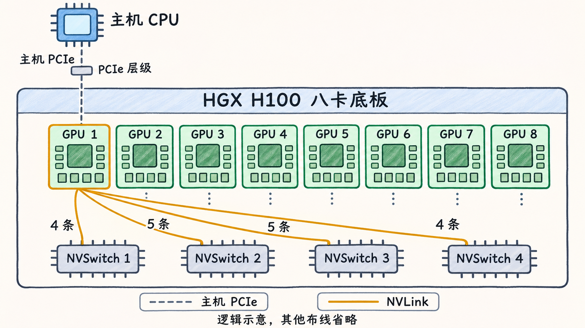
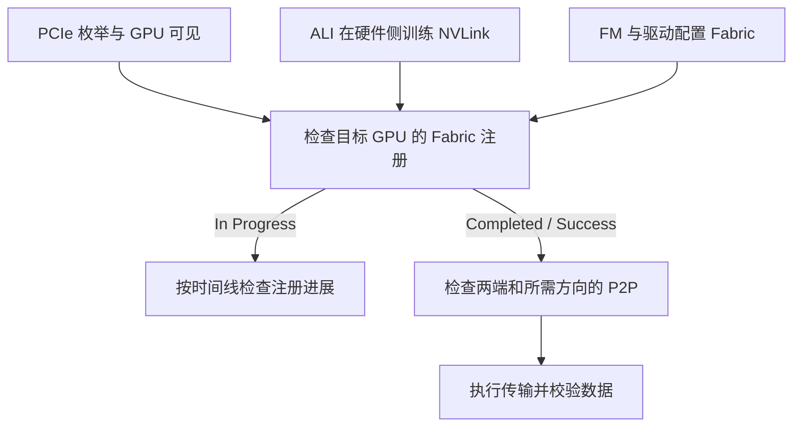

# NVLink 与 NVSwitch 平台何时就绪

在一台 HGX H100 八卡服务器上，`nvidia-smi` 能列出八张卡，说明管理工具可以查询这些设备。卡间 NVLink 还需经过链路训练、Fabric 注册和应用验证。本篇采用 HGX H100 八 GPU 裸机场景，与其余各篇的四卡 PCIe 教学节点分别分析。 [NVIDIA Fabric Manager · Initializing NVSwitch and NVLink](https://docs.nvidia.com/datacenter/tesla/fabric-manager-user-guide/index.html#initializing-nvswitch-and-nvlink)

## 把主机 PCIe 和卡间 NVLink 分开

在支持直连的配置中，一组 NVLink 可以直接连到两张 GPU。当多张 GPU 需要互达时，NVSwitch 可在各 GPU 的 NVLink 端口之间转发。HGX H100 八卡底板有八张 H100 SXM 和四个第三代 NVSwitch。每张 GPU 的 18 条第四代 NVLink 分别连到四个 NVSwitch，其中两个各连 4 条，另外两个各连 5 条。底板上的 GPU 与 NVSwitch 同时作为 PCIe 设备出现在主机的设备树中。主机 PCIe 和 GPU 间的 NVLink 是两套连接，GPU 间数据可以通过 NVSwitch 到达对端的独立显存。 [NVIDIA Fabric Manager · HGX H100 GPU Baseboard](https://docs.nvidia.com/datacenter/tesla/fabric-manager-user-guide/index.html#the-nvidia-hgx-h100-gpu-baseboard) · [NVIDIA Hopper Tuning Guide · NVLink](https://docs.nvidia.com/cuda/archive/11.8.0/hopper-tuning-guide/index.html#nvlink)

规格里的 `900 GB/s` 是**单张 H100 的 NVLink 双向合计**。如果按对称方向拆分，单方向的聚合规格为 `450 GB/s`。一次复制的有效吞吐还取决于端点、实际可用链路、其他流量和复制方式。主机到显存的复制应沿主机 PCIe 另算。 [NVIDIA · Third-Generation NVSwitch](https://developer.nvidia.com/blog/upgrading-multi-gpu-interconnectivity-with-the-third-generation-nvidia-nvswitch/)



**图 04-04-01**　HGX H100 八卡底板的逻辑拓扑。灰色虚线表示主机 PCIe，琥珀色实线表示卡间 NVLink。图中展开一张 GPU 到四个第三代 NVSwitch 的 18 条 NVLink，其余布线从略。编号仅用于示意。

## 链路训练之后还有 GPU 注册

HGX H100 支持 ALI（Autonomous Link Initialization），GPU 和 NVSwitch 硬件可以自行训练 NVLink。Fabric Manager（FM）是主机上的管理进程，通过驱动配置和监视交换结构。GPU 还要注册到 Fabric 才具备 NVLink P2P。NVIDIA 文档说明，H100 这类 ALI 平台上的 GPU 注册失败后，会失去 NVLink P2P 能力，仍可供非 P2P 用途使用。 [NVIDIA Fabric Manager · NVSwitch Core Software Stack](https://docs.nvidia.com/datacenter/tesla/fabric-manager-user-guide/index.html#nvswitch-core-software-stack) · [Initializing NVSwitch and NVLink](https://docs.nvidia.com/datacenter/tesla/fabric-manager-user-guide/index.html#initializing-nvswitch-and-nvlink)

下面按现场检查顺序画出几层证据。PCIe 枚举和硬件链路训练分别观察，图中的并列关系只表示检查点。



NVIDIA 的裸机指南给出了 `nvidia-smi -q` 的单 GPU 示例，注册中为 `State = In Progress`、`Status = N/A`，成功后为 `State = Completed`、`Status = Success`。这是厂商文档的状态示例，示例段落未注明具体驱动与 FM 完整版本。判读时应一起看 `State` 和 `Status`。 [NVIDIA Fabric Manager · Initializing NVSwitch and NVLink](https://docs.nvidia.com/datacenter/tesla/fabric-manager-user-guide/index.html#initializing-nvswitch-and-nvlink)

以使用 systemd 的 Linux 裸机为例，同一轮采集先保留驱动、FM 与工具版本，再把服务、日志时间和 GPU UUID 对齐。查询命令如下。 [NVIDIA Fabric Manager · Managing the Fabric Manager Service](https://docs.nvidia.com/datacenter/tesla/fabric-manager-user-guide/index.html#managing-the-fabric-manager-service) · [NVIDIA SMI · Topology](https://docs.nvidia.com/deploy/nvidia-smi/)

```bash
systemctl status nvidia-fabricmanager.service
journalctl -b -u nvidia-fabricmanager.service -o short-iso
nvidia-smi --query-gpu=index,uuid,pci.bus_id --format=csv
nvidia-smi -q
nvidia-smi topo -p2p n
```

假设作业使用 GPU A 和 GPU B。下面的观察是教学设定，A 和 B 代表采集表中已核对的两个 UUID。

| 这次观察到了什么 | 能据此确认什么 | 下一项证据 |
| --- | --- | --- |
| `nvidia-smi` 列出 A 和 B | 管理路径能查询这两张卡 | 按 UUID 读两张卡各自的 Fabric 状态 |
| FM 显示 `active`，A 为 `In Progress / N/A` | 查询时服务在运行，A 的注册仍在进行 | 对齐同一启动周期的服务日志时间与 A 的后续状态 |
| A 变为 `Completed / Success`，B 尚无记录 | A 已注册成功 | 采集 B 的状态，再看目标设备对的 NVLink P2P 能力 |
| 两端均已注册，所需方向的 P2P 测试完成且数据正确 | 这对设备在该测试条件下可通信 | 若要确认整机，补测其余目标设备对与方向。若要评价吞吐，固定测试口径再量 |

## 第四代 NVSwitch 的管理分工和版本边界

| 单节点平台 | 管理分工 | 核对版本时看什么 |
| --- | --- | --- |
| HGX H100 八 GPU，第三代 NVSwitch | FM 与驱动协作，配置适用的交换和 GPU 路由，监视 Fabric。硬件侧负责 ALI 链路训练 | 查该平台和所用驱动分支的兼容要求。指南的 FM 版本表仍列出早于第四代的系统有驱动侧库匹配要求 |
| HGX B100/B200/B300 八 GPU 等第四代 NVSwitch 平台 | NVLSM（NVLink Subnet Manager）发现拓扑、编程交换机转发表。FM 负责 GPU 侧路由、NVLink 配置等，两者通过进程间通信协作 | 第四代的裸机安装说明在 R620 以前按驱动分支提供配套组件，从 R620 起 FM 独立版本化，仍依赖驱动提供的 `libnvidia-fmdrv.so.1`。以目标平台的安装与依赖表为准 |

表中讨论单节点 NVSwitch。直接相连的 NVLink、机架级 NVLink 域和其他虚拟化模式各有自己的管理条件。现场从整机型号和 NVSwitch 代际出发，再决定采集哪些服务、注册字段及设备对测试。 [NVIDIA Fabric Manager · NVSwitch Core Software Stack](https://docs.nvidia.com/datacenter/tesla/fabric-manager-user-guide/index.html#nvswitch-core-software-stack) · [Fabric Manager Versioning](https://docs.nvidia.com/datacenter/tesla/fabric-manager-user-guide/index.html#fabric-manager-versioning)
