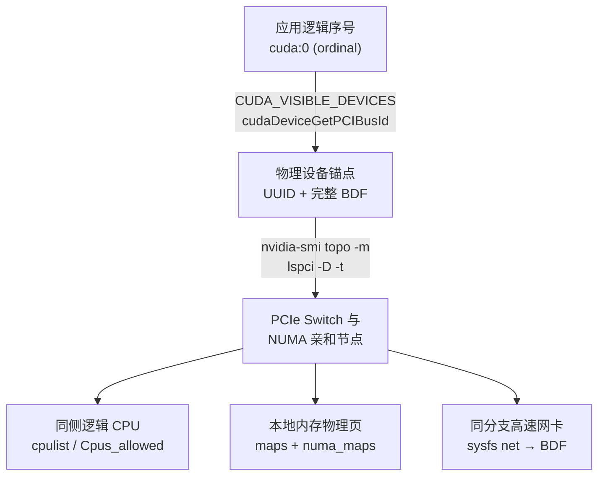

# GPU 编号映射与 GPU、CPU、网卡的 NUMA 亲和

排障现场经常出现令人抓狂的一幕：训练日志或大模型推理服务不断报 `cuda:0` 通信卡顿，你登到宿主机一看 `nvidia-smi topo -m`，以为它在 `GPU 0` 上、离本地内存和网卡都近在咫尺，结果查了半天才发现——进程眼里的 `cuda:0` 其实是物理 `GPU 2`，而且它的 DMA 缓冲页全落在对面 Socket 的远端内存里。

要把前面学过的带宽和路径推演真正落到线上节点，必须先把四件事一一对齐：**应用逻辑卡号、物理 GPU 身份、PCIe 桥与就近网卡，以及缓冲区的真实 NUMA 页落点**。

## 把应用里的 `cuda:0` 对回物理 GPU

Linux 服务器上的 GPU 同时存在三套编号体系，混用它们是排障踩坑的头号来源：

- **CUDA 进程内序号（ordinal）**：进程视角下从 `0` 开始的连续逻辑编号（如 PyTorch 的 `cuda:0`、`cuda:1`），由环境变量 `CUDA_VISIBLE_DEVICES` 筛选和重新排序。
- **宿主机 `nvidia-smi` index**：驱动枚举 GPU 时给出的宿主机序号，重启或调整 PCIe 卡槽后可能漂移。
- **物理设备锚点（UUID 与完整 BDF）**：**GPU UUID** 唯一标识一张物理显卡；**完整 PCI BDF** 锚定它在本次启动 PCIe 树中的确切插槽位置（工具输出的 8 位域号 `00000000` 与常见 4 位域号 `0000` 指同一 PCI 域）。

回到双路四卡参考节点，先用同一轮采集把宿主机 index、UUID 与 BDF 固化成对照表（重启或硬件变更后需重新采集）：

| 主机 index | 物理 GPU UUID | 完整 PCI BDF | 接入分支与 NUMA |
| ---: | --- | --- | --- |
| `0` | `GPU-11111111-1111-1111-1111-111111111111` | `0000:41:00.0` | `Switch A` / `NUMA 0` |
| `1` | `GPU-22222222-2222-2222-2222-222222222222` | `0000:42:00.0` | `Switch A` / `NUMA 0` |
| `2` | `GPU-33333333-3333-3333-3333-333333333333` | `0000:c1:00.0` | `Switch B` / `NUMA 1` |
| `3` | `GPU-44444444-4444-4444-4444-444444444444` | `0000:c2:00.0` | `Switch B` / `NUMA 1` |

假设启动容器或训练任务时，用 UUID 按逆序暴露了两张跨分支 GPU：

```bash
# 1. 宿主机采集三元组映射
$ nvidia-smi --query-gpu=index,uuid,pci.bus_id --format=csv
index, uuid, pci.bus_id
0, GPU-11111111-1111-1111-1111-111111111111, 00000000:41:00.0
1, GPU-22222222-2222-2222-2222-222222222222, 00000000:42:00.0
2, GPU-33333333-3333-3333-3333-333333333333, 00000000:C1:00.0
3, GPU-44444444-4444-4444-4444-444444444444, 00000000:C2:00.0

# 2. 启动进程时先列 GPU 2、再列 GPU 0（按 UUID 绑定可防止序号漂移）
$ export CUDA_VISIBLE_DEVICES=GPU-33333333-3333-3333-3333-333333333333,GPU-11111111-1111-1111-1111-111111111111

# 3. 进程内通过 cudaDeviceGetPCIBusId 查到的实际归属：
#    cuda:0 (ordinal 0) -> 0000:c1:00.0 -> 对应宿主机 GPU 2（Switch B / NUMA 1）
#    cuda:1 (ordinal 1) -> 0000:41:00.0 -> 对应宿主机 GPU 0（Switch A / NUMA 0）
```

只要做完这一步对齐，日志里看似模糊的 `cuda:0` 立刻还原成了宿主机 PCIe 树上的明确物理端点。

## 读懂 `nvidia-smi topo -m` 并用 `lspci` 回溯真实桥树

锁定物理卡后，下一步就是用 `nvidia-smi topo -m` 俯瞰整机的卡间距离、就近网卡与 CPU/NUMA 亲和关系。下面是双路四卡节点带完整图例的典型输出与逐行解读：

```bash
$ nvidia-smi topo -m
        GPU0    GPU1    GPU2    GPU3    NIC0    NIC1    CPU Affinity    NUMA Affinity
GPU0     X      PIX     SYS     SYS     PIX     SYS     0-31            0      # GPU 0 与 GPU 1、NIC 0 同在 Switch A，亲和 NUMA 0
GPU1    PIX      X      SYS     SYS     PIX     SYS     0-31            0      # 与 GPU 0 同分支；跨到 GPU 2/3 或 NIC 1 须走 SYS
GPU2    SYS     SYS      X      PIX     SYS     PIX     32-63           1      # GPU 2 与 GPU 3、NIC 1 同在 Switch B，亲和 NUMA 1
GPU3    SYS     SYS     PIX      X      SYS     PIX     32-63           1      # 进程 cuda:0 映射到这里，应匹配 CPU 32-63 与 M1

Legend:
  X    = Self
  SYS  = Connection traversing PCIe as well as the SMP interconnect between NUMA nodes (e.g., QPI/UPI)
  NODE = Connection traversing PCIe as well as the interconnect between PCIe Host Bridges within a NUMA node
  PHB  = Connection traversing PCIe as well as a PCIe Host Bridge (typically the CPU)
  PXB  = Connection traversing multiple PCIe bridges (without traversing the PCIe Host Bridge)
  PIX  = Connection traversing at most a single PCIe bridge
  NV#  = Connection traversing a bonded set of # NVLinks
```

> [!note] 版本与平台说明：矩阵表头与纯 PCIe 视图
> 部分新架构平台或较新驱动版本的 `nvidia-smi topo -m` 还会多出一列 `GPU NUMA ID`，阅读时以实际表头与 Legend 为准。在带 NVLink 的 HGX 节点上，矩阵默认优先显示 `NV18` 等 NVLink 连接；如果想单独核查底层 PCIe 亲和，可以执行 `nvidia-smi topo -mp`。

把矩阵中六个核心距离标签按“物理距离由近到远”整理，看拓扑图只需两秒钟：

| 距离标签 | 经过的硬件层级 | 工程含义 |
| --- | --- | --- |
| `NV#` | 由 `#` 条 NVLink 组成的专用高速互联 | 卡间通信最优路径（如 H100 上显示 `NV18`） |
| `PIX` | 最多经过一颗 PCIe Switch（单桥内直连） | 同 Switch 邻居设备，无 NVLink 时的最佳 PCIe 亲和 |
| `PXB` | 经过多颗级联 PCIe Switch，未穿过 Host Bridge | 同侧多级交换，仍在同一 PCIe 根分支下 |
| `PHB` | 穿过 CPU 内的 PCIe Host Bridge | 同 Socket 下的不同根端口分支 |
| `NODE` | 穿过同一 NUMA 节点内不同 Host Bridge 间的互联 | 同 NUMA 跨芯片组/多 Die 互联 |
| `SYS` | 穿过 PCIe 及跨 NUMA 节点的处理器间互联（UPI/xGMI） | 跨 Socket 远端路径，延迟最高、常触发中转或跨路争用 |

拓扑矩阵帮你快速圈定亲疏远近，而要确认**具体共用哪条 Switch 上行**，以及把 Linux 里的网口名（如 `enp195s0f0`）对回矩阵里的 `NIC1`，还要回到 `lspci -D -t` 与 `/sys` 核对完整 BDF：

```bash
# 1. 对照整机两条 PCIe 分支的桥树
$ lspci -D -t
-+-[0000:80]---01.0-[bf-c3]----00.0-[c0-c3]--+-01.0-[c1]----00.0   # GPU 2 (0000:c1:00.0)
 |                                           +-02.0-[c2]----00.0   # GPU 3 (0000:c2:00.0)
 |                                           \-03.0-[c3]----00.0   # NIC 1 (0000:c3:00.0)
 \-[0000:20]---01.0-[3f-43]----00.0-[40-43]--+-01.0-[41]----00.0   # GPU 0 (0000:41:00.0)
                                             +-02.0-[42]----00.0   # GPU 1 (0000:42:00.0)
                                             \-03.0-[43]----00.0   # NIC 0 (0000:43:00.0)

# 2. 将系统网口名反查到物理 PCI BDF（多口网卡需同时保留接口名与端口号对应关系）
$ readlink -f /sys/class/net/enp195s0f0/device
/sys/devices/pci0000:80/0000:80:01.0/0000:bf:00.0/0000:c0:03.0/0000:c3:00.0
```

| 根端口与 Switch 上行端口 | 同分支下的 Switch 下行端点 |
| --- | --- |
| Socket 0：`0000:20:01.0` → `0000:3f:00.0`（`Switch A`） | `GPU 0`（`0000:41:00.0`）、`GPU 1`（`0000:42:00.0`）、`NIC 0`（`0000:43:00.0`） |
| Socket 1：`0000:80:01.0` → `0000:bf:00.0`（`Switch B`） | `GPU 2`（`0000:c1:00.0`）、`GPU 3`（`0000:c2:00.0`）、`NIC 1`（`0000:c3:00.0`） |

对照上表一目了然：系统网口 `enp195s0f0` 对应的网卡与 `GPU 2` 同挂在 `Switch B` 下（距离为 `PIX`）。相比远在另一侧 Socket 的网卡，它自然成为该卡传输跨机数据的最佳就近候选，既避开跨 Socket 互联，也为 [第 06 章](../06_从普通网络通信走向RDMA/00_内容大纲.md) 的 GPUDirect RDMA 铺平了物理通路。

## 核查 CPU 亲和与 DMA 缓冲区的实际物理页落点

把显卡、CPU 核心和网卡对到同一 NUMA 节点，只完成了一半；真正决定 H2D 拷贝会不会偷偷跨 Socket 的，是**参与 DMA 的缓冲区物理页到底驻留在哪一侧内存**。

整个四级身份与亲和对齐链条可以浓缩为下面这张排查路径图：



*图 04-05-01：将进程逻辑 GPU 序号对齐到物理拓扑、CPU、内存物理页与就近网卡的四级取证链。*

Linux 在 `/sys` 与 `/proc` 里提供了完整的观测接口，逐项对照即可查清每一层是否真的对齐：

| 要核实的对象 | Linux 只读观察路径与关键字段 |
| --- | --- |
| PCIe 设备的亲和 NUMA 节点 | `/sys/bus/pci/devices/<BDF>/numa_node`（若为 `-1` 表示固件未上报，须结合桥树补证） |
| 某 NUMA 节点包含的逻辑 CPU | `/sys/devices/system/node/node<N>/cpulist` |
| 线程允许运行的 CPU 与内存范围 | `/proc/<pid>/task/<tid>/status` 中的 `Cpus_allowed_list` 与 `Mems_allowed_list` |
| 线程最近一次执行的 CPU 编号 | `/proc/<pid>/task/<tid>/stat` 中的 `processor` 字段 |
| 缓冲区实际驻留的物理页节点 | 先由 `/proc/<pid>/maps` 定位虚拟地址段起始地址，再对照 `/proc/<pid>/numa_maps` 中的 `N0`、`N1` 页计数 |

来看一个极具迷惑性的真实排障片段：进程把 `cuda:0`（即挂在 `NUMA 1` 的 `GPU 2`）的提交线程绑在了 `CPU 32-63` 上，表面上看 CPU 亲和完全正确，但一查缓冲区 `0x7f0000000000` 的 `numa_maps`，立刻露馅：

```bash
# 1. 确认目标 GPU (0000:c1:00.0) 归属 NUMA 1，且节点 1 的 CPU 范围为 32-63
$ cat /sys/bus/pci/devices/0000:c1:00.0/numa_node
1
$ cat /sys/devices/system/node/node1/cpulist
32-63

# 2. 检查提交线程的 CPU 允许范围：确实已绑在 NUMA 1 上
$ grep -E "Cpus_allowed_list|Mems_allowed_list" /proc/48120/task/48125/status
Cpus_allowed_list:      32-63
Mems_allowed_list:      0-1

# 3. 核查 DMA 源缓冲区（独立匿名映射，起始地址 0x7f0000000000）的真实物理页落点
$ grep "^7f0000000000 " /proc/48120/numa_maps
7f0000000000 default anon=256 N0=256 kernelpagesize_kB=4
# 解读：256 个 4 KiB 页（共 1 MiB）全部驻留在 NUMA 0（M0）上，而非本地 M1！
```

由于这 1 MiB 页锁定缓冲区的物理页全部落在远端内存 `M0`（`N0=256`），只要采样后页位置未发生变化，即便提交线程跑在 `CPU 32-63` 上，目标卡发起的 DMA 载荷依然要绕道 **M0 → Socket 0 → 处理器间互联 → Socket 1 → 上行 B → 目标卡**，凭空多出跨 Socket 跳数。

> [!warning] 常见误区：绑对线程 CPU ≠ 缓冲区在本地内存
> 1. **“首次触页”定终身**：如果主线程（常在 NUMA 0 上运行）先分配并填充了输入缓冲，再把指针交给 NUMA 1 的工作线程提交拷贝，物理页早就被钉在 `M0` 上了。
> 2. **共享映射的统计粒度**：`numa_maps` 按虚拟内存区域（VMA）汇总页分布。若目标缓冲区与其他对象共用同一段大映射，读出的 `N0/N1` 是整段合并结果，排查时需确保对准参与本次 DMA 的独立映射与采样时刻。

## 为什么推理 TP 与分布式训练都极度看重同 NVLink / 同 Switch 放置

掌握了编号对齐与亲和核查，就能看清为什么几乎所有高性能 AI 平台都在极力避免“跨 Socket 乱放卡”：

- **大模型在线推理（张量并行 TP）对微秒级延迟极其敏感**：Decode 阶段每生成 1 个 token，Transformer 每一层都要在 TP 卡组间执行小消息 AllReduce（80 层模型即上百次同步）。
  - 将 TP 组放在同一个 **NVLink 域**或同 **PCIe Switch（`PIX`）** 内，卡间直达只需微秒级；若跨到无 P2P 的 `SYS` 分支走主机内存中转，毫秒级延迟会直接击穿 TPOT SLO。
- **分布式训练对高带宽与通路隔离双重敏感**：大批次同步训练每步要交换数 GB 梯度与激活张量。将同一通信组收拢到同 NVLink / 同 Switch，不仅让卡间交换走最高速的直达捷径，还能把各侧独立的 PCIe 上行、本地主机内存与同分支高速网卡（`PIX`）留给数据加载（DataLoader H2D）和跨机通信，避免主机输入与卡间交换迎头撞车。

> [!summary] 核心结论
> 判断一台多卡节点的亲和是否过关，记住四个对齐动作：**`cuda:0` 对 UUID/BDF** → **拓扑矩阵对 `lspci` 桥树** → **GPU 对同分支高速网卡** → **提交线程与 DMA 物理页（`numa_maps`）双双落到本地 NUMA**。把这四条路径与带宽算清楚，下一篇我们就能对真实作业的两种放卡方案做出精确的毫秒级取舍。

> [!info]- 参考资料
> - **CUDA 设备标识、环境变量与 Runtime API**：[CUDA 13.2.1 · Environment Variables](https://docs.nvidia.com/cuda/archive/13.2.1/cuda-programming-guide/05-appendices/environment-variables.html)、[CUDA Runtime Device Management](https://docs.nvidia.com/cuda/archive/13.2.1/cuda-runtime-api/group__CUDART__DEVICE.html)
> - **NVIDIA 拓扑查询与 GPUDirect RDMA**：[NVIDIA SMI · Device Attributes & Topology](https://docs.nvidia.com/deploy/nvidia-smi/)、[NVIDIA · GPUDirect RDMA](https://docs.nvidia.com/cuda/gpudirect-rdma/index.html)
> - **Linux 桥树、sysfs、proc 与 NUMA 策略**：[pciutils · lspci 手册](https://github.com/pciutils/pciutils/blob/v3.13.0/lspci.man)、[Linux Kernel · Sysfs](https://docs.kernel.org/filesystems/sysfs.html)、[PCI sysfs ABI](https://www.kernel.org/doc/Documentation/ABI/testing/sysfs-bus-pci)、[NUMA Memory Policy](https://docs.kernel.org/admin-guide/mm/numa_memory_policy.html)、[The `/proc` Filesystem](https://docs.kernel.org/filesystems/proc.html)
