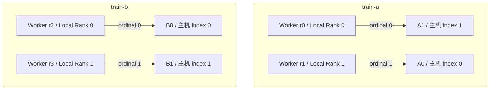

# 把进程、Rank 与 GPU 对应起来

## 一个成员有几种不同的编号

进程是操作系统中的执行实体；**Worker** 是作业中的工作进程角色；**Rank** 是一个通信组内的成员序号，范围为 `0…组大小−1`。本章采用一个 Worker 进程负责一张 GPU 的模式，因此可以逐行对应，但“进程、Rank、GPU”不是普遍的一一对应定律。

**World Size** 表示默认工作组中的 Worker 数量。本章 W 有四个成员，因此 `WORLD_SIZE=4`。**Local Rank** 是同一节点本地工作组里的序号，每台节点都可以从 0 开始。`LOCAL_WORLD_SIZE=2` 表示该节点运行两个 Worker。Linux PID 只在相应系统或命名空间中定位进程，不能拿来当全局 Rank。

GPU 则同时有物理身份和观察位置：UUID 用于确认是哪张设备，PCI BDF 表示本机 PCI 总线位置，主机 index 是一次枚举编号，CUDA ordinal 是进程可见设备列表中的编号。`LOCAL_RANK=0` 只有在应用按约定选择 ordinal 0 时，才与可见列表第一张设备对应。字段定义参见 [PyTorch 2.9 torchrun：Definitions 与 Environment Variables](https://docs.pytorch.org/docs/2.9/elastic/run.html#definitions)。

## 完成一张实际可读的映射表

以下为 `job-05` **一次启动的自拟教学清单**。所有 Worker 都看到本节点的同一份双设备列表，应用统一执行“以 Local Rank 选择 CUDA ordinal”。`A0/A1/B0/B1` 是本文物理代号，不是命令字段。

| 物理代号 | 所在节点／主机 index | GPU UUID 教学占位值 | PCI BDF（本节点） |
| --- | --- | --- | --- |
| A0 | train-a / 0 | `GPU-aaaaaaaa-aaaa-aaaa-aaaa-aaaaaaaaaaa0` | `0000:41:00.0` |
| A1 | train-a / 1 | `GPU-aaaaaaaa-aaaa-aaaa-aaaa-aaaaaaaaaaa1` | `0000:42:00.0` |
| B0 | train-b / 0 | `GPU-bbbbbbbb-bbbb-bbbb-bbbb-bbbbbbbbbbb0` | `0000:41:00.0` |
| B1 | train-b / 1 | `GPU-bbbbbbbb-bbbb-bbbb-bbbb-bbbbbbbbbbb1` | `0000:42:00.0` |

`train-a` 的可见顺序被反转，而 `train-b` 保持本机顺序：

```text
# 自拟环境片段；各行代表节点上两个 Worker 共同继承的值
train-a: CUDA_VISIBLE_DEVICES=GPU-aaaaaaaa-aaaa-aaaa-aaaa-aaaaaaaaaaa1,GPU-aaaaaaaa-aaaa-aaaa-aaaa-aaaaaaaaaaa0
train-b: CUDA_VISIBLE_DEVICES=GPU-bbbbbbbb-bbbb-bbbb-bbbb-bbbbbbbbbbb0,GPU-bbbbbbbb-bbbb-bbbb-bbbb-bbbbbbbbbbb1
```

| 节点 | PID | RANK | LOCAL_RANK | WORLD_SIZE / LOCAL_WORLD_SIZE | 选中 ordinal | 物理代号 |
| --- | --- | --- | --- | --- | --- | --- |
| train-a | 4100 | 0 | 0 | 4 / 2 | 0 | A1 |
| train-a | 4101 | 1 | 1 | 4 / 2 | 1 | A0 |
| train-b | 5200 | 2 | 0 | 4 / 2 | 0 | B0 |
| train-b | 5201 | 3 | 1 | 4 / 2 | 1 | B1 |

因此，“r0 使用 GPU0”只能在明确编号空间后理解：它使用自己的 CUDA ordinal 0，对应 train-a 的物理 A1、主机 index 1、BDF `0000:42:00.0`。BDF 必须连同主机名使用；两台服务器上的 `0000:41:00.0` 是不同设备。可见设备重排的定义见 [CUDA 12.8.1 Programming Guide：CUDA_VISIBLE_DEVICES](https://docs.nvidia.com/cuda/archive/12.8.1/cuda-c-programming-guide/index.html#env-vars)。

下图是**软件角色与设备绑定关系**。范围框表示服务器包含的对象，箭头表示本次进程选择设备，不表示数据方向、PCIe 连接或网络拓扑。



## 通信组可以小于整个作业

**通信组（Process Group）**定义一批共同参加通信的成员及其顺序。NCCL 中的 Communicator 承载相应成员关系和通信上下文；框架的 Process Group 是上层抽象，可能管理多个底层通信对象，不能视为永远一一对应。集合通信中的 Rank、root 和组大小都必须放回所用的组来解释。

例如，本次 G 的实际成员映射为 `[全局 r1, 全局 r3]`，则全局 r1 的组内 Rank 为 0，全局 r3 的组内 Rank 为 1，组大小为 2。r3 的 Local Rank 仍为 1；这次恰好与组内 Rank 一样，只是巧合。组内编号应从实际建立的映射确认，不能假定反写某个 API 的输入列表就能反转编号：PyTorch 2.9 的 `new_group` 实现会先对传入 ranks 排序，见 [v2.9.0 distributed_c10d.py：_new_group_with_tag](https://raw.githubusercontent.com/pytorch/pytorch/v2.9.0/torch/distributed/distributed_c10d.py)，定位 `ranks = sorted(ranks)`。

以后若说“G 的 root=0”，指的是 G 内的第一个成员 r1，查本次映射后才知道它使用 train-a 的 A0；而 W 的 root=0 是 r0，使用 A1。数字相同，所属组不同，源设备也不同。直接调用 NCCL 时 root 是该 Communicator 内的 Rank；框架接口还可能区分全局 `src` 与组内 `group_src`，应按具体参数解释。参见 [NCCL 2.31.2：Broadcast](https://docs.nvidia.com/deeplearning/nccl/archives/nccl_2312/user-guide/docs/usage/collectives.html#broadcast) 与 [PyTorch 2.9：broadcast 参数](https://docs.pytorch.org/docs/2.9/distributed.html#torch.distributed.broadcast)。

## 启动器、应用与设备分配分别负责什么

集群管理系统先提供进程能运行的位置与资源；每台机器的启动器再创建 Worker、传递成员环境并监视退出。应用读取这些信息，选择设备，建立默认组与子组，提交计算与通信。NCCL 负责已经定义好的通信工作，不负责申请 Pod 或替应用决定模型怎样拆分。

这些环节必须使用同一套约定。如果平台让每个进程只看到一张 GPU，进程内可见 ordinal 都可能是 0，这时直接拿 Local Rank 1 去选 ordinal 1 就会越界。本章贯穿模型刻意让两个 Worker 都看到两卡，才成立 `ordinal=LOCAL_RANK`。设备已被分配、进程能看到设备、应用选对设备是三个相接的步骤。

全局 Rank 的连续分配方式也由本次启动材料给定，不能永久假定 `RANK=节点序号×每机卡数+LOCAL_RANK`。重启或弹性重组后，重新记录“作业标识、启动代次、主机、PID、全局/组内 Rank、UUID”才能将新日志对应到设备。

现在已经能确定“谁参加”，下一篇说明“参加同一次通信”到底要求成员对数据做什么。

[上一篇：从单卡约束走向多卡作业](01_从单卡约束走向多卡作业.md) · [下一篇：用具体数据推演集合通信](03_用具体数据推演集合通信.md) · [返回导读](00_导读.md)
