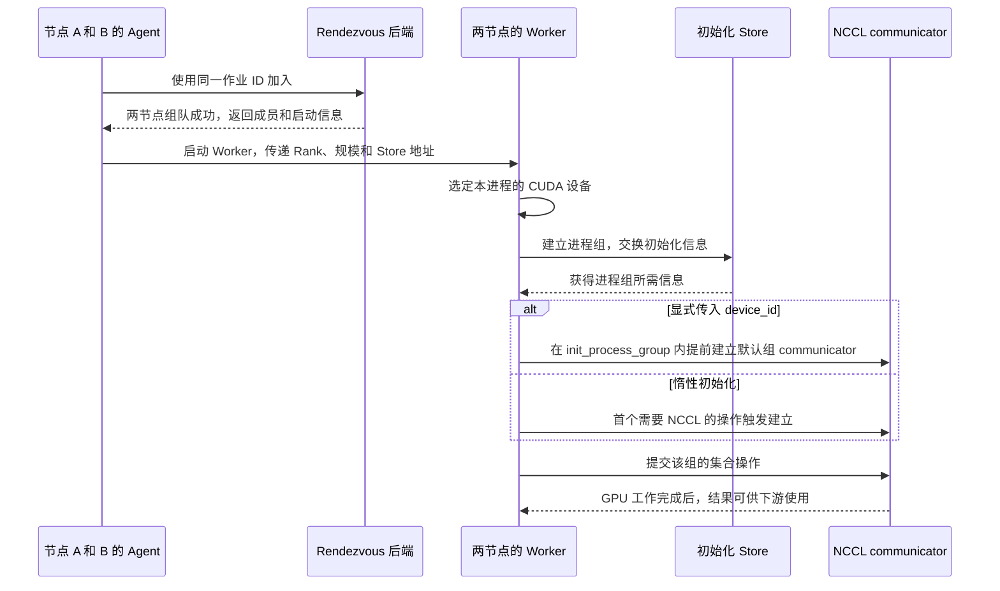

# 从发现作业成员到首次交换数据

两台机器都执行了启动命令，其中一台也能连到协调端口，训练仍可能停在第一步之前。一个端口可达，只说明探测到了这个端口。作业还要让节点加入同一次组队，让训练进程取得一致的成员信息，再建立 GPU 通信并完成首次数据交换。

## 先由 Agent 组队，再启动 Worker

外部作业管理器决定在哪些节点、用哪些资源启动。节点上的 `torchrun` Agent 用 Rendezvous（会合）来发现同一作业的其他 Agent，形成一致的成员集合。下面是教学配置，基于 PyTorch `v2.9.1` 的固定规模示例。两台 Linux 节点各有四张可见整卡，在两台节点上执行同一组参数。假定两边都能解析和访问 `node-a:29400`，且各自已有应用脚本 `train.py`。这里展示参数与调用关系。 [PyTorch v2.9.1 · torchrun 源码与示例](https://github.com/pytorch/pytorch/blob/v2.9.1/torch/distributed/run.py)

```bash
torchrun --nnodes=2 --nproc-per-node=4 \
  --rdzv-backend=c10d --rdzv-endpoint=node-a:29400 \
  --rdzv-id=ai05-demo-001 --max-restarts=1 train.py
```

`--nnodes=2` 要求两节点参加，`--nproc-per-node=4` 指定每节点启动四个 Worker。这一角色的本地 Worker 数在两节点一致，组队后 `WORLD_SIZE=8`。两边必须对同一作业使用相同的 Rendezvous 后端、地址和运行 ID。如果 B 没有启动 Agent，或者 B 填了不同的运行 ID，A 可能一直在等同一轮的第二个成员，即使能连到 `node-a:29400`。固定规模也可以重试，`--max-restarts=1` 给 Worker 组一次重启预算。 [PyTorch 2.9 · Rendezvous](https://docs.pytorch.org/docs/2.9/elastic/rendezvous.html) · [PyTorch 2.9 · torchrun](https://docs.pytorch.org/docs/2.9/elastic/run.html)

如果平台只给了 A 节点，四张 GPU 已经占用，固定两节点作业却还不能开始。这是成组调度要处理的资源依赖。调度器在资源分配阶段考虑整个成员集合的最低需求，启动器再让获得资源并实际启动的成员会合。两阶段各有独立的成功条件。 [Volcano v1.16.0 · Gang Scheduling](https://volcano.sh/docs/v1.16.0/scheduler/plugins/gang/) · [PyTorch 2.9 · Rendezvous](https://docs.pytorch.org/docs/2.9/elastic/rendezvous.html)

组队成功后，每个 Agent 得到本轮成员、Rank 分配和启动所用的 Store 地址，随后启动本地 Worker，并交付 `RANK`、`WORLD_SIZE`、`LOCAL_RANK`、`MASTER_ADDR`、`MASTER_PORT` 等环境变量。`--rdzv-endpoint` 是 Agent 查找会合后端的地址，`MASTER_ADDR` 与 `MASTER_PORT` 供 Worker 初始化进程组时使用。实现可以共享 Store 服务，排查时仍要按角色和阶段分别核对地址，避免拿其中一个地址的连通性代替另一阶段的证据。 [PyTorch v2.9.1 · Agent 的组队和启动顺序](https://github.com/pytorch/pytorch/blob/v2.9.1/torch/distributed/elastic/agent/server/api.py) · [Worker 环境变量的构造](https://github.com/pytorch/pytorch/blob/v2.9.1/torch/distributed/elastic/agent/server/local_elastic_agent.py)

## 进程组先确定成员，communicator 再接上设备

以下是 `train.py` 中每个 Worker 调用的初始化片段。调用方传入已构造的模型，随后使用返回的 DDP 模型训练。本例每节点的四个 Worker 继承同一份设备可见列表，`LOCAL_RANK` 用作选卡的 CUDA ordinal。 [PyTorch 2.9 · init_process_group](https://docs.pytorch.org/docs/2.9/distributed.html#torch.distributed.init_process_group) · [PyTorch 2.9 · DDP](https://docs.pytorch.org/docs/2.9/generated/torch.nn.parallel.DistributedDataParallel.html)

```python
import os

import torch
import torch.distributed as dist
from torch.nn.parallel import DistributedDataParallel


def wrap_for_training(model):
    local_rank = int(os.environ["LOCAL_RANK"])
    device = torch.device("cuda", local_rank)
    torch.cuda.set_device(device)
    dist.init_process_group(backend="nccl", init_method="env://")
    return DistributedDataParallel(model.to(device), device_ids=[local_rank])
```

Worker 通过 `env://` 读取启动器给出的 Rank、规模和地址，使用 Store 交换初始化信息。**进程组**定义框架操作的成员和编号。**NCCL communicator** 将一组参与者及其各自的 CUDA 设备组织成通信实例。以 NCCL 的原生初始化为例，框架要为对应的 communicator 将同一个唯一标识分发给组内成员，然后各 Rank 在自己的设备上初始化。大批量梯度或激活由通信后端传输，Store 承担初始化所需的小量信息交换。 [PyTorch 2.9 · Initialization](https://docs.pytorch.org/docs/2.9/distributed.html#initialization) · [NCCL 2.31.2 · Communicator Creation](https://docs.nvidia.com/deeplearning/nccl/archives/nccl_2312/user-guide/docs/api/comms.html)

在 PyTorch 2.9 的 NCCL 后端下，上述写法没有传 `device_id`，communicator 通常在第一次需要它的操作中惰性建立。在 `init_process_group` 中加上 `device_id=device` 可让默认组的 NCCL communicator 在该调用内提前建立。还要注意，DDP 默认 `init_sync=True`，构造时检查参数形状并同步初始参数和缓冲区，首个通信操作可能就在构造阶段。因此排查“训练循环一行都没跑”时，DDP 构造也要单独记开始与返回。 [PyTorch 2.9 · init_process_group 的 device_id](https://docs.pytorch.org/docs/2.9/distributed.html#torch.distributed.init_process_group) · [PyTorch 2.9 · DDP 的 init_sync](https://docs.pytorch.org/docs/2.9/generated/torch.nn.parallel.DistributedDataParallel.html)



## 按最后一个已确认事件判断等待位置

下表是**自拟事件样例**，对应上述固定两节点、八 Worker 的 Linux 教学环境。事件名为便于判读而定义。Agent 的组队记录、Worker 的调用记录和 GPU 完成证据分别采集，再按作业 ID、尝试编号和成员对齐。

| 已看到的事件 | 能确认什么 | 下一项证据 |
| --- | --- | --- |
| A 有 `rdzv_begin`，没有 `rdzv_done`，也没有 B 加入的记录 | 尚无两节点完成组队的证据 | 查看 B 的 Agent 是否启动，并核对运行 ID、地址、解析和会合后端的成员记录 |
| 两边有 `rdzv_done`，只有部分进程有 `worker_start` 或 `pg_enter` | Agent 已组队，训练进程尚未全部到达初始化 | 对照应有的八个本地启动记录，找缺失进程的启动、选卡或退出证据 |
| 有 `pg_enter`，部分进程没有 `pg_return` | 相应初始化调用尚未观察到返回 | 对齐所有 Worker 的 Rank、规模和 Store 地址。若传了 `device_id`，同时查 NCCL 初始化阶段 |
| 八个进程有 `pg_return`，某组有 `first_collective_enter` 却缺 `first_collective_complete` | 有成员进入 GPU 通信阶段 | 查该组成员的操作进入点、communicator 是否建立及 GPU 工作进度。惰性初始化和首次传输都可能出现在这段区间 |

`first_collective_enter` 表示调用进入或由通信侧观测到操作发起。只有能证明对应 GPU 工作已完成的同步点或跟踪事件才记为 `first_collective_complete`。若操作是 DDP 构造内部发出的，应用通常只能直接标记构造边界，内部事件还要靠框架或通信侧观测。这样可以区分**成员已经组队**、**进程组调用返回**、**GPU 通信已经完成**三种状态。 [PyTorch 2.9 · CUDA 集合操作的同步与异步语义](https://docs.pytorch.org/docs/2.9/distributed.html#synchronous-and-asynchronous-collective-operations)
