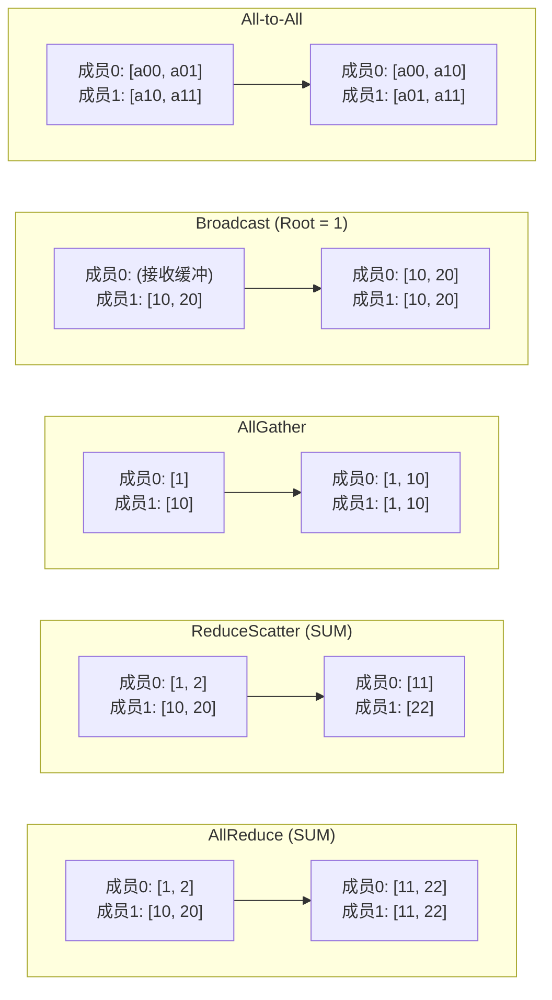

# 集合通信的输入输出与调用约定

初次接触分布式训练或大模型推理代码时，`AllReduce`、`ReduceScatter`、`AllGather`、`Broadcast`、`All-to-All` 这一串英文词最容易让人犯晕。其实它们背后一点也不玄乎——每一种操作都只回答两个朴素问题：**参与成员各自拿着什么输入？操作结束后，每个成员手里该拿到什么结果？**

当一个通信组里的全部成员共同按规则协同交换数据时，称为**集合通信（Collective Communication）**；当只需要在两个指定成员之间单独发送和接收数据时，则称为**点对点通信（Point-to-Point，Send/Recv）**。无论是同步训练的梯度合并、流水线激活接力，还是大模型推理的层内同步与 KV Cache 迁移，底层全靠这两类操作撑起。

## 五大核心集合原语：先看归约，再看数据分布

取一个最简的两成员子组（例如由跨机的两位成员组成，按组内编号称作 `成员 0` 与 `成员 1`），假设两者初始分别持有向量 `[1, 2]` 与 `[10, 20]`。

把不同成员相同位置的元素按规则（最常见是求和）合并，称为**归约（Reduce）**——这里第一位得到 $1 + 10 = 11$，第二位得到 $2 + 20 = 22$。顺着“是否归约”与“结果怎么分发”，五大集合原语一网打尽：

1. **AllReduce（全归约）**：先对所有成员的输入按位置归约，再把**完整的归约结果**交给每一位成员。两位成员最终都拿到 `[11, 22]`。
2. **ReduceScatter（归约并分散）**：同样先按位置归约，但不把整份结果发给所有人，而是按组内编号把结果切片分摊。`成员 0` 只拿第一段 `[11]`，`成员 1` 只拿第二段 `[22]`。
3. **AllGather（全收集）**：不做算术归约，只把每个成员手里的局部切片按组内编号顺序**拼接成完整数组**并分发给所有人。如果把上面 ReduceScatter 的输出 `[11]` 与 `[22]` 再做一次 AllGather，双方就重新拿齐完整的 `[11, 22]`。
4. **Broadcast（广播）**：初始有效数据只存在于某一位指定成员——称为**根（Root）**——其余成员只提供空接收缓冲，操作后全员拿到与根完全一致的数据。
5. **All-to-All（全对全重排）**：每个成员都把数据按目的地切块，发给不同的目标成员。记 $a_{ij}$ 为来源 $i$ 交给目的地 $j$ 的数据块：`成员 0` 得 `[a00, a10]`，`成员 1` 得 `[a01, a11]`。
   - 从矩阵视角看，**All-to-All 相当于把按行存放的分布式矩阵做了一次全局转置，让每个成员按列收齐属于自己的数据**。



*图 05-03-01：两成员子组中五类核心集合通信原语的输入与输出语义对照。*

用一张速查表收束这五种独立操作的输入输出（表中编号均为组内 Rank）：

| 集合原语 | 成员 0 输入 | 成员 1 输入 | 成员 0 输出 | 成员 1 输出 | 典型 AI 负载场景 |
| --- | --- | --- | --- | --- | --- |
| **AllReduce**（求和） | `[1, 2]` | `[10, 20]` | `[11, 22]` | `[11, 22]` | DDP 梯度同步、TP 层内部分和合并 |
| **ReduceScatter**（求和分块） | `[1, 2]` | `[10, 20]` | `[11]` | `[22]` | FSDP2 反向梯度归约分片、TP 序列并行 |
| **AllGather**（按序拼接） | `[1]` | `[10]` | `[1, 10]` | `[1, 10]` | FSDP2 前向权重重组、激活汇总 |
| **Broadcast**（根为 1） | 接收缓冲 | `[10, 20]` | `[10, 20]` | `[10, 20]` | 初始权重同步、DDP 缓冲区广播 |
| **All-to-All**（按目的重排） | `[a00, a01]` | `[a10, a11]` | `[a00, a10]` | `[a01, a11]` | MoE 专家并行（EP）token 分发与回传 |

> [!tip] 工程直觉：记住两个高频等价与换算细节
> - **逻辑等价与数值细节**：对精确整数求和而言，`ReduceScatter` 紧接 `AllGather` 与直接执行 `AllReduce` 结果完全一致（实际上许多通信库的 Ring AllReduce 内部正是按这两阶段实现的）。不过在浮点运算下，不同规约顺序可能带来微小舍入差异。
> - **逻辑输入 ≠ 接收缓冲 ≠ 物理链路流量**：以两成员 `AllGather` 为例，若每个元素占 `4 B`，每成员的逻辑输入是 `4 B`，但接收缓冲需准备 `8 B`（包含自身切片）；而物理网卡或 NVLink 上究竟实际跑过多少字节，还取决于底层采用的 Ring/Tree 算法与路径（[第 08 章](../08_NCCL如何组织GPU间的通信/00_内容大纲.md) 拆解）。

> [!note] 版本与接口细节：Broadcast 根编号与 NCCL 2.27.3 的 All-to-All 实现
> - **Broadcast 指定根**：在 PyTorch 2.9 中调用 `dist.broadcast` 时，既可用 `src=<全局Rank>`（如 `src=5`），也可用 `group_src=<组内Rank>`（如 `group_src=1`），二选一传入即可；而 NCCL 原生 C 接口一律使用**组内 Rank** 指定根。
> - **NCCL 2.27.3 的 All-to-All**：在 NCCL 2.27.3 阶段尚未提供独立的原生 `ncclAlltoAll` 函数，底层是通过 `ncclGroupStart()` 与 `ncclGroupEnd()` 包裹成对 `ncclSend`/`ncclRecv` 并发完成的；PyTorch 的 `dist.all_to_all_single` 已在框架层屏蔽了这一差异。

## 对应调用必须严格匹配

集合通信是“集体契约”，**同组所有成员必须按完全一致的顺序、兼容的参数共同进入同一操作**。

如果 `成员 0` 先调用 `AllReduce` 再调用 `Broadcast`，而 `成员 1` 代码里走错了分支把两者顺序对调，第一次调用就会发生错配，直接报错甚至让全组无限期挂起。核对匹配性时必须逐项检查：**操作类型、张量数据类型、元素计数、归约算子、以及 Broadcast 根或 All-to-All 分段长度**。

有两个实操中极易写错的参数约定值得特别标红：

- **NCCL 原生 `ReduceScatter` 的计数口径**：接口传入的 `recvcount` 是**每个成员最终分到的元素数**，而不是发送缓冲总长度。如前例总长度 2 元素、2 成员分片时，`recvcount = 1`，但每个成员的发送缓冲仍必须容纳完整的 `2` 个元素。
- **不等长 `all_to_all_single` 的矩阵对称约束**：MoE 推理与训练中各专家收到的 token 数往往不均等，PyTorch 2.9 允许用显式分段列表发起不等长交换。此时必须严格保证：**来源 $i$ 发给目的地 $j$ 的发送分段长度，必须精确等于目的地 $j$ 为来源 $i$ 预留的接收分段长度**。

## 从 CPU 提交到 GPU 结果真正可用

集合通信不是在 CPU 上同步跑完再返回的，它同样遵循 [第 02 章](../02_GPU如何计算与显存/00_内容大纲.md) 的 **CUDA Stream 异步执行模型**。在 PyTorch 2.9 中，理解同步与异步调用的真实边界能省掉无数排障弯路：

```python
# 1. 默认同步调用（async_op=False）：CPU 提交完就可能返回，但保证同一 Stream 下游算子可见结果
dist.all_reduce(tensor, op=dist.ReduceOp.SUM, group=tp_group)
y = torch.matmul(tensor, weight)  # 在同一当前 Stream 上安全消费归约结果，无需 CPU 显式 wait

# 2. 异步调用（async_op=True）：用于通信与计算重叠，消费结果前须用 wait() 在当前 Stream 建立依赖
work = dist.all_reduce(grad_bucket, op=dist.ReduceOp.SUM, group=dp_group, async_op=True)
compute_independent_layer()       # 与后台通信并行计算
work.wait()                       # 在当前 CUDA Stream 上插入等待，确保后续更新读到归约后梯度
optimizer.step()
```

> [!warning] 常见误区：看到 Python 函数返回 ≠ GPU 上数据已经传完
> - 即便默认不传 `async_op=True`，PyTorch 2.9 的 CUDA 集合调用返回时，GPU 硬件很可能仍在后台搬运数据；它只是把后续同 Stream 的算子正确排在了通信之后。如果由**另一条 CUDA Stream** 消费结果，必须显式建立跨 Stream 的事件等待关系。
> - 显式 `dist.barrier()` 可强制全组成员在某处会合；但即使不写 Barrier，只要下游算子依赖集合通信输出，任何一名成员的延迟都会顺着依赖链推迟全组。排查慢通信时，至少要把 **CPU 进入调用、GPU 通信完成、下游开始消费** 三个时间点拆开记录。

> [!summary] 核心结论
> 掌握五大集合原语的输入输出布局、严格调用匹配条件与 Stream 异步语义后，所有复杂的分布式并行策略就只剩“按需拼装”。下一篇，我们就用 `torchrun` 和一段 20 行的最小脚本，把两台节点上的 8 个 Worker 真正拉起来并跑通第一次 `AllReduce`。

> [!info]- 参考资料
> - **NCCL 2.27.3 集合通信与点对点语义**：[NCCL 2.27.3 · Overview](https://docs.nvidia.com/deeplearning/nccl/archives/nccl_2273/user-guide/docs/overview.html)、[Collective Operations](https://docs.nvidia.com/deeplearning/nccl/archives/nccl_2273/user-guide/docs/usage/collectives.html)、[Point-to-Point & All-to-All](https://docs.nvidia.com/deeplearning/nccl/archives/nccl_2273/user-guide/docs/usage/p2p.html)、[NCCL API Reference](https://docs.nvidia.com/deeplearning/nccl/archives/nccl_2273/user-guide/docs/api.html)
> - **PyTorch 2.9 分布式接口与同步语义**：[PyTorch 2.9 · `broadcast`](https://docs.pytorch.org/docs/2.9/distributed.html#torch.distributed.broadcast)、[`all_to_all_single`](https://docs.pytorch.org/docs/2.9/distributed.html#torch.distributed.all_to_all_single)、[Synchronous & Asynchronous Collectives](https://docs.pytorch.org/docs/2.9/distributed.html#synchronous-and-asynchronous-collective-operations)、[`barrier`](https://docs.pytorch.org/docs/2.9/distributed.html#torch.distributed.barrier)
