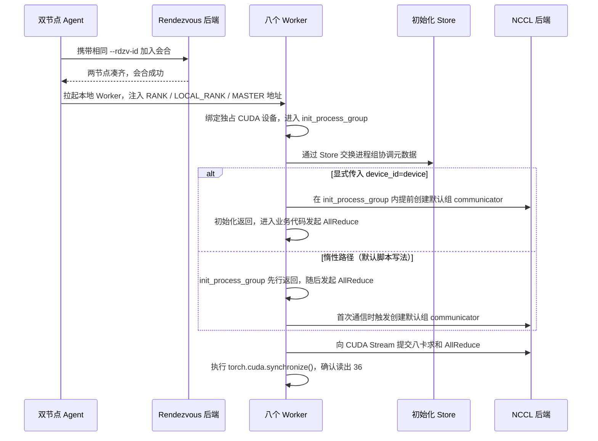

# torchrun 会合、进程组与首次 AllReduce

刚把一个双机八卡作业提交到集群，终端却卡在黑屏上一动不动，连第 1 步训练日志都没打出来——这是每个 AI 基础设施工程师都会碰到的经典僵局。问题到底出在节点没凑齐、进程组卡死，还是 NCCL 通信器建不起来？

要想一眼定位卡顿层级，必须先理清从“拉起进程”到“跑通第一次卡间求和”之间的**四层职责边界**：
- **资源管理器 / 编排系统**：负责分配两台节点与八张 GPU，并拉起启动命令；
- **启动器（`torchrun` Agent）**：负责节点间**会合（Rendezvous）**、分配本轮 Rank 并拉起和看护本地 Worker；
- **框架进程组（PyTorch `torch.distributed`）**：借助轻量协调服务 **Store** 交换元数据，定义通信成员与后端；
- **通信库与执行队列（NCCL + CUDA Stream）**：建立底层 **Communicator（通信器）**，驱动同机或跨机张量数据真正流动。

## Agent 会合并启动本地 Worker

**Rendezvous（会合）** 是分布式多机启动时各节点 Agent 发现彼此、确认成员凑齐并统一分配全局编号的协调过程。在两台服务器（`node-1`、`node-2`）上分别执行下面这条固定规模启动命令，就能将八张卡拉进同一轮作业：

```bash
# 在 node-1 与 node-2 上各自执行完全一致的启动命令（假设 node-1 地址双节点可达，脚本已就位）
torchrun \
  --nnodes=2 \                       # 参与本轮会合的节点总数（需等待 2 个 Agent 全部报到）
  --nproc-per-node=4 \               # 每台节点启动的 Worker 数（全局规模 WORLD_SIZE = 2 × 4 = 8）
  --rdzv-backend=c10d \              # 使用 PyTorch 内置 c10d 会合后端
  --rdzv-endpoint=node-1:29400 \     # Agent 查找会合服务的协调地址与端口
  --rdzv-id=train-demo-001 \         # 本轮作业唯一标识，不同节点必须严格一致
  --max-restarts=1 \                 # 允许整组 Worker 失败后自动重启的预算次数
  sum_ranks.py                       # 每个 Worker 要执行的训练/验证入口脚本
```

如果 `node-2` 迟迟未启动，或两边填了不同的 `--rdzv-id`，即便网络通畅，`node-1` 的 Agent 也会停在会合阶段干等。

如果缺席的节点压根没被调度器分配出来，排查就需转向成组资源交付（[第 15 章](../15_从单个Pod放置到多卡作业调度/00_内容大纲.md) 会将这种齐备依赖映射为 Kubernetes 的 Gang 调度）。

> [!tip] 工程直觉：分清两对地址的真正使用者
> 会合成功后，每个 Agent 会把 `RANK`、`LOCAL_RANK`、`WORLD_SIZE` 以及 `MASTER_ADDR`、`MASTER_PORT` 注入本地 Worker 的环境变量。
>
> 排查建连不通时千万别混淆：**`--rdzv-endpoint` 供两台 Agent 会合使用**，而 **`MASTER_ADDR` / `MASTER_PORT` 供八个 Worker 初始化框架进程组（Store）使用**，两者地址和端口可能不同，需分别核对。

## Worker 初始化进程组并完成首次求和

Worker 启动后，先按 `LOCAL_RANK` 绑定本机 GPU（前提是该节点上各 Worker 看到的 `CUDA_VISIBLE_DEVICES` 列表顺序一致），再以 `env://` 读取环境变量并初始化默认进程组。

初始化阶段用到的 **Store** 是进程间交换少量协调信息的键值服务（如交换连接元数据）。而在真正传递张量前，NCCL 会把一组 Rank 及其绑定的 CUDA 设备组织成一个 **Communicator（通信器）**——原生多进程流程是全员先拿到同一个唯一通信器 ID，再各自带着组规模和自身组内 Rank 完成通信器初始化，随后由后端接管显存间的数据搬运。

下面这段精简的 `sum_ranks.py` 剥离了模型与数据加载，让八个 Worker 各自放入 `rank + 1`，通过一次全组 `AllReduce` 检验全员是否同时读到 $1 + 2 + \dots + 8 = 36$：

```python
import os
import torch
import torch.distributed as dist
from torch.distributed.elastic.multiprocessing.errors import record


@record  # 将未捕获的 Python 异常写入 error_file，供 torchrun Agent 汇总首故障原因
def main():
    # 1. 按节点内局部编号绑定独占 GPU，避免多进程撞卡
    local_rank = int(os.environ["LOCAL_RANK"])
    device = torch.device("cuda", local_rank)
    torch.cuda.set_device(device)

    # 2. 通过 env:// 读取 Agent 注入的环境变量，连接 Store 初始化默认进程组
    dist.init_process_group(backend="nccl", init_method="env://")

    # 3. 构造各卡输入 [rank + 1]，向八人默认组提交求和 AllReduce
    rank = dist.get_rank()
    value = torch.tensor([rank + 1], device=device, dtype=torch.int32)
    dist.all_reduce(value, op=dist.ReduceOp.SUM)

    # 4. 显式等待本卡 GPU 工作完成，再读取结果确认 1+2+...+8 = 36
    torch.cuda.synchronize(device)
    print(f"rank={rank} sum={value.item()}", flush=True)

    dist.destroy_process_group()


if __name__ == "__main__":
    main()
```

> [!note] 版本与框架行为：惰性通信器初始化与 DDP 构造期首通信
> - **惰性 vs 提前建通信器**：在 PyTorch 2.9 的 NCCL 后端中，不传设备参数的 `init_process_group` 默认采用**惰性初始化**，直到首次 `all_reduce` 才建 NCCL communicator。
>   - 若改用 `init_process_group(..., device_id=device)` 显式传入设备，则会在初始化阶段直接把默认组通信器建好。
> - **DDP 的隐式首通信**：在真实训练脚本里，构造 `DistributedDataParallel` 时默认 `init_sync=True`，会立即校验各卡参数形状并广播同步初始权重和缓冲区——因此第一次跨机通信往往发生在正式进入训练循环之前。

把从 Agent 会合到 GPU 确认读出 `36` 的全流程画成时序图，两种通信器初始化路径的分叉点一眼可见：



*图 05-04-01：双节点八卡作业从 `torchrun` 会合、进程组初始化到首次 `AllReduce` 完成的时序与通信器创建分叉。*

## 用四级进度证据精准定位“启动卡死”

只要在 Agent 会合、Worker 启动、进程组初始化和首次通信完成后各埋一行关键进度日志，面对“作业启动挂起”就再也不用盲猜。对照下面四级现象，可直接把排查范围缩到唯一一层：

| 最后确认推进到的进度 | 卡顿所属层级 | 下一步立刻核对的证据 |
| --- | --- | --- |
| 仅一方节点进入会合，无另一方加入或会合成功记录 | **会合层（Agent）** | 另一节点 Agent 是否已拉起；两端 `--rdzv-id`、`--rdzv-endpoint` 与网络端口是否一致 |
| 两节点均完成会合，但只有部分 Worker 开始初始化 | **进程拉起与选卡层** | 定位缺失 Worker 所在节点；查它是未启动、卡在选卡/驱动初始化，还是已异常退出 |
| 全部 Worker 进入 `init_process_group`，但部分未返回 | **Store / 进程组层** | 核对 8 个 Rank 是否全员进入、`WORLD_SIZE` 与 `MASTER_ADDR/PORT` 是否一致；若传了 `device_id` 则同步查通信器创建 |
| 8 个 `init_process_group` 均已返回，进入求和却迟迟无结果 | **通信器与数据面层** | 核对各 Rank 集合调用是否匹配、GPU 完成点是否推进；采用惰性初始化时重点查 NCCL communicator 建立日志 |

> [!warning] 常见误区：别把 `init_process_group` 或 `all_reduce` 返回当成通信已畅通
> - 采用惰性路径时，`init_process_group` 顺利返回只说明 TCP/Store 元数据交换走通，底层高速网络和 GPU 通信器甚至还没开始握手。
> - `dist.all_reduce` 函数返回只代表指令已排入 CUDA Stream；唯有在显式 `torch.cuda.synchronize()` 之后，全部八个 Worker 都打印出正确结果 `36`，才构成整条启动与计算通信链条真正打通的闭环证据。在真实 DDP 作业中，也应记录整个 DDP 构造函数的起止时刻来捕获首轮隐式广播卡顿。

> [!summary] 核心结论
> 启动多机作业的本质，是让 **Agent 会合 → Store 元数据对齐 → NCCL Communicator 握手 → CUDA Stream 提交与同步** 四层严丝合缝地接力。打通这套基础设施底座后，下一篇我们将正式拆解五类并行策略，看清不同的模型与数据切分方法分别会向这条底座注入怎样的通信负载。

> [!info]- 参考资料
> - **PyTorch `torchrun` 会合、源码与运行约束**：[PyTorch 2.9 · `torchrun`](https://docs.pytorch.org/docs/2.9/elastic/run.html)、[Rendezvous](https://docs.pytorch.org/docs/2.9/elastic/rendezvous.html)、[Important Notices](https://docs.pytorch.org/docs/2.9/elastic/run.html#important-notices)；v2.9.1 实现源码见 [`torch/distributed/run.py`](https://github.com/pytorch/pytorch/blob/v2.9.1/torch/distributed/run.py)、[`agent/server/api.py`](https://github.com/pytorch/pytorch/blob/v2.9.1/torch/distributed/elastic/agent/server/api.py)、[`local_elastic_agent.py`](https://github.com/pytorch/pytorch/blob/v2.9.1/torch/distributed/elastic/agent/server/local_elastic_agent.py)
> - **PyTorch 2.9 进程组、集合调用与同步语义**：[PyTorch 2.9 · Backends & Initialization](https://docs.pytorch.org/docs/2.9/distributed.html#initialization)、[`init_process_group`](https://docs.pytorch.org/docs/2.9/distributed.html#torch.distributed.init_process_group)、[`all_reduce`](https://docs.pytorch.org/docs/2.9/distributed.html#torch.distributed.all_reduce)、[Synchronous & Asynchronous Collectives](https://docs.pytorch.org/docs/2.9/distributed.html#synchronous-and-asynchronous-collective-operations)、[`torch.cuda.synchronize`](https://docs.pytorch.org/docs/2.9/generated/torch.cuda.synchronize.html)、[DDP `init_sync`](https://docs.pytorch.org/docs/2.9/generated/torch.nn.parallel.DistributedDataParallel.html)
> - **NCCL 2.27.3 通信器初始化**：[NCCL 2.27.3 · Overview](https://docs.nvidia.com/deeplearning/nccl/archives/nccl_2273/user-guide/docs/overview.html)、[NCCL API Reference (`ncclCommInitRank`)](https://docs.nvidia.com/deeplearning/nccl/archives/nccl_2273/user-guide/docs/api.html)
