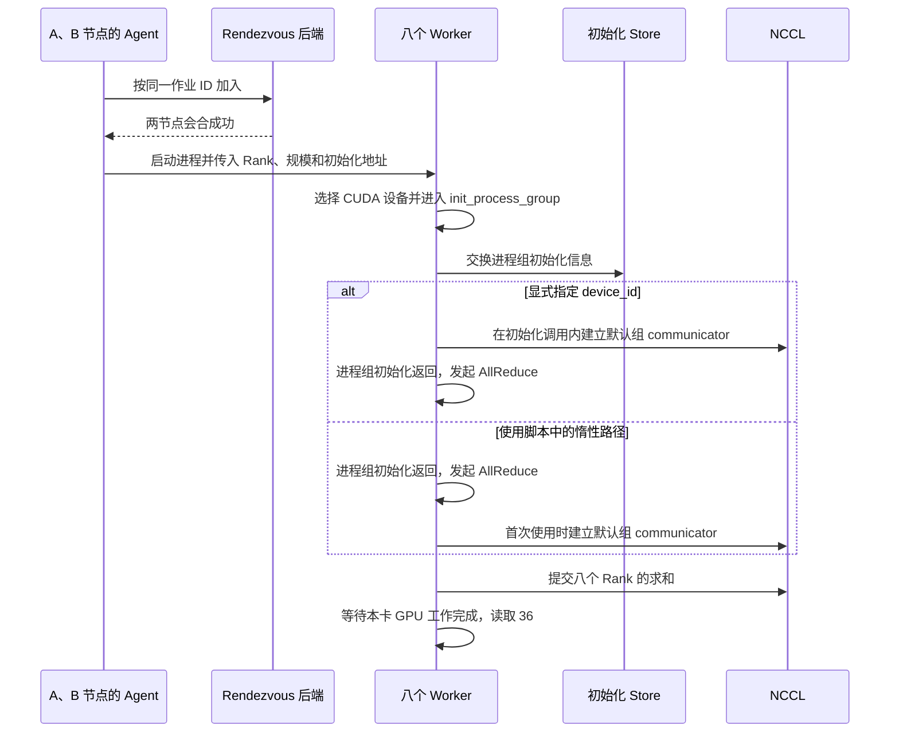

要让八个 Worker 各提供一个数字并得到相同的总和，先要让它们属于同一轮作业，取得该轮编号，选好各自的设备，再把求和提交给通信后端。以 PyTorch 为例，资源管理器交付节点与 GPU，`torchrun` 负责会合和启动训练进程，应用用 PyTorch 进程组指定要交换数据的成员。这个例子选用 NCCL 作为通信后端，由它执行同机或跨机的集合通信及点对点操作，CUDA Stream 承接提交的 GPU 工作。 [PyTorch 2.9 · torchrun](https://docs.pytorch.org/docs/2.9/elastic/run.html) · [PyTorch 2.9 · 通信后端](https://docs.pytorch.org/docs/2.9/distributed.html#backends) · [NCCL 2.31.2 · 概览](https://docs.nvidia.com/deeplearning/nccl/archives/nccl_2312/user-guide/docs/overview.html)

## Agent 会合并启动本地 Worker

**Rendezvous**（会合）让各节点的 Agent 就本轮参与者达成一致。本例固定两个节点，各启动四个 Worker。两边使用相同的后端、会合地址和作业 ID。以下为 PyTorch v2.9.1 的教学命令，在 A、B 两边各执行一次。假设 `node-a` 能解析到 A 并可从两节点访问，且每台机器上都保存了下文的 `sum_ranks.py`。本例还要求每节点的四张 GPU 都可见且该节点各 Worker 的可见顺序一致。 [PyTorch v2.9.1 · 固定规模启动](https://github.com/pytorch/pytorch/blob/v2.9.1/torch/distributed/run.py) · [PyTorch 2.9 · Rendezvous](https://docs.pytorch.org/docs/2.9/elastic/rendezvous.html)

```bash
torchrun --nnodes=2 --nproc-per-node=4 \
  --rdzv-backend=c10d --rdzv-endpoint=node-a:29400 \
  --rdzv-id=ai05-demo-001 --max-restarts=1 sum_ranks.py
```

`--nnodes=2` 要求两个 Agent 加入，`--nproc-per-node=4` 指定每节点的 Worker 数。该角色每节点的 Worker 数相同，会合后全局规模为 `2 × 4 = 8`。如果 B 没启动，或使用了不同的 `--rdzv-id`，A 即使能访问会合端口，也还在等属于这次作业的第二个 Agent。资源管理器若只交付了一个节点，应先追查资源放置与启动。第 15 章会将相同依赖映射为 Kubernetes 中的成组资源需求。 [PyTorch 2.9 · Rendezvous](https://docs.pytorch.org/docs/2.9/elastic/rendezvous.html) · [PyTorch 2.9 · torchrun 运行约束](https://docs.pytorch.org/docs/2.9/elastic/run.html#important-notices)

会合后，每个 Agent 给本地 Worker 传入 `RANK`、`LOCAL_RANK`、`WORLD_SIZE`，以及初始化用的 `MASTER_ADDR`、`MASTER_PORT`。`--rdzv-endpoint` 用于 Agent 查找会合后端，`MASTER_ADDR` 和 `MASTER_PORT` 供 Worker 初始化框架进程组时使用。诊断时分别核对实际地址和使用者。 [PyTorch v2.9.1 · Agent 初始化和 Rank 分配](https://github.com/pytorch/pytorch/blob/v2.9.1/torch/distributed/elastic/agent/server/api.py) · [PyTorch v2.9.1 · Worker 环境变量](https://github.com/pytorch/pytorch/blob/v2.9.1/torch/distributed/elastic/agent/server/local_elastic_agent.py)

## Worker 初始化进程组并完成求和

Worker 先按 `LOCAL_RANK` 选卡，再用 `env://` 读取环境变量、初始化默认进程组。初始化用的 **Store** 是进程间交换少量协调信息的键值服务。PyTorch 进程组确定成员和通信后端。NCCL **communicator**（通信器）则把一组 Rank 及其 CUDA 设备组织成通信实例。以原生多进程初始化为例，成员先取得同一个 communicator ID，再分别带着组规模和自身组内 Rank 初始化通信器。接下来，张量载荷由通信后端交换。 [PyTorch 2.9 · 初始化与 Store](https://docs.pytorch.org/docs/2.9/distributed.html#initialization) · [NCCL 2.31.2 · Communicator 初始化](https://docs.nvidia.com/deeplearning/nccl/archives/nccl_2312/user-guide/docs/api/comms.html#ncclcomminitrank)

以下是只执行一次集合操作的教学脚本，省去模型、数据和生产故障处理。本例默认使用八人组，每个 Rank 放入 `全局 Rank + 1`，预期每个 Rank 都读到 `1 + 2 + … + 8 = 36`。`synchronize` 让这个脚本在打印结果前显式等待本卡 GPU 工作完成。命令和脚本按接口编写，尚无双机实测记录。 [PyTorch 2.9 · all_reduce](https://docs.pytorch.org/docs/2.9/distributed.html#torch.distributed.all_reduce) · [PyTorch 2.9 · CUDA synchronize](https://docs.pytorch.org/docs/2.9/generated/torch.cuda.synchronize.html)

```python
import os

import torch
import torch.distributed as dist
from torch.distributed.elastic.multiprocessing.errors import record


@record
def main():
    local_rank = int(os.environ["LOCAL_RANK"])
    device = torch.device("cuda", local_rank)
    torch.cuda.set_device(device)
    dist.init_process_group(backend="nccl", init_method="env://")

    rank = dist.get_rank()
    value = torch.tensor([rank + 1], device=device, dtype=torch.int32)
    dist.all_reduce(value, op=dist.ReduceOp.SUM)
    torch.cuda.synchronize(device)
    print(f"rank={rank} sum={value.item()}", flush=True)

    dist.destroy_process_group()


if __name__ == "__main__":
    main()
```

在 PyTorch 2.9 的 NCCL 后端中，以上写法通常在第一次操作需要 communicator 时才初始化它。传入 `device_id=device` 可在 `init_process_group` 中提前初始化默认组的 communicator。实际 DDP 作业还要考虑构造过程，默认 `init_sync=True` 会检查参数形状并同步初始参数和缓冲区，首个通信操作可能出现在训练循环之前。 [PyTorch 2.9 · init_process_group 的 device_id](https://docs.pytorch.org/docs/2.9/distributed.html#torch.distributed.init_process_group) · [PyTorch 2.9 · DDP 的 init_sync](https://docs.pytorch.org/docs/2.9/generated/torch.nn.parallel.DistributedDataParallel.html)



## 用进度证据定位启动等待

在八卡教学环境中，可分别给 Agent 会合、Worker 启动、进程组初始化和首次操作加进度记录。下表描述四种独立的**教学记录**，可以用作应用和启动器的取证位置。

| 最后确认的进度 | 接下来核对的证据 |
| --- | --- |
| A 已进入会合，尚无 B 加入或本轮会合成功记录 | B 的 Agent 是否启动，两侧的作业 ID、会合地址是否一致 |
| A、B 都完成会合，只有部分 Worker 开始初始化 | 哪台节点缺 Worker，缺失的进程是未启动、选卡未完成，还是已退出 |
| Worker 进入 `init_process_group`，部分未返回 | 本轮八个 Rank 是否都进入，规模、地址是否一致。若传了 `device_id`，还查通信器初始化 |
| 八个初始化调用都返回，部分进入求和却无结果 | 匹配各 Rank 的调用和 GPU 完成点。惰性初始化时还要核对 communicator 进度 |

从应用看到集合调用返回，只能将排查范围缩到相应提交阶段。这个脚本在 GPU 同步后打印的各 Rank 结果，才是一次求和确实完成的证据。DDP 的内部调用通常要结合框架或通信侧记录；应用可先记录整个 DDP 构造的开始和结束。 [PyTorch 2.9 · CUDA 集合操作语义](https://docs.pytorch.org/docs/2.9/distributed.html#synchronous-and-asynchronous-collective-operations)
