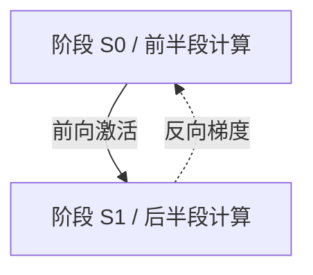

# 并行方式怎样产生通信需求

## 先认清计算中会交换的对象

模型参数是执行计算所用的状态；输入经过一段计算得到的中间结果称为激活值。训练中还会沿反方向计算梯度，表示需要汇总的更新信息；优化器再利用梯度及其状态更新参数。读者不必掌握求导算法，但需要区分：传的是一份完整状态、一批中间结果，还是不同成员对同一状态的贡献。

**数据并行 DP、张量并行 TP、流水线并行 PP、专家并行 EP**，分别回答哪些输入、张量分块、连续阶段或专家放到不同成员上。下面每个例子都是独立的教学分工，不将四种模式同时施加于 `job-05`。

## 数据并行：复制计算状态，分担不同输入

在最简单的同步副本式 DP 中，四个成员从相同参数状态出发，分别处理不同样本，产生本地梯度，再汇总成一致的梯度后，各自在本地完成相同更新。因此它能扩大每轮处理的输入量，也能在固定全局批量时分担计算，但完整模型状态仍需在每卡容纳。

**教学例子**：每个成员本轮样本数相同，对应某一参数的本地平均梯度分别为 `[1,3,5,7]`。SUM AllReduce 给每人 16，除以 4 后给每人平均梯度 4。各成员保有一致的初值并执行相同更新，更新后的状态才能继续一致。如果某成员处理的样本数不同，“本地平均值再平均”就不等于所有样本的平均，必须按应用目标调整权重。

实际框架可以把梯度分桶：某个桶已生成就开始汇总，同时继续计算后面的梯度，最后只等待未完成部分。PyTorch DDP 的这一实现及一致调用顺序见 [2.9 DDP Design：Distributed Training](https://docs.pytorch.org/docs/2.9/notes/ddp.html#internal-design)。所以“每步需要同步”不表示每步所有计算后必定有一整段无法重叠的 AllReduce，也不表示应用必须在每层手写 Barrier。

DP 的基础设施需求是支撑跨副本的持续归约，并让所有成员按同样次序推进。输入供应慢的一个成员会推迟自己的梯度就绪，其他成员即使算完也要等；同等通信量下，越少可重叠计算，暴露的通信代价越大。状态分片式 DP 会增加 AllGather、ReduceScatter 等交换，第一篇已给容量动机，这里不把副本式 DP 当成全部数据并行实现。

推理中的多个独立模型副本通常也可分担不同请求；若请求之间没有同步依赖，就不需要照搬训练中的每步梯度汇总。它提高的是总体服务能力，单个请求的模型若仍放不下，还要另作切分。

## 张量并行：一次运算由多个成员共同完成

TP 把同一次运算涉及的张量分给多个成员。为看清交换必要性，先用一个**双成员标量结果例子**：输入 `x=[2,3]`，权重 `w=[5,7]`，目标是 `y=2×5+3×7=31`。一名成员只计算 `2×5=10`，另一名只计算 `3×7=21`。若后续两个成员都要完整 y，就需要 SUM AllReduce，让双方得到 31；只把两个数拼成 `[10,21]` 并没有完成这个运算。

另一种切法可以让各成员计算不同的输出分量，先保留分片；只有后续需要完整输出时才 AllGather。这说明 TP 的通信取决于张量布局和下一步需要什么，不能用“TP 一律每层 AllReduce”概括。列向、行向切分的实现例子见 [PyTorch 2.9 Tensor Parallelism：ColwiseParallel 与 RowwiseParallel](https://docs.pytorch.org/docs/2.9/distributed.tensor.parallel.html#torch.distributed.tensor.parallel.ColwiseParallel)。

TP 可以分担部分参数与运算，但输入、某些激活、未分片状态和通信缓冲仍可能复制。一次前向包含多段计算时，这些局部结果交换会在依赖链中反复发生；小批量推理可用于遮住通信的计算更少。因而它对组内延迟、带宽与成员均衡敏感。把紧密协作组放到较强互联域是有依据的候选策略，最终仍要比较完整工作量和测得的代价。

## 流水线并行：按计算阶段交接中间结果

PP 把模型的连续执行分成阶段。第一个阶段处理输入后把激活交给第二个，第二个再继续。训练反向时，还要把激活对应的梯度传回上游。它的主要交接关系是相邻阶段间的点对点传输；某阶段内部若又用了 TP 或 DP，就还会有相应集合通信。

下图只画**两阶段的逻辑数据交接**，两个箭头属于前向和反向两个过程，不表示同一时刻必然双向传输，也不表示设备之间物理直连。

如果仅有一份输入，S1 要等 S0；S0 完成后又可能空闲。将一批输入切成多个**微批次（Microbatch）**，可以让不同阶段同时处理不同微批次。

以下是**只含前向的理想教学时间表**：两阶段各处理一个微批次需要 10 ms，四个微批次，交接耗时为零，无资源争用。

| 10 ms 时隙 | 1 | 2 | 3 | 4 | 5 |
| --- | --- | --- | --- | --- | --- |
| S0 | m1 | m2 | m3 | m4 | 空闲 |
| S1 | 等待 | m1 | m2 | m3 | m4 |

共需 `（4+2−1）×10=50 ms`。两台设备的有效计算共 80 ms，可用设备时间为 `2×50=100 ms`，利用比例为 80%；填充与排空造成的空档称为**流水空泡**。相同条件下四份输入完全串行需要 80 ms，但第一份输入仍要经过两个阶段、20 ms 才结束，吞吐提升不等于每份输入延迟同比下降。

这个公式只适用于本表的等时长、零交接前向模型，不能直接计算带反向、重计算或不等阶段的训练。微批次数增加可摊薄空泡，也会改变激活存活与缓冲需求，不能只按时间选最大值。阶段划分、微批调度和梯度传播职责见 [PyTorch 2.9 Pipeline Parallelism](https://docs.pytorch.org/docs/2.9/distributed.pipelining.html#what-is-torch-distributed-pipelining)。

## 专家并行：按本轮路由把数据交给不同专家

在混合专家负载中，一组可选计算模块称为专家，路由决定每份输入交给哪些专家。本章的 **Token** 指一份待处理位置的激活记录，不是要把文本字符串发给 GPU。EP 把不同专家放到不同成员，输入激活按目的专家分发，计算结果再送回原来的输入位置并组合。

这常形成“分发 → 专家计算 → 回送”的模式，分发与回送可由 All-to-All 形态的交换完成。具体实现还可能采用 AllGather 或专门的调度路径，不能仅从 EP 名称断言使用了哪个 API。一个对照是 [Megatron Core 0.15.0：MoEAlltoAllTokenDispatcher](https://docs.nvidia.com/megatron-core/developer-guide/0.15.0/apidocs/core/core.transformer.moe.token_dispatcher.html#core.transformer.moe.token_dispatcher.MoEAlltoAllTokenDispatcher)，本章只使用其分发与回送的职责。

以下为**四成员独立教学路由表**：每人持有四份 Token 激活，每份只选一个专家，每个目的成员恰有一个专家，无丢弃、复制或填充。数字是记录数，不是字节。

| 来源 → 目的专家所在成员 | r0 | r1 | r2 | r3 | 本行合计 |
| --- | --- | --- | --- | --- | --- |
| r0 | 1 | 1 | 1 | 1 | 4 |
| r1 | 0 | 2 | 1 | 1 | 4 |
| r2 | 0 | 0 | 3 | 1 | 4 |
| r3 | 0 | 0 | 1 | 3 | 4 |
| 专家收到的记录数 | 1 | 3 | 6 | 6 | 16 |

四个来源负载相同，专家负载却不同。若忽略通信，每个专家串行处理一条记录用 1 ms，则专家阶段共同完成需 6 ms，而均衡四份各四条只需 4 ms。有效工作共 16 ms，设备时间为 `4×6=24 ms`，比例约 66.7%。r0 没有硬件变慢，也会在 1 ms 算完后等待更多工作落到 r2/r3 的分支。

若每条激活为 2 KiB，r2 要接收 12 KiB，其中本地 3 条、6 KiB 无需从外部交付；外部来源合计 6 KiB。本表四个对角项共 9 条，因此分发给其他成员的记录共 7 条、14 KiB。源端相同批量不能推断目的端相同入流，接收容量、并发交换与专家负载都需要分别预算。真实路由若一份 Token 选择多个专家，还会增加副本与回送合并，本表不包含该条件。

## 同一批卡可以承载多个通信组

现在回到 `job-05` 的四个 Worker，设定一个**DP=2、TP=2、无 PP/EP 的分工变体**：

| 维度 | 组成员（使用 W 的全局编号） | 含义 |
| --- | --- | --- |
| TP 组 T0 | `[r0,r1]` | 第一份模型副本的两个分片，均在 train-a |
| TP 组 T1 | `[r2,r3]` | 第二份模型副本的两个分片，均在 train-b |
| DP 组 D0 | `[r0,r2]` | 两份副本中相同分片的协作成员 |
| DP 组 D1 | `[r1,r3]` | 另一相同分片的协作成员 |

在这个笛卡尔式映射中 `World Size=DP×TP=4`。每个成员同时属于一个 TP 组和一个 DP 组；发生的是哪组的操作，决定谁必须参加。每份模型副本的微批量为 8、累积 4 次，则一次更新全局批量为 `8×2×4=64`。TP 两成员共同处理同一份 8 个样本，不能再乘 2。

这张表解释了为什么仅给总 GPU 数还无法安排作业。TP 在这里被放在节点内，而跨节点的 DP 组仍需要通信；是否最优要由两类交换的频率、规模和有效路径决定。更复杂布局不能无条件用 `DP×TP×PP×EP` 相乘，例如 EP 可能与其他维度共享组织方式；应先列出成员映射再计数。

| 分工 | 主要交换对象 | 当前最需关注的依赖 |
| --- | --- | --- |
| 副本式 DP | 梯度贡献、初始化状态 | 不同输入分支何时就绪、跨副本归约 |
| TP | 部分结果、分片或完整激活 | 同一次计算中频繁的组内交接 |
| PP | 阶段边界的激活与反向梯度 | 上下游依赖、阶段不均与空泡 |
| EP | 按路由分发的激活及返回结果 | 目的端热点、接收规模与专家不均 |

知道哪些成员互相依赖之后，还需要让它们在同一次作业中找到彼此，并正确开始第一步。

[上一篇：用具体数据推演集合通信](03_用具体数据推演集合通信.md) · [下一篇：从成员会合到一步共同完成](05_从成员会合到一步共同完成.md) · [返回导读](00_导读.md)
