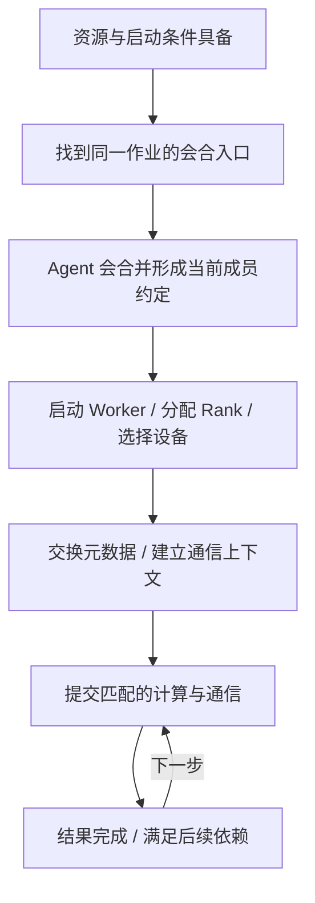

# 从成员会合到一步共同完成

## 先找到同伴，再建立工作关系

四个进程在两台服务器上分别启动，并不会自动知道自己与谁合作。作业需要一个标识，将本次参与者与其他作业隔开；还需要可找到的会合地址，以及期望的参与规模。发现使参与者能够找到入口，**Rendezvous（会合）**使它们对本代成员及角色形成一致约定。

本章采用两层视角：每台服务器运行一个 `torchrun` Agent，Agent 参加节点级会合，然后创建本地两个 Worker；四个 Worker 再按分配的 Rank 与 World Size 建立进程通信组。因而“到齐两台 Agent”与“到齐四个 Worker”是不同证据，不应把 `--nnodes=2` 误读成 World Size 为 2。会合的发现、一致性和共享 Store 职责见 [PyTorch 2.9 Rendezvous](https://docs.pytorch.org/docs/2.9/elastic/rendezvous.html)。

以下是**用于读字段的教学命令**，两台节点各执行一次；不是完整安装或可用性保证。假定应用、设备访问与可见列表已按第二篇准备，主机名能解析，会合端口可达，并且应用读取启动器提供的环境：

```bash
torchrun --nnodes=2 --nproc-per-node=2 \
  --rdzv-backend=c10d --rdzv-endpoint=train-a:29400 \
  --rdzv-id=job-05 --max-restarts=1 worker.py
```

`--nnodes=2` 固定本次节点数，`--nproc-per-node=2` 给每个节点两个 Worker；它们确定本例 World Size 为 4。两端的作业标识和会合入口必须相同，其他并行作业应使用独立标识和适当隔离的入口。`--max-restarts=1` 是给这次启动配置的重启上限，不是所有作业的默认值。`worker.py` 是示意应用名称，正文没有提供一份可执行训练程序。

## 会合、通信组初始化与首个结果各有完成条件

Agent 会合成功后，启动器提供成员环境；应用选择设备，利用 **Store** 等协调机制发布和查询少量键值元数据，形成进程组和底层通信上下文。Store 支持成员找到初始化所需信息，不负责执行模型计算。启动命令中的 `--rdzv-backend=c10d` 指会合实现；应用随后选择 `backend="nccl"` 则指 GPU 张量通信后端，这两个 backend 参数服务于不同环节。

随后才能提交与本组匹配的数据操作。底层通信上下文的建立可能推迟到首次使用，也可以由相应初始化选项提前触发；见 [PyTorch 2.9 init_process_group：device_id](https://docs.pytorch.org/docs/2.9/distributed.html#torch.distributed.init_process_group)。因此不能把下面的概念阶段当成所有实现都有的六条固定日志。

下图是**概念上的先后依赖**，箭头表示后一步需要前一步的相应条件，不表示一条固定物理数据通路；循环箭头表示同一成员组中的重复执行。



协调元数据可经普通 TCP Store 等通路交换；大块张量随后采用什么传输，由通信后端及其路径选择决定。两类流量可共用物理网，也可以使用不同接口。会合地址不是“所有 GPU 数据必须转发经过的中心服务器”。RDMA 的数据路径和 NCCL 选择哪些设备，分别在第 06、08 章展开。

| 已有证据 | 当前可确认的环节 | 下一份材料的用途 |
| --- | --- | --- |
| Pod/进程在运行 | 执行实体已存在 | 看成员环境和会合状态，判断是否加入同一作业 |
| 两台 Agent 已会合 | 节点级成员约定已形成 | 核对四个 Worker、Rank 与设备绑定 |
| 四个 Worker 报通信组初始化返回 | 上层初始化已返回 | 看首次通信完成、数据校验与是否存在延迟初始化 |
| 第一次 AllReduce 结果校验通过 | 本次组与消息上的数据通信已成功 | 用完整负载、消息规模和重复条件评估性能 |

这四类材料应分别保存。只验证入口 TCP 端口，并没有验证所有 Worker 间的数据通路；四进程都能各自算 Kernel，也没有检验它们是否按同一个通信次序协作。

## 同步依赖怎样把慢成员变成共同等待

同步是下一步依赖某些结果已经可用；显式 **Barrier（屏障）**则要求相应组中所有成员到达。普通集合通信有自身的参与与完成条件，但不等同于“给整个作业所有设备加上万能屏障”。子组通信只约束该组；异步提交还需满足结果被使用时的完成依赖。

下面给出**刻意简化的单桶 DP 教学模型**：所有成员从同一参考时刻开始，各自先完成本地计算，只有四份输入都 ready 后，才能开始一段完整的 20 ms 归约；这段归约不与计算重叠，无其他开销。

| 成员 | 输入 ready 的相对时刻 | 等待其他输入的时间 | 所有结果 done 的时刻 |
| --- | --- | --- | --- |
| r0 | 80 ms | 40 ms | 140 ms |
| r1 | 82 ms | 38 ms | 140 ms |
| r2 | 81 ms | 39 ms | 140 ms |
| r3 | 120 ms | 0 ms | 140 ms |

共同完成为 `max(80,82,81,120)+20=140 ms`。如果只把 r3 就绪提前到 84 ms，其他不变，共同完成就变为 104 ms；只把 r0 的计算由 80 缩到 40 ms，对原来的 140 ms 结果没有帮助。决定这一轮的是最晚分支。

这里 `done−ready` 混合了到达不齐与归约服务时间；r0 的 60 ms 不应全记成“网络传了 60 ms”。真实通信还可能在成员陆续到达时推进部分工作，分桶与重叠也会改变时间线。本表用于推导等待传播，不是 NCCL 所有算法的执行定律。要诊断真实作业，需要每个成员的计算、数据加载、通信提交与完成证据。

## 调用不一致也会表现成等待

如果同一 W 中 r0—r2 的下一项是 `AllReduce(SUM,1024,FP32)`，r3 因一条分支进入 `Broadcast(root=0,1024,FP32)`，硬件再快也无法替应用组成同一次正确调用。检查对象是“同组、第几次操作、类型、数量、数据类型、归约或 root”，而不是先给网卡换参数。

另一个常见条件是某成员提前结束输入循环，剩余成员继续做下一轮集合通信。没有应用支持的处理方式时，退出的成员不会自动被所有集合操作忽略。框架可能提供特定的 Join 等机制处理部分不均输入，但那需要相应的应用约定，本章固定四成员例子没有启用。

因此，同步不要求成员同时启动 API，却要求它们能以一致语义形成所需操作。**超时**只表示在规定时间内没完成某个等待条件；它可能来自成员缺失、程序次序错误、数据供应慢或传输故障。超时位置是定位起点，不能单凭发生超时的 Rank 判定故障设备。

## 成员失联后，重试的是一段协作关系

固定四成员作业中，r3 崩溃后，其他成员不能继续用原组把它当作永久零输入。既有通信可能报错或等待超时，上层需要停止受影响的协作、清理旧上下文，再形成可用成员组。新的成员不能仅因拿到旧 Rank 就无条件接续旧通信。

本章命令使用的 PyTorch 2.9 `torchrun` 在 Worker 失败时，会停止并按限制重启工作组，而不是只修补那一个 Python 进程；节点/Agent 失败还涉及集群管理者的处理。具体范围见 [torchrun：Failure Modes、Membership Changes 与 Important Notices](https://docs.pytorch.org/docs/2.9/elastic/run.html#failure-modes)。这是一种明确版本下的恢复策略，不代表所有通信库、容错算法和启动系统都必须如此。

应用的 **Checkpoint（检查点）**保存可恢复进度，例如一致的参数、优化器状态、步号及需要的数据位置/随机状态。启动器负责重建进程，不会替应用从日志里重建这些状态。固定规模恢复还需要重新取得足够资源；弹性改变成员数则需要应用支持重新分配数据与分片、处理批量和状态变化。

重试成本会扩散到整个组。**教学时间预算**：一次失败使四成员都回退，丢失自上次完整检查点以来 30 s 的工作，重新组建与读取检查点用 10 s，且恢复后的速度不变。每个成员恢复到失败前进度需要额外 40 s；四卡合计额外占用 `4×40=160 GPU·s`。这里排除了排队、写检查点和重复失败；若下一次仍触发同样的 OOM 或次序错误，重试本身不会消除原因。

这也给组调度提供了动机：固定作业即使先取得三张卡，缺少第四个必需成员仍可能无法开始，已占用的资源一起等待。第 15 章再讨论如何成组准入和放置；调度成功之后，应用内部的通信一致性仍需成立。

[上一篇：并行方式怎样产生通信需求](04_并行方式怎样产生通信需求.md) · [下一篇：读懂一份多机作业记录](06_读懂一份多机作业记录.md) · [返回导读](00_导读.md)
