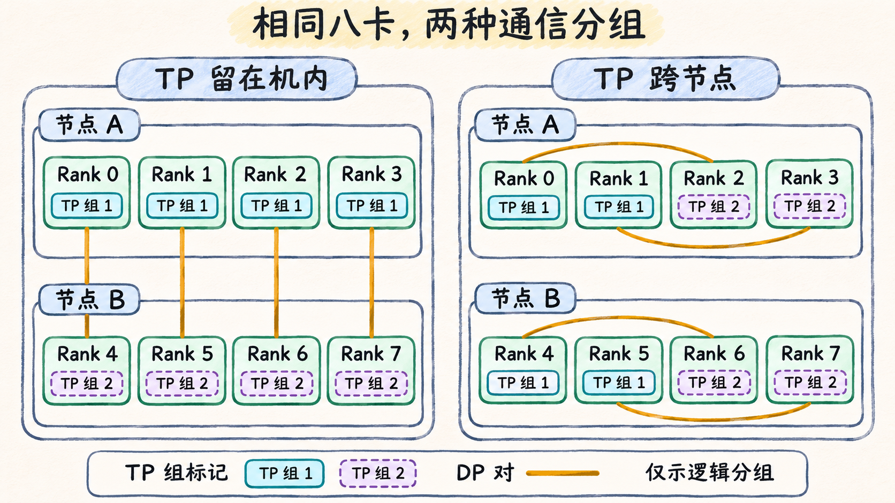

# 并行切分决定哪些数据走哪一组

同样使用八张卡，有的作业主要交换梯度，有的作业每经过若干层就得交换一次中间结果。先确定每张卡持有什么，再追踪下一段计算缺少谁的数据。由此可以推导通信的内容、时机和参与者。

## 数据并行把样本分开，再同步梯度

普通 DDP 的各个副本起步时持有相同的模型参数。输入管道为不同副本分配不同样本，例如用 `DistributedSampler` 按数据并行组的成员分配索引。反向时，每个副本先得到本地梯度。DDP 将梯度组织成 bucket，各 Rank 按同一 bucket 顺序发起 AllReduce，得到同步后的梯度。各副本随后在本地更新自己的参数。规约已发起的 bucket 时，反向可以继续计算其他梯度。最后一段未被覆盖的通信仍可能挡住更新。默认的前向缓冲区广播也会通信，可用 `broadcast_buffers` 区分这部分流量。 [PyTorch 2.9 · DistributedSampler](https://docs.pytorch.org/docs/2.9/data.html#torch.utils.data.distributed.DistributedSampler) · [PyTorch 2.9 · DDP](https://docs.pytorch.org/docs/2.9/generated/torch.nn.parallel.DistributedDataParallel.html) · [PyTorch 2.9 · DDP Reducer](https://docs.pytorch.org/docs/2.9/notes/ddp.html)

假定八个副本各处理两个微批次再更新一次。若第一个微批次的前向和反向都包在 `no_sync()` 里，本地先累积梯度，在退出上下文后的第二次前向与反向进行梯度同步。判断规约频率时，应看哪些反向触发了同步，以及每次同步有几个 bucket。只看训练步数会漏掉累积策略的影响。 [PyTorch 2.9 · DDP no_sync](https://docs.pytorch.org/docs/2.9/generated/torch.nn.parallel.DistributedDataParallel.html#torch.nn.parallel.DistributedDataParallel.no_sync)

### 同样切样本，状态也可以分片

用 PyTorch 2.9 的单维 FSDP2 跟踪一个模块单元。平时每个 Rank 持有一份参数分片，需要做该模块的前向时，组内用 AllGather 恢复完整参数。反向算出梯度后，ReduceScatter 把规约好的各份梯度交还给相应 Rank，各自在本地更新自己负责的参数分片。若 `reshard_after_forward=True`，前向完成就释放重组的参数，反向需要时再 AllGather。若设为 `False`，参数在这两个阶段之间继续占用显存，从而省去这次反向前重取。容量核算要把常驻分片、暂时重组的参数和同时在途的缓冲分开。 [PyTorch 2.9 · FSDP2 fully_shard](https://docs.pytorch.org/docs/2.9/distributed.fsdp.fully_shard.html)

## 张量并行把一层拆开，下一段按输出布局取数据

张量并行（TP）让组内 GPU 协同完成同一层的运算。以线性层按输入维度切分为例，两个 Rank 分别用各自的输入分片和权重分片得到部分和。若某个输出位置的两份部分和分别是 3 和 7，且下一操作要求两个 Rank 都拿到完整输出，该位置便要先求和得到 10，再由两个 Rank 使用。PyTorch 2.9 的 `RowwiseParallel` 默认输入沿最后一维分片、输出为复制布局，符合这个例子。若下游接受规约后的分片，可用 ReduceScatter。若数据只是分散存放、下游需要取齐各份，则是 AllGather。检查通信频率时，应数前向和反向中真正改变数据布局的边界，以及有多少层会重复该模式。 [PyTorch 2.9 · RowwiseParallel](https://docs.pytorch.org/docs/2.9/distributed.tensor.parallel.html#torch.distributed.tensor.parallel.RowwiseParallel) · [NCCL 2.31.2 · Collective Operations](https://docs.nvidia.com/deeplearning/nccl/archives/nccl_2312/user-guide/docs/usage/collectives.html)

## 流水线并行把模型分段，微批次在阶段间推进

流水线并行（PP）把不同层放到不同阶段。阶段 0 完成某个微批次的前向后，把边界激活点对点发给阶段 1。反向时，阶段 1 将该边界的激活梯度发回阶段 0。每个阶段可以处理不同的微批次，同一微批次的前向和反向仍要等待相邻阶段给出所需的数据。 [PyTorch 2.9 · Pipeline Parallelism](https://docs.pytorch.org/docs/2.9/distributed.pipelining.html)

下表是**自拟时序**。假设两阶段、四个微批次、先做完全部前向再反向，每个阶段的一次计算占一个等长时隙，传输能在两个时隙之间完成。编号表示微批次，F 表示前向，B 表示反向。

| 阶段 | 1 | 2 | 3 | 4 | 5 | 6 | 7 | 8 | 9 | 10 |
| --- | --- | --- | --- | --- | --- | --- | --- | --- | --- | --- |
| 阶段 0 | F1 | F2 | F3 | F4 | 空 | 空 | B4 | B3 | B2 | B1 |
| 阶段 1 | 等激活 | F1 | F2 | F3 | F4 | B4 | B3 | B2 | B1 | 空 |

时隙 1 是前向填充，阶段 1 要等时隙 1 的激活发来。时隙 6 的 B4 结束后，阶段 0 才能在时隙 7 开始 B4。减少微批次数时，填充与排空占比通常会上升。一个阶段处理得较慢，会推迟对端所需的数据。若阶段边界跨机，激活和激活梯度都要走跨节点路径，原先假设的“时隙之间传完”也要重新核对。

## 专家并行按目标专家分发，输入相等也会偏斜

专家并行（EP）把不同专家放到不同设备。给定路由决定后，每个源 Rank 把 token 表示按目标专家所在 Rank 分组并分发。专家计算完成后，输出被送回来源，再按原来位置合并。Megatron Core 0.15.0 中，显式选 `--moe-token-dispatcher-type alltoall` 可以用 All-to-All 形态解释这次分发和返回。该版本还有其他 dispatcher，实际交换方式取决于配置。 [Megatron Core 0.15.0 · Token Dispatching](https://docs.nvidia.com/megatron-core/developer-guide/0.15.0/user-guide/features/moe.html#token-dispatching)

**自拟例子。** 两个 Rank 各有 4 个 token，每个 token 只投给一个专家。两个源都把 3 个投给 Rank 0 的专家、1 个投给 Rank 1 的专家。

| 来源 | 投给 Rank 0 | 投给 Rank 1 | 来源合计 |
| --- | ---: | ---: | ---: |
| Rank 0 | 3 | 1 | 4 |
| Rank 1 | 3 | 1 | 4 |
| 目标合计 | 6 | 2 | 8 |

即使输入同样多，两个专家的工作量仍可能不同。若每个 token 的处理代价相近，且后续计算要等分发结果都返回，热门专家会增加整组的等待。对角项是本地处理。这张表只记录逻辑分配，要算物理流量还需知道设备位置、单 token 载荷及 dispatcher 的传输方式。

## 从交换需求推到节点放置

| 方式 | 切分对象 | 交换内容与参与者 | 发起时机 | 后续依赖 | 常见不均衡来源 |
| --- | --- | --- | --- | --- | --- |
| DP，普通 DDP | 样本 | 数据并行组内规约梯度 bucket | 需要同步的反向过程中，bucket 就绪并轮到它规约时 | 参数更新需要同步后的梯度 | 输入等待、样本计算量 |
| TP | 层内张量 | 同一层的部分结果或分片，在 TP 组内规约或重排 | 走到需要改变布局的算子边界时 | 下一算子需要约定的输入布局 | 分片大小、成员计算和通信进度 |
| PP | 模型阶段 | 相邻阶段点对点交换激活与激活梯度 | 每个微批次完成阶段前向或反向时 | 同一微批次的相邻阶段在等数据 | 各阶段的计算量和边界传输时间 |
| EP | 专家 | EP 组内分发 token 表示并送回专家输出 | 路由选定目标时分发，专家计算后返回 | 消费方需要对应的专家结果 | 各目的端的 token 数和专家耗时 |

下面把 `DP=2, TP=4` 叠加到两节点八卡的教学作业。A 上的全局 Rank 为 0—3，B 上为 4—7。一个 TP 组协作组成一个模型副本，两个副本的相同张量分片组成一个 DP 对应组。按下表给出的组内顺序，两个 TP 组的同一位置就是同一分片。

| 布置 | 两个 TP 组 | 四个 DP 对应组 | 哪类交换跨节点 |
| --- | --- | --- | --- |
| TP 留在各自节点 | `[0,1,2,3]`、`[4,5,6,7]` | `[0,4]`、`[1,5]`、`[2,6]`、`[3,7]` | 四个 DP 组跨节点，两个 TP 组各自留在机内 |
| TP 副本各占两边 | `[0,1,4,5]`、`[2,3,6,7]` | `[0,2]`、`[1,3]`、`[4,6]`、`[5,7]` | 两个 TP 组跨节点，四个 DP 组各自留在机内 |

**图 05-05-01**　同一套八卡放置采用两种通信分组。左图四个 DP 对跨节点，右图两个 TP 组跨节点。琥珀色连线只标记 DP 对，图中省略实际互联和流量。

假如每层都有一次直接挡住下一算子的 TP 交换，而 DP 的许多梯度规约能与反向重叠，第一种布置值得优先比较。若 DP 的跨机载荷更重或重叠更差，就需重新判断。组表只说明哪些操作必须涉及两台节点。要估算时间，还要数每步调用频率、消息大小及可重叠窗口，再用实际路径和链路证据验证。 [PyTorch 2.9 · Process Groups](https://docs.pytorch.org/docs/2.9/distributed.html#groups)

这个区分也说明了 NCCL 和 RDMA 各解决哪一层的问题。并行策略确定交换的组与结果，NCCL 将集合操作组织成实际传输。具备相应网络和软件条件时，跨机部分可以走 InfiniBand 或 RoCE 的 RDMA 路径，也可以使用 IP Socket 等传输。更换路径可能改变交换耗时，应用需要的输入与输出仍由集合操作决定。 [NCCL 2.31.2 · Overview](https://docs.nvidia.com/deeplearning/nccl/archives/nccl_2312/user-guide/docs/overview.html) · [NCCL 2.31.2 · IB/RoCE 与 Socket 传输](https://docs.nvidia.com/deeplearning/nccl/archives/nccl_2312/user-guide/docs/env.html#nccl-ib-disable)
