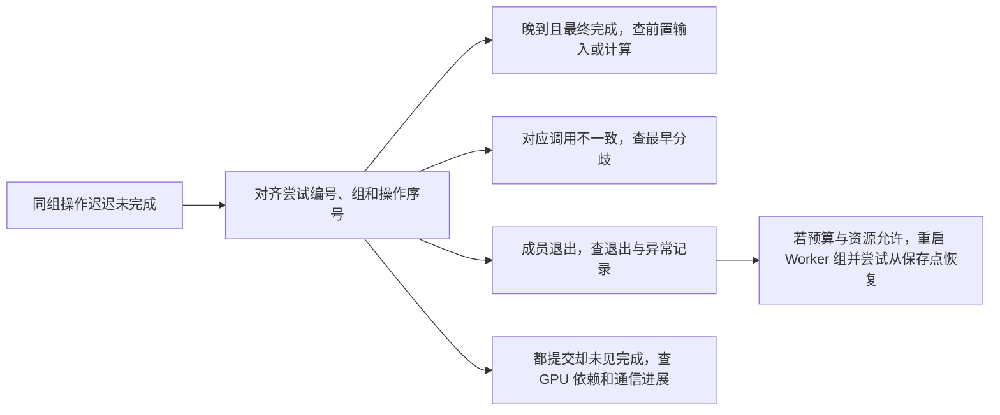

# 为什么一个慢成员或失败会拖住整组

八个训练进程里，七个已经走到梯度同步。第八个可能还在取数据，也可能已经退出。两种情况在其他进程上都可能表现为等待，处理方法却不同。先找同一轮、同一组的对应操作，再看哪个阶段缺少什么证据。

## 晚到怎样变成整步变慢

同步训练依赖各 Rank 为集合操作提供输入。假设一轮更新最后要完成一次 AllReduce，且参数更新必须等其结果。如果 Rank 5 的数据读取慢，或它负责的专家收到更多 token，导致对应输入晚就绪，其他 Rank 即使已经提交通信，也得等该组取得所需数据才能继续。若有独立计算可以重叠，延迟可能先消耗重叠窗口，只有推迟了下一项必需工作才增加步时。 [NCCL 2.31.2 · Collective Operations](https://docs.nvidia.com/deeplearning/nccl/archives/nccl_2312/user-guide/docs/usage/collectives.html) · [PyTorch 2.9 · DDP Reducer](https://docs.pytorch.org/docs/2.9/notes/ddp.html)

下面是**自拟时间算例**。Linux 教学环境为两节点各四张 NVIDIA 整卡、每卡一个 PyTorch Worker。时间从同一步的共同起点计。题设规定关键路径上的通信在全员就绪后花 `10 ms`，不与其他计算重叠，更新耗时忽略。

| 场景 | 其余七个 Rank 就绪 | Rank 5 就绪 | 规约结束与步时 |
| --- | ---: | ---: | ---: |
| 正常 | 35 ms | 35 ms | `35 + 10 = 45 ms` |
| Rank 5 晚到 | 35 ms | 50 ms | `50 + 10 = 60 ms` |

其他七个进程会多观察到 `15 ms` 的等待，而题设的通信执行时间保持 `10 ms`。实测应把最晚输入就绪时刻、GPU 通信进展和结果消费点放在一起看。真实操作可能在成员到齐之前就取得部分进展，上表只用于推导这一项依赖怎样延长关键路径。

## 按同一个操作对齐记录

先用 `run_id + attempt + group + step + collective_seq` 找同一轮同一组的记录。`group` 要对应相同的成员表，`collective_seq` 用于对齐该组的操作顺序。若某个 Rank 连训练步号也对不上，保留这项差异，用组与序号继续查最早出现分歧的位置。随后比较 `host`、`pid`、GPU UUID、`event`、`op`、`count`、`dtype`，有根或可变分段时再比对应参数。跨主机的绝对时间需要已对齐的时钟，单机阶段耗时可用该机的单调时钟。CPU 进入调用与 GPU 工作完成分开记录。

下面是**自拟事件对照**。四行是四个独立场景，均对照运行 `ai05-demo-001` 的第 0 次尝试、八 Rank 默认组、训练步 480、组内操作序号 901。默认组的预期操作为 `AllReduce(SUM)`，每 Rank 的 `count=1024`、`dtype=float32`。本轮 Rank 5 在 B，PID 为 3201，GPU UUID 简称 B0。事件名和时点是教学埋点。

| 其余成员的共同症状 | Rank 5 与同组的证据 | 能作出的判断与下一步 |
| --- | --- | --- |
| 已进入规约，尚在等待 | 先见 `input_wait`，较晚出现匹配的 `collective_enter`，随后全组有 GPU 完成证据 | 这次对应调用晚到。用输入和计算分段记录找晚到的来源 |
| 规约未完成或已报错 | 同一序号 Rank 5 记为 `Broadcast`，其余记为 `AllReduce` | 对应操作不匹配。查调用分支与组成员，定位最早的分歧 |
| 其余 Rank 等待或随后超时 | Rank 5 没有进入对应操作，Agent 已记录该 PID 退出 | 该成员无法再提供输入。读退出码、可用的异常栈和系统记录，区分退出原因 |
| 各成员提交后迟迟没有 GPU 完成证据 | 所有 Rank 都提交相容调用，进程仍存活 | 目前不能断定卡在哪里。查 GPU 侧操作是否实际开始、前置 Stream 依赖是否就绪，再看通信进展及链路证据 |

某 Rank 没留下调用记录，也可能只是采集缺失。用进程是否存活、Agent 的退出记录和 GPU 时间线补证。其他 Rank 的超时往往发生在最早的异常之后，只靠最后一条报错难以定位源头。调长等待时间可以让仍会到达的成员有更多时间，已退出的成员需要由重启或作业管理流程处理。 [PyTorch 2.9 · Distributed Communication](https://docs.pytorch.org/docs/2.9/distributed.html) · [NCCL 2.31.2 · Collective Operations](https://docs.nvidia.com/deeplearning/nccl/archives/nccl_2312/user-guide/docs/usage/collectives.html)

## 重启进程组与恢复训练状态是两件事

PyTorch 2.9 的固定规模示例使用 `--nnodes=2 --nproc-per-node=4 --max-restarts=1`。一个 Worker 失败后，在预算允许且两台节点仍能组队时，`torchrun` 会停止并重新启动 Worker 组。新 Worker 重新取得 Rank、选择设备、初始化通信，再由应用加载已保存的训练状态。若丢失的是节点或 Agent，是否补回节点或终止作业由外部作业管理器决定。固定两节点的作业仍要等足两节点。若允许范围式规模，例如 `--nnodes=1:2`，重新组队时 `WORLD_SIZE` 可能改变，`RANK` 也可能重新分配。应用据此重建子组和输入分片，并处理全局批次、数据进度与恢复状态。 [PyTorch 2.9 · torchrun Failure Modes 与 Membership Changes](https://docs.pytorch.org/docs/2.9/elastic/run.html#failure-modes) · [PyTorch v2.9.1 · Agent 重启流程](https://github.com/pytorch/pytorch/blob/v2.9.1/torch/distributed/elastic/agent/server/api.py)

下面是同一教学环境的**自拟恢复记录**，对应另一次故障。故障发生于完成 480 步之后，最近一次完整可用的 Checkpoint 在完成 400 步之后。表格混合启动器提供的环境、Agent 失败信息和应用自身记录，并标明各自来源。

| 尝试 | 来源 | 节点与进程 | 观察 |
| --- | --- | --- | --- |
| 0 | 应用 | 当轮 Rank 0 | 保存并确认 `checkpoint_step=400` |
| 0 | Agent 汇总 | B，Rank 5，PID 3201 | `exitcode=1`，`error_file` 可读，内含未处理 Python 异常及调用栈 |
| 1 | 启动器环境 | B，Rank 5，本地 Rank 1，PID 4201 | `TORCHELASTIC_RUN_ID=ai05-demo-001`，`TORCHELASTIC_RESTART_COUNT=1`，本例重新采集的全局 Rank 仍为 5 |
| 1 | 应用 | 重建后的 Worker 组 | 加载 `checkpoint_step=400`，从第 401 步开始重放 |

应用若能恢复到保存点的参数、优化器状态及所需的数据进度，已完成的第 401—480 步共 `480 − 400 = 80` 步需要重算。另计可能尚未完成的一步、重新组队与初始化时间、Checkpoint 读取时间。若保存点不完整或无法读取，Worker 即使启动成功也未必能继续原来的训练进度。

用 `@record` 装饰 Worker 的 Python 入口，可以把未处理异常写入 `TORCHELASTIC_ERROR_FILE`，由启动器汇总。进程遭到直接终止时可能只有退出码或信号信息，未必留下 Python 调用栈。Agent 按时间挑出的首个失败是排查线索，应与同一轮各成员的进度、退出记录及外部事件对照。 [PyTorch 2.9 · Error Propagation](https://docs.pytorch.org/docs/2.9/elastic/errors.html) · [PyTorch 2.9 · torchrun Important Notices](https://docs.pytorch.org/docs/2.9/elastic/run.html#important-notices)

