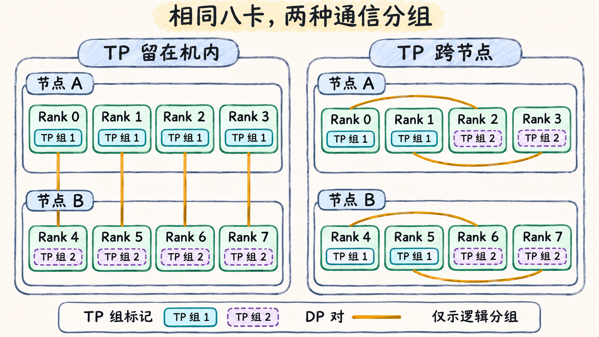

# 数据并行与张量并行的通信组放置

同样是两台四卡服务器组成八卡集群，同样是采用 `DP=2, TP=4` 的组合并行配置——仅仅调换一下哪几张卡组成 TP 组，整套作业的跨机网络负载和单步耗时就会彻底反转。

理解多维并行的放置规律，关键在于分清每个成员同时背负的**双重通信组身份**，再把两类跨机开销放到关键路径上逐笔算账。

## 双重组归属：TP 组内协作，DP 组对齐同一分片

在 `DP=2, TP=4` 配置下，8 个 Worker 被划成两个 4 卡模型副本，每个副本由一个 TP 组协同算出同一层的四个分片（组内位置记为 `0–3`），而两个副本分别处理不同样本。

反向同步梯度时，有一条铁律绝对不能搞混：**每个模型分片，只能和另一个副本中“完全相同的那个分片”做梯度归约**。因此 4 个分片自然衍生出 4 个两成员的 DP 组。

保留双节点八卡的进程映射（`node-1` 为全局 `Rank 0–3`，`node-2` 为全局 `Rank 4–7`；对应下图中标注的节点 A 与节点 B），就能摆出两种截然不同的分组方案：

| 放置方案 | 两个 4 卡 TP 组（层内协作） | 四个 2 卡 DP 组（同分片同步） | 穿越节点边界的通信组 |
| --- | --- | --- | --- |
| **布置甲：TP 留在机内** | `[0, 1, 2, 3]`、`[4, 5, 6, 7]` | `[0, 4]`、`[1, 5]`、`[2, 6]`、`[3, 7]` | 四个 DP 组跨节点 |
| **布置乙：TP 跨节点** | `[0, 1, 4, 5]`、`[2, 3, 6, 7]` | `[0, 2]`、`[1, 3]`、`[4, 6]`、`[5, 7]` | 两个 TP 组跨节点 |

*图 05-06-01：双节点八卡集群上 `DP=2, TP=4` 的两种逻辑分组对照（节点 A、B 分别对应 `node-1`、`node-2`）。绿色标签区分两个 TP 组，琥珀色连线标出同一分片的 DP 梯度同步对，仅表示逻辑成员关系。*

盯住图中节点 B 上的任意一位成员（例如 `Rank 5`），两种方案的跨机方向立刻清晰：
- 在**布置甲**中，它在 `TP 组 2` 内排第 1 号分片，与同机三张卡走机内高速互联完成每层计算，只在步末跨节点和节点 A 上同样负责第 1 号分片的 `Rank 1` 同步梯度。
- 在**布置乙**中，它改与跨机的 `[0, 1, 4, 5]` 协作算同一层（每层通信都跨节点），而梯度同步则缩回到同机伙伴 `Rank 7` 上完成。

> [!warning] 常见误区：在 PyTorch 中创建与并发使用多进程组的顺序红线
> 用 PyTorch 2.9 的 `dist.new_group()` 拆分出上述 TP 组与 DP 组时，**默认要求全局组内的所有 8 个进程按完全一致的顺序进入每一次 `new_group` 调用**——哪怕某个进程并不属于即将创建的那个子组，也不能跳过调用，否则全组会在建组阶段死锁。此外，当多个 NCCL 进程组并发提交通信时，也必须保证各组内成员维持一致的全局提交顺序，并处理好跨组的 CUDA Stream 同步依赖。

## 用关键路径跨机代价定量比较两种放置

把“机内 vs 跨机”的定性直觉换成精确毫秒账。假设单步更新中，每个 TP 组需执行 `12` 次阻塞后续算子的层内归约，每次每个成员提供 `2 MiB` 逻辑输入（$1\ \text{MiB} = 2^{20}\ \text{B}$），则单步每成员的 TP 逻辑输入总量为：

$$V_{\text{TP}} = 12 \times 2\ \text{MiB} = 24\ \text{MiB}$$

这代表应用层交出去的逻辑消息规模（实际跑在物理网卡上的发送和接收字节数，还需结合通信算法与网卡共享情况核算）。

设所有通信都留在机内时，基准单步耗时为 $T_0 = 115\ \text{ms}$。现在叠加上跨机带来的**未被计算覆盖的关键路径增量**（忽略额外链路争用）：
- 四个 DP 组并行同步梯度，大部分被反向计算掩盖，跨机后仅给整步额外增加 **`4 ms`**；
- TP 的 `12` 次归约串联在同一条依赖链上无法重叠，每次跨机比机内多花 **`0.6 ms`**。

代入计算两种放置的推算步时：

$$T_{\text{甲}} = 115 + 4 = 119\ \text{ms}, \qquad T_{\text{乙}} = 115 + 12 \times 0.6 = 122.2\ \text{ms}$$

| 放置方案 | 跨机新增关键路径代价 | 推算单步耗时 | 胜负结论 |
| --- | ---: | ---: | --- |
| **布置甲（TP 留在机内）** | DP 跨机共 `+4.0 ms` | `119.0 ms` | **更快**（每步省 `3.2 ms`） |
| **布置乙（TP 跨节点）** | TP 串行跨机 `12 × 0.6 = +7.2 ms` | `122.2 ms` | 较慢 |

由此可以直接读出两种方案的**反转边界**：只有当 DP 梯度极大或反向重叠窗口严重不足，导致 DP 跨机暴露代价超过 **`7.2 ms`**（例如升至 `8 ms` 使布置甲达到 `123 ms`）时，布置乙才会反超。

> [!tip] 工程直觉：为什么生产集群几乎一律优先把 TP 收在机内？
> 真实大模型往往有几十到上百层，TP 串行归约次数远不止 12 次——不仅分布式训练如此，第 08 篇即将展开的**大模型在线推理 TP** 更是连反向计算重叠的机会都没有，每生成一个 token 都要硬扛上百次串行 AllReduce。因此只要单机 NVLink 域装得下 TP 维度，**“高频阻塞的 TP 留机内，低频可重叠的 DP / PP 放跨机”** 是绝对首选的黄金放卡法则。

应用层划定逻辑分组后，底层 NCCL 会按硬件条件将跨机流量送上传统 IP Socket 或高性能 RDMA 计算网。

从 [第 06 章](../06_从普通网络通信走向RDMA/00_内容大纲.md) 到 [第 08 章](../08_NCCL如何组织GPU间的通信/00_内容大纲.md)，我们将沿着这条节点边界，一路把数据从显存缓冲区追到高速网卡、无损网络与集合算法。

> [!summary] 核心结论
> 并行放置的本质是**把通信最密集、最阻塞关键路径的维度对齐到带宽最高、延迟最低的物理互联域**。不过，哪怕放卡方案完美无瑕，多卡协同只要有一张卡变慢或宕机，就会立刻牵动整条关键路径——下一篇我们就拆解同步训练的慢成员、故障取证与恢复代价。

> [!info]- 参考资料
> - **PyTorch 2.9 多进程组创建与并发顺序约束**：[PyTorch 2.9 · Process Groups](https://docs.pytorch.org/docs/2.9/distributed.html#groups)
> - **NCCL 2.27.3 机内与跨机传输后端**：[NCCL 2.27.3 · Overview (Supported Interconnects)](https://docs.nvidia.com/deeplearning/nccl/archives/nccl_2273/user-guide/docs/overview.html)、[Environment Variables (`NCCL_IB_DISABLE`)](https://docs.nvidia.com/deeplearning/nccl/archives/nccl_2273/user-guide/docs/env.html#nccl-ib-disable)
