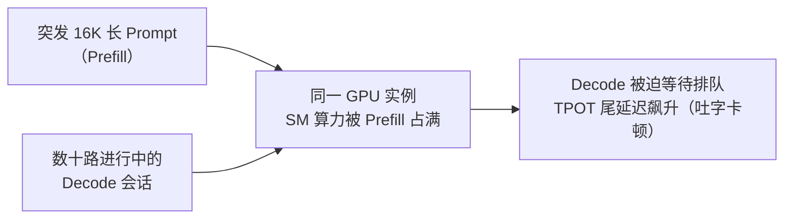
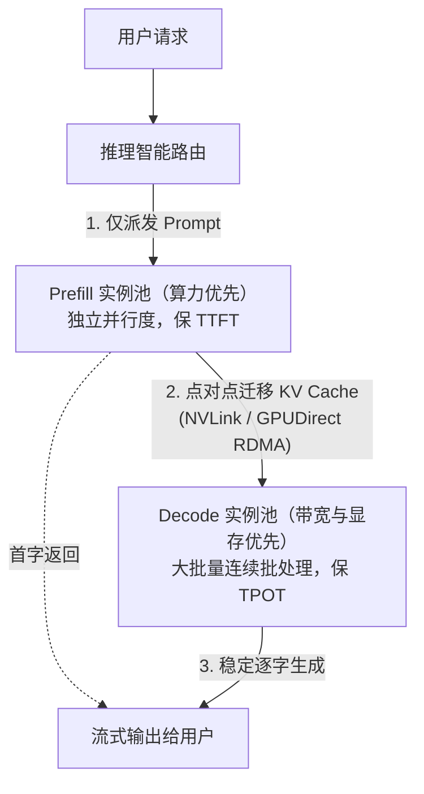

# 推理多卡并行与 Prefill-Decode 分离架构

不少团队把训练调优的经验直接套到大模型在线推理集群上，很快就会撞上两个让人措手不及的线上事故：
- 明明开启了 Continuous Batching，平时吐字丝滑流畅，可只要有一个用户贴进来一篇 32K 长文档做总结，同卡上正在生成答案的几十个用户画面瞬间一起“冻住”两秒；
- 为了省钱把 70B 模型的 4 卡张量并行跨两台双卡机器拼起来，结果单卡显存和算力看着都挺宽裕，用户侧吐字速度却直接腰斩。

这两个痛点背后藏着同一件事：**大模型在线推理的通信模式、并行取舍与架构演化，和离线同步训练走的是完全不同的两条路**。

## 在线推理的三种核心多卡并行形态

前文已经厘清，在线推理没有反向传播和优化器更新，因此不存在 FSDP 式的状态重组，也很少在低延迟场景优先使用流水线并行（PP 只能逐阶段接力，无法像 TP 那样把单用户的单次权重读取拆给多张卡并行加速）。生产推理集群的主力组合集中在 **TP、EP 与多副本 DP** 三者。

### 1. 推理张量并行（TP）：极度依赖机内 NVLink 的低延迟命脉

在线推理部署 70B 级稠密模型时，**推理 TP** 是突破单卡显存墙、同时把单用户 TTFT 与 TPOT 压到几十毫秒内的核心手段——把权重沿通道切分到 $K$ 张卡后，每生成 1 个 token，每张卡只需读取 $1/K$ 的权重，聚合 HBM 带宽成倍放大。

但它付出的通信代价极其严苛：在标准 Transformer 中，每一层的自注意力（Attention）和前馈网络（MLP）末尾各需要 **1 次阻塞式 `AllReduce`**。以一个 80 层大模型为例，**每生成一个 token 就要在关键路径上硬扛 $80 \times 2 = 160$ 次串行小消息 `AllReduce`**，且毫无反向计算可以重叠隐藏。

算一笔微秒级延迟账就能明白为什么**推理 TP 几乎绝不跨机**：

$$T_{\text{TP,NVLink}} = 160 \times 15\ \mu\text{s} = 2.4\ \text{ms/token}, \qquad T_{\text{TP,跨机慢链}} = 160 \times 150\ \mu\text{s} = 24.0\ \text{ms/token}$$

在单机 NVLink 域内，160 次微秒级同步加起来只有两三毫秒，稳稳落在 `20–30 ms` 的流畅 TPOT 预算里；一旦跨过节点边界，单次小消息通信延迟翻十倍，光通信等待就会把整个 TPOT 预算彻底吃干抹净。

### 2. MoE 大模型推理的专家并行（EP）：扩容与尾延迟陷阱

面对数千亿总参数、每 token 只激活一小部分参数的稀疏 MoE 大模型，如果硬把所有专家塞进单机 TP，显存很快就会爆掉。生产环境普遍采用 **推理 EP**，把数百个专家分散部署到多张卡甚至多台节点上。

每过一层 MoE，推理引擎都要执行“Dispatch（分发 token 到目标专家）→ 本地计算 → Combine（送回原卡）”两次 **`All-to-All`** 通信。

Decode 阶段每个请求每步只吐 1 个 token，传输的多是极小碎片消息。一旦热门专家触发**动态负载偏斜**（部分专家涌入 3–5 倍 token），或跨机 All-to-All 遇到网络拥塞抖动，全部等待合并的并发请求都会同步卡顿，直接拉爆 **P99 TPOT 尾延迟**。

这也正是新一代机柜级大 NVLink 域（[第 07 章](../07_InfiniBand、RoCE与集群网络拓扑/00_内容大纲.md) 剖析的 Scale-up 架构）对大 MoE 推理产生颠覆意义的原因。

### 3. 多副本数据并行（DP）：零同步水平扩容与故障隔离

与训练 DP 每步都要跨全集群归约梯度不同，**在线推理的权重在服务期完全只读，多个推理副本之间不需要任何梯度或权重通信**。

如果 1 个 4 卡 TP 实例已经满足单用户的 TTFT/TPOT 目标，想把整套服务的总吞吐翻 4 倍，只需水平复制出 4 个完全独立的 4 卡 TP 副本（即 `DP=4 × TP=4`），由前端负载均衡分发请求即可——吞吐近似线性增长，且单个副本故障绝不会拖垮其余健康副本。

| 推理并行形态 | 主要解决的瓶颈 | 通信特征与阻塞性 | 典型部署边界 |
| --- | --- | --- | --- |
| **推理 TP** | 权重装不下 + 单用户 TTFT/TPOT 过慢 | 每层 2 次阻塞式小消息 `AllReduce` | **严格收敛在单机 NVLink / 同 Switch 内** |
| **推理 EP** | 巨型 MoE 专家显存墙 + 高并发批处理 | 每 MoE 层两次 `All-to-All`，易受热点偏斜拖尾 | 大 NVLink 域优先，跨机强依赖低延迟 RDMA |
| **多副本 DP** | 集群总请求并发与吞吐扩容 | **副本间零权重同步**，仅路由分发请求 | 天然跨节点、跨机架水平扩展，隔离故障域 |

## Prefill / Decode 分离（PD Disaggregation）架构

解决了“单模型怎么跨卡”之后，在线推理还面临一个从 [第 02 章](../02_GPU如何计算与显存/00_内容大纲.md) 就埋下伏笔的深层结构矛盾：**同一个请求的前后两段生命周期，对硬件的胃口完全相反**。

- **Prefill（首字预填充）**：一次性并行消化整段输入 Prompt 并生成初始 KV Cache，属于高算术强度的**计算受限**任务，决定 **TTFT**。
- **Decode（逐字解码生成）**：每步只吐 1 个新 token 却要重读全部权重与累积 KV Cache，属于低算术强度的**显存带宽受限**任务，决定 **TPOT**。

### 混部部署为何互相拖累？

在传统的**混部（Colocated）** 推理架构里，同一个 GPU 实例既要接新进来的长 Prompt 做 Prefill，又要维持几十个正在流式吐字的 Decode 会话。这会引发两类难以调和的冲突：

1. **长上下文 Prefill 抢占算力导致 Decode 严重卡顿**：哪怕使用了 Continuous Batching 或 Chunked Prefill 缓解，当突发涌入多个万字长 Prompt 时，繁重的 Prefill 矩阵乘仍会强行挤占 SM 计算资源，导致正在平稳输出的 Decode 迭代被迫排队，用户端肉眼可见“吐字卡死”。
2. **硬件与并行策略被迫折中妥协**：Prefill 喜欢高算力卡和小并发以保 TTFT，Decode 喜欢大显存容量、高 HBM 带宽和超大并发批次以摊薄读权重成本；把两者锁在同一套实例上，无论怎么调 TP 度和批大小，顾了 TTFT 就伤 TPOT，顾了延迟就掉吞吐。



*图 05-08-01：传统混部（Colocated）推理中长 Prompt Prefill 抢占算力导致 Decode 卡顿的干扰路径。*

### 拆池解耦：Prefill 池 + KV 高速迁移 + Decode 池

**PD 分离（Prefill/Decode Disaggregation）**（由 DistServe、Splitwise、Mooncake 等经典系统确立，并已被 vLLM 等主流推理引擎原生支持）给出了一刀切透的解法：**把 GPU 集群拆成物理独立的 Prefill 实例池（P 池）与 Decode 实例池（D 池），让两类任务各自按最优并行度独立运行和扩缩容**。

一次请求的完整流转按四步推进：
1. **入口路由**：智能网关接收用户请求，将其派发给负载合适的 **Prefill 实例**；
2. **集中预填充**：Prefill 实例开足算力算完整个 Prompt，输出第一个 token 并在显存中生成完整的 **KV Cache**；
3. **跨实例 KV Cache 点对点迁移**：通过专用高速传输引擎（如 NVIDIA NIXL 或基于 RDMA/NVLink 的 P2P 连接器），将刚算出的 KV Cache 显存块**直接搬运**到目标 Decode 实例的显存中；
4. **流式稳定解码**：**Decode 实例**接管 KV Cache，将该请求汇入高并发 Continuous Batching 队列，专心以稳定 TPOT 逐字流式返回剩余内容。



*图 05-08-02：PD 分离架构（Prefill / Decode Disaggregation）的负载隔离与 KV Cache 点对点迁移路径。*

以 vLLM 原生支持的 PD 分离配置为例，Prefill 节点与 Decode 节点分别以 `kv_producer`（KV 生产者）和 `kv_consumer`（KV 消费者）角色启动，并通过高速 KV 传输连接器（如基于异步 RDMA 的 `NixlConnector`）对接：

```bash
# 1. 在 Prefill 实例池节点启动 KV 生产者（专注于 Prompt 预填充并写出 KV Cache）
vllm serve /models/Llama-70B-Instruct \
  --tensor-parallel-size 4 \
  --kv-transfer-config '{"kv_connector":"NixlConnector","kv_role":"kv_producer"}'

# 2. 在 Decode 实例池节点启动 KV 消费者（接收 KV Cache 并专注高并发流式解码）
vllm serve /models/Llama-70B-Instruct \
  --tensor-parallel-size 4 \
  --kv-transfer-config '{"kv_connector":"NixlConnector","kv_role":"kv_consumer"}'
```

## 定量算账：PD 分离为何倒逼集群上高速 RDMA？

PD 分离把算力抢占消灭了，却在 P 池和 D 池之间凭空多出了一段**跨节点 KV Cache 点对点传输**。这段传输一旦慢了，就会直接叠到首字延迟（TTFT）或首字后的停顿里，甚至让分离得不偿失。

沿用 [第 02 章](../02_GPU如何计算与显存/00_内容大纲.md) 算过的典型 70B GQA 模型规格（80 层、每层 8 个 KV 头、头维度 128、BF16 精度 2 B），先算出单个 token 的 KV Cache 体积：

$$s_{\text{KV}} = 2\ (\text{K+V}) \times 80 \times 8 \times 128 \times 2\ \text{B} = 327,680\ \text{B} = 320\ \text{KiB/token}$$

当用户发来一条 `16,384` token（16K）的长上下文请求时，Prefill 实例必须向 Decode 实例搬运的 KV Cache 总量为：

$$V_{\text{KV}} = 16,384 \times 320\ \text{KiB} = 5,242,880\ \text{KiB} = 5\ \text{GiB} \approx 5.37\ \text{GB}$$

把这 `5.37 GB` 数据分别放到两种跨机网络上传，结果天差地别：

$$T_{\text{10G TCP}} \approx \frac{5.37\ \text{GB}}{1\ \text{GB/s}} \approx \mathbf{5.37\ \text{s}}, \qquad T_{\text{400G RDMA}} \approx \frac{5.37\ \text{GB}}{40\ \text{GB/s}} \approx \mathbf{134\ \text{ms}}$$

- 在普通 `10 Gb/s`（有效约 `1 GB/s`）TCP 业务网上，光搬一次 KV Cache 就要花掉 **5 秒多**，还会把双端 CPU 协议栈打满，PD 分离完全失去实用价值；
- 而在 `400 Gb/s`（有效按 `40 GB/s` 估算）的 **GPUDirect RDMA** 高速计算网上，整块迁移只需 **134 ms**；若进一步配合**逐层流水发送**（Prefill 算完第 $l$ 层立刻把该层 KV 异步推送出去），绝大部分传输时间甚至可以完全藏在 Prefill 计算背后！

> [!warning] 常见误区：PD 分离不是“无条件拉高总吞吐”的魔法按钮
> 官方文档与论文结论都非常明确：**PD 分离的首要价值是解除两阶段互相干扰、守住严苛的 TTFT 与 P99 TPOT 服务等级目标（从而大幅提升“达标有效吞吐 Goodput”），而不是在无延迟约束下凭空变出更多原始 FLOPS**。如果业务以极短输入、宽松延迟为主，或者节点间缺少高带宽低延迟 RDMA 网络，盲目拆池反而会因为 KV 搬运开销与资源碎片得不偿失。

> [!summary] 核心结论
> 到这里，**分布式训练**与**大模型在线推理**两条主线在基础设施层完成了历史性会师：训练为了藏住海量梯度与专家通信，推理为了把大 MoE All-to-All 和 PD 分离下的数 GB KV Cache 压进百毫秒级——两者共同把最严苛的需求指向了同一套底座：**绕开 CPU 协议栈、让高速网卡直达显存的 RDMA 与集群无损高速网络**。从 [第 06 章](../06_从普通网络通信走向RDMA/00_内容大纲.md) 开始，我们就正式踏进这片高速网络世界。

> [!info]- 参考资料
> - **Prefill / Decode 分离经典论文**：[DistServe (OSDI 2024): Disaggregating Prefill and Decoding for Goodput-Optimized LLM Serving](https://arxiv.org/abs/2401.09670)、[Splitwise (ISCA 2024): Efficient Generative LLM Inference Using Phase Splitting](https://arxiv.org/abs/2311.18677)、[Mooncake (FAST 2025): A KVCache-Centric Disaggregated Architecture for LLM Serving](https://arxiv.org/abs/2407.00079)
> - **主流推理引擎 PD 分离实现**：[vLLM Documentation · Disaggregated Prefilling & KV Transfer Connectors](https://docs.vllm.ai/)
> - **MoE 分发与点对点通信参考**：[Megatron Core 0.15.0 · MoE Token Dispatching](https://docs.nvidia.com/megatron-core/developer-guide/0.15.0/user-guide/features/moe.html#token-dispatching)、[NCCL 2.27.3 · Point-to-Point & All-to-All](https://docs.nvidia.com/deeplearning/nccl/archives/nccl_2273/user-guide/docs/usage/p2p.html)
