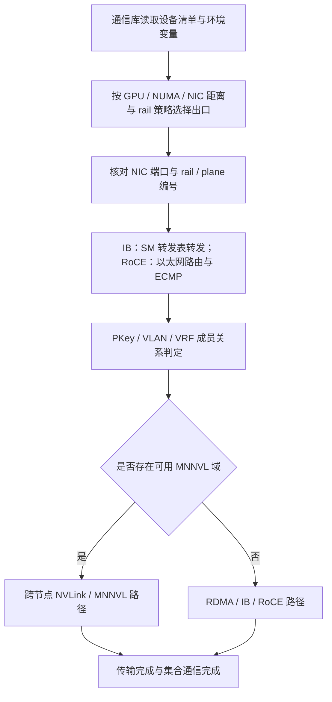

---
tags:
  - AI-Infra
  - 组网
  - 集合通信
  - 体系
created: 2026-10-11
---

# 一次跨机集合通信的完整旅程

一次多机 AllReduce 开始之前，通信库并不知道「网络」这个抽象整体。它看到的是本机可见的网卡、每块网卡的端口 / rail / plane 身份、GPU 与网卡的距离、其他 rank 交换来的拓扑信息，以及可选的 MNNVL 域信息。随后，数据会经过某个本机出口、某条轨道、某台叶交换机、可能的脊层路径、某个分区成员关系，最终到达对端并完成传输层确认。集合通信完成后，应用层看到的只是一个返回；排障者要做的，是把这次返回背后的路径还原出来。



## 段 1：选定本机出口

本段的决定者是通信库，但输入不只来自通信库自身。它至少要读三类事实：

| 输入 | 例子 | 错误时的现象 |
| --- | --- | --- |
| 本机可见设备 | HCA（Host Channel Adapter，主机侧 RDMA 网卡设备）设备名、端口、PCIe / NUMA 位置 | 设备不可见、权限不足或容器内注入缺失 |
| 显式选路配置 | `NCCL_IB_HCA`、`NCCL_CROSS_NIC`、`NCCL_IB_RAIL_POLICY`、`NCCL_NET_MERGE_POLICY` | 可用网卡被过滤掉，或不同 rail 被合并成错误虚拟设备 |
| 拓扑信息 | 自动探测结果或拓扑文件 | 网卡与 GPU 的距离、rail / plane 编号与真实 fabric 不一致 |

`NCCL_IB_HCA` 的条目形式是 `<hca>[:<port>[:<rail>[:<plane>]]]`。例如 `=mlx5_0:1:0:0,mlx5_1:1:0:1` 表示使用两张网卡的 1 号端口，二者都属于 rail 0，但分别属于 plane 0 与 plane 1。若只写 `mlx5_1`，则默认是前缀匹配，可能把 `mlx5_10` 到 `mlx5_19` 一并选中；因此精确指定设备时应使用 `=` 前缀。

`NCCL_CROSS_NIC` 决定同一个 ring / tree 是否允许在不同节点使用不同网卡：

| 取值 | 适用形态 |
| --- | --- |
| `0` | 尽量不跨 rail，适合每块网卡接不同 rail、跨轨连接较弱的 fabric |
| `1` | 允许使用不同网卡（不强制同卡） |
| `2` | 默认值：优先同卡，但若性能模型认为更好则允许不同网卡 |

因此，「所有 rank 都选了同一块网卡」不是一个能直接结案的判据。它可能来自显式过滤、拓扑文件错误、设备命名漂移、rail 合并策略错误，也可能是物理接线确实没有对齐。

## 段 2：按轨道对齐

选路结论要落到物理拓扑上才有意义。GPU、网卡与 CPU 之间的 PCIe / NUMA 距离决定本机出口选择与搬运代价；本段把这张本机拓扑扩展到跨机：

```text
GPU → process → local NIC → port / rail / plane → leaf switch port
```

健康状态是：同一通信组内，rank 的物理位置、使用的网卡编号、rail / plane 编号与交换机端口记录能够互相解释。若 node-a 的 NIC 0 接 Rail 0，而 node-b 的 NIC 0 接 Rail 1，则通信库即使「按编号」在两台机器上都选了 NIC 0，物理上仍然落在不同 rail，跨脊流量与故障半径都会改变。

这一段的失败不一定是「不通」。轨道错位更多表现为：

- 某条 rail 流量过高，另一条闲置；
- 跨脊链路队列增长；
- 通信吞吐低于同规模基线；
- 故障影响面与预期 rank 分布不一致。

## 段 3：在 fabric 内转发

进入 fabric 后，IB 与 RoCE 的第一责任对象不同。

IB 上，交换机按 SM 下发的转发表转发。若 SM 正在重算、主备切换或拓扑发现结果与基线不一致，主机侧看到的超时和重传可能是控制面收敛的一部分。RoCE 上，路径由 IP 路由与以太网交换共同决定，ECMP 可能把不同流散列到不同链路；散列不均会让某条链路先拥塞，而其他链路仍显示低利用率。

本段必须把主机侧证据与交换机侧证据对上：

| 主机侧证据 | fabric 侧证据 | 它们共同回答 |
| --- | --- | --- |
| 本机端口状态与速率 | 交换机对应端口状态 | 链路是否按预期速率工作 |
| 主机侧重传 / 错误计数 | 交换机侧错误 / 丢包 / 队列计数 | 错误发生在哪一侧、哪一段 |
| 通信库选定的网卡与 rail | 拓扑图中的端口映射 | 这条流量应该经过哪个物理对象 |
| 作业异常时间窗 | SM / 路由 / 链路事件时间线 | 异常是否发生在收敛窗口内 |

## 段 4：分区与成员关系

传输路径可达不等于通信被允许。IB 用 PKey 限定端口分区，RoCE 常用 VLAN 或 VRF 划分网络。成员关系错误时，常见形态不是整网不通，而是：

| 现象 | 可能的成员问题 |
| --- | --- |
| 只有一组 rank 建链失败 | 这组 rank 对应的端口缺少同一 PKey / VLAN 成员关系 |
| 同一节点部分网卡可用、部分不可用 | 成员关系按端口而不是按节点生效 |
| 换作业后现象变化 | 新作业使用不同网卡、rail 或地址段 |
| 报错显示地址或权限无效 | 成员关系与地址选择共同失败 |

因此，失败集合本身就是证据。把失败 rank 映射回 node / NIC / rail / port 后，如果它与某个成员关系缺口重叠，就先修成员关系，再做性能测试。

## 段 5：选择跨机域路径

当参与通信的 GPU 属于同一个 MNNVL 域时，通信库可以不把跨节点通信交给 RDMA 网卡路径。但这个结论必须同时满足：

1. CUMEM 与 fabric handle 支持；
2. 所有 rank 的 GPU fabric 状态完成；
3. fabric UUID 一致；
4. clique 一致，或明确允许跨 clique；
5. IMEX 通道能导出并导入 FABRIC 句柄。

NCCL 日志中的 `MNNVL ... fabric UUID ... cliqueId ... state ... healthMask ...` 与 `MNNVL 1 cliqueId ... cliqueSize ... nvlDomainSize ...` 是把域结论落到字段的证据。若日志显示 MNNVL 为 0，而硬件上确实存在多机 NVLink，应先查域状态、UUID、clique、IMEX 通道与 CUMEM 支持，而不是先改集合通信算法。

这段路径还有一层容易误判的对象：MNNVL 是跨节点 GPU 访问能力，NVLS 是 NVSwitch 域内的归约 / 多播能力，IB SHARP 是 IB 交换机上的集合通信卸载。三者相关，但不是同一个开关，也不能用同一个计数器证明。

## 段 6：到达与确认

传输层确认说明一次 RDMA 传输或跨域内存访问完成；集合通信完成说明算法所需的归约或分发已经完成。两者不是同一个口径：

| 口径 | 它证明什么 | 它不证明什么 |
| --- | --- | --- |
| 传输完成 / ACK | 对端收到了这次传输 | 不代表整个 AllReduce 已完成 |
| 集合通信返回 | 本次集合通信在通信库与应用层完成 | 不代表路径没有绕行、没有降速 |
| 吞吐与延迟 | 数据面性能 | 需要同口径基线才可判断 |
| SHARP / NVLS 参与情况 | 归约或多播是否被卸载 | 不自动等于性能必然更好 |

SHARP 或 NVLS 生效后，链路上搬运的数据量与参与节点会改变。此时不能再用「未开 SHARP 时的每 rank 发送字节数」直接解释网卡计数；应以通信库日志中的算法 / 通道结论与同一时间窗的链路计数共同判断。

## 失败落点总表

| 现象 | 优先落在哪一段 | 第一组证据 | 不要先做什么 |
| --- | --- | --- | --- |
| 初始化时找不到网络设备 | 段 1 | 通信库设备探测日志、环境变量、容器内设备可见性 | 不要先改交换机 |
| 所有 rank 都用同一块网卡 | 段 1 / 段 2 | 生效的 `NCCL_IB_HCA`、设备清单、rail / plane 字段、拓扑文件 | 不要直接断定接线错误 |
| 只有部分 rank 建链失败 | 段 4 | 失败 rank 的 node / NIC / rail 映射、PKey / VLAN / VRF 成员关系 | 不要先重启所有节点 |
| 某条 rail 反复拥塞 | 段 2 / 段 3 | rank 分布、rail 利用率、叶 / 脊队列、ECMP 散列 | 不要先整体扩容 |
| 多节点同时超时 | 段 3 | SM / 路由事件时间线、作业时间窗、两侧计数差分 | 不要先判定硬件损坏 |
| MNNVL 未启用 | 段 5 | NCCL MNNVL 字段、fabric 状态、UUID、clique、IMEX 通道 | 不要先改 RDMA 网卡参数 |
| 作业能跑但吞吐低 | 段 2 / 段 5 / 段 6 | 路径证明、链路计数、算法 / 协议结论、同口径基线 | 不要只看一个平均带宽数字 |

## 每段的证据读法

| 段 | 关键字段 | 判据 | 与谁同看 |
| --- | --- | --- | --- |
| 1 本机出口 | 通信库日志选定的 HCA、port、rail、plane | 与本机拓扑和预期 fabric 形态一致 | `NCCL_IB_HCA`、`NCCL_CROSS_NIC`、拓扑文件、NUMA 归属 |
| 2 轨道对齐 | NIC ↔ rail ↔ plane ↔ leaf port 映射 | 每台机器的第 n 块网卡应落在预期 rail / plane | golden topology 与交换机端口表 |
| 3 fabric 转发 | SM / 路由状态、交换机端口与队列计数 | 同一时间窗内两侧计数能互相解释 | 主机侧网卡计数与作业异常时间 |
| 4 成员关系 | PKey / VLAN / VRF 成员表 | 通信两端处于同一成员关系 | 失败 rank 集合与建链报错文本 |
| 5 域路径 | MNNVL UUID、clique、state、healthMask、IMEX 状态 | 同 UUID、预期 clique、状态完成、句柄可用 | Fabric Manager / IMEX 域报告与 NCCL 日志 |
| 6 完成与性能 | 传输确认、集合通信结果、算法 / 协议、吞吐 | 与同口径基线比较；路径与计数一致 | rank 时间线与链路计数差分 |

**第一反应不要做什么**：不要在拿到 rank / node / NIC / rail 映射之前就指定某台交换机；不要把 MNNVL 硬件存在当成路径结论；不要把控制面收敛窗口内的超时直接归因为硬件故障；不要用传输层 ACK 代替集合通信性能结论。

## 参考文档

- NCCL User Guide 的环境变量一页：`NCCL_IB_HCA`、`NCCL_CROSS_NIC`、`NCCL_IB_RAIL_POLICY`、`NCCL_NET_MERGE_POLICY`、`NCCL_MNNVL_ENABLE`。
- NCCL User Guide 的网络排障与日志说明。
- InfiniBand Architecture 与 UFM 文档中 SM、PKey、拓扑发现与转发表的口径。
- CUDA 文档中 IMEX domain 的说明。

