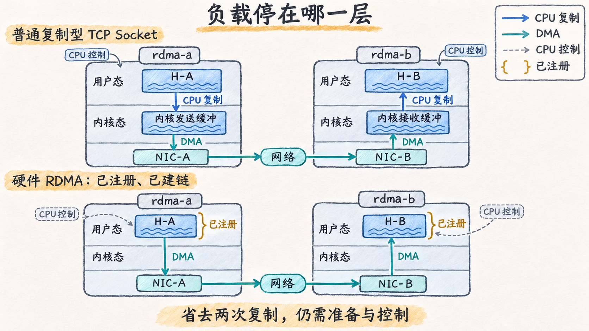

# Socket 与 RDMA 改变了哪段路径

## 先看一块主机内存中的数据

进程 A 的 H-A 里有一块已经生成好的数据，进程 B 希望在 H-B 使用它。这里先比较普通复制型 TCP Socket 和硬件 RDMA，暂时没有 GPU，也不讨论文件发送。**DMA（Direct Memory Access，直接内存访问）**表示设备按已建立的映射读写内存，CPU 无需用指令逐字节搬运。普通网卡同样使用 DMA，因此“有 DMA”本身无法区分两条路径。

下面是**教学数据流图**。实线箭头只表示 A→B 的有效负载；省略网卡内部缓冲、包头、ACK 与 PCIe 桥层。标注“CPU 复制”的边是用户缓冲与内核缓冲间的复制，不是额外物理网线；两组网络段是两种互斥方案。

```mermaid
flowchart TB
    subgraph S[普通复制型 TCP Socket]
        SA[H-A / 用户缓冲] -->|CPU 复制| SKA[A 内核发送缓冲]
        SKA -->|DMA 读取| SN1[A 网卡]
        SN1 --> SW[网络]
        SW --> SN2[B 网卡]
        SN2 -->|DMA 写入| SKB[B 内核接收缓冲]
        SKB -->|CPU 复制| SB[H-B / 用户缓冲]
    end
    subgraph R[硬件 RDMA / 已完成注册与建链]
        RA[H-A / 注册缓冲] -->|DMA 读取| RN1[A RDMA 网卡]
        RN1 --> RW[网络]
        RW --> RN2[B RDMA 网卡]
        RN2 -->|DMA 写入| RB[H-B / 注册缓冲]
    end
```

普通 TCP 路径中，应用调用发送接口，内核维护字节流、协议状态与缓冲；接收侧由网络栈把数据交给应用。网卡可以卸载校验、分段等工作，不能把协议处理简单归结为“每个包都由 CPU 完整处理”。这里选择复制型缓冲模型，是为了定位可以省去的两次用户/内核复制。

这个模型也不代表所有 Socket 实现。Linux 的 `MSG_ZEROCOPY` 等机制可以减少发送复制，同时增加页管理与完成通知要求；这些机制并不会把 Socket 接口变成 Verbs。对照见 [Linux 内核：MSG_ZEROCOPY 的 Intro 与 Notifications](https://docs.kernel.org/networking/msg_zerocopy.html)。本章后续不把“零拷贝”用作某个协议的唯一身份标志。

## RDMA 把哪部分工作提前、哪部分交给硬件

**RDMA（Remote Direct Memory Access，远程直接内存访问）** 让网卡在权限范围内，直接把数据从一个已准备的缓冲搬到另一端的缓冲。通信库先把内存范围、映射、访问权限和通信端点交给系统与设备建立起来；传输时再提交“用哪段缓冲、做什么操作”的工作描述。网卡执行 DMA、传输协议和相应的完成报告。

“绕过内核”指支持直接用户态访问的硬件数据快路径可以不为每次提交进入内核。创建资源、注册内存、设备管理和错误处理仍依赖内核；CPU 仍要执行通信库、提交请求、检查完成和推进应用。Linux 明确区分资源管理慢路径与用户态映射寄存器的快路径，见 [Userspace verbs access：User-kernel communication](https://docs.kernel.org/infiniband/user_verbs.html#user-kernel-communication)。软件 RDMA 实现的 CPU 行为不能套用这幅硬件图。

接收端的 CPU 可以不为每次单边读写执行一条接收系统调用，前提是它已经建立资源、授权内存，并与发送方约定使用方式。它仍要决定何时处理结果、何时回收缓冲；应用逻辑并没有消失。下一篇会看到，这些前置工作被具体分解为内存区域和队列对象。

## 少了复制，为什么仍然会等待

比较性能时，把以下几项分开：

| 开销或约束       | RDMA 改变了什么           | 仍需满足的条件                  |
| ----------- | -------------------- | ------------------------ |
| 用户/内核有效负载复制 | 注册缓冲可供网卡直接访问         | 应用不能在在途时随意改写或释放缓冲        |
| 主机协议处理      | 硬件网卡承担相应传输处理         | 网卡资源、协议和网络仍须正常           |
| 提交与通知       | 可走直接提交、轮询或事件通知       | CPU 仍要推进队列；忙轮询会消耗 CPU 时间 |
| 内存准备        | 映射与授权可以被多次传输复用       | 注册有开销，也占用受限资源            |
| 实际搬运        | 数据仍经过内存、PCIe、NIC 与网络 | 任何一段的带宽或延迟都可能成为约束        |

例如，把初始化和注册放在计时外，可研究重复传输的稳定吞吐；把它们计入首条消息耗时，则回答首次交付的成本。这两个问题都有价值，结果不能直接相互替代。若每次只发很小的数据却重新建链、注册，减少复制节省的时间未必覆盖准备成本。

这里的“直接”也没有让网络变成共享内存总线。B 的虚拟地址不能被 A 的 CPU 直接解引用；远端访问必须通过协议、设备对象、地址及权限。把这些条件写成对象后，才能检查一条请求是否被正确描述。

图 06-01-01　两种互斥的 A→B 主机缓冲路径。普通复制型 Socket 在两端分别发生用户/内核负载复制，网卡本来就使用 DMA；已准备好的硬件 RDMA 直接访问注册用户缓冲。内核资源管理和 CPU 控制仍存在，省略桥层及网络内部不表示这些开销消失。

[返回导读](00_导读.md) · [下一篇：用队列与注册内存描述一次传输](02_用队列与注册内存描述一次传输.md)
