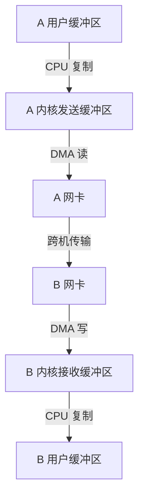
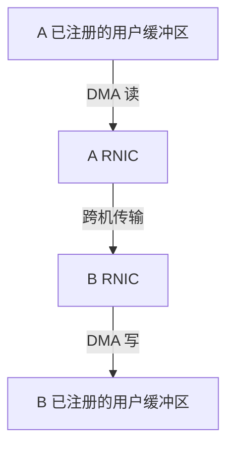

# 同一段数据，Socket 和 RDMA 各经过哪里

训练作业的 Rank A 要把一段数据交给另一台机器上的 Rank B。先假定两端的数据都在主机内存，并把网络简化为两张网卡之间的一条可用路径。无论选择普通 TCP Socket 还是硬件 RDMA（远程直接内存访问），网卡都会通过 DMA 搬数据。对比两条路径时，先看**网卡从哪里取数据，又把数据写到哪里**。

DMA（直接内存访问）允许网卡按设备可用的地址读写内存。CPU 或驱动先准备缓冲区、地址映射和工作描述，再由设备搬运载荷。分析时把三类工作分开。**载荷搬运**决定数据经过哪些缓冲区，**协议处理**决定谁负责分段、确认和重传，**控制操作**包括建连、安排工作和取得完成结果。 [Linux 内核 · DMA API HOWTO](https://docs.kernel.org/core-api/dma-api-howto.html) · [Linux 内核 · Userspace Verbs](https://docs.kernel.org/infiniband/user_verbs.html)

## 常规 TCP 的载荷经过内核缓冲区

在 Linux 常规复制路径上，A 调用 `send()`，内核把用户缓冲区中的数据复制进内核管理的发送缓冲区。内核 TCP/IP 栈维护连接状态、组织发送，网卡驱动准备描述符，网卡用 DMA 从发送缓冲区读取数据。B 的网卡则先把收到的数据 DMA 写入驱动提供的接收缓冲区。驱动和内核协议栈处理数据包，B 调用 `recv()` 时，内核把可读的字节复制到 B 的用户缓冲区。两端因此各有一段用户缓冲区与内核缓冲区之间的 CPU 复制。TCP 提供字节流，一次 `recv()` 取得的长度也由当前可读数据和调用参数决定。 [Linux v6.12 · `tcp_sendmsg_locked` 和 `tcp_recvmsg_locked`](https://github.com/torvalds/linux/blob/v6.12/net/ipv4/tcp.c)

网卡可以承担部分 TCP 路径的工作。例如启用发送校验和卸载和 TCP 分段卸载（TSO）后，内核交给设备的缓冲区可以包含较大的待分段数据，设备按要求切分并完成相应校验和。此时少掉的是 CPU 上的部分协议处理。常规 `send()` 是否仍复制用户缓冲区，要单独看发送 API 与所走分支。 [Linux 内核 · Segmentation Offloads](https://docs.kernel.org/networking/segmentation-offloads.html)

## 硬件 RDMA 把已注册的用户缓冲区交给网卡

硬件 RDMA 使用能执行 RDMA 传输的网卡，下面称 RNIC。应用先通过内核驱动建立连接所需资源，并注册将要使用的内存。注册让驱动可以建立设备可用的 DMA 映射，约束网卡能访问的范围和方式。以一次写入为例，准备好之后，A 的用户态设备库把工作提交到队列，通过门铃通知 RNIC。A 的 RNIC DMA 读取 A 的已注册缓冲区并发出数据，B 的 RNIC 处理收到的传输并把载荷 DMA 写入 B 的已注册缓冲区。两段经内核网络缓冲区的 CPU 复制由此省去。 [Linux 内核 · Userspace Verbs](https://docs.kernel.org/infiniband/user_verbs.html) · [NVIDIA · RDMA Aware Networks Programming User Manual v1.7，§3.1](https://docs.nvidia.com/rdma-aware-networks-programming-user-manual-1-7.pdf)

这里采用 ConnectX 一类硬件的典型快路径。内核仍负责设备访问和资源管理。CPU 要安排连接、提交请求、处理错误和回收缓冲区。通过轮询读取完成时，等数据的线程可能持续占用一个 CPU 核。应用也可采用基于事件的等待，或批量提交和读取完成，改变 CPU 时间花在轮询、唤醒还是提交上的比例。评估卸载收益时，要把注册与建连的一次性成本、稳态每次提交的成本和等待成本分开。 [Linux 内核 · Userspace Verbs](https://docs.kernel.org/infiniband/user_verbs.html) · [rdma-core v57.0 · CQ 事件](https://github.com/linux-rdma/rdma-core/blob/v57.0/libibverbs/man/ibv_get_cq_event.3)

### 常规 TCP 的载荷路径

两端的内核 TCP/IP 栈和驱动分别管理本机的发送与接收。网卡做 DMA 的端点是内核管理的缓冲区。

### 硬件 RDMA 的载荷路径

两端应用和驱动先建连、注册缓冲区。A 的应用提交请求后，两端 RNIC 接力传输，分别对各自机器的主机内存做 DMA，A 再读取完成记录。两张图中的箭头都表示载荷方向。

## 条件改变时，逐段重画路径

| 变化 | 如何判断发生了什么 |
| --- | --- |
| TCP 发送端先启用 `SO_ZEROCOPY`，再带 `MSG_ZEROCOPY` 调用发送 | 内核可以让发送路径暂时引用应用的页，从而省去发送端复制。应用通过 `recvmsg(..., MSG_ERRQUEUE)` 读取完成通知，在内核释放对相应缓冲区的引用后再改写。 |
| 零拷贝通知的 `ee_code` 出现 `SO_EE_CODE_ZEROCOPY_COPIED` | 内核报告此次通知涉及复制。完成通知的语义是本地缓冲区可重用，对端应用的读取时间要从对端取得。 |
| `rdma link` 显示 `rxe` 类型的软件 RoCE 设备 | 应用仍可走 Verbs，RDMA 传输由软件实现。应重新观察 CPU 和网络栈路径，硬件 RNIC 的卸载推导适用于硬件主例。 |

表中标志和设备类型来自内核及 iproute2 的接口文档。 [Linux 内核 · MSG_ZEROCOPY](https://docs.kernel.org/networking/msg_zerocopy.html) · [iproute2 v6.12.0 · rdma-link](https://github.com/iproute2/iproute2/blob/v6.12.0/man/man8/rdma-link.8)
