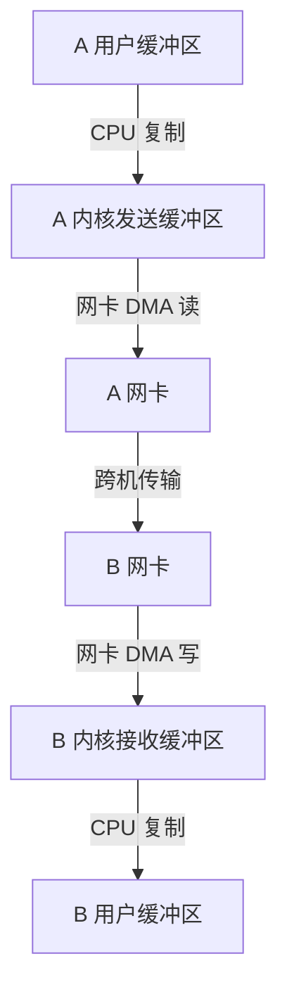
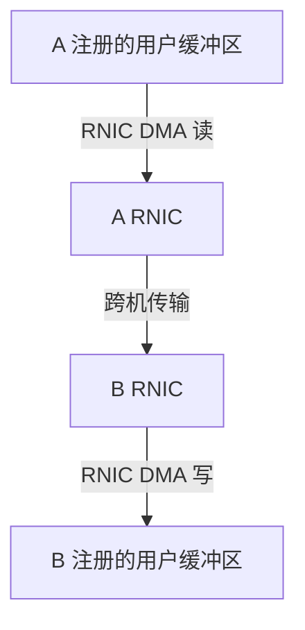

多机作业中，节点 A 上的进程算出一段数据，节点 B 上的进程需要它才能继续。第 05 章把这些进程在通信组里的编号称为 Rank。本章只取 A → B 这一段交换，先把源和目标都放在主机内存。无论上层要发送一块梯度还是一段中间结果，底层都要把字节从 A 的缓冲区搬到 B 的缓冲区。

**RDMA（Remote Direct Memory Access，远程直接内存访问）** 是一种在两台机器之间传输数据的机制。以硬件实现为例，应用或通信库准备连接和内存，向支持 RDMA 的网卡（RDMA Network Interface Card，以下简称 RNIC）提交要执行的操作。两端 RNIC 负责相应的传输协议处理，各自读写本机已注册的缓冲区。一次最小的 **RDMA Write** 是 A 给出源缓冲区和 B 已授权的目标，A 的 RNIC 读源、B 的 RNIC 写目标，A 的进程再查询执行结果。后续的 Send 和 Read 也使用这套设备接口，缓冲区由谁指定会随操作变化。 [Linux 内核 Userspace Verbs](https://docs.kernel.org/infiniband/user_verbs.html) · [NVIDIA RDMA 编程手册 v1.7，RDMA Operations](https://docs.nvidia.com/rdma-aware-networks-programming-user-manual-1-7.pdf)

**DMA（Direct Memory Access，直接内存访问）** 负责一台机器内部的设备访问。驱动先建立设备能使用的地址映射，设备再据此读写相应内存。因此跨机 Write 包含两个本机 DMA 动作，中间由网络传送数据。普通 TCP 网卡也用 DMA。判断两条路径的差别时，分别看数据经过的**缓冲区**、执行**协议处理**的主体，以及安排并收取结果的**控制操作**。 [Linux 内核 DMA API HOWTO](https://docs.kernel.org/core-api/dma-api-howto.html)

## 常规 TCP 经过内核管理的网络缓冲区

A 调用常规 `send()` 时，Linux 将接受的字节从用户缓冲区复制进内核管理的发送缓冲区。TCP 是面向字节流的协议，内核维护连接状态并组织发送，驱动给网卡准备发送描述符。网卡 DMA 读取发送缓冲区，向 B 发出数据。B 的网卡把收到的数据 DMA 写入驱动准备的接收缓冲区，随后由内核协议栈处理。B 调用普通 `recv()` 时，内核将已可读的字节复制到 B 的用户缓冲区。一次 `recv()` 返回的字节数取决于实际到达的数据和调用参数，应用自己确定一条消息的边界。 [Linux v6.12 的 TCP 发送和接收实现](https://github.com/torvalds/linux/blob/v6.12/net/ipv4/tcp.c)

## 硬件 RDMA 以应用注册的缓冲区为 DMA 端点

以两端 ConnectX 一类硬件的典型路径为例，B 预先注册写入目标，并把目标地址、范围和访问密钥交给 A。注册在这里指将指定范围交给驱动建立设备访问所需的映射，并限制访问。A 注册自己的源缓冲区，通过 Verbs（操作 RDMA 设备的接口）投递一次 Write。设备库将这项工作放进网卡的队列，通过称为**门铃**的设备机制通知网卡有新工作。A 的 RNIC 从注册好的源缓冲区取数，B 的 RNIC 校验目标后把数据写到注册好的目标。A 的应用读取完成记录，B 的应用依照双方约定获知结果可供使用。 [Linux 内核 Userspace Verbs](https://docs.kernel.org/infiniband/user_verbs.html) · [rdma-core v57.0 的 Write 工作请求](https://github.com/linux-rdma/rdma-core/blob/v57.0/libibverbs/man/ibv_post_send.3)

只数一次单向传输的应用载荷，设 A 发送 `S` 字节并最终全部放入 B 的缓冲区。常规 TCP 在两机各有一次 `S` 字节的用户态与内核态之间的 CPU 复制，合计 `2S` 字节的复制载荷。硬件 RDMA 改变了网卡 DMA 的起点和终点，省去这两次复制。两条路径的跨网有效载荷仍各为 `S` 字节。这个计数省略头部、重传、缓存和内存总线流量，也无法直接换算为端到端加速比。

硬件快路径通常可在用户态投递和轮询，内核负责设备访问、资源创建和注册。CPU 仍要做连接、提交、处理错误和安排缓冲区交接。每条消息都重新注册时，映射的开销会重复发生。连续轮询完成队列也会消耗 CPU 时间。若改用完成事件，可以让线程等待通知后再查询队列，会引入相应的事件管理和唤醒开销。 [Linux 内核 Userspace Verbs](https://docs.kernel.org/infiniband/user_verbs.html) · [rdma-core v57.0 的完成事件](https://github.com/linux-rdma/rdma-core/blob/v57.0/libibverbs/man/ibv_get_cq_event.3)

## 卸载、零拷贝和软件 RDMA 改变的环节

- TCP 分段卸载（TCP Segmentation Offload，TSO）让网卡根据内核提供的信息分段，发送校验和也可以卸载。若应用仍走常规复制式 `send()`，用户发送缓冲区到内核缓冲区的复制仍会发生。 [Linux 内核 Segmentation Offloads](https://docs.kernel.org/networking/segmentation-offloads.html)
- Linux 应用启用 `SO_ZEROCOPY` 后，可用 `MSG_ZEROCOPY` 请求避免**发送端**复制。内核可能暂时引用用户页，也可能回退到复制。应用从错误队列取得通知，再复用对应缓冲区。通知带有 `SO_EE_CODE_ZEROCOPY_COPIED` 时，涉及的发送发生了复制。这个通知回答的是本地页何时可以重用。 [Linux 内核 MSG_ZEROCOPY](https://docs.kernel.org/networking/msg_zerocopy.html)
- `rxe` 是软件实现的 RoCE（RDMA over Converged Ethernet，经以太网承载的 RDMA）设备。应用仍可通过 Verbs 使用它，协议处理回到软件路径，CPU 开销需按所用实现重新判断。 [iproute2 v6.12.0 的 rdma link 文档](https://github.com/iproute2/iproute2/blob/v6.12.0/man/man8/rdma-link.8)

当 RNIC 直接读写进程的内存时，内核网络缓冲区不再为每次传输提供中间落点。应用因此要明确告诉设备哪段内存可访问、队列可以引用哪些缓冲区，以及何时可以回收它们。
