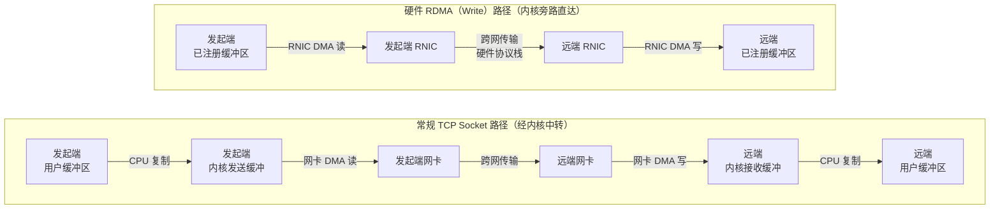

# TCP Socket 与硬件 RDMA 的数据路径

在 `200 Gb/s`（`25 GB/s`）乃至 `400 Gb/s`（`50 GB/s`）的 AI 集群网络里，如果还用传统 TCP Socket 跨机传输几百 MiB 的训练梯度，或是在 PD 分离推理架构中把数 GiB 的 KV Cache 从 Prefill 节点搬往 Decode 节点，网络带宽还没跑满，CPU 核心和主机内存总线往往就先被打穿了。

根源不在于网卡不够快，而在于数据在操作系统内核里绕了太多远路。要理解高速 AI 集群为什么普遍转向 RDMA，先看清两种通信路径在缓冲区、协议处理与 CPU 分工上的本质差异。

## 邮局中转 vs 门禁直达：什么是 RDMA

**RDMA（Remote Direct Memory Access，远程直接内存访问）** 的核心思路极其干脆：**绕开操作系统内核和 CPU 的数据搬运，让两台机器的网卡直接读写对方进程的内存**。

可以把它类比成两种寄送包裹的方式：
- **传统 TCP Socket 像经由邮局中转**：发起端进程把包裹交给本地邮局（内核发送缓冲区），邮局负责拆箱、贴运单、排队装车（TCP 协议栈处理）；到达对端后，由远端邮局签收、重组，再人工搬运交给收件进程（内核到用户态拷贝）。
- **硬件 RDMA 像办好门禁授权后的点对点直达**：双方先向系统办好“门禁与地址授权”（内存注册），此后发起端只需把货运单放进队列、轻按一下**门铃（Doorbell）** 通知支持 RDMA 的网卡（**RNIC，RDMA Network Interface Card**），两端 RNIC 就直接把包裹从发起端仓库搬进远端仓库，全程几乎不打扰两端 CPU。

在单机内部，第 01 章介绍的 DMA 让外设按映射地址直接读写本机内存；而一次跨机硬件 RDMA 传输，本质上是由两台机器的 RNIC 各自完成一次本机 DMA，再由硬件卸载的传输协议把数据跨网接通。应用或通信库用来准备资源、投递请求和收取结果的标准接口，称为 **Verbs**。

## 传统 TCP 与硬件 RDMA 数据路径对照

以发起端把一块内存数据单向传给远端为例，先对比两条路径每一步由谁干活。

在常规 TCP 路径上，发起端调用 `send()` 时，CPU 把字节从用户缓冲区复制进内核发送缓冲区。内核维护面向字节流的连接状态、分段封装，驱动提交发送描述符，由普通网卡 DMA 读出并上链。远端网卡收到数据包后 DMA 写入内核接收缓冲区，经内核协议栈校验重组，再等远端调用 `recv()` 时由 CPU 复制进用户缓冲区。

在硬件 RDMA 路径上（以最典型的 **RDMA Write** 为例），远端提前注册好目标缓冲区，把地址、长度与访问密钥交给发起端。发起端同样注册源缓冲区，通过 Verbs 提交一条 Write 工作请求并触发网卡门铃。发起端 RNIC 直接 DMA 读取源缓冲区并经硬件协议栈发出，远端 RNIC 校验权限后直接 DMA 写入目标缓冲区，最后发起端读取完成记录，远端按约定开始消费数据。

*图 06-01-01：传统 TCP Socket 与硬件 RDMA（Write）数据路径对照。硬件 RDMA 将网卡 DMA 端点直接推进到用户进程已注册的缓冲区上。*

## 定量对比：为什么 200G/400G 会拖垮 CPU

设发起端向远端单向传送 $S$ 字节应用有效载荷，暂不计协议头、重传与缓存局部性效应，对比两条路径上的额外数据搬运量：

$$
\text{TCP 两端额外 CPU 拷贝量} = S_{\text{发起端}} + S_{\text{远端}} = 2S
$$

$$
\text{硬件 RDMA 两端额外 CPU 拷贝量} = 0
$$

两条路径在物理网络上传输的有效载荷都是 $S$ 字节，但传统 TCP 在两台主机的内存总线上各多出一次整块数据的 CPU 读写复制（合计 $2S$），同时还要承担逐包中断、内核协议栈状态机维护与消息边界切分。

按单条 `200 Gb/s` 链路折算，满速线速吞吐为 $25\text{ GB/s}$：走传统 TCP 时，每端仅用户态与内核态之间的数据搬运就需要持续吞吐 $25\text{ GB/s}$ 的内存读加 $25\text{ GB/s}$ 的内存写，叠加协议栈计算极易耗尽多核 CPU 算力；换成硬件 RDMA 后，这两段拷贝与协议处理一并下沉到了 RNIC 硬件。

| 对比维度 | 常规 TCP Socket | 硬件 RDMA（如 ConnectX RNIC） |
| --- | --- | --- |
| **数据经过的缓冲区** | 用户缓冲 ↔ 内核缓冲 ↔ 网卡 | 已注册用户缓冲 ↔ RNIC（跳过内核缓冲） |
| **协议处理主体** | 主机 CPU（Linux 内核协议栈） | RNIC 专用硬件引擎 |
| **单向传 $S$ 字节的 CPU 拷贝** | 两端合计 $2S$ | $0$ |
| **消息边界语义** | 面向字节流，`recv()` 需应用自行拼包 | 面向消息/块操作，单条请求语义清晰 |

> [!summary] 核心结论
> 硬件 RDMA 带来高吞吐与微秒级低延迟的两大支柱是**内核旁路（Kernel Bypass）**与**零拷贝硬件卸载**：控制面建连与注册走内核，真正传输数据时用户态直接敲门铃、RNIC 直接对注册内存做 DMA。

## 别把 RDMA 神化成“零 CPU”

硬件快路径允许应用直接在用户态投递请求和轮询结果，但 CPU 并没有彻底退休。建连协商、内存注册、投递工作项、错误处理以及收发双方的缓冲区复用同步，依然由 CPU 负责。

> [!warning] 常见误区：开启 RDMA 就等于零 CPU 开销
> 两种常见写法会让 RDMA 的 CPU 消耗居高不下：
> 1. **逐条消息反复注册内存**：内存注册需要进内核锁页并建立设备映射，若每次发送都临时注册、用完即注销，控制面开销会彻底抵消零拷贝收益，工程上必须提前注册内存池反复复用。
> 2. **死循环忙轮询（Busy Polling）**：为了压低微秒级延迟，通信库常让线程持续轮询完成队列，这会把对应 CPU 核心打到 100%；若改用**完成事件（Completion Event）**让线程休眠等待中断唤醒，则可节省 CPU，但会引入内核唤醒延迟。

## 三个容易混淆的“半路方案”

工程中经常看到网卡卸载、Socket 零拷贝和软件 RDMA，它们各自只改变了上述路径中的某一环，不能与硬件 RDMA 画等号：

- **TCP 分段卸载（TSO）与校验和卸载**：让普通网卡替 CPU 承担大包切分与校验和计算，减轻了部分协议栈负担；但只要应用仍调用常规 `send()`，数据从用户态拷贝进内核缓冲区的开销依然存在。
- **Linux `SO_ZEROCOPY` / `MSG_ZEROCOPY`**：允许发送端请求内核直接引用用户内存页、尽量避免发送侧 CPU 拷贝。内核仍可能回退到拷贝（应用需从错误队列读通知，检查是否带有 `SO_EE_CODE_ZEROCOPY_COPIED` 标志，并据此判断本地页何时能安全复用），且整个传输仍运行在内核 TCP 协议栈内。
- **软件 RDMA（如 `rxe` / Soft-RoCE）**：在普通以太网卡上用内核软件模拟 RDMA 协议栈。上层代码照样调用 Verbs 接口，便于开发与功能验证，但协议处理完全回落到 CPU，不具备硬件 RNIC 的低开销与线速优势。

> [!tip] 工程直觉
> 排查集群通信性能时，看到程序走 Verbs 接口并不自动意味着享受了硬件卸载——先确认底层设备究竟是硬件 RNIC（如 `mlx5`），还是软件模拟的 `rxe`。

当 RNIC 直接读写进程内存后，操作系统内核不再充当安全缓冲垫。应用必须先明确告诉网卡：哪几段内存允许访问、允许谁读谁写、队列里排了哪些任务，以及任务何时真正做完可以覆盖内存——这正是下一篇 Verbs 核心对象与权限模型要解决的问题。

> [!info]- 参考资料
> - **Linux 内核 Userspace Verbs 与 DMA 机制**：[Linux Kernel Userspace Verbs](https://docs.kernel.org/infiniband/user_verbs.html)、[Linux Kernel DMA API HOWTO](https://docs.kernel.org/core-api/dma-api-howto.html)
> - **Linux TCP 实现与网络卸载**：[Linux v6.12 `net/ipv4/tcp.c`](https://github.com/torvalds/linux/blob/v6.12/net/ipv4/tcp.c)、[Segmentation Offloads](https://docs.kernel.org/networking/segmentation-offloads.html)、[MSG_ZEROCOPY](https://docs.kernel.org/networking/msg_zerocopy.html)
> - **RDMA 编程接口与软件 RoCE**：[NVIDIA RDMA Aware Networks Programming User Manual v1.7](https://docs.nvidia.com/rdma-aware-networks-programming-user-manual-1-7.pdf)、[rdma-core v57.0 `ibv_post_send(3)`](https://github.com/linux-rdma/rdma-core/blob/v57.0/libibverbs/man/ibv_post_send.3)、[rdma-core v57.0 `ibv_get_cq_event(3)`](https://github.com/linux-rdma/rdma-core/blob/v57.0/libibverbs/man/ibv_get_cq_event.3)、[iproute2 v6.12.0 `rdma-link(8)`](https://github.com/iproute2/iproute2/blob/v6.12.0/man/man8/rdma-link.8)
