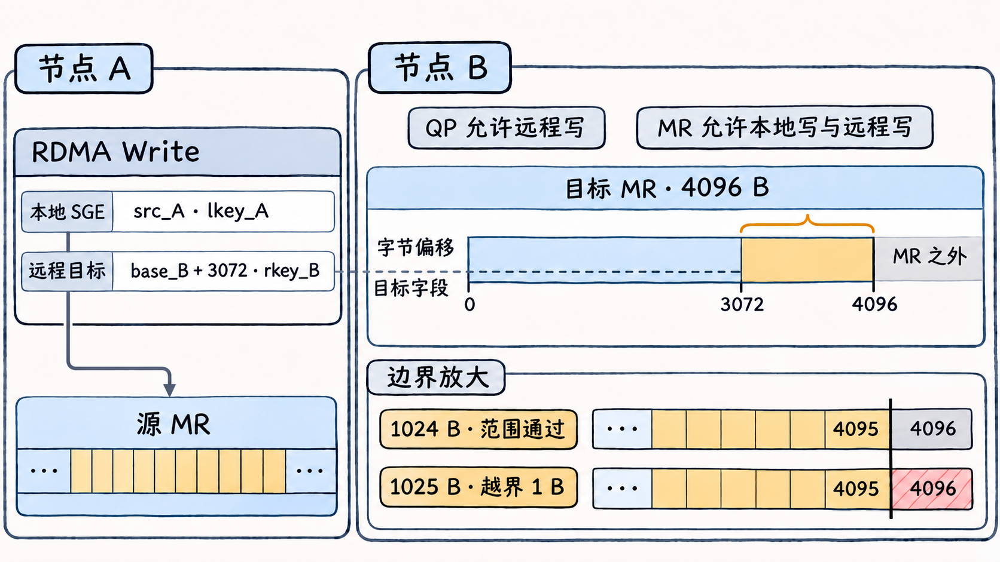

节点 A 要把主机内存中的 `1024 B` 写到节点 B 的一个缓冲区。两端各用一组队列安排网卡的发送和接收，这组队列称为队列对。先假定两端的 **RC（Reliable Connected，可靠连接）** 已经就绪。RC 把两端各一个队列对配成一条可靠、有序的连接，传输服务处理确认和重传。B 在建立连接之外，还要明确开放哪段内存供 A 写入。 [NVIDIA RDMA 编程手册 v1.7 的 Transport Modes](https://docs.nvidia.com/rdma-aware-networks-programming-user-manual-1-7.pdf)

## 内存注册建立设备映射和访问范围

进程中的指针是虚拟地址。RNIC 需要一份在执行请求时能用的设备映射，还要知道可以访问的范围和方式。对本例的普通主机缓冲区，应用将起始地址、长度和访问标志交给 `ibv_reg_mr()`。驱动固定相关内存页并准备 DMA 映射。固定让页面在设备使用期间保持可用。支持 ODP（On-Demand Paging，按需分页）的设备与注册方式可以按需处理映射，本例使用普通注册。 [Linux 内核 Userspace Verbs 的内存固定](https://docs.kernel.org/infiniband/user_verbs.html#memory-pinning) · [rdma-core v57.0 的 MR 注册](https://github.com/linux-rdma/rdma-core/blob/v57.0/libibverbs/man/ibv_reg_mr.3)

注册得到一个**内存区域（Memory Region，MR）**。本机请求用 `lkey`（本地密钥）引用本机 MR。远端对这段 MR 发起 Read 或 Write 时，使用接收方授权的 RDMA 地址与 `rkey`（远程密钥）。远程写权限须在 MR 上显式开启，收到请求的队列对也须允许远程写。通常先结束在途操作，并约定对端停止访问，才注销 MR 和释放底层缓冲区。 [rdma-core v57.0 的 MR 权限](https://github.com/linux-rdma/rdma-core/blob/v57.0/libibverbs/man/ibv_reg_mr.3) · [队列对属性](https://github.com/linux-rdma/rdma-core/blob/v57.0/libibverbs/man/ibv_modify_qp.3)

## 从工作请求到完成队列

应用通过 `libibverbs` 打开本机选定的 RDMA 设备，得到一个**设备上下文**。在这个上下文中创建**保护域（Protection Domain，PD）**，用它把能够在同一次访问中配合的本机资源归在一起。本例中，A 的队列对和源 MR 属于同一个 A 端 PD，B 的队列对和目标 MR 属于同一个 B 端 PD。两台机器分别建立自己的资源。 [rdma-core v57.0 的保护域](https://github.com/linux-rdma/rdma-core/blob/v57.0/libibverbs/man/ibv_alloc_pd.3) · [队列对创建](https://github.com/linux-rdma/rdma-core/blob/v57.0/libibverbs/man/ibv_create_qp.3)

**队列对（Queue Pair，QP）** 在本例中由发送队列（Send Queue，SQ）和接收队列（Receive Queue，RQ）组成。主动发起的 Write 投到 SQ。RQ 用于预先提供接收项，普通 Write 执行时由 B 的 RNIC 直接找已授权的 MR。创建 QP 时指定发送侧和接收侧各关联哪个**完成队列（Completion Queue，CQ）**，两侧可以共用一个 CQ。CQ 归设备上下文管理。 [rdma-core v57.0 的队列对创建](https://github.com/linux-rdma/rdma-core/blob/v57.0/libibverbs/man/ibv_create_qp.3) · [完成队列创建](https://github.com/linux-rdma/rdma-core/blob/v57.0/libibverbs/man/ibv_create_cq.3)

A 提交一条**工作请求（Work Request，WR）**，给出操作、本地缓冲区和远程目标。每段本地缓冲区的描述称为 **SGE（Scatter/Gather Element，分散收集条目）**，包含地址、长度和本地密钥。设备库将这个 WR 编码成 **WQE（Work Queue Entry，设备工作队列项）**。本例要求成功时也产生完成通知，因此网卡执行完成后写入 **CQE（Completion Queue Entry，完成队列条目）**。应用用 `ibv_poll_cq()` 将结果取为 **WC（Work Completion，工作完成记录）**，借助自己指定的 `wr_id` 与原 WR 对上。 [rdma-core v57.0 的提交接口](https://github.com/linux-rdma/rdma-core/blob/v57.0/libibverbs/man/ibv_post_send.3) · [完成轮询](https://github.com/linux-rdma/rdma-core/blob/v57.0/libibverbs/man/ibv_poll_cq.3)


**图 06-02-01**　只画 A 端。琥珀色实线是本机的载荷方向，虚线表示提交、引用和完成。网卡是节点 A 的硬件，设备上下文框用于归组软件资源。图在网卡处省略了 A 的发送与 B 的接收、校验和写入。

## 用 1024 B 推导 Write 的授权条件

以下为**字段级教学配置**。A 已注册从 `src_A` 开始的一段足够大的源缓冲区。B 向 A 发布目标 MR 的 RDMA 基址 `base_B`、长度和 `rkey_B`。请求使用非 inline 路径，设备在执行时按 SGE 读取源数据。

```text
A 的 WR           wr_id=17, opcode=IBV_WR_RDMA_WRITE, send_flags=IBV_SEND_SIGNALED
A 的本地 SGE      addr=src_A, length=1024 B, lkey=lkey_A
A 的远程目标      remote_addr=base_B + 3072, rkey=rkey_B
B 的目标 MR       base_B, length=4096 B, rkey=rkey_B
B 的 MR 许可      IBV_ACCESS_LOCAL_WRITE | IBV_ACCESS_REMOTE_WRITE
B 的 QP 许可      IBV_ACCESS_REMOTE_WRITE
```

1. A 的 RNIC 用本地密钥找到源 MR，检查源地址和长度是否在域内已注册的范围中。本例 A 的网卡只从自己的 MR 读数据。
2. B 的 RNIC 根据请求到达的 QP 及远程密钥检查目标。先假定域、密钥和许可均匹配。目标 MR 的有效偏移区间为 `[0, 4096)`，请求覆盖的是 `[3072, 3072 + 1024) = [3072, 4096)`，最后写到偏移 `4095`。
3. 长度增至 `1025 B` 且 A 的源区仍足够大时，请求覆盖到偏移 `4096`，该字节已在 B 的 MR 之外。改回 `1024 B` 后，若 `rkey_B` 写错或已失效，则范围计算依然成立，但授权检查无法通过。若只保留 B 的 QP 远程写权限，B 的 MR 仍须允许远程写。Verbs 要求开启 MR 的远程写权限时同时开启其本地写权限。 [rdma-core v57.0 的 MR 访问标志](https://github.com/linux-rdma/rdma-core/blob/v57.0/libibverbs/man/ibv_reg_mr.3) · [Write 字段和 SGE](https://github.com/linux-rdma/rdma-core/blob/v57.0/libibverbs/man/ibv_post_send.3)



**图 06-02-02**　上方的 `4096` 标记区间右边界，下方的 `4096` 格代表第一个越界字节。红格表示请求覆盖的范围。范围判断之前已假定 B 的 QP 与 MR 许可有效且 `rkey_B` 匹配。

## 提交、完成和源缓冲区复用

| A 观察到的事件 | 对请求 17 的判断 |
| --- | --- |
| 单条请求的 `ibv_post_send()` 返回 `0` | 本地投递成功，设备可以随后执行。 |
| `ibv_poll_cq()` 返回 `0` | 这一轮没有取到记录，继续按该请求的完成设置观察。 |
| 取到 `wr_id=17, status=IBV_WC_SUCCESS` | 本例的非 inline Write 已成功完成，若没有其他在途请求引用同一段源内存，A 可复用它。B 的应用按约定取得消费信号。 |
| 取到错误 WC | 从 `wr_id`、`qp_num` 关联原 WR，再读 `status`、`vendor_err`。错误时操作类型、目标和长度从保存的提交记录恢复。 |

对设备支持的小消息，`IBV_SEND_INLINE` 会在投递时将数据放进发送队列项，调用返回后即可重用原源缓冲区。批量发送还有选择性完成，例如在一条 RC SQ 上的一批普通 Write 中给最后一个请求设置完成标志，按发送队列的完成顺序回收其覆盖的前序请求。应用需要单独处理错误完成和队列状态。 [rdma-core v57.0 的提交与缓冲区生存期](https://github.com/linux-rdma/rdma-core/blob/v57.0/libibverbs/man/ibv_post_send.3) · [完成记录的字段约束](https://github.com/linux-rdma/rdma-core/blob/v57.0/libibverbs/man/ibv_poll_cq.3) · [perftest 26.07.8 的批量完成计数](https://github.com/linux-rdma/perftest/blob/a31f9ea9df720ee68f941e55f75fec31349fcd35/src/perftest_resources.c)

一次 Write 已能从提交跟到完成。下一步要把 A 与 B 的两个 QP 接起来，并约定 B 何时发布地址、何时获知写入结果。
