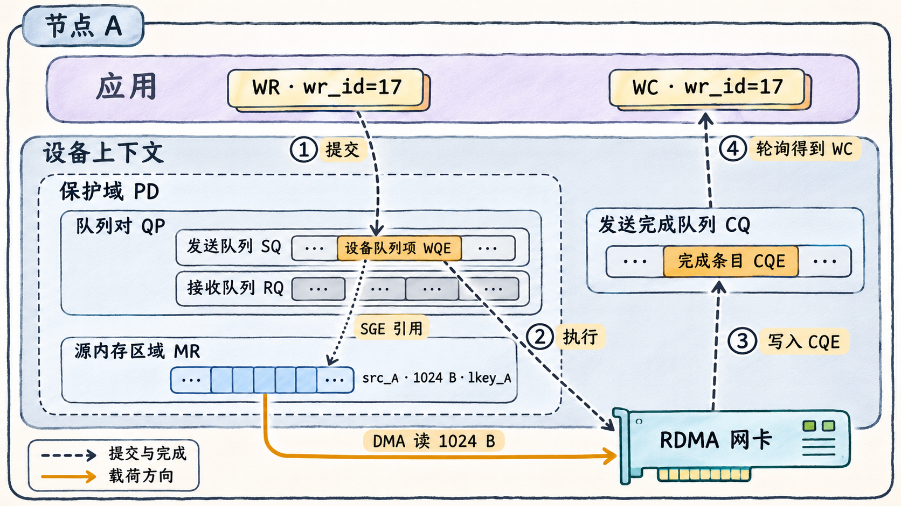

# Verbs 队列、内存注册与访问权限

取消内核缓冲区中转之后，两个极其现实的问题立刻浮出水面：第一，进程手里的指针只是虚拟地址，网卡如何找到它背后的物理内存页？第二，如果允许对端网卡直接往本机内存里写数据，凭什么防止它越界踩坏其他数据？

Verbs 用一套严谨的对象体系回答了这两个问题。本篇先假定发起端与远端之间的 **RC（Reliable Connected，可靠连接）** 已经就绪——RC 将两端各一个队列对配成一对一的可靠、有序通道，由网卡硬件负责确认与重传。在此基础上，我们拆解一次 `1024 B` 的非 inline RDMA Write 背后全部核心对象与门禁检查。

## 内存注册（MR）：给内存办“通行证”与固定门牌

普通进程分配的内存随时可能被操作系统换出或迁移物理页，而网卡 DMA 访问需要稳定有效的设备地址映射。因此，任何准备参与 RDMA 传输的内存，都必须先通过 `ibv_reg_mr()` 完成注册，生成一个 **内存区域（Memory Region，MR）**。

常规注册时，内核驱动会**固定（Pin）** 该区间的物理内存页，防止它们在传输期间被换出或回收，并为其建立 RNIC 可见的 DMA 映射表。（部分新硬件支持 **ODP，On-Demand Paging，按需分页**，可按需触发页映射，常规高性能路径仍以显式固定注册为主。）

注册成功后，系统会返回两把关键钥匙：
- **`lkey`（本地密钥）**：供本机发起的工作请求使用，告诉本机 RNIC 这段内存属于哪个已注册的 MR。
- **`rkey`（远程密钥）**：交给远端进程，远端在发起 RDMA Read 或 Write 时必须携带目标地址与匹配的 `rkey`，才被允许访问这段内存。

> [!warning] 常见误区：远程写权限的隐藏前提与注销顺序
> 1. **权限联动**：按 Verbs 规范，给一个 MR 开启远程写权限（`IBV_ACCESS_REMOTE_WRITE`）时，**必须同时开启本地写权限（`IBV_ACCESS_LOCAL_WRITE`）**，否则注册直接报错。同时，接收该请求的队列对也必须打开远程写开关，二者缺一不可。
> 2. **生命周期**：必须等所有引用该 MR 的在途请求彻底完成、且对端确认不再发起远程访问之后，才能注销 MR 并释放底层内存。

## 核心对象图谱：从 PD、QP、CQ 到提交与完成

应用通过用户态库 `libibverbs` 打开选定的本地 RDMA 设备后，会获得一个**设备上下文（Device Context）**，随后在其中按“门禁域 + 收发窗口 + 回执箱”的关系创建资源：

- **保护域（Protection Domain，PD）**：相当于安全隔离的“门禁域”。只有归属同一个 PD 的队列对和 MR 才能在同一次操作里互相配合，防止不同模块或租户错用密钥跨区访问。两端机器各自独立维护自己的 PD。
- **队列对（Queue Pair，QP）**：网卡的收发业务窗口，由**发送队列（Send Queue，SQ）**与**接收队列（Receive Queue，RQ）**成对构成。发起端主动投递的 Write 排进 SQ；RQ 则用于预先摆放接收缓冲区（普通 Write 直接按远程地址落盘，不消耗远端 RQ）。
- **完成队列（Completion Queue，CQ）**：网卡用来投放执行回执的邮箱。CQ 直接归属设备上下文（位于 PD 之外），创建 QP 时可为发送侧和接收侧指定各自的 CQ，也可以共用一个 CQ。

一次数据传输如何穿过这些队列？完整链路只有四步：
1. **构造与提交**：应用构造 **工作请求（Work Request，WR）**，用自定义整数 `wr_id` 标记，并用 **SGE（分散收集条目）** 指明本地地址、长度与 `lkey`（Write 另附远端地址与 `rkey`）。
   - 调用 `ibv_post_send()` 时，用户态库把 WR 编码为 **WQE（Work Queue Entry）** 写入 SQ，再敲响门铃。
2. **网卡执行**：RNIC 收到门铃后读取 SQ 中的 WQE，经 SGE 校验本地 `lkey`，通过 DMA 读取源 MR 中的数据并跨网发送。
3. **写回执**：请求执行完毕后（当 WR 请求了完成通知时），RNIC 向对应的 CQ 写入一条 **CQE（Completion Queue Entry）**。
4. **应用轮询**：应用调用 `ibv_poll_cq()` 从 CQ 捞出 **工作完成记录（Work Completion，WC）**，核对 `wr_id` 与状态码，就能确认哪一条 WR 已经真正收尾。



*图 06-02-01：发起端（图中标为节点 A）Verbs 核心对象关系与一次 1024 B Write 的本机执行链路。QP 与源 MR 同属保护域 PD，发送 CQ 位于 PD 之外；实线为载荷 DMA 方向，虚线为提交、引用与完成回执。*

## 用 1024 B Write 逐步验证四层门禁

现在把上述抽象落到一组具体字段上。假设发起端（对应下图中节点 A）准备把 `1024 B` 数据通过非 inline Write 写入远端（对应下图中节点 B）提前发布的 `4096 B` 目标 MR：

```text
# 发起端（节点 A）提交的工作请求（WR）
wr_id       = 17                       # 应用自定义编号，用于与完成记录（WC）对齐
opcode      = IBV_WR_RDMA_WRITE        # 单边写操作，直接写远端指定 MR
send_flags  = IBV_SEND_SIGNALED        # 要求网卡在成功时也向 CQ 写入完成记录

# 发起端本地 SGE（指明源数据在哪里）
local_sge   = { addr = src_A, length = 1024 B, lkey = lkey_A }

# 发起端指定的远程目标（由远端提前告知）
remote_dst  = { remote_addr = base_B + 3072, rkey = rkey_B }

# 远端（节点 B）提前配置好的目标 MR 与 QP 门禁
target_mr   = { addr = base_B, length = 4096 B, rkey = rkey_B }
mr_access   = IBV_ACCESS_LOCAL_WRITE | IBV_ACCESS_REMOTE_WRITE
qp_access   = IBV_ACCESS_REMOTE_WRITE
```

数据包真正落盘前，两端 RNIC 会依次把关四道硬门槛：

1. **发起端本地检查**：发起端 RNIC 凭 `lkey_A` 定位源 MR，确认它与当前 QP 同属一个 PD，且 `[src_A, src_A + 1024)` 完整落在源 MR 范围内，然后发起本机 DMA 读。
2. **远端 PD 与密钥校验**：数据包抵达目标 QP 后，远端 RNIC 校验 `rkey_B` 是否有效且未注销、是否指向同一 PD 下的目标 MR。只要密钥填错或旧 MR 已被注销，即便地址没越界也会当场拒绝。
3. **远端双权限校验**：远端 RNIC 同时检查目标 QP 和目标 MR 是否均已开启 `IBV_ACCESS_REMOTE_WRITE`；若只开了 QP 权限而漏开 MR 权限，校验同样失败。
4. **远端偏移边界校验**：远端目标 MR 的合法偏移是左闭右开区间 $[0, 4096)$。本次 Write 起始偏移为 $3072$，写入 $1024\text{ B}$ 时覆盖的字节区间为：

$$
[3072,\; 3072 + 1024) = [3072,\; 4096) \implies \text{末字节偏移 } 4095 \in [0,\; 4096) \quad (\text{通过})
$$

如果把写入长度多加 $1\text{ B}$ 变成 $1025\text{ B}$（哪怕发起端源 MR 足够大），目标区间就会伸向偏移 $4096$：

$$
[3072,\; 3072 + 1025) = [3072,\; 4097) \implies \text{触及越界字节 } 4096 \notin [0,\; 4096) \quad (\text{拒绝})
$$


*图 06-02-02：发起端（节点 A）与远端（节点 B）的 Write 地址范围对照。1024 B 恰好落到偏移 4095 通过校验，增至 1025 B 后红格标记的偏移 4096 超出目标 MR 边界。*

## 受理不等于完成：源缓冲区何时能安全复用

异步硬件队列最容易踩的坑，是把“`ibv_post_send()` 返回成功”当成“数据已经发完”。对非 inline 请求，网卡是稍后才来 DMA 读取源缓冲区的——如果函数一返回应用就覆盖源内存，发出去的就会是新旧混杂的脏数据。

| 发起端观察到的事件 | 对请求 `wr_id=17` 的准确含义 |
| --- | --- |
| `ibv_post_send()` 返回 `0` | 请求已成功排入本地 SQ，网卡稍后执行，**此时绝不能覆盖源缓冲区**。 |
| `ibv_poll_cq()` 返回 `0` | 当前 CQ 里暂无新完成记录，请求仍在途或尚未处理完，需继续等待。 |
| 取到 `wr_id=17, status=IBV_WC_SUCCESS` | 本次非 inline Write 已成功完成；若无其他在途请求引用同一块内存，**发起端可安全复用源缓冲区**。 |
| 取到错误状态 WC | 凭 `wr_id` 和 `qp_num` 关联本地保存的原 WR 记录，再读 `status` 与 `vendor_err` 定位根因（出错时 WC 里的长度、操作类型等字段不可信，需从原提交记录还原）。 |

> [!tip] 工程直觉：两个高频性能优化技巧
> - **小消息内联（`IBV_SEND_INLINE`）**：对于几十到几百字节的小控制消息，只要不超过设备内联上限，开启 `IBV_SEND_INLINE` 会在投递时直接把载荷抄进 WQE 本身。这样不仅省去一次网卡 DMA 读，而且 `ibv_post_send()` 一返回即可立即复用原源缓冲区。
> - **选择性完成通知（Selective Signaling）**：批量发送大量普通 Write 时，不必每条都设 `IBV_SEND_SIGNALED`。在有序的 RC 发送队列上，只需隔一批（例如每 64 或 128 条）给最后一条设置完成标志——当它的成功 WC 到达时，就能一次性回收前面整批请求的源缓冲区（`perftest` 即采用此技巧大幅降低 CQ 轮询开销）。

至此，一次 RDMA Write 从提交到完成的本机逻辑已经闭环。接下来要补上两块关键拼图：两台机器上各自孤立的 QP 是如何牵手建成 RC 连接的？除了普通 Write，Send、Read 和带立即数的 Write 又各在什么场景下大显身手？

> [!info]- 参考资料
> - **RDMA 传输模式与内存固定**：[NVIDIA RDMA Aware Networks Programming User Manual v1.7 (Transport Modes)](https://docs.nvidia.com/rdma-aware-networks-programming-user-manual-1-7.pdf)、[Linux Kernel Userspace Verbs (Memory Pinning)](https://docs.kernel.org/infiniband/user_verbs.html#memory-pinning)
> - **rdma-core v57.0 核心对象与接口手册**：[`ibv_alloc_pd(3)`](https://github.com/linux-rdma/rdma-core/blob/v57.0/libibverbs/man/ibv_alloc_pd.3)、[`ibv_reg_mr(3)`](https://github.com/linux-rdma/rdma-core/blob/v57.0/libibverbs/man/ibv_reg_mr.3)、[`ibv_create_qp(3)`](https://github.com/linux-rdma/rdma-core/blob/v57.0/libibverbs/man/ibv_create_qp.3)、[`ibv_modify_qp(3)`](https://github.com/linux-rdma/rdma-core/blob/v57.0/libibverbs/man/ibv_modify_qp.3)、[`ibv_create_cq(3)`](https://github.com/linux-rdma/rdma-core/blob/v57.0/libibverbs/man/ibv_create_cq.3)、[`ibv_post_send(3)`](https://github.com/linux-rdma/rdma-core/blob/v57.0/libibverbs/man/ibv_post_send.3)、[`ibv_poll_cq(3)`](https://github.com/linux-rdma/rdma-core/blob/v57.0/libibverbs/man/ibv_poll_cq.3)
> - **批量选择性完成实现参考**：[perftest 26.07.8 `src/perftest_resources.c`](https://github.com/linux-rdma/perftest/blob/a31f9ea9df720ee68f941e55f75fec31349fcd35/src/perftest_resources.c)
