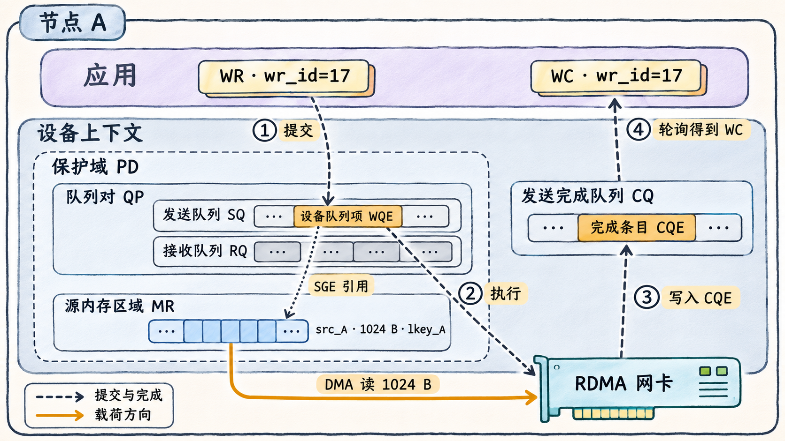
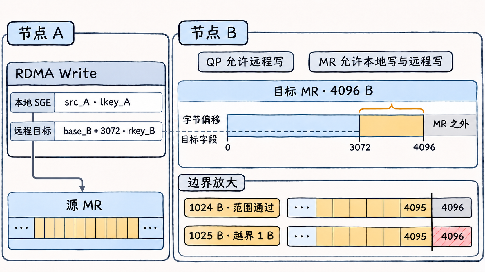

# 网卡凭什么能访问进程的缓冲区

两台 Linux 服务器各有一个可用的 RDMA 端口。A 想用一次 RDMA Write，把自己的 `1024 B` 数据写进 B 的缓冲区。A 持有本地指针，B 可以告诉 A 远程地址。网卡执行请求前，还需要知道地址落在哪块已授权的内存、允许读还是写，以及完成结果交给哪个队列。这些信息由 Verbs 的资源对象和工作请求一起提供。

## 资源对象各管什么

**Verbs** 是操作 RDMA 设备的接口。在 Linux 用户态，应用经 `libibverbs` 打开指定设备并取得设备上下文，在这个上下文下创建资源。**保护域（PD）** 定义哪些本地资源可以配合使用，例如一次请求中的队列对和本地内存区域须属于兼容的保护域。**队列对（QP）** 包含发送队列（SQ）和接收队列（RQ）。应用把 Send、Read、Write 一类主动操作投到 SQ，把可供对端 Send 使用的接收项投到 RQ。**完成队列（CQ）** 用于收取执行结果，QP 的发送和接收可以关联同一个 CQ，也可以分开。 [rdma-core v57.0 · ibv_alloc_pd](https://github.com/linux-rdma/rdma-core/blob/v57.0/libibverbs/man/ibv_alloc_pd.3) · [ibv_create_qp](https://github.com/linux-rdma/rdma-core/blob/v57.0/libibverbs/man/ibv_create_qp.3)

**工作请求（WR）** 描述这次操作。以 Write 为例，WR 包含操作类型、本地源缓冲区的描述和远程目标的地址与密钥。用户态设备库把 WR 转成设备可以执行的队列项。网卡执行后按操作和通知设置写入完成条目（CQE），应用用 `ibv_poll_cq()` 把它读成工作完成记录（WC）。 [rdma-core v57.0 · ibv_post_send](https://github.com/linux-rdma/rdma-core/blob/v57.0/libibverbs/man/ibv_post_send.3) · [ibv_poll_cq](https://github.com/linux-rdma/rdma-core/blob/v57.0/libibverbs/man/ibv_poll_cq.3)



**图 06-02-01**　A 端执行一次请求成功完成通知的非 inline RC Write。QP 和源 MR 关联同一 PD，发送 CQ 位于 PD 框外。琥珀色箭头表示源 MR 到网卡的载荷，虚线表示提交和完成。设备上下文框用来归组软件资源，右下角叠在框线上的网卡是节点 A 的独立硬件。

## 注册把一段地址变成有访问范围的 MR

普通主机内存注册时，应用把起始地址、长度和访问标志交给 `ibv_reg_mr()`。驱动通常把相关页面固定住，并建立设备使用的 DMA 映射。固定页面让它们能在设备持有映射期间保持可用。注册成功后得到**内存区域（MR）**，其中的 `lkey` 用于校验本地请求对这段内存的访问，`rkey` 则用于校验对端发来的远程访问。应用须确保缓冲区在使用期间有效，并在结束相关操作和远程访问授权后再注销 MR、释放内存。设备支持的按需分页（ODP）可以按需建立映射，本例采用普通注册。 [Linux 内核 · Userspace Verbs](https://docs.kernel.org/infiniband/user_verbs.html#memory-pinning) · [rdma-core v57.0 · ibv_reg_mr](https://github.com/linux-rdma/rdma-core/blob/v57.0/libibverbs/man/ibv_reg_mr.3)

下面是**字段级教学配置**。两端使用已就绪的 RC（Reliable Connected，可靠连接）QP，A 的本地源 MR 足够大。B 只开放这个缓冲区的远程写入。`base_B` 是 B 发布的、可由 RDMA 请求引用的远程 MR 基址。 [rdma-core v57.0 · ibv_reg_mr](https://github.com/linux-rdma/rdma-core/blob/v57.0/libibverbs/man/ibv_reg_mr.3) · [ibv_modify_qp](https://github.com/linux-rdma/rdma-core/blob/v57.0/libibverbs/man/ibv_modify_qp.3)

```text
B 的 QP 访问标志    IBV_ACCESS_REMOTE_WRITE
B 的目标 MR        基址 base_B，长度 4096 B，远程密钥 rkey_B
B 的 MR 访问标志    IBV_ACCESS_LOCAL_WRITE | IBV_ACCESS_REMOTE_WRITE
A 的 WR            wr_id=17，opcode=IBV_WR_RDMA_WRITE
A 的本地 SGE       addr=src_A，length=1024 B，lkey=lkey_A
A 的远程目标       remote_addr=base_B + 3072，rkey=rkey_B
```

本地 SGE 是请求引用的一段缓冲区描述，包含 `addr`、`length`、`lkey`。本例远程写入的字节偏移是 `3072` 到 `4095`，最后一个字节刚好在 B 的 MR 内。若长度改为 `1025 B`，且 A 的源 MR 仍足够大，远程访问会多触及偏移 `4096` 的一个字节。若长度不变，只换错 `rkey`，范围仍然正确，但对应的远程授权不成立。若 B 的 QP 或目标 MR 缺少远程写许可，密钥和范围匹配也无法补齐权限。目标 MR 同时需要本地写许可，这是 `ibv_reg_mr()` 对设置远程写权限的要求。 [rdma-core v57.0 · ibv_reg_mr](https://github.com/linux-rdma/rdma-core/blob/v57.0/libibverbs/man/ibv_reg_mr.3) · [ibv_post_send](https://github.com/linux-rdma/rdma-core/blob/v57.0/libibverbs/man/ibv_post_send.3)



**图 06-02-02**　从同一个起点比较两个请求。A 的本地 SGE 用 `lkey_A` 引用源 MR，跨节点虚线把远程目标字段连到 B 的偏移 `3072`。题设中 `rkey_B` 匹配，B 的 QP 和 MR 都允许远程写。下方红色格标出 `1025 B` 请求超出目标 MR 的一个字节。全长条为示意，范围以偏移标注为准。

## 从提交返回到缓冲区可重用

| 看到的证据 | 可以判断的事 |
| --- | --- |
| 单个 WR 的 `ibv_post_send()` 返回 `0` | 本地提交被接受。执行结果要从 CQ 取。 |
| `ibv_poll_cq()` 返回 `0` | 这一轮轮询没有取到完成。结合请求是否要求完成通知和后续轮询判断进度。 |
| 取到 `wr_id=17`、`status=IBV_WC_SUCCESS` 的 WC | 对本例带完成通知、非 inline 的 Write，应用可以回收相应本地源缓冲区。B 的应用何时使用结果，由双方的通知约定决定。 |
| 取到错误 WC | 用 `wr_id` 和 `qp_num` 对回原请求。错误 WC 中可依赖的字段为 `wr_id`、`status`、`qp_num`、`vendor_err`。操作类型及长度应从提交时保存的 WR 信息找回。 |

表中的编号为教学值，状态和字段取自 API。 [rdma-core v57.0 · ibv_post_send](https://github.com/linux-rdma/rdma-core/blob/v57.0/libibverbs/man/ibv_post_send.3) · [ibv_poll_cq](https://github.com/linux-rdma/rdma-core/blob/v57.0/libibverbs/man/ibv_poll_cq.3)

两个设置会改变回收点。对设备支持的短 Send 或 Write，`IBV_SEND_INLINE` 会把源数据放进发送队列项，源缓冲区可在提交返回后重用。对一批走同一 RC 发送队列的非 inline Write，应用可只要求最后一个请求产生成功完成，再按该队列的完成顺序回收被覆盖的前序请求。若中间发生错误，按实际错误完成和队列状态处理。 [rdma-core v57.0 · ibv_post_send](https://github.com/linux-rdma/rdma-core/blob/v57.0/libibverbs/man/ibv_post_send.3) · [perftest 26.07.8 · 选择性请求完成与完成计数](https://github.com/linux-rdma/perftest/blob/a31f9ea9df720ee68f941e55f75fec31349fcd35/src/perftest_resources.c)
