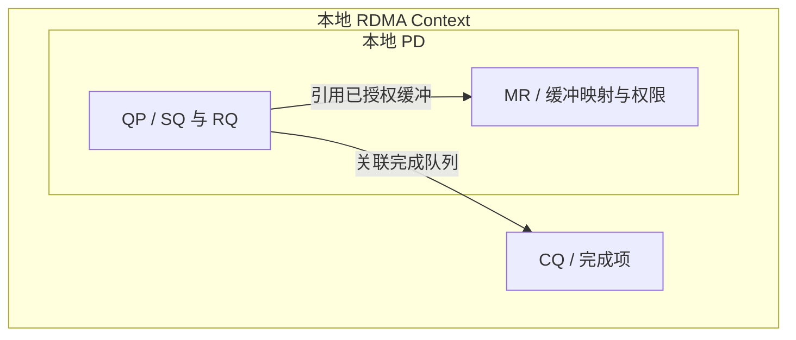
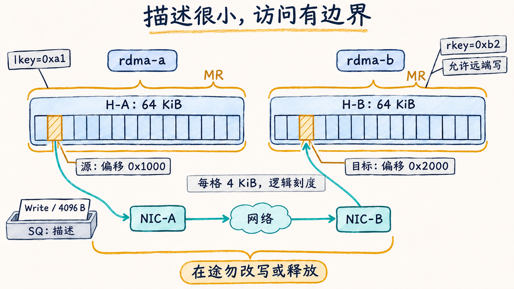

# 用队列与注册内存描述一次传输

## 从“搬这段数据”变成设备能执行的描述

**Verbs** 是描述 RDMA 资源和操作的一组接口语义。Linux 应用或通信库通过 `libibverbs` 使用它，设备相关的用户态实现称为 **Provider**。高层框架可以隐藏接口，但底层仍要解决端点、内存、权限和完成等问题。Verbs 不是某种网线，也不等同于 InfiniBand；本章的 RoCE 网卡同样使用这些接口。

先打开所选 RDMA 设备，得到 **Context（设备上下文）**，表示进程对该设备的一次访问上下文。它不是 CUDA Context。接下来在这个上下文中组织以下对象：

| 对象 | 解决的问题 | 在一次交付中的作用 |
| --- | --- | --- |
| PD：Protection Domain，保护域 | 哪些本地资源允许配合访问内存 | QP 与它使用的 MR 必须具有相容的保护域关系 |
| MR：Memory Region，内存区域 | 网卡可访问哪一段内存、有哪些权限 | 保存范围与映射，产生本地/远端访问所用的 Key |
| QP：Queue Pair，队列对 | 从哪个端点提交操作、接收消息 | 本章每个 QP 含 SQ 发送队列与 RQ 接收队列 |
| CQ：Completion Queue，完成队列 | 已提交的工作以什么结果结束 | 保存设备产生的完成项，供软件取出判断 |

PD 是本地资源保护关系，不是一条跨节点隧道，也不是网络租户隔离的全部。A 的 PD 与 B 的 PD 各自独立，不要求编号相同。CQ 建在 Context 上，**不属于 PD**；QP 创建时指定发送和接收所用的 CQ，二者可以相同，也可分开。接口关系见 rdma-core v56.0 的 [ibv_alloc_pd](https://raw.githubusercontent.com/linux-rdma/rdma-core/v56.0/libibverbs/man/ibv_alloc_pd.3)、[ibv_create_qp](https://raw.githubusercontent.com/linux-rdma/rdma-core/v56.0/libibverbs/man/ibv_create_qp.3) 与 [ibv_create_cq](https://raw.githubusercontent.com/linux-rdma/rdma-core/v56.0/libibverbs/man/ibv_create_cq.3)。

## 队列里放的是描述，缓冲里才是负载

应用提交的 **WR（Work Request，工作请求）**描述一个操作；Provider 将其编码为设备识别的队列项，可称 **WQE（Work Queue Element）**。例如“从地址 X 读 4096 B，发往某个远端位置”。通知网卡有新工作可称为写 Doorbell。CPU 提交的是描述，网卡随后读写的是数据缓冲；它们不必是同一块内存。

一个 WR 可包含一个或多个 **SGE（Scatter/Gather Element，散布/聚集条目）**。本章只用一个 SGE，包含本地地址 `addr`、长度 `length` 与 `lkey`。SQ 不只提交 Send，还提交 RDMA Read/Write；RQ 中的 Receive WR 则预先声明可接收消息的本地缓冲。

设备产生 **CQE（Completion Queue Entry，完成项）**，`ibv_poll_cq` 将它取出成为软件读取的 **WC（Work Completion，工作完成记录）**。`wr_id` 是应用自己附在 WR 上的标记，用来把 WC 对回某个缓冲或请求；它不是全局设备号。具体完成和错误的读法留到下一篇。

下面是**单进程对象关系图**，不是数据路径图。范围框表示创建范围，有标签的实线表示关联。访问检查由设备及其映射/保护机制执行，图中的 QP→MR 表示请求引用该内存关系。应用在这些对象上提交 WR、读取 WC，图中不另画软件动作。远端主机有自己的独立一套对象。

## 注册内存为什么不是把数据“上传网卡”

进程知道虚拟地址，网卡做 DMA 时需要有效的设备地址映射，还要确保范围与权限可被检查。对本章普通主机内存，注册过程涉及保持页面驻留、建立 DMA 访问所需的映射，并建立 MR；它不把整个负载复制到网卡内存。虚拟连续的范围背后可以是多段物理页。

本章限定预注册、非 ODP 内存。ODP 允许另一种按需处理页面的模型，不能据本章说“所有 RDMA 都必须预先永久锁住全部页面”。Linux 对普通锁页还会检查 `RLIMIT_MEMLOCK` 等资源限制，见 [Userspace verbs access：Memory pinning](https://docs.kernel.org/infiniband/user_verbs.html#memory-pinning)。锁页与内存容量相关，但“内存空闲足够”不代表注册额度足够。

MR 注册得到的 **lkey** 供本地网卡检查本地 SGE；**rkey** 供对端发起单边操作时引用远端 MR。Key 不是加密密钥，也不单独代表完整权限。远端访问还依赖已建立的 QP、正确地址与长度、有效的 MR、MR 权限及相应 QP 访问设置。MR 的接口、Key 与权限定义见 [ibv_reg_mr，rdma-core v56.0](https://raw.githubusercontent.com/linux-rdma/rdma-core/v56.0/libibverbs/man/ibv_reg_mr.3)。

## 用一组明确地址检查范围与权限

以下是**自拟的主机内存注册清单**，数值均为教学占位值；不采用零基地址 MR，Key 不表达真实设备的生成规则。

| 字段 | A 的源 MR | B 的目标 MR |
| --- | --- | --- |
| 缓冲及地址范围 | H-A：`[0x10000000, 0x10010000)` | H-B：`[0x20000000, 0x20010000)` |
| 长度 | 65536 B / 64 KiB | 65536 B / 64 KiB |
| 本地保护域 | PD-A，与 QP-A 相同 | PD-B，与 QP-B 相同 |
| lkey / rkey | `0xa1` / `0xa2` | `0xb1` / `0xb2` |
| 注册权限 | 本地读取；未授予远端访问 | `LOCAL_WRITE \| REMOTE_WRITE` |

A 要把源偏移 `0x1000` 开始的 4096 B 写到 B 的偏移 `0x2000`。A 的 SGE 是 `addr=0x10001000, length=4096, lkey=0xa1`；远端描述是 `remote_addr=0x20002000, rkey=0xb2`。源区间结束于 `0x10002000`，目标区间结束于 `0x20003000`，都在注册范围内。远端地址由 B 发布给 A，A 不能从自己的地址推算它。

注意三组不同的数字：QP 号寻找通信端点；`wr_id` 对应软件中的工作；lkey/rkey 对应内存注册访问。把 B 的 `lkey=0xb1` 填到远端 rkey 字段，不能因为“都来自 H-B”就认为正确。

MR 的本地读访问始终允许；`LOCAL_WRITE` 允许设备向该本地区域写入，并不是 CPU 可否执行普通存储指令的开关。给 MR 设置 `REMOTE_WRITE` 时还必须设置 `LOCAL_WRITE`。本例 A 的源只需被 NIC 读取，B 的目标需要本地写和远端写权限；QP-B 同时要允许远端写。若改成 A 发起 RDMA Read，B 的源 MR 要有 `REMOTE_READ`，A 的接收目标 MR 要允许本地写，不能沿用上表假定条件已经充分。

表中的权限是便于阅读的缩写，实际 Verbs 枚举名为 `IBV_ACCESS_LOCAL_WRITE`、`IBV_ACCESS_REMOTE_WRITE`、`IBV_ACCESS_REMOTE_READ`。使用普通 API 时，A 的只读源可令 `access=0`；B 的可远端写目标使用前两项按位或，注册调用还必须检查返回值。这里的权限不是替代操作系统文件权限或网络认证的完整安全方案。

## 谁负责防止缓冲提前消失

注册成功只表示可按相应条件访问。应用仍需保证：发起前源数据已准备，传输期间缓冲仍有效且没有冲突写入，确认相应工作结束之后才改写、注销 MR 或释放底层内存。下一篇限定非 Inline、每条 SQ 请求都要求完成，便于逐条追踪。

地址被释放后即使再次分配得到同一数值，也不能把旧 MR、Key 和旧通信约定直接当成新缓冲的访问凭据。通信库可以缓存注册以分摊成本，但缓存必须跟随分配的真实生命周期失效。最终释放顺序要先停止对端的新访问、处理在途工作，再撤销注册与内存；本地“暂时没请求”不代表对端再也不会访问。

图 06-02-01　第二篇普通 RC Write 的范围示意。每个 64 KiB MR 划成 16 个 4 KiB 逻辑刻度，A 从偏移 0x1000 取一格，写到 B 偏移 0x2000 的一格；刻度不代表物理页。描述与负载分离，访问仍依赖当前 MR、Key、权限、相容的保护关系及缓冲生命周期，完整字段见注册清单。

对象和范围已经建立。接下来要决定对端是预先投递接收缓冲，还是主动授权一个远端地址，并在真正可传输后解释完成事件。

[上一篇：Socket 与 RDMA 改变了哪段路径](01_Socket与RDMA改变了哪段路径.md) · [下一篇：先建链，再提交并判断完成](03_先建链再提交并判断完成.md)
