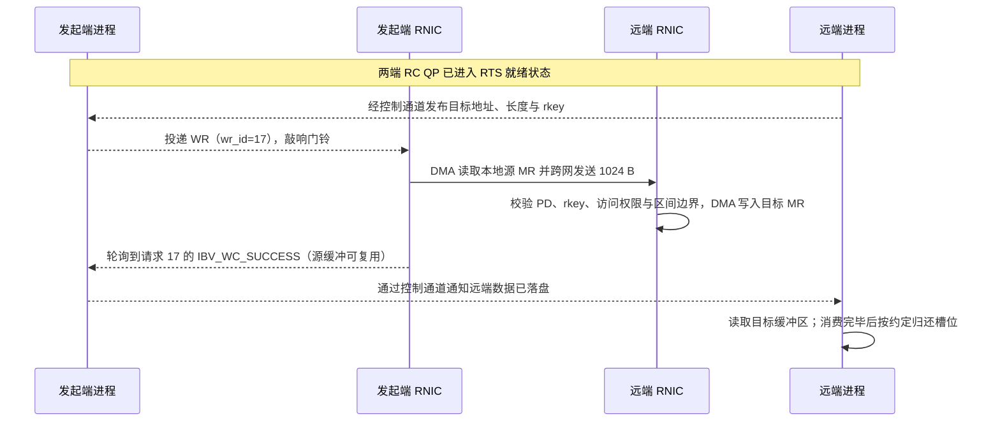

# RC 建连、RDMA 操作与完成通知

两端各自创建好 QP 和 MR 后，它们还只是两部没拨号的座机。要让数据真正跨过网络流动，必须先完成两件准备：把一对 RC QP 逐级推进到可收发状态，再根据业务诉求选对通信原语并约定好“写完了如何通知对方消费”。

## 从孤立 QP 到可靠连接（RC）：两条建连路径

在 Verbs 中，刚创建出来的 QP 处于 `RESET` 状态，无法收发任何流量。手工建连时，两端通常会先借助一条普通 TCP 控制连接（例如集群管理网）交换各自的 QP 编号（QPN）、初始包序号（PSN）以及链路层地址参数，然后按严格顺序调用 `ibv_modify_qp()` 推进状态机：

| QP 状态跃迁 | 关键配置内容 | 本阶段完成后能做什么 |
| --- | --- | --- |
| `RESET` → `INIT` | 绑定本地物理端口、设置允许的远程访问权限（如远程读/写） | 可以提前向接收队列（RQ）预投递 Receive 工作项 |
| `INIT` → `RTR` | 填入对端 QPN、链路地址、对端初始包序号与路径 MTU | **Ready to Receive**：具备接收对端数据包的能力 |
| `RTR` → `RTS` | 配置本地发送包序号、超时与重试次数（含 RNR 重试） | **Ready to Send**：双向可靠通道就绪，可正式投递发送请求 |

如果不想自己维护带外 TCP 交换和手工状态机，可以使用 **RDMA CM（RDMA Connection Manager，连接管理器）** 及其用户态库 `librdmacm`。它的用法类似大家熟悉的 Socket 流程：发起端按 IP 解析目标地址与路由并创建关联 QP，远端监听并接受连接请求，双方收到各自的 `ESTABLISHED` 事件即表明 RC 通道建立完成。

> [!warning] 常见误区：控制通道通 ≠ RDMA 通道通
> 手工建连中用于交换参数的普通 TCP Socket 往往走管理网或内核协议栈。TCP 握手成功只能证明两端应用能交换元数据，**绝不代表高速 RDMA 端口或 QP 载荷路径已经联通**。若第一条业务操作是 Send，远端应在接受连接或通知就绪前预投递 Receive；若要做 Read/Write，建连之后仍需通过控制通道或首次 Send 交换目标缓冲区的地址、长度与 `rkey`。

## 单边 vs 双边：四种核心 RDMA 操作怎么选

建连完成后，RDMA 提供两类风格截然不同的传输原语：**双边操作（Send / Receive）** 要求远端 CPU 预先配合准备接收项，而**单边操作（RDMA Write / RDMA Read）** 只需发起端单方面驱动，远端 CPU 全程“无感知”。

- **双边操作（Send）**：远端必须提前调用 `ibv_post_recv()` 在 RQ 中摆好接收缓冲区。发起端发出的字节落到哪里由远端决定，收完后两端 CQ 都会收到完成记录。
- **单边操作（RDMA Read / Write）**：远端只需提前注册 MR 并开放授权；传输时由发起端直接指定远端地址与 `rkey`，**不消耗远端 RQ，也不会在远端 CQ 产生完成记录**。注意执行 RDMA Read 时，数据最终写入发起端本地内存，因此发起端自己的目标 MR 必须开启 `IBV_ACCESS_LOCAL_WRITE`。
- **混合利器（RDMA Write with Immediate）**：载荷像普通 Write 一样直接写入发起端指定的远端目标 MR，同时额外附带一个 `32 bit` 立即数（例如槽位号、梯度桶编号或 KV 块批次号）。这会消耗远端 RQ 中的一个空接收项并在远端 CQ 产生一条携带立即数的接收 WC——既享受单边指定目标地址的灵活，又自带原子级“到货通知”。

| 发起端执行的操作 | 载荷流向 | 远端载荷缓冲区由谁决定 | 是否消耗远端 Receive | 成功完成记录（WC）落点 |
| --- | --- | --- | --- | --- |
| **Send** | 发起端 → 远端 | 远端在预投递的 Receive 中指定 | 是 | 发起端发送 WC + 远端接收 WC |
| **RDMA Read** | 远端 → 发起端 | 发起端指定远端源地址与 `rkey` | 否 | 仅发起端 Read WC |
| **RDMA Write** | 发起端 → 远端 | 发起端指定远端目标地址与 `rkey` | 否 | 仅发起端 Write WC |
| **RDMA Write with Immediate** | 发起端 → 远端 | 发起端指定远端目标地址与 `rkey` | 是（仅用于收通知） | 发起端发送 WC + 远端带立即数的接收 WC |

> [!tip] 训推通信选型直觉
> 为什么 AI 基础设施格外偏爱单边操作？
> - **分布式训练（NCCL）**：批量传输大块梯度时常采用 `RDMA Write with Immediate`，一步完成“直写目标显存 + 通知对端分片到达”，免去远端逐块管理接收缓冲区地址的麻烦。
> - **PD 分离推理（Prefill → Decode KV Cache 迁移）**：Decode 节点正忙于逐 token 生成并严守 P99 TPOT 尾延迟，最怕被突发网络中断打断。采用单边 **RDMA Write（Prefill 推送）** 或 **RDMA Read（Decode 拉取）** 配合轻量控制信号，就能在不打扰远端 CPU 的前提下把大片 KV Cache 直接落入目标显存。

## 一次完整 RDMA Write 的端到端时序

由于普通 RDMA Write 不会在远端 CQ 生成任何记录，双方必须建立明确的“数据交接协议”——远端只有收到约定通知后才能读取目标缓冲区；若发起端要反复复用同一个远端槽位，远端消费完后还需归还槽位，避免新一轮写入踩踏正在读取的数据。

*图 06-03-01：普通 RDMA Write 的端到端控制流与数据流时序。实线代表数据载荷搬运，虚线代表元数据交换、队列投递、完成回执与应用层通知（图中省略网卡硬件内部的可靠确认包）。*

## 读懂两条最典型的错误完成记录

当 RC 传输失败时，RNIC 会在发起端 CQ 中返回带错误状态码的 WC。把 WC 中的 `status` 与发起端自己记录的原 WR 操作类型对起来，就能第一时间锁定远端缺失的前置条件：

| 发起端原 WR | 轮询得到的错误 WC | 根因含义与远端排查清单 |
| --- | --- | --- |
| `wr_id=21`，**Send** | `IBV_WC_RNR_RETRY_EXC_ERR` | **RNR（Receiver Not Ready）重试耗尽**：数据包到达时远端 RQ 里没有空闲的 Receive 接收项，重试次数用光仍未等到补给。核查远端预投递时机、RQ 队列深度与发起端 RNR 重试配置。 |
| `wr_id=22`，**RDMA Write** | `IBV_WC_REM_ACCESS_ERR` | **远端访问授权或越界拒绝**：请求到达远端时未通过门禁。对照发起端保存的原目标地址与长度，逐项核查是否超出 MR 边界、`rkey` 是否过期或错写、目标 MR 与接收 QP 的远程写权限是否同时开启。 |

> [!summary] 核心结论
> 看到普通 Write 在发起端返回 `IBV_WC_SUCCESS`、而远端 CQ 毫无动静时，不必惊慌——这正是单边 Write 的标准语义；反过来，若在显存场景使用 Write 或 Write with Immediate，除了应用通知本身，远端还必须接上 CUDA 显存可见性同步（第 05 篇展开）。

到这里，我们已经把连接、操作和完成回执全链路理顺。但如果程序在真机上连 RDMA 设备都打不开，上述一切都无从谈起——下一篇我们顺着 Linux RDMA 驱动栈往下看，学会用五条只读命令把抽象设备对回具体的物理网卡。

> [!info]- 参考资料
> - **RC QP 状态机与 RDMA 操作语义**：[rdma-core v57.0 `ibv_modify_qp(3)`](https://github.com/linux-rdma/rdma-core/blob/v57.0/libibverbs/man/ibv_modify_qp.3)、[`ibv_post_send(3)`](https://github.com/linux-rdma/rdma-core/blob/v57.0/libibverbs/man/ibv_post_send.3)、[`ibv_reg_mr(3)`](https://github.com/linux-rdma/rdma-core/blob/v57.0/libibverbs/man/ibv_reg_mr.3)、[`ibv_poll_cq(3)`](https://github.com/linux-rdma/rdma-core/blob/v57.0/libibverbs/man/ibv_poll_cq.3)、[WC 状态枚举 `verbs.h`](https://github.com/linux-rdma/rdma-core/blob/v57.0/libibverbs/verbs.h)
> - **RDMA CM 与编程手册**：[rdma-core v57.0 `rdma_cm(7)`](https://github.com/linux-rdma/rdma-core/blob/v57.0/librdmacm/man/rdma_cm.7)、[`rdma_get_cm_event(3)`](https://github.com/linux-rdma/rdma-core/blob/v57.0/librdmacm/man/rdma_get_cm_event.3)、[NVIDIA RDMA Aware Networks Programming User Manual v1.7](https://docs.nvidia.com/rdma-aware-networks-programming-user-manual-1-7.pdf)
> - **基准测试连接与显存内存顺序**：[perftest 26.07.8 README](https://github.com/linux-rdma/perftest/blob/a31f9ea9df720ee68f941e55f75fec31349fcd35/README)、[CUDA 13.2.1 GPUDirect RDMA Synchronization and Memory Ordering](https://docs.nvidia.com/cuda/archive/13.2.1/gpudirect-rdma/index.html#synchronization-and-memory-ordering)
