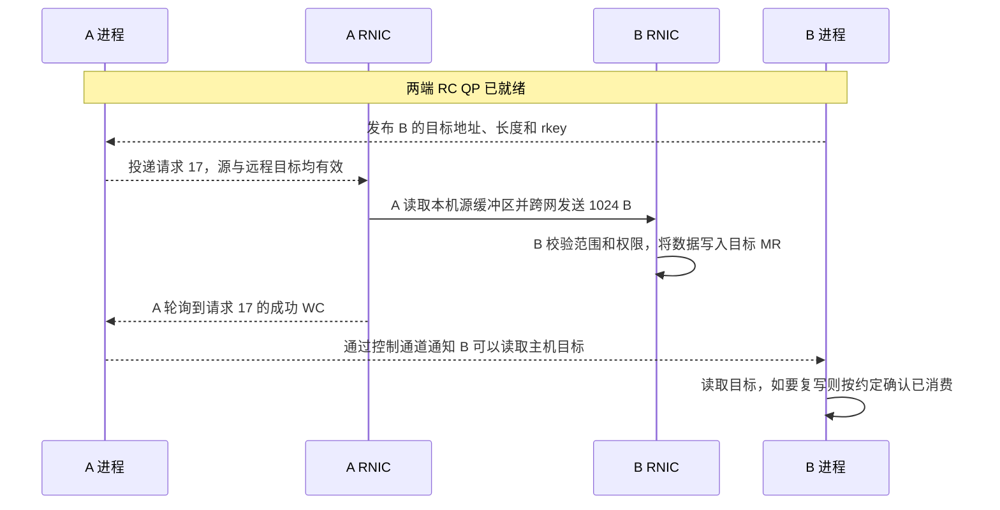

节点 A 和节点 B 各有一个可靠连接（RC）类型的队列对（QP）。两端要先配置连接，再准备本次操作用到的内存，最后才能传输载荷。对于前篇的 Write，连接使 A 的请求到达指定的 B 端 QP，B 发布的地址和远程密钥 `rkey` 则决定数据可以写到哪里。

## 从本地 QP 到可靠连接

使用 Verbs 手工配置时，应用可以先用普通 TCP Socket 交换对端 QP 编号、包序号以及与链路类型有关的地址参数。每端的状态从 `RESET` 进入 `INIT`，设置本地端口及 QP 访问标志，再进入可接收的 `RTR`（Ready to Receive），配置到对端 QP 的路径和路径 MTU（Maximum Transmission Unit，最大传输单元）。进入可发送的 `RTS`（Ready to Send）时，配置发送序号和重试等参数。两端要满足启动传输的条件才开始投递。控制 Socket 连通时，应用已能交换参数，RDMA 端口和 QP 的载荷路径还需要单独验证。 [rdma-core v57.0 的 RC QP 状态与必要属性](https://github.com/linux-rdma/rdma-core/blob/v57.0/libibverbs/man/ibv_modify_qp.3) · [perftest 26.07.8 的连接选项](https://github.com/linux-rdma/perftest/blob/a31f9ea9df720ee68f941e55f75fec31349fcd35/README)

另一种做法是用 **RDMA CM（RDMA Connection Manager，RDMA 连接管理器）** 及其用户态库 `librdmacm`。在本例的异步流程中，A 解析地址、选择本地 RDMA 设备，创建与 CM 标识关联的 QP，并解析路由。B 监听，收到连接请求后准备对应 QP 并接受。双方按各自的 `ESTABLISHED` 事件识别连接阶段完成。若第一条业务操作是 Send，B 可在接受连接前预投递接收项。若要发起 Read 或 Write，应用还须约定如何交付目标缓冲区的地址、长度和 `rkey`，下图使用已有的控制通道。 [rdma-core v57.0 的 RDMA CM 流程](https://github.com/linux-rdma/rdma-core/blob/v57.0/librdmacm/man/rdma_cm.7) · [RDMA CM 事件](https://github.com/linux-rdma/rdma-core/blob/v57.0/librdmacm/man/rdma_get_cm_event.3)

实线展示载荷阶段，虚线展示元数据、投递和应用通知。图省略网卡之间的传输确认。A 的成功完成记录和 B 的应用消息分属两个事件。若 A 要反复写同一槽位，双方还要保证上一份数据已消费，例如让 B 消费后归还槽位。

## Send、Read、Write 与带立即数的 Write

投递 **Receive** 指 B 预先在接收队列中放一项接收工作。对 Send，这一项给出接收缓冲区，收到的载荷交给它。Read 和普通 Write 由 A 指定远程地址和 `rkey`，B 事先注册缓冲区，该 MR 和 B 的 QP 均须授予对应的远程访问权限。Read 的本地结果写入 A 的 MR，因此 A 的目的 MR 须允许本地写。 [NVIDIA RDMA 编程手册 v1.7，RDMA Operations](https://docs.nvidia.com/rdma-aware-networks-programming-user-manual-1-7.pdf) · [rdma-core v57.0 的工作请求与操作类型](https://github.com/linux-rdma/rdma-core/blob/v57.0/libibverbs/man/ibv_post_send.3) · [MR 访问标志](https://github.com/linux-rdma/rdma-core/blob/v57.0/libibverbs/man/ibv_reg_mr.3)

| A 发起的操作 | 载荷方向 | B 侧载荷缓冲区如何选 | B 是否消耗 Receive | 成功完成记录 |
| --- | --- | --- | --- | --- |
| Send | A → B | B 在 Receive 中给出目标 | 是 | A 的发送 WC，B 的接收 WC |
| RDMA Read | B → A | A 指定 B 的源地址并携带 B 授权的 `rkey` | 否 | A 的 Read WC |
| RDMA Write | A → B | A 指定 B 的目标地址并携带 B 授权的 `rkey` | 否 | A 的 Write WC |
| RDMA Write with Immediate | A → B | 和 Write 一样由 A 给出远程目标 | 是，用于接收通知 | A 的发送侧 WC，B 的接收 WC 带立即数 |

表中假定 A 要求成功时产生完成记录。Write with Immediate 附带一个 `32 bit` 立即数，可作槽位编号或序号。B 消耗一个接收项获得这条接收完成，主载荷仍写到 Write 指定的目标 MR。若 B 的目标在显存，还须把接收通知接到 CUDA 的数据可见性和执行依赖上。 [rdma-core v57.0 的完成字段与立即数](https://github.com/linux-rdma/rdma-core/blob/v57.0/libibverbs/man/ibv_poll_cq.3) · [CUDA 13.1.2 的 GPUDirect RDMA 内存顺序](https://docs.nvidia.com/cuda/archive/13.1.2/gpudirect-rdma/index.html#synchronization-and-memory-ordering)

## 从完成状态追到缺少的前置条件

下表是两个独立的教学变体。两例均假定 RC QP 已连接。操作来自 A 保存的 WR，状态来自 A 轮询取得的 WC。

| A 原来投递的 WR | A 取得的 WC | 在 B 侧补查的证据 |
| --- | --- | --- |
| `wr_id=21`，Send | `IBV_WC_RNR_RETRY_EXC_ERR` | RNR（Receiver Not Ready）表示对端在该次尝试时没有可用的接收项，状态表示重试耗尽。对照 B 的接收投递时间和队列余量，再看 A 的 RNR 重试设置。 |
| `wr_id=22`，RDMA Write | `IBV_WC_REM_ACCESS_ERR` | 校对请求到达时 B 的远程地址和长度、`rkey`、目标 MR 的有效期和访问许可，也核对接收 QP 的权限。 |

状态能缩小取证范围。以第二例为例，仍需用原请求还原目标区间，才能分辨是越界还是密钥、权限等条件发生了变化。若 A 的普通 Write 已成功，B 在 CQ 里没有收到接收 WC 符合这种操作的行为，消费应等待约定的应用通知。 [rdma-core v57.0 的 WC 状态定义](https://github.com/linux-rdma/rdma-core/blob/v57.0/libibverbs/verbs.h) · [QP 的 RNR 重试与访问属性](https://github.com/linux-rdma/rdma-core/blob/v57.0/libibverbs/man/ibv_modify_qp.3)

一条请求走到投递之前，要依靠本机软件打开设备、创建队列并建立映射。若程序连设备都打不开，连接和工作请求尚无从谈起，可以沿驱动栈逐项确认这些资源是否存在。
