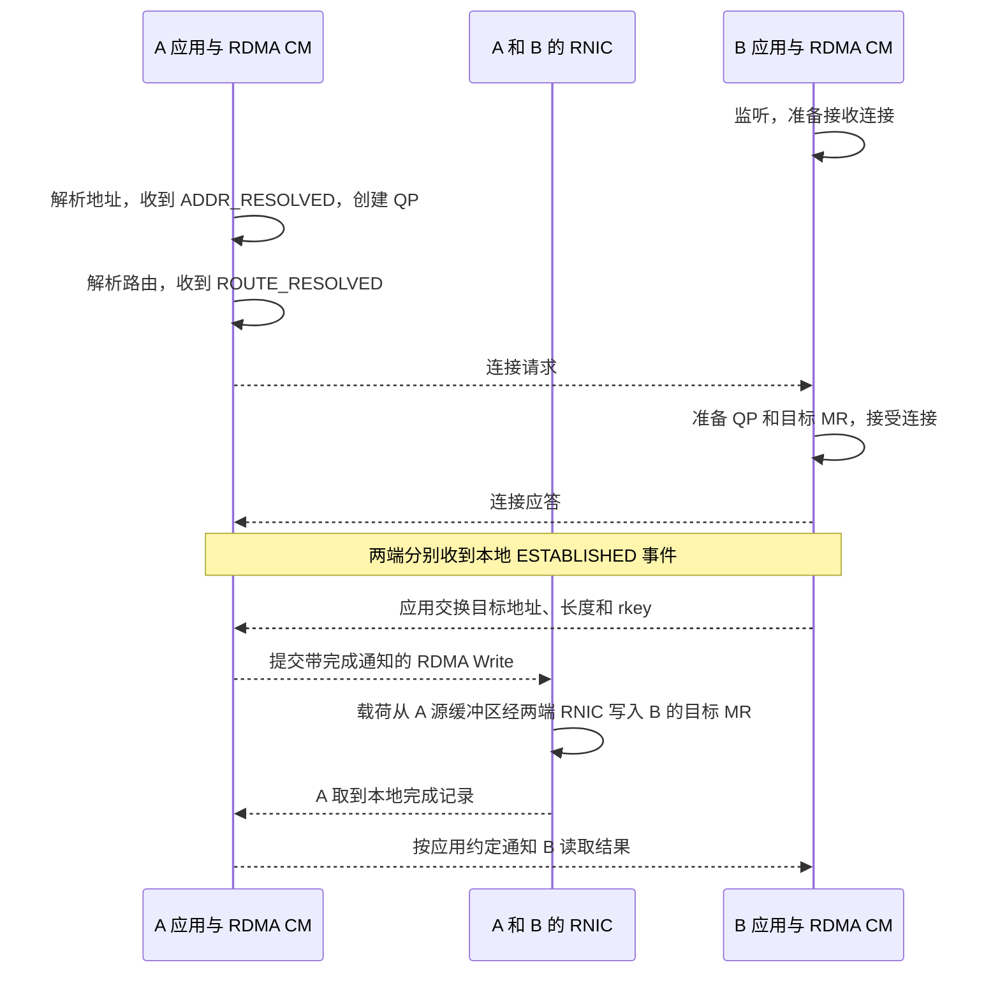

# 从连接就绪到 Send、Read 和 Write

A 和 B 的控制连接已经成功。A 提交 Send，B 却没有拿到数据。换成普通 RDMA Write 后，A 取到了成功的完成记录，B 的接收队列仍没有事件。要解释这两个现象，需要知道 QP 何时可用、远端缓冲区由谁指定，以及每种操作会给哪一端产生完成记录。这里以可靠连接（RC）为例。

## 建连、准备缓冲区和传输分别推进

用 `librdmacm` 建连时，主动端 A 先解析目标地址并选出可达的本地 RDMA 设备，收到 `RDMA_CM_EVENT_ADDR_RESOLVED` 后可建立 QP，再解析路由并等待 `RDMA_CM_EVENT_ROUTE_RESOLVED`。随后 A 发起连接，监听端 B 收到连接请求，为该连接准备 QP 并接受。A 和 B 分别以本地的 `RDMA_CM_EVENT_ESTABLISHED` 判断连接已建立。若第一条业务消息是 Send，B 可以提前贴好 Receive。Read 或 Write 所需的 MR 元数据则由应用协议交付，本例将它放在连接就绪之后。 [rdma-core v57.0 · rdma_cm](https://github.com/linux-rdma/rdma-core/blob/v57.0/librdmacm/man/rdma_cm.7) · [rdma_get_cm_event](https://github.com/linux-rdma/rdma-core/blob/v57.0/librdmacm/man/rdma_get_cm_event.3)

另一种做法是应用用普通 TCP Socket 交换双方的 QP 参数，再自行配置 QP。读这类程序时可把状态看作 `RESET → INIT → RTR → RTS`。`INIT` 用于配置本地参数和访问权限，`RTR` 表示就绪接收，`RTS` 表示就绪发送。TCP 控制连接成功只说明控制地址和端口可达。要判断 RDMA 载荷是否真的跨机，应看相应工作请求是否完成。 [rdma-core v57.0 · ibv_modify_qp](https://github.com/linux-rdma/rdma-core/blob/v57.0/libibverbs/man/ibv_modify_qp.3) · [perftest 26.07.8 · 控制连接和测试参数](https://github.com/linux-rdma/perftest/blob/a31f9ea9df720ee68f941e55f75fec31349fcd35/README)

图中实线标出载荷移动，虚线表示跨组件的控制信息。地址、路由、资源准备等本地步骤画在各自参与者上。最后一步采用显式控制通知，普通 Write 的接收端不会因此自动多出一条接收 WC。

## 同样由 A 发起，远端的义务不同

贴 Receive 指的是 B 先提交一个接收工作请求，告诉网卡有一项接收资源可供使用。对于 Send，接收项还描述载荷要写到 B 的哪块缓冲区。Read 和普通 Write 则由 A 指明远程地址与 `rkey`，B 事先注册缓冲区并授予相应访问权限，网卡可直接执行请求。

| A 发起的操作 | 载荷方向 | B 侧载荷缓冲区由谁指定 | 是否消耗 B 的 Receive | 成功时的完成记录 |
| --- | --- | --- | --- | --- |
| Send | A → B | B 在 Receive 里指定目的缓冲区 | 是 | A 的发送完成和 B 的接收完成 |
| RDMA Read | B → A | A 指定 B 的源地址和 `rkey`，也指定 A 自己的目的缓冲区 | 否 | A 的 Read 完成 |
| RDMA Write | A → B | A 指定 B 的目标地址和 `rkey` | 否 | A 的 Write 完成 |
| RDMA Write with Immediate | A → B | A 指定 B 的目标地址和 `rkey`，载荷写入该目标 | 是 | A 的发送侧完成和 B 的接收完成。B 的 WC 带 immediate 值。 |

表中假定 A 请求生成成功完成。Write with Immediate 消耗的 B 接收项用于接收完成通知，immediate 值是附带的 `32 bit` 信息，和写入 B 目标 MR 的载荷分开。B 可用这条 WC 实现应用层通知。若 B 的目标是 GPU 显存，启动依赖该数据的 Kernel 还要满足 GPU 内存顺序。 [NVIDIA · RDMA Aware Networks Programming User Manual v1.7，§3.1](https://docs.nvidia.com/rdma-aware-networks-programming-user-manual-1-7.pdf) · [rdma-core v57.0 · ibv_poll_cq](https://github.com/linux-rdma/rdma-core/blob/v57.0/libibverbs/man/ibv_poll_cq.3) · [CUDA 13.1.2 · Synchronization and Memory Ordering](https://docs.nvidia.com/cuda/archive/13.1.2/gpudirect-rdma/index.html#synchronization-and-memory-ordering)

## 用完成状态决定下一步查哪端

以下是两个**独立的教学变体**，假定 A、B 的 RC QP 已建立，完成字段来自应用轮询后的记录格式，编号为自拟值。

| A 保存的提交信息 | A 取到的 WC 字段 | 在 B 侧找什么证据 |
| --- | --- | --- |
| `wr_id=21`，操作为 Send | `wr_id=21`，`qp_num=101`，`status=IBV_WC_RNR_RETRY_EXC_ERR` | RNR 表示接收端暂未准备好，错误表示相应的重试已耗尽。检查 B 首次贴 Receive 的时间、之前的接收是否用光了队列，以及 A 的 RNR 重试设置。 |
| `wr_id=22`，操作为 RDMA Write | `wr_id=22`，`qp_num=101`，`status=IBV_WC_REM_ACCESS_ERR` | 检查 B 当时的目标 MR 是否仍有效，远端地址与长度是否落在范围内，`rkey` 是否与当时发布的一致，并核对 QP 和 MR 的写权限。 |

`vendor_err` 如有记录，可交给相应设备的诊断资料解释。读错误 WC 时，从 `wr_id` 关联到原始提交记录，再辨认操作类型、目标地址和长度。普通 Write 若已成功且 B 没有接收 WC，则检查应用是否送出并处理了约定的通知。 [rdma-core v57.0 · WC 状态定义](https://github.com/linux-rdma/rdma-core/blob/v57.0/libibverbs/verbs.h) · [ibv_poll_cq](https://github.com/linux-rdma/rdma-core/blob/v57.0/libibverbs/man/ibv_poll_cq.3) · [ibv_modify_qp](https://github.com/linux-rdma/rdma-core/blob/v57.0/libibverbs/man/ibv_modify_qp.3)
