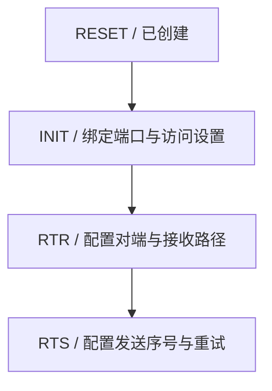
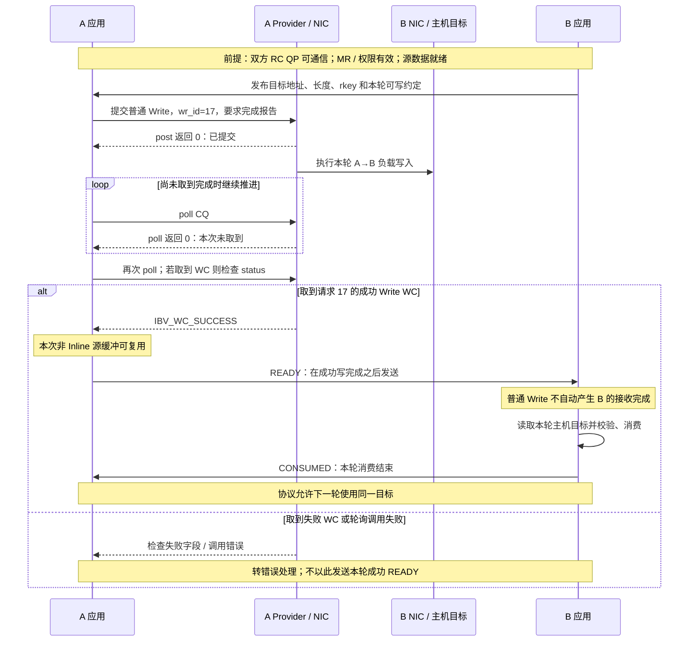

# 先建链，再提交并判断完成

## 先决定谁指定接收位置

沿用 A、B 两个进程。以下均为 RC QP，A 是主动发起方，每条 SQ 请求要求报告完成；“本地”指发起方 A，“远端”指 B。普通 Read/Write 不包含 Immediate、原子操作或设备扩展。

| 操作 | A 提交什么 | B 提前准备什么 | 有效负载方向 | B 的 RQ 与接收 CQ |
| --- | --- | --- | --- | --- |
| Send / Receive | SQ 上的 Send，带本地源 SGE | 在 RQ 投递带目标 SGE 的 Receive | A → B | 消耗一个 Receive；成功后产生接收完成 |
| RDMA Write | SQ 上的 Write，带本地源 SGE、远端地址/rkey | 注册并授权目标内存，发布范围和 rkey | A → B | 普通 Write 不消耗 Receive，也不自动产生接收完成 |
| RDMA Read | SQ 上的 Read，带本地目标 SGE、远端地址/rkey | 注册并授权源内存，保证内容可被读取 | B → A | 普通 Read 不消耗 Receive，也不自动产生接收完成 |

Send 的接收位置由 B 投递的 Receive 决定，A 无需知道它的地址和 rkey。Write 的目标位置由 A 根据 B 发布的描述指定。Read 的“请求发起方向”是 A→B，返回负载却是 B→A；它的完成仍由 A 的 SQ 关联 CQ 报告。接口支持的操作类型见 [ibv_post_send 的 OPCODE 表，rdma-core v56.0](https://raw.githubusercontent.com/linux-rdma/rdma-core/v56.0/libibverbs/man/ibv_post_send.3)。

因此，Send/Receive 称为**双边操作**：两侧应用都要为这次消息投递工作。Read/Write 称为**单边操作**：B 的应用不必为每次访问再投递一个 Receive，但前期仍要授权和协商生命周期。B 的 NIC 仍参与整个传输，并非远端机器不工作。

**Write with Immediate** 是一个需单独辨认的变体：负载仍按远端地址/rkey 写入，而附带的小值通过接收完成通知 B；它会消耗 B 的接收请求。不能把“普通 Write 不需要 Receive”扩展到这个变体，也不能把其负载目的地当作 Receive SGE 的地址。操作差别见 [DOCA 3.5.0 RDMA-aware Networks Programming Guide，4.1 与 4.3.2 小节](https://networking-docs.nvidia.com/doca/archive/3-5-0/rdma-aware-networks-programming-guide)。

## 对象存在以后，连接还没有自动建立

创建 QP 只是得到本地端点。本章使用一对 RC QP，双方还需交换端点及路径信息，把彼此配置成可通信的对端。这与应用发现其他成员属于不同层次：知道“进程 B 在哪台机器”，还没有为这对 QP 设置目的端点与传输状态。

可采用两类安排：

- 应用借助已有的 TCP 等控制通道，交换 QP 号、传输起始序号和路径信息，再调用 Verbs 修改 QP 状态；需要单边访问时，另外交换 MR 的地址、长度、rkey 和缓冲使用约定。
- 使用 `librdmacm` 提供的 RDMA CM 解析地址、建立连接和处理连接事件，并与 Verbs 配合；内存注册及应用缓冲授权仍要安排。

第一种不是“先建立一个 TCP 数据连接，再把它变成 RDMA”；两条逻辑通道可以共用网卡和线缆，但承载的内容不同。第二种也不意味着必须再手工重复全部 QP 状态转换。RDMA CM 的职责见 [rdma_cm(7)，v56.0 的 NOTES 与 CLIENT/SERVER OPERATION](https://raw.githubusercontent.com/linux-rdma/rdma-core/v56.0/librdmacm/man/rdma_cm.7)。

下面是**手工配置 RC 的逻辑状态图**。箭头是本地 QP 状态推进，不是包传输路径；两端分别完成。省略错误、排空、重置等分支，网络寻址参数的具体来源由第 07 章展开。



`RTR` 是 Ready to Receive，`RTS` 是 Ready to Send。RC 在 INIT→RTR 时需要对端 QP 号、接收起始 PSN、路径 MTU 和地址向量等；RTR→RTS 时需要本地发送 PSN、超时和重试等。**PSN（Packet Sequence Number）**是传输序号，对端接收预期与本端发送起点要对应；它不等于 `wr_id`。字段要求见 [ibv_modify_qp 的 RC 状态转换表，v56.0](https://raw.githubusercontent.com/linux-rdma/rdma-core/v56.0/libibverbs/man/ibv_modify_qp.3)。

本章题设双方已配置匹配的路径和访问权限。在手工方式中，使用 Send 或 Write with Immediate 时，要在允许对端发送前准备足够的 Receive 并交换就绪信息；可在 INIT 阶段先投递接收。普通 Write 不因 RQ 为空就缺少自己的负载目标。端口 Active 只说明端口状态，不能替代这对 QP 的配置与缓冲就绪。

RC 提供可靠传输机制，并不保证永远成功。对端失联、路径问题或接收资源长期不足仍可使重试耗尽并报告失败；数据丢失也不能一概理解成“RDMA 没有任何重传”。拥塞、丢包与部署条件在第 07 章继续解释。

## 提交、完成、消费分别发生在何时

沿用第二篇的 64 KiB MR，A 将 `0x10001000` 的 4096 B 普通 Write 到 B 的 `0x20002000`，远端 rkey 为 `0xb2`。两端所有初始化成功，H-A 内容已准备；H-B 是本章受支持的普通、缓存一致的主机内存，无其他线程或设备并发修改。以下是**自拟的因果事件记录**，顺序来自应用协作，不假定两台主机时钟同步。

```text
1. B -> A 控制消息：目标地址=0x20002000，长度=4096，rkey=0xb2，本轮可写
2. A 提交 wr_id=17，opcode=IBV_WR_RDMA_WRITE，flags=IBV_SEND_SIGNALED
   ibv_post_send 返回 0
3. A 取到 WC：wr_id=17，status=IBV_WC_SUCCESS，opcode=IBV_WC_RDMA_WRITE
4. A -> B 控制消息：READY，本轮写入已完成（在事件 3 后发送）
5. B 收到 READY，读取 H-B 对应区间并校验内容：PASS
6. B -> A 控制消息：CONSUMED，本轮缓冲可再次交给 A 使用
```

事件 2 的返回 0 只说明提交成功，没有保证数据已经抵达。事件 3 是这条 RC Write 的成功完成，A 可复用本次非 Inline 源缓冲；它不是 B 的应用已经处理完的证明。B 的普通 Write 没有接收完成，因此这里明确使用写完成之后发送的控制消息传递 READY。事件 5 才提供本轮内容校验，事件 6 则反馈远端消费结束，防止下一轮覆盖仍在使用的目标。

这个例子选择最容易推导的串行通知方式，不追求最少延迟。真实通信库可以组合 Write with Immediate、消息协议或其他有保证的同步机制，但必须解释其可见性、顺序和缓冲所有权。不同 QP 之间也不能只靠“程序先提交了某条请求”就假定全局有序。

若改为 Send，B 在 A 发送前投递目标 Receive，B 的接收完成就可提供消息到达的通知；之后仍需区分“收到”与“消费完”。若改为 Read，A 的成功完成表示其本地目标获得数据，B 何时可以修改被读取的源缓冲仍需双方的应用协议安排。缓冲复用规则见 [ibv_post_send 的 NOTES](https://raw.githubusercontent.com/linux-rdma/rdma-core/v56.0/libibverbs/man/ibv_post_send.3) 与 [ibv_post_recv 的 NOTES，v56.0](https://raw.githubusercontent.com/linux-rdma/rdma-core/v56.0/libibverbs/man/ibv_post_recv.3)。

## 正确读取完成，而不是只寻找 SUCCESS 字样

`ibv_poll_cq(cq, n, wc)` 返回 0 表示这次未取到完成，正数是取出的数量，负数才是轮询调用失败。取到完成后，再检查每条 `wc.status`。一个失败的工作也会报告完成；“完成”描述结束状态，不专指成功。

以下是**彼此独立的教学完成快照**，错误行只展示规范保证有效的字段：

```text
快照 N：poll 返回 0
快照 S：poll 返回 1；wr_id=17 status=IBV_WC_SUCCESS opcode=IBV_WC_RDMA_WRITE
快照 E：poll 返回 1；wr_id=17 status=IBV_WC_REM_ACCESS_ERR qp_num=0x101 vendor_err=0
```

N 不能立即解释成失败；S 支持请求 17 的传输成功，不表示应用消费完成；E 表示请求已经以远端访问错误结束，优先核对当前 MR、rkey、地址范围、MR/QP 访问权限及生命周期。`vendor_err=0` 在这里是占位值，不能据此细分根因。WC 失败时，不把 `byte_len`、`opcode` 等未保证有效的字段当作证据。返回值、有效字段与 CQ 溢出规则见 [ibv_poll_cq，v56.0](https://raw.githubusercontent.com/linux-rdma/rdma-core/v56.0/libibverbs/man/ibv_poll_cq.3)。

本章每条 SQ 工作都设置完成报告，便于逐条分析。真实程序可减少成功 CQE 的数量来降低处理成本，因此“没有每条请求的成功 CQE”未必异常。无论通知策略如何，都要持续消费 CQ，避免完成队列溢出；也要补充被消耗的 Receive，避免对端发送时长期接收未就绪。这些都是“省掉逐包系统调用”之后转由通信软件承担的工作。




图 06-03-01　普通、非 Inline RC Write 的串行通知协议。图中上下顺序表示因果，不表示两机同步时钟；循环可执行零次或多次。B 是本章受支持的普通缓存一致主机内存，无并发冲突访问。源复用不等于目标可覆盖，失败分支不推断远端内容；真实失败处理另需检查状态与资源。

[上一篇：用队列与注册内存描述一次传输](02_用队列与注册内存描述一次传输.md) · [下一篇：把软件栈与主机证据对应起来](04_把软件栈与主机证据对应起来.md)
