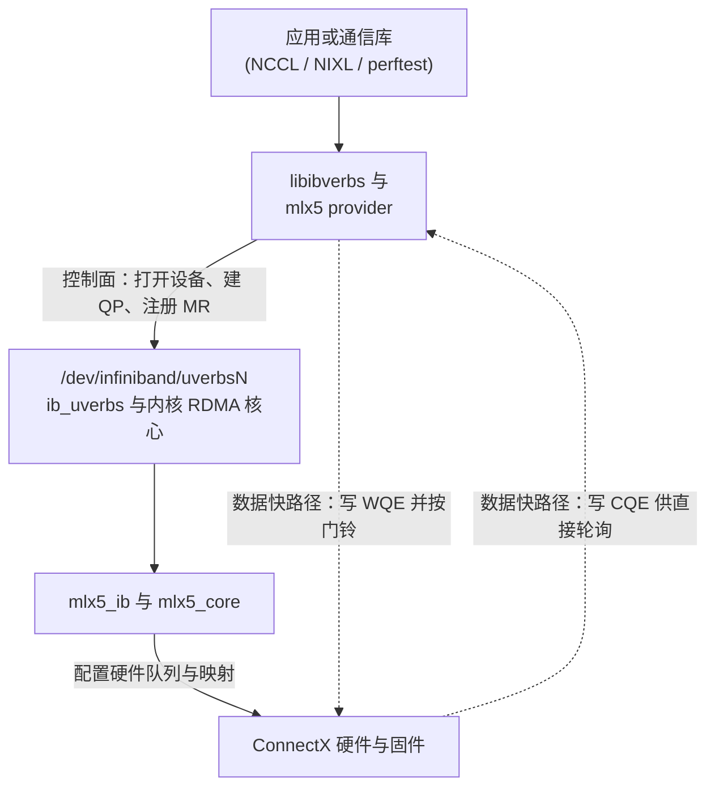

# Linux RDMA 驱动栈与设备证据

运维 GPU 服务器时经常遇到一个反直觉现象：明明 `ip a` 显示高速网卡接口已经 `UP`，甚至能互相 `ping` 通，但一跑 RDMA 测试或分布式任务，程序却报错说找不到 RDMA 设备、或者根本打不开端口。

原因在于**同一块物理 ConnectX 网卡在 Linux 里分出了两条平行的软件入口**：普通以太网走内核网络协议栈，而 RDMA 走独立的 `ib_uverbs` 与用户态 Verbs 栈。要判断前面讲的队列对和内存注册究竟能不能落地，必须先把用户态设备名对回同一块网卡的 PCI BDF，再逐层核对运行证据。

## 控制面走内核，数据快路径直连硬件

在 Linux 下，硬件 RDMA 软件栈由用户态库、内核子系统与网卡固件三层协同构成：

- **用户态接口与适配层**：`libibverbs` 为上层应用和通信库提供统一的 Verbs API；具体到某家厂商的硬件，由对应的用户态 **provider** 适配（ConnectX 系列网卡使用 `mlx5` provider）。若采用 RDMA CM 建连，则额外经由 `librdmacm` 处理地址与路由。
- **内核控制面与设备驱动**：打开设备、分配 PD、创建 QP 和注册 MR 等资源管理操作，都会穿过字符设备 `/dev/infiniband/uverbsN` 进入内核 `ib_uverbs` 与 RDMA 核心层。底层由 `mlx5_core` 接管物理 PCIe 设备基础能力，再由 `mlx5_ib` 将其 RDMA 能力注册进内核 RDMA 子系统。
- **数据快路径与网卡固件**：一旦队列和内存映射准备完毕，用户态 provider 直接在用户空间组装 WQE 并写入网卡的门铃寄存器，绕开内核触发硬件发送；网卡执行完毕后把 CQE 写回完成队列供用户态直接轮询。网卡芯片内部运行的**固件（Firmware）** 版本则直接决定了硬件支持哪些特性与修复了哪些协议缺陷。



*图 06-04-01：Linux RDMA 驱动栈的控制面（实线）与数据快路径（虚线）分工。控制面负责安全准入与映射建立，数据快路径绕开内核直接交互。*

## 沿同一个 BDF 采集五条现场证据

排查一块高速网卡是否真正“RDMA 就绪”，切忌只看 `ip a` 或零散的设备名。最佳实践是**锚定一个 PCI BDF**，自下而上依次核对枚举绑定、设备映射、端口链路、用户态可读性与运行固件。

下面以 `node-1` 上插槽位 `0000:83:00.0` 的 ConnectX 网卡（对应 RDMA 设备 `mlx5_0` 的端口 `1`）为例，演示完整的五步只读取证流程：

```bash
# 1. 核对 PCI 设备枚举与底层内核驱动绑定
$ lspci -nnk -s 0000:83:00.0
83:00.0 Infiniband controller [0207]: Mellanox Technologies MT28908 Family [ConnectX-6] [15b3:101b]
        Kernel driver in use: mlx5_core          # 确认已由 mlx5_core 接管

# 2. 把用户态 RDMA 设备名 mlx5_0 精确对回同一个 PCI BDF
$ readlink -f /sys/class/infiniband/mlx5_0/device
/sys/devices/pci0000:80/0000:80:01.1/0000:81:00.0/0000:81:02.0/0000:83:00.0

# 3. 确认驱动已向内核 RDMA 子系统注册端口，并观察链路活跃状态
$ rdma link show mlx5_0/1
link mlx5_0/1 state ACTIVE physical_state LINK_UP

# 4. 站在用户态入口打开设备，核对链路层类型与有效 MTU
$ ibv_devinfo -d mlx5_0 -i 1
hca_id: mlx5_0
        transport:                      InfiniBand (0)
        fw_ver:                         20.39.2048
        phys_port_cnt:                  1
                port:   1
                        state:                  PORT_ACTIVE (4)
                        max_mtu:                4096 (5)
                        active_mtu:             4096 (5)
                        link_layer:             InfiniBand

# 5. 通过 devlink 区分网卡当前运行固件（running）与已刷入闪存版本（stored）
$ devlink dev info pci/0000:83:00.0
pci/0000:83:00.0:
  driver mlx5_core
    versions:
      fixed:
        fw.psid MT_0000000222
      running:
        fw.version 20.39.2048                    # 当前真正在跑的固件版本
      stored:
        fw.version 20.39.2048                    # 下次复位后生效的固件版本
```

这五条命令构成了一道逐层递增的证据链。一旦其中某一步断掉，就能立刻把故障锁定到具体层次：

| 异常现象 | 最先排查的故障层 | 核查动作 |
| --- | --- | --- |
| `lspci` 看到 `mlx5_core`，但 `rdma link` 无端口 | 内核 RDMA 子驱动缺失或未绑定 | 检查 `mlx5_ib` 是否加载、内核日志（`dmesg`）中网卡初始化是否报错 |
| `rdma link` 为 `ACTIVE`，但业务进程执行 `ibv_devinfo` 失败 | 用户态入口权限或 provider 缺失 | 核对 `/dev/infiniband/uverbs*` 权限（容器内还需检查设备注入）、`libibverbs` 与 `mlx5` provider 库路径 |
| `devlink` 中 `running` 与 `stored` 固件版本不一致 | 固件已升级刷盘但尚未复位生效 | 固件新特性仍按 `running` 版本运行，需按维护窗口执行固件激活或冷重启 |

> [!warning] 常见误区：运维账号能跑通 `ibv_devinfo` ≠ 业务进程也能打开
> `ibv_devinfo` 验证的是**当前执行命令的 Shell 账号与库环境**能够打开 `uverbs` 设备。如果生产作业跑在非 root 账号或容器镜像里，镜像内自带的旧版 `libibverbs`、缺失的 provider 或受限的 `/dev/infiniband/uverbsN` 访问权限，仍会让业务进程在启动瞬间找不到设备（容器设备与网络注入将在第 10、13 章深入拆解）。

## 驱动来源识别与升级后的三点对齐

在生产 Linux 服务器上，哪怕看到的内核模块都叫 `mlx5_core` 和 `mlx5_ib`，背后却可能来自两种截然不同的软件供应链：

- **inbox 驱动**：随操作系统发行版内核原生附带，通常与发行版仓库打包的 `rdma-core` 用户态库和 provider 配套维护，升级跟随系统内核节奏。
- **MLNX_OFED / DOCA-OFED**：NVIDIA 为自家网络硬件发布的专用驱动与用户态套件（DOCA-OFED 为新一代演进分支），提供针对新硬件、新固件与 GPUDirect 场景的增强能力。

> [!tip] 工程直觉：节点升级后务必对齐“三处版本”
> 仅仅 `lsmod | grep mlx5_ib` 看不出驱动来自哪里。内核或驱动变更后，养成习惯同时锚定三个版本：
> 1. **内核态**：用 `uname -r` 核对运行内核，结合 `modinfo -n mlx5_ib` 确认模块文件路径与所属安装包，再对照当前已加载模块状态；
> 2. **用户态**：核对实际业务进程加载的 `libibverbs` 与 `mlx5` provider 共享库路径及其所属软件包；
> 3. **硬件固件**：用 `devlink dev info` 核对同一 BDF 的 `running` 固件版本。

至此，单机与双机之间的主机内存 RDMA 通路已经从原理落到驱动和设备证据。不过对 AI 基础设施来说，数据真正的家在 GPU 显存里——下一篇，我们把网卡的 DMA 端点推进 GPU HBM，看看 **GPUDirect RDMA** 如何为分布式训练和 PD 分离推理砍掉最后一道主机内存中转墙。

> [!info]- 参考资料
> - **Linux 内核 RDMA 与 mlx5 驱动文档**：[Linux Kernel Userspace Verbs](https://docs.kernel.org/infiniband/user_verbs.html)、[Linux Kernel mlx5 Driver](https://docs.kernel.org/next/networking/device_drivers/ethernet/mellanox/mlx5.html)、[Linux Kernel mlx5 devlink info](https://docs.kernel.org/networking/devlink/mlx5.html)
> - **用户态库、provider 与工具手册**：[rdma-core v57.0 `providers/mlx5/qp.c`](https://github.com/linux-rdma/rdma-core/blob/v57.0/providers/mlx5/qp.c)、[`ibv_devinfo(1)`](https://github.com/linux-rdma/rdma-core/blob/v57.0/libibverbs/man/ibv_devinfo.1)、[`rdma_cm(7)`](https://github.com/linux-rdma/rdma-core/blob/v57.0/librdmacm/man/rdma_cm.7)、[iproute2 v6.12.0 `rdma-link(8)`](https://github.com/iproute2/iproute2/blob/v6.12.0/man/man8/rdma-link.8)
> - **NVIDIA OFED 与 DOCA-OFED 软件栈**：[NVIDIA MLNX_OFED Installation Overview](https://docs.nvidia.com/base-command-manager/product-manuals/installation/nvidiamlnxofed)、[MLNX_OFED to DOCA-OFED Transition Guide](https://docs.nvidia.com/doca/archive/2-8-0/nvidia-mlnx-ofed-to-doca-ofed-transition-guide.pdf)
