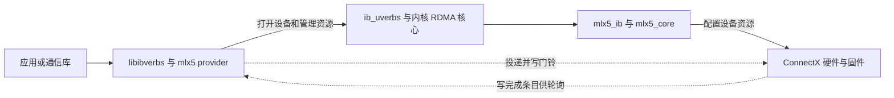

Linux 识别了一张 ConnectX 网卡，普通网络接口也能收发，用户程序却可能打不开这张卡的 RDMA 端口。同一物理卡的普通网络与 RDMA 有各自的内核和用户态入口。要判断前面讲的队列对和内存注册能否使用，先把设备对到同一个 PCI 功能，再沿应用到网卡的路径检查。

## 资源管理经内核，投递使用已配置的队列

`libibverbs` 给用户态提供通用的设备接口，**provider** 是其中负责适配特定设备的用户态实现。本章的 ConnectX 例使用 mlx5 provider。打开设备、创建队列和注册内存等管理操作经 `ib_uverbs` 进入内核，对应字符设备通常为 `/dev/infiniband/uverbsN`。`mlx5_core` 提供设备的核心支持，`mlx5_ib` 将其 RDMA 功能接入内核 RDMA 子系统。`librdmacm` 可另行负责地址、路由与连接管理。 [Linux 内核 Userspace Verbs](https://docs.kernel.org/infiniband/user_verbs.html) · [Linux 内核 mlx5 驱动](https://docs.kernel.org/next/networking/device_drivers/ethernet/mellanox/mlx5.html) · [rdma-core v57.0 的 RDMA CM](https://github.com/linux-rdma/rdma-core/blob/v57.0/librdmacm/man/rdma_cm.7)

一旦配置了队列和访问权限，典型 mlx5 快路径由用户态 provider 准备工作项并写门铃，设备执行后把完成项放进完成队列，用户程序可直接轮询。内核仍负责建立和清理进程持有的资源。固件在网卡设备侧运行，版本和设备能力关系密切。识别 PCI 设备、建立队列和执行传输各有对应的证据。 [rdma-core v57.0 的 mlx5 QP 实现](https://github.com/linux-rdma/rdma-core/blob/v57.0/providers/mlx5/qp.c) · [Linux 内核 mlx5 devlink 信息](https://docs.kernel.org/networking/devlink/mlx5.html)

实线给出这条路径的资源准备关系。虚线表示资源就绪后，用户态库与设备之间的典型投递和轮询路径。

## 沿同一个 BDF 核对设备、端口和访问权限

用 BDF（Bus、Device、Function，PCI 地址还包含域号）把命令输出对回硬件。下表是节点 A 的教学示例。`mlx5_0/1` 表示本机 RDMA 设备 `mlx5_0` 的端口 1，对应网卡的 PCI 功能 `0000:83:00.0`。去现场时，用实际读数替换这些标识。

| 观察步骤 | 读到什么才支持判断 |
| --- | --- |
| `lspci -nnk -s 0000:83:00.0` | PCI ID 确认可枚举，`Kernel driver in use` 确认这个 PCI 功能的绑定。 |
| `readlink -f /sys/class/infiniband/mlx5_0/device` | 路径中的 PCI 地址应对上 `0000:83:00.0`，把 RDMA 设备名与网卡对齐。 |
| `rdma link show mlx5_0/1` | 端口存在说明驱动已向 RDMA 子系统注册相关设备。若看到 `ACTIVE`，记录的是该端口当时的状态。 |
| `ibv_devinfo -d mlx5_0 -i 1` | 若能读到 `state`、`active_mtu`、`link_layer`，说明运行该命令的用户环境能打开设备并查询端口。业务进程若权限或库环境不同，须按业务环境复核。 |
| `devlink dev info pci/0000:83:00.0` | 对支持显示这些字段的设备，当前行为查 `running` 中的 `fw.version`，同时记录 `stored` 中持久保存的版本。 |

设备已绑定但没有 RDMA 端口时，先查 `mlx5_ib` 等 RDMA 支持与该设备的运行状态。端口已列出却打不开用户态入口时，核对 `uverbs` 的映射与权限、实际加载的库和 provider。查询端口成功后，可通过双端工作请求完成记录继续验证传输。 [iproute2 v6.12.0 的 rdma link](https://github.com/iproute2/iproute2/blob/v6.12.0/man/man8/rdma-link.8) · [rdma-core v57.0 的 ibv_devinfo](https://github.com/linux-rdma/rdma-core/blob/v57.0/libibverbs/man/ibv_devinfo.1) · [mlx5 devlink 的固件版本](https://docs.kernel.org/networking/devlink/mlx5.html)

## 供应来源和运行版本分别核对

**inbox** 是随发行版内核提供的驱动。它通常与发行版打包的 `rdma-core` 用户态库和 provider 配套。**MLNX_OFED** 和 **DOCA-OFED** 是 NVIDIA 为其网络设备发布的驱动及相关软件组合。模块名可能都叫 `mlx5_ib`，应结合实际运行组件和包归属判断来源。某项功能能否使用，要按发行版、内核、网卡和运行固件核对相应的支持范围。 [NVIDIA OFED 软件栈](https://docs.nvidia.com/base-command-manager/product-manuals/installation/nvidiamlnxofed) · [NVIDIA MLNX_OFED 到 DOCA-OFED 的迁移指南](https://docs.nvidia.com/doca/archive/2-8-0/nvidia-mlnx-ofed-to-doca-ofed-transition-guide.pdf)

升级后的节点尤其要把三处版本对齐。`uname -r` 给出运行内核，`modinfo -n mlx5_ib` 帮助定位该内核模块树里的候选文件及包归属，还需结合设备绑定、已加载组件或内核内建配置确认运行态。用户态查测试进程实际加载的库与 provider，再对回软件包。固件查同一 BDF 的运行版本。等主机内存路径具备这些条件后，把缓冲区换成显存，会额外用到 GPU 驱动及网卡访问该 GPU 的平台能力。
